内网信息收集

主机信息收集：

查询网络配置信息：ipconfig /all

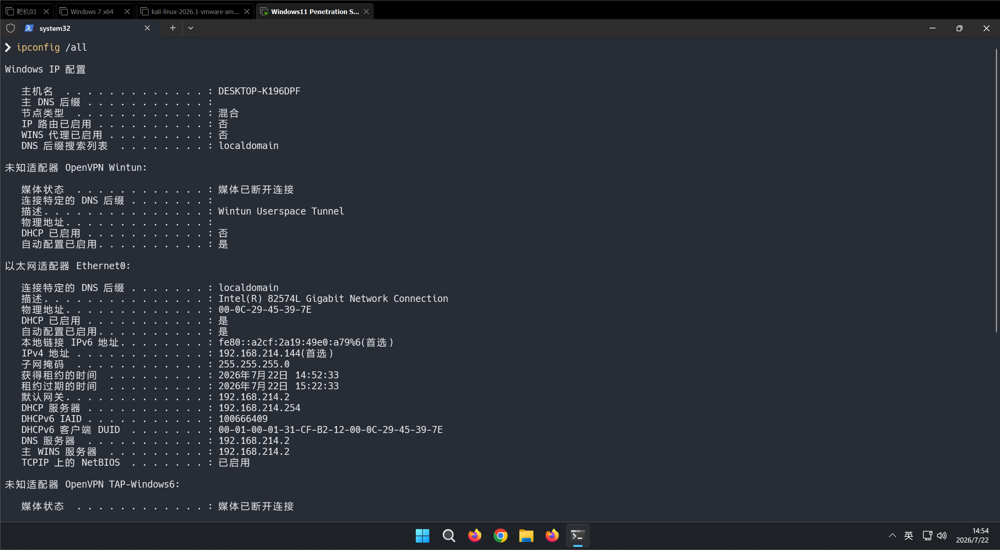

查询操作系统及安装软件的版本信息：

systeminfo | findstr /I "OS Name OS Version"

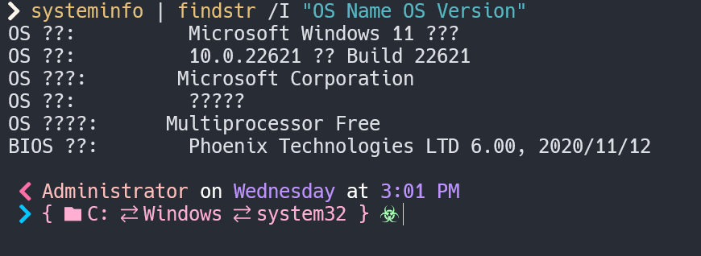

软件查询：wmic product get name,version

Powershell：powershell "Get-WmiObject -class Win32_Product |Select-Object -Property name,version"

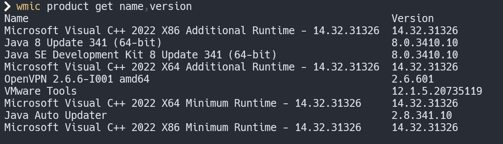

查询本机服务信息：wmic service list brief

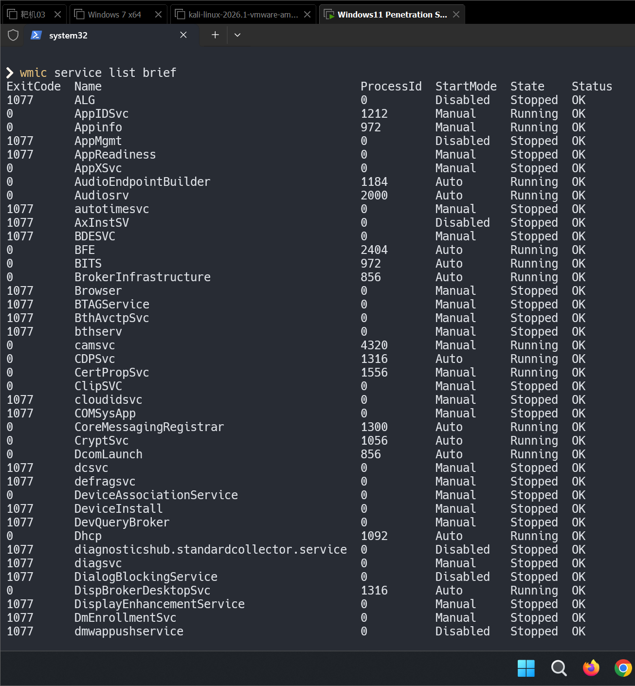

查询进程列表：Tasklist /v

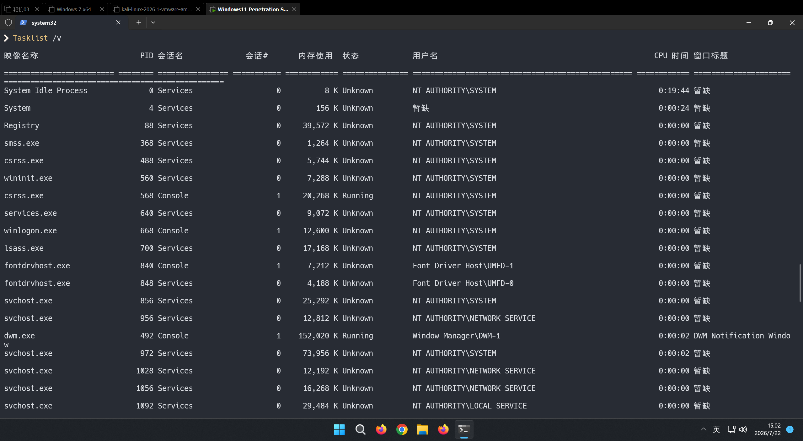

关闭360杀毒软件：taskkill /im 360Tray.exe /f

查询启动程序信息：wmic startup get command,caption

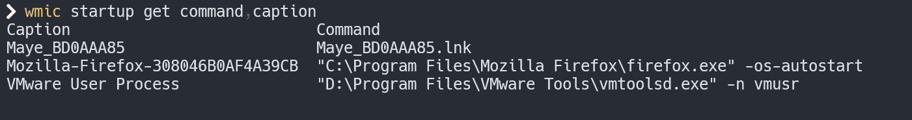

查询计划任务及开机时间

计划任务：schtasks /query /fo LIST /v

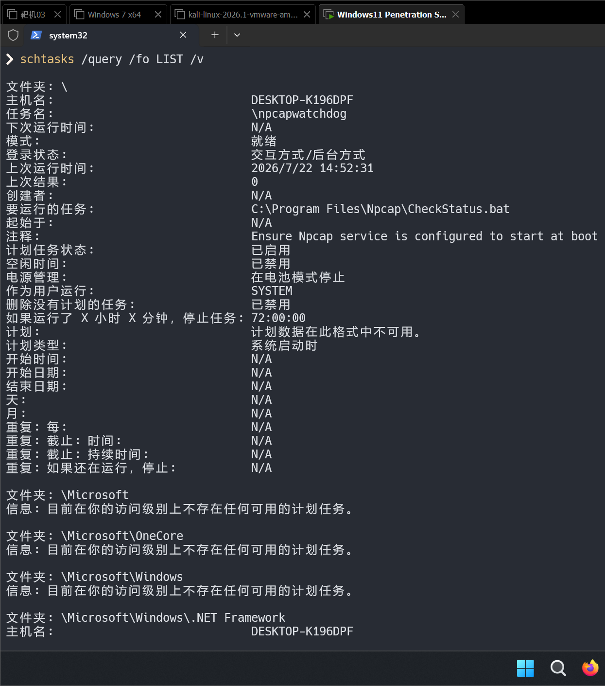

开机时间： net statistics workstation

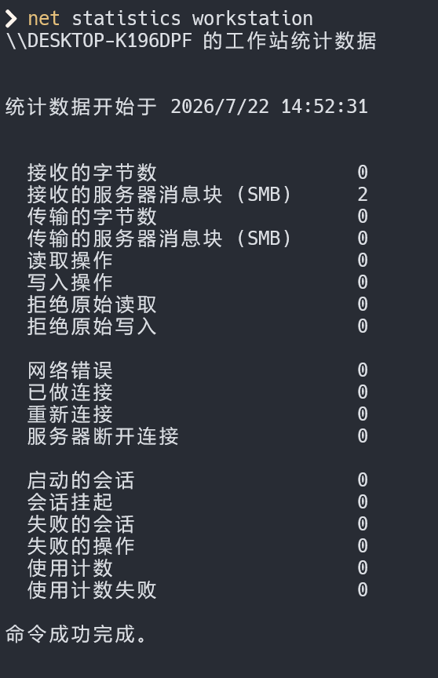

查询用户列表

用户：Net user 可以找命名规则 推测整个域的用户命名方式

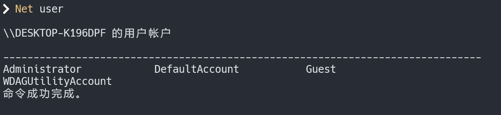

获取本地管理员（含域）：net localgroup administrators

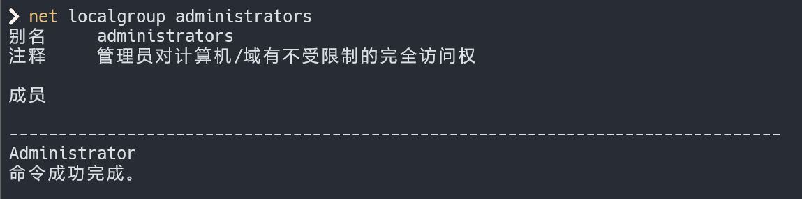

查询当前在线用户：query user || qwinsta

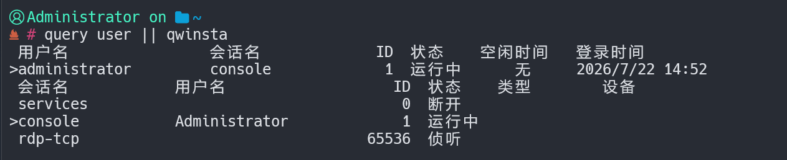

读取密码：mimikatz

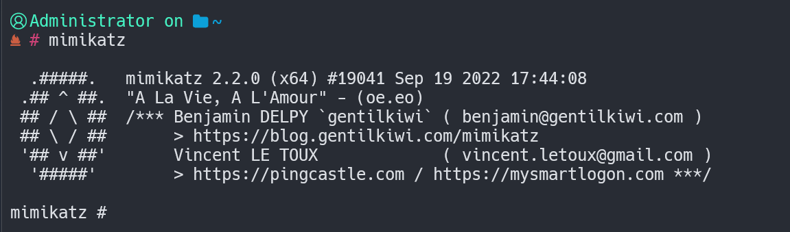

查询端口列表及补丁

端口查询：Netstat –ano

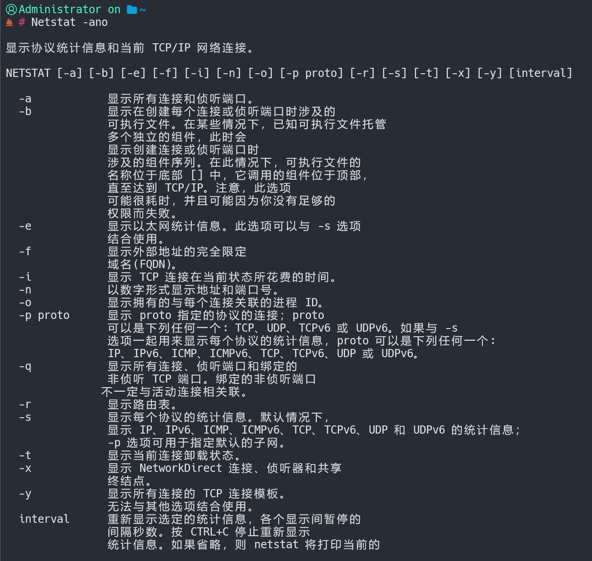

查询补丁列表：Systeminfo

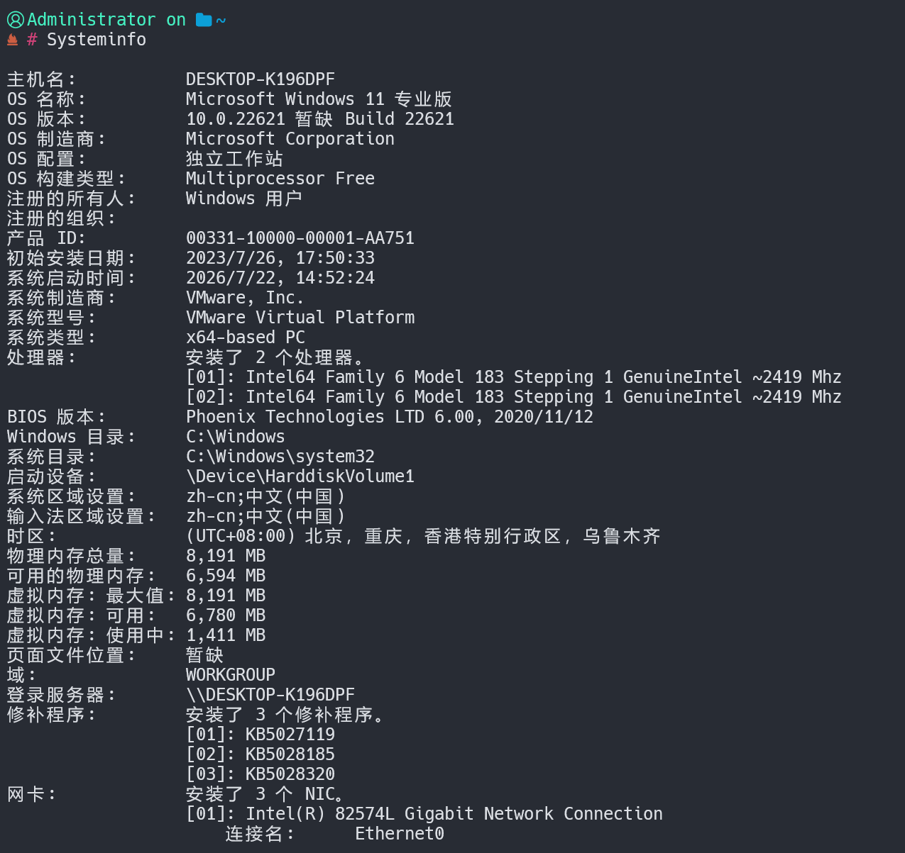

例：wmic qfe get Caption,Description,HotFixID,InstalledOn

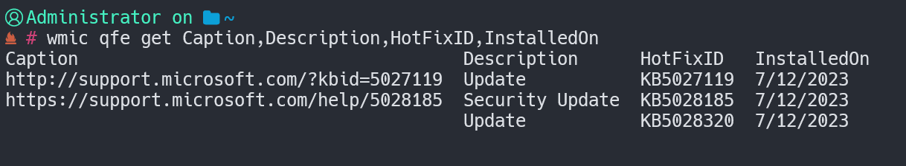

查询路由表：arp -a

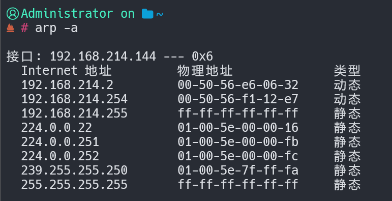

查询本机共享列表：net share

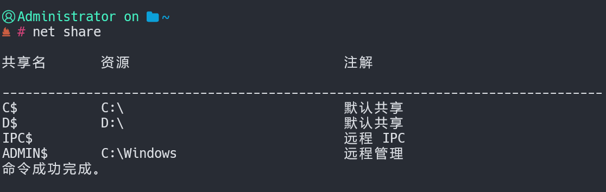

查询IE浏览器的代理信息：reg query "HKEY_CURRENT_USER\Software\Microsoft\Windows\CurrentVersion\Internet Settings"

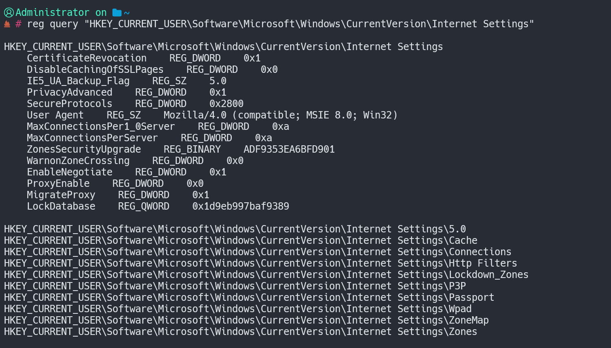

查询RDP端口号：reg query "HKEY_LOCAL_MACHINE\SYSTEM\CurrentControlSet\Control\Terminal Server\WinStations\RDP-TCP" /v portNumber

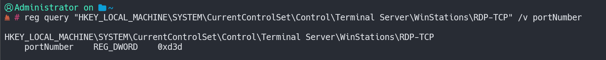

查询用户列表：net user

#通过分析本机用户列表，分析命名规则，推测整个域的命名方式

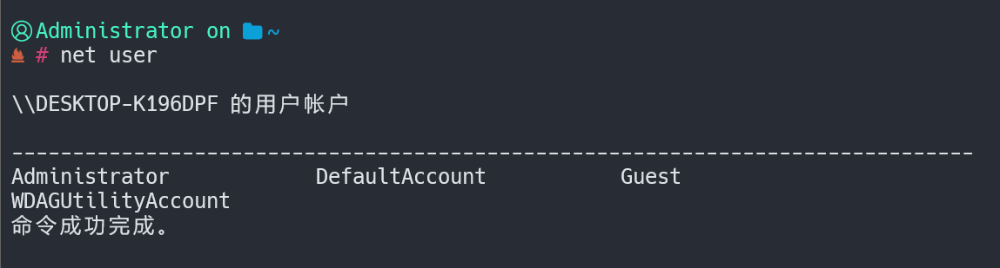

域信息收集：

域内用户基本信息

net view 查看域内机器列表

net view /domain: ZZZ 查看ZZZ域中所有的机器列表。

net group /domain 查询域里面所有的用户组列表

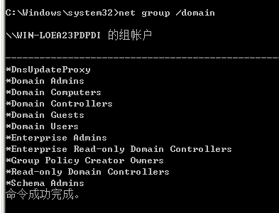

net group "domain computers" /domain 查看所有域成员计算机列表

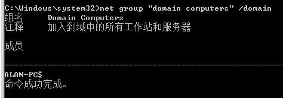

net accounts /domain 查询域用户密码过期等信息

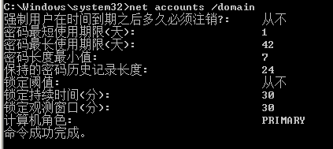

net user /domain 获取域用户列表

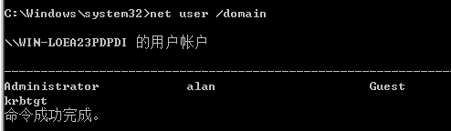

net group "domain admins" /domain 获取域管理员列表

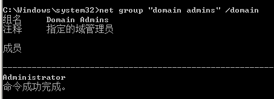

net group "domain controllers" /domain 查看域控制器(如果有多台)

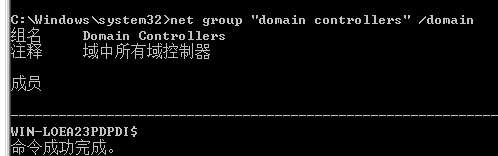

net localgroup administrators 查看本地管理员组用户[通常含有域用户]

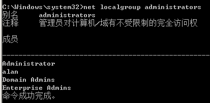

net localgroup administrators /domain 登录域管理员用户

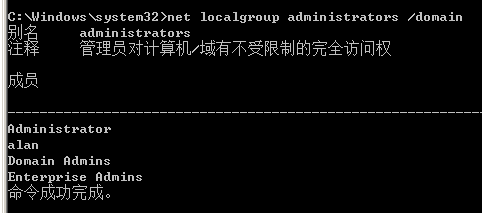

net view /domain 查看内网存在多少个域

查询所有域用户列表

向域控制器进行查询

net user /domain

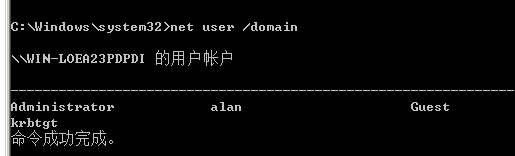

获取域内用户详细信息

wmic useraccount get /all

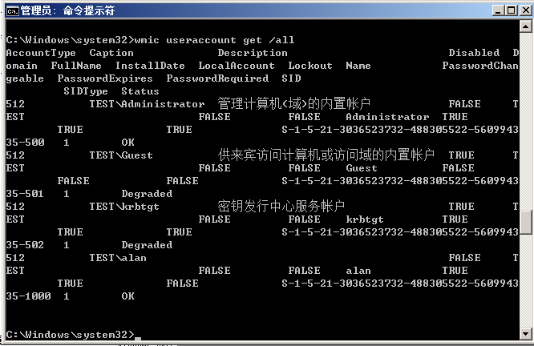

查看存在的用户

dsquery user

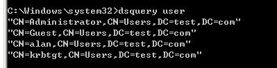

查询域内置本地管理员组用户

net localgroup administrators /domain

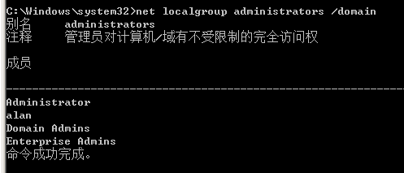

查询域管理员用户组

查询域管理员用户

net group “domain admins” /domain

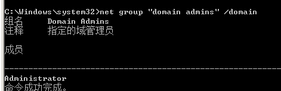

查询管理员用户组

net group “Enterprise Admins” /domain

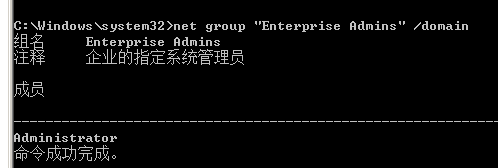
