Pikachu -xss第1-6关

反射型xss（get）

搜索框输入

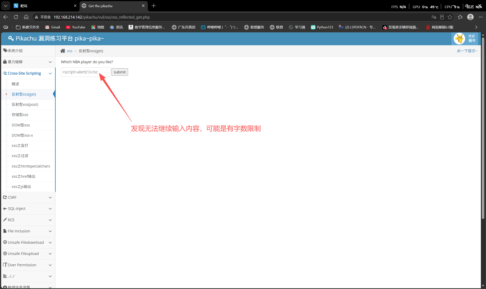

打开控制台查看源代码，发现maxlength=”20”

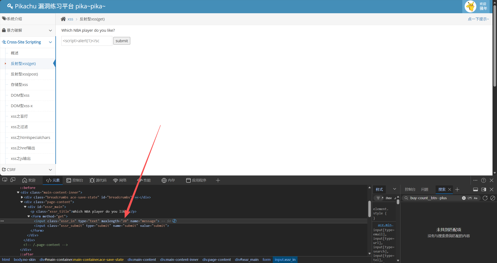

把20修改成100试试，此时发现能完整输入

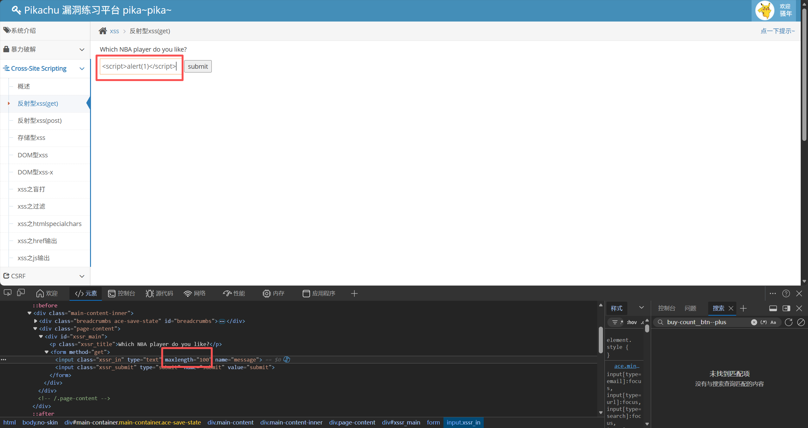

成功弹窗

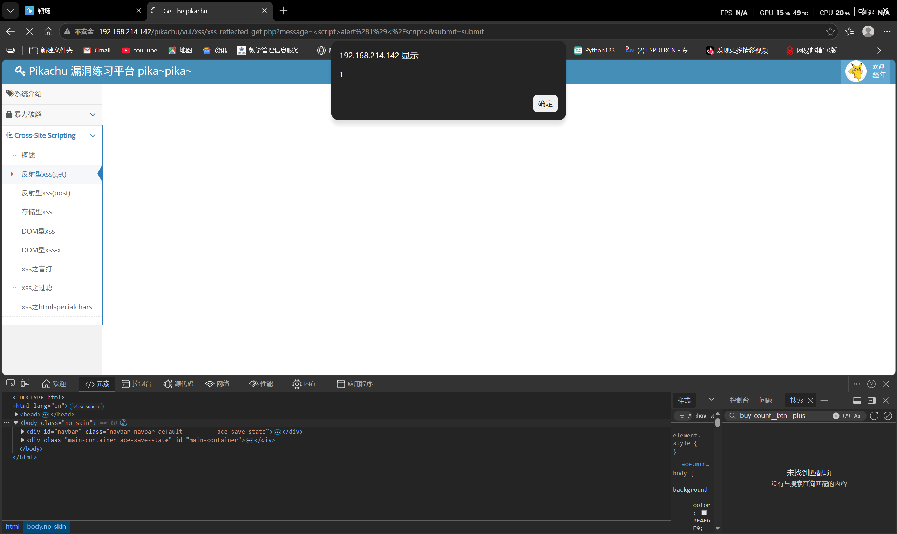

反射性xss(post)

admin/123456登录

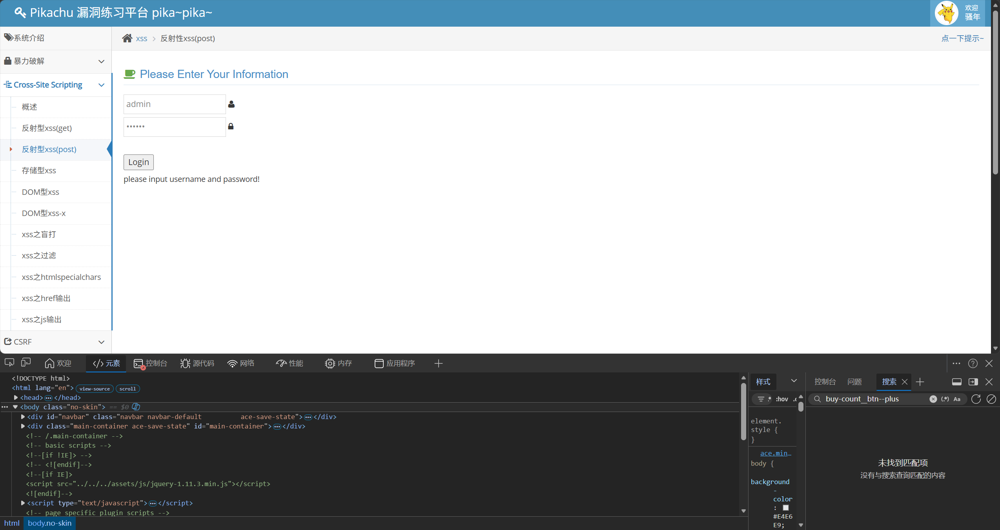

搜索框输入

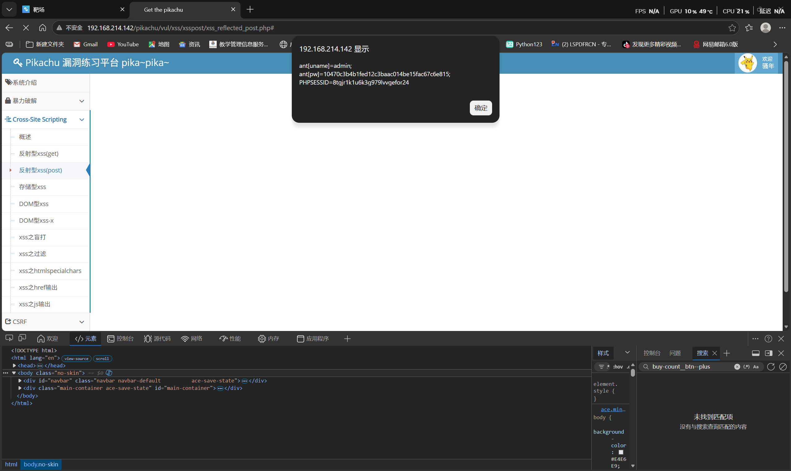

存储型xss

留言板中输入

刷新页面依旧还有弹窗

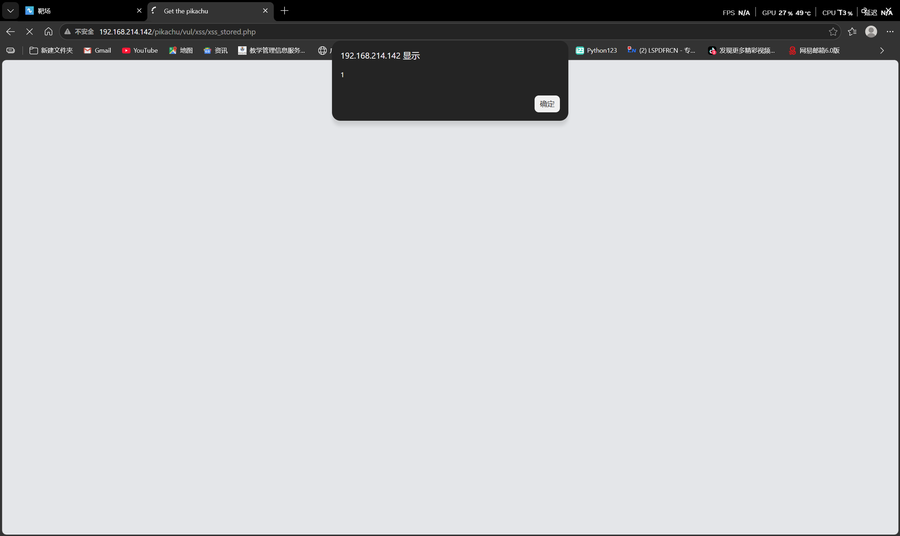

DOM型xss

输入123提交，发现“123”被发送到<a href=””>里

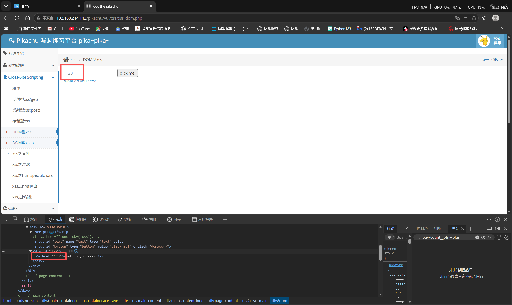

javascript:alert(1)

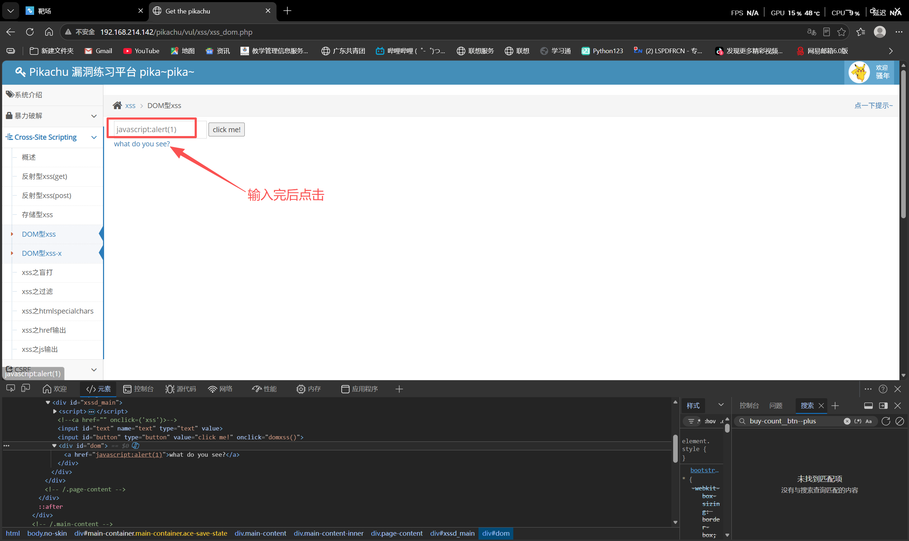

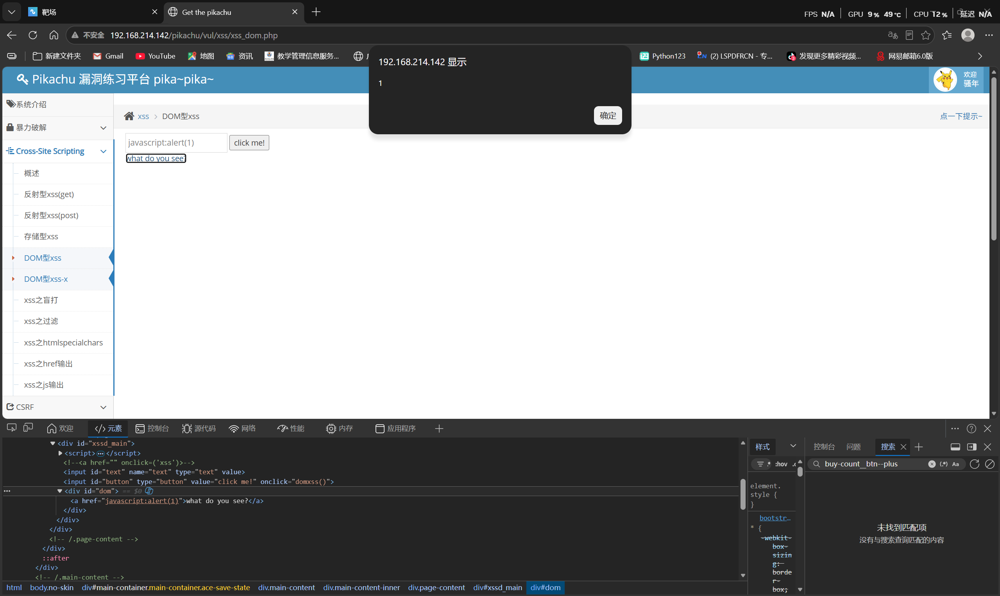

DOM型xss

1. 输入123
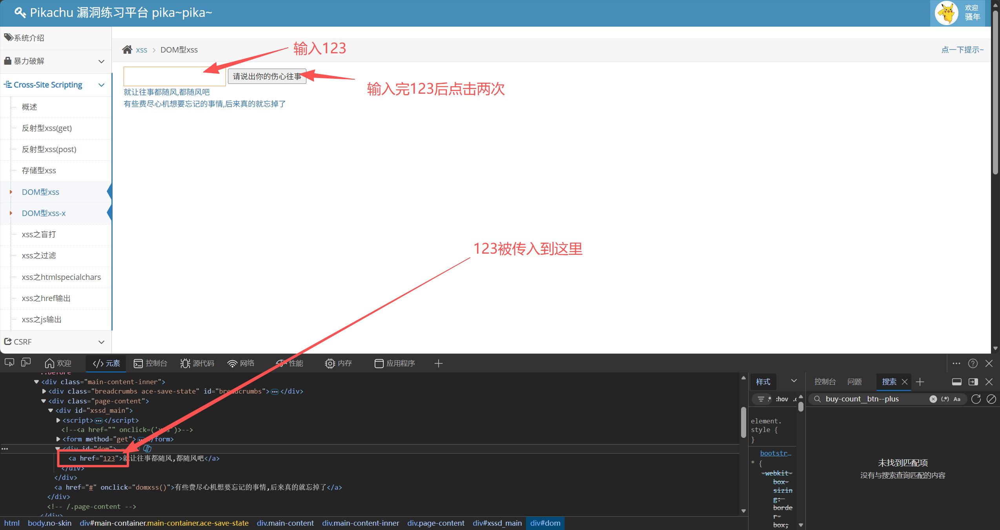

2.输入javascript:alert(1)

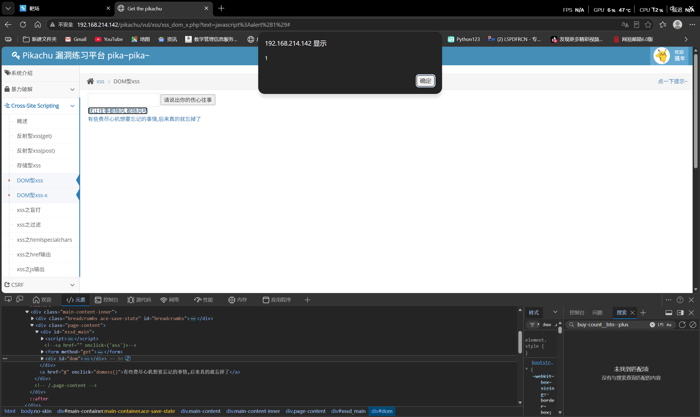

xss盲打

输入提交

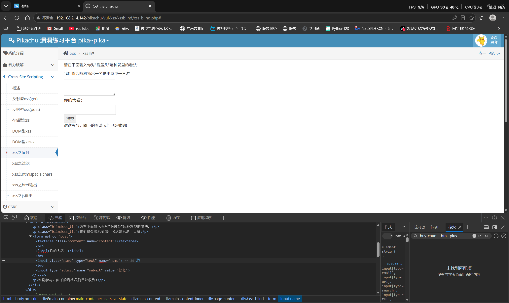

进入后台/xssblind/admin_login.php登录admin/123456，登录进去后立刻有弹窗

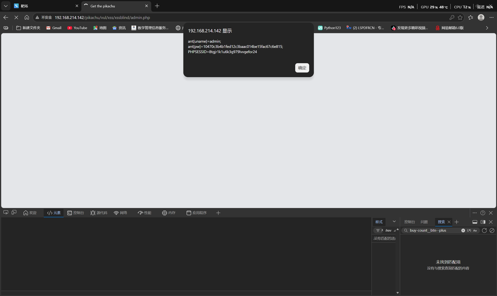

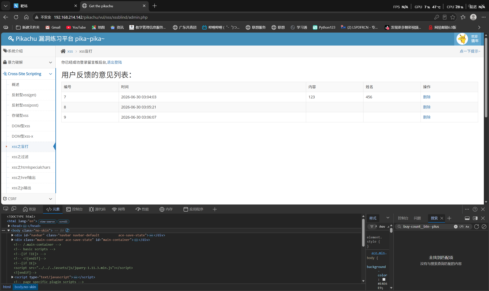
