第一题：查询平均成绩大于60 分的同学的学号和平均成绩

截图：

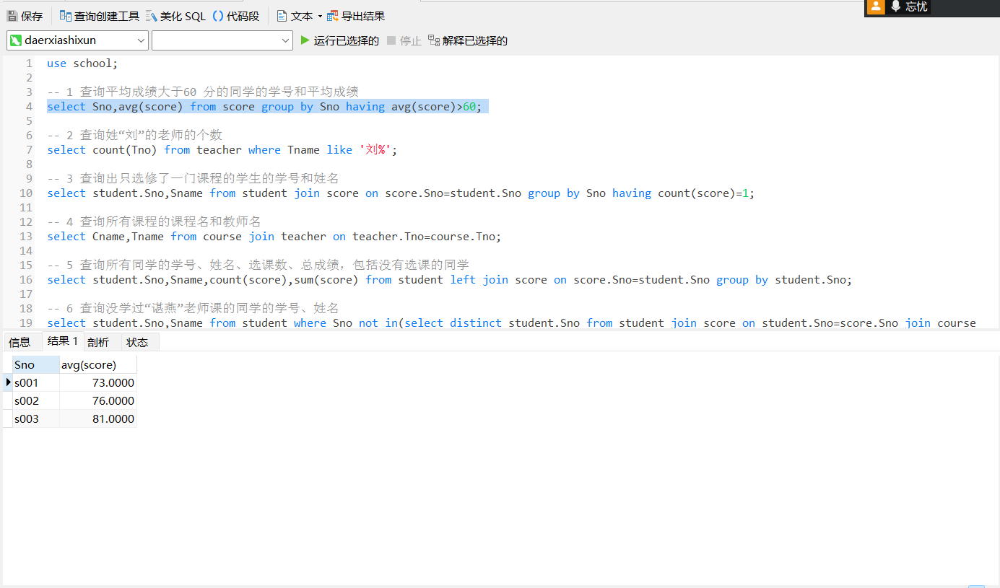

第二题：查询姓“刘”的老师的个数

截图：

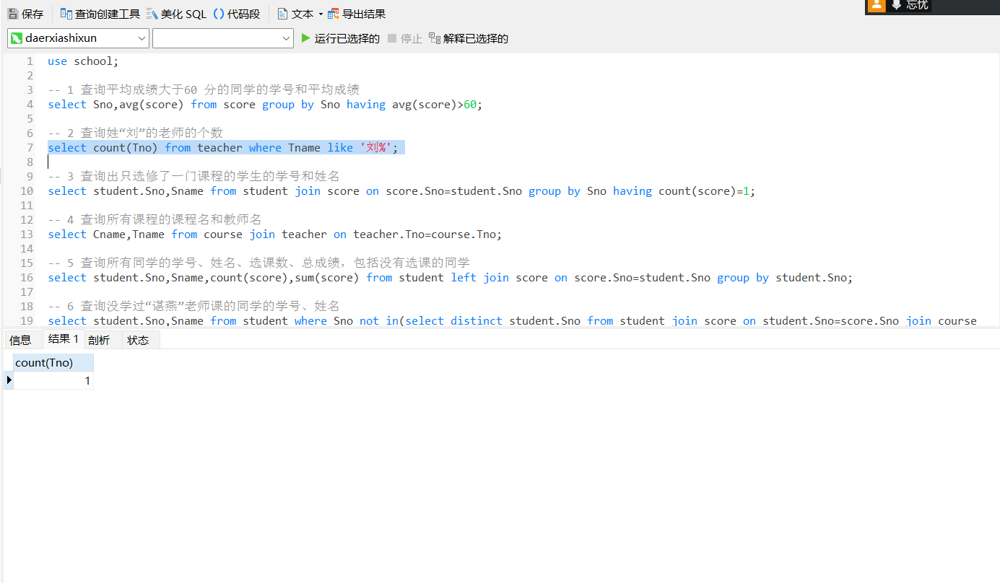

第三题：查询出只选修了一门课程的学生的学号和姓名

截图：

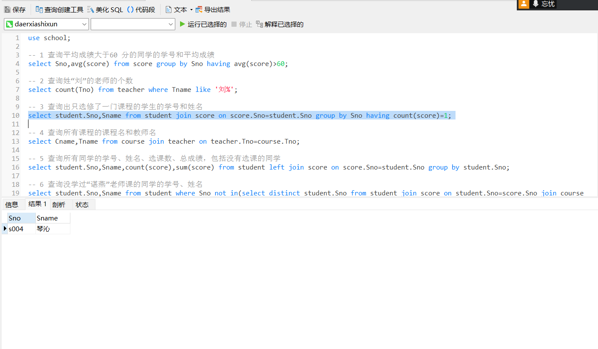

第四题：查询所有课程的课程名和教师名

截图：

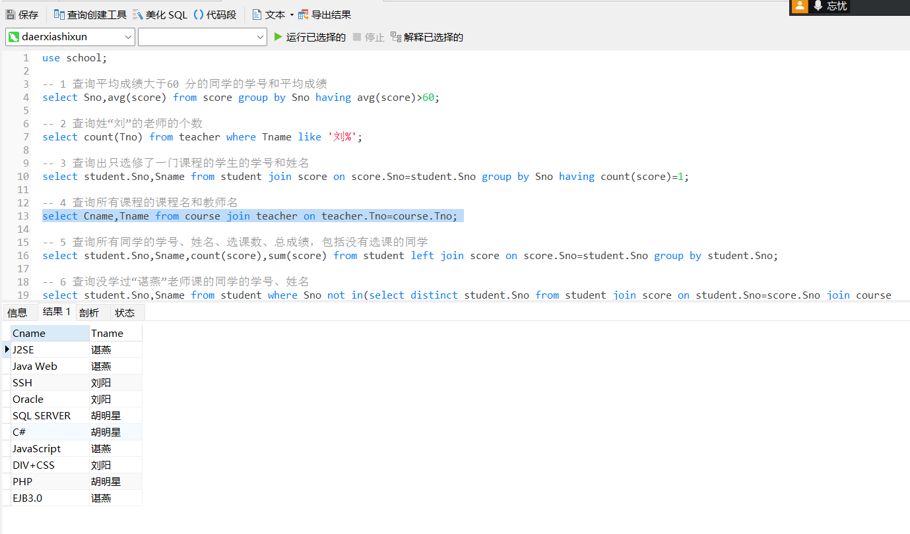

第五题：查询所有同学的学号、姓名、选课数、总成绩，包括没有选课的同学

截图：

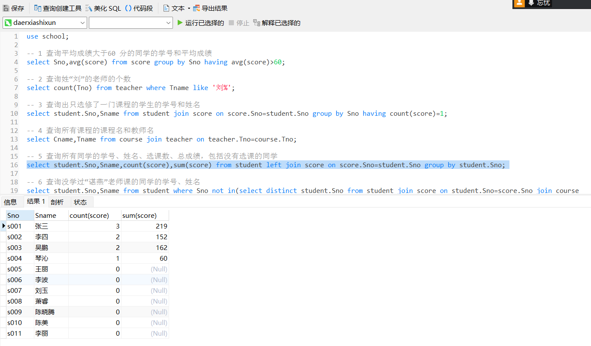

第六题：查询没学过“谌燕”老师课的同学的学号、姓名

截图：

第七题：查询没有参加任何课程的学生的学号和姓名
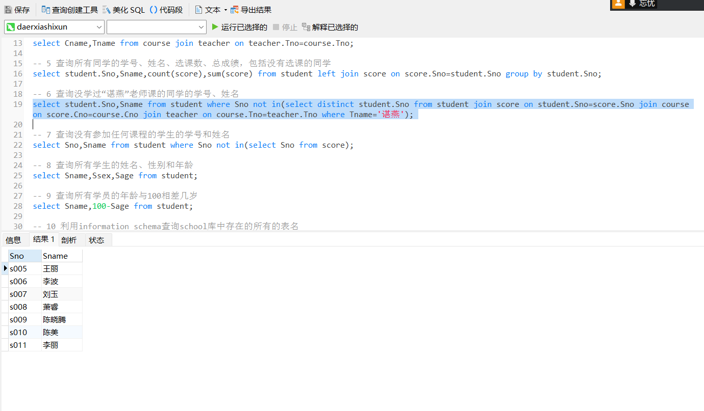

截图：

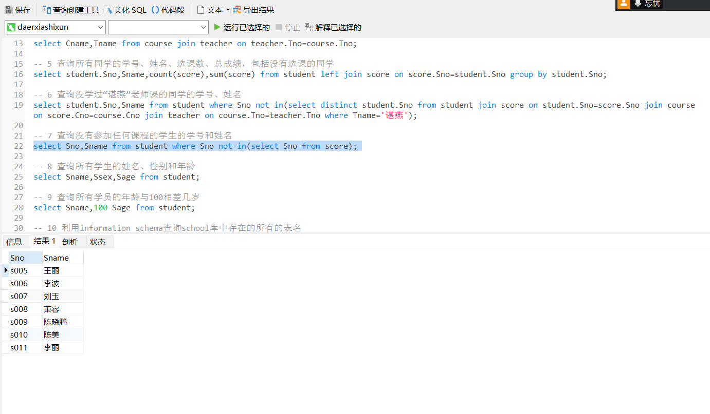

第八题：查询所有学生的姓名、性别和年龄

截图：

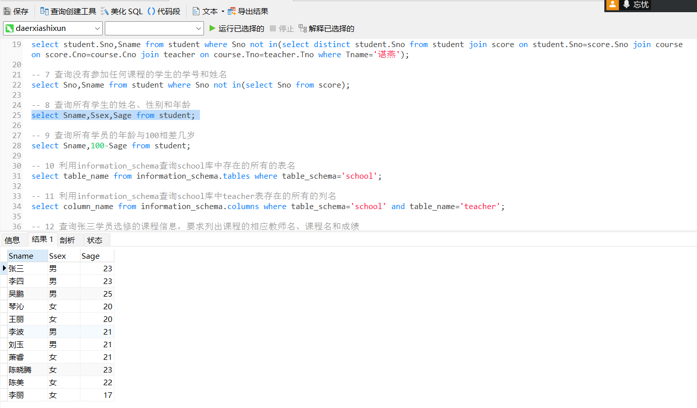

第九题：查询所有学员的年龄与100相差几岁

截图：

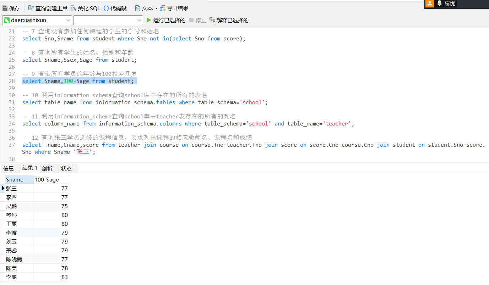

第十题：利用information_schema查询school库中存在的所有的表名

截图：

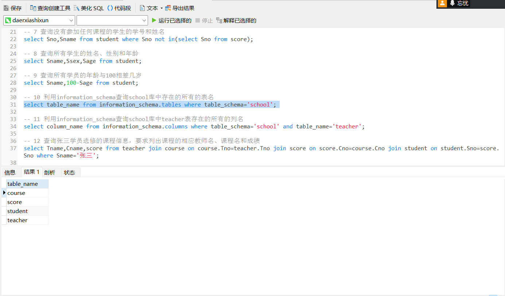

第十一题：利用information_schema查询school库中teacher表存在的所有的列名

截图：

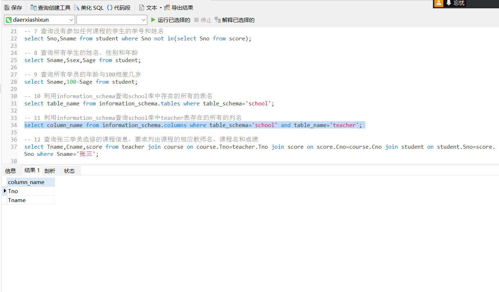

第十二题：查询张三学员选修的课程信息，要求列出课程的相应教师名、课程名和成绩

截图：

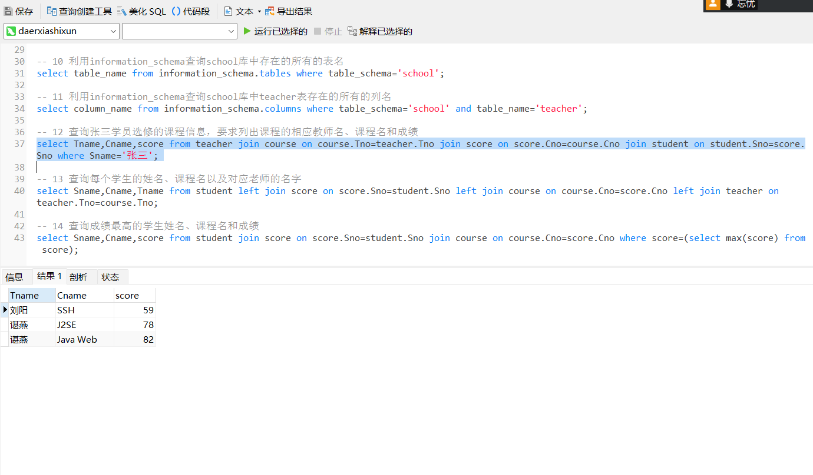

第十三题：查询每个学生的姓名、课程名以及对应老师的名字

截图：

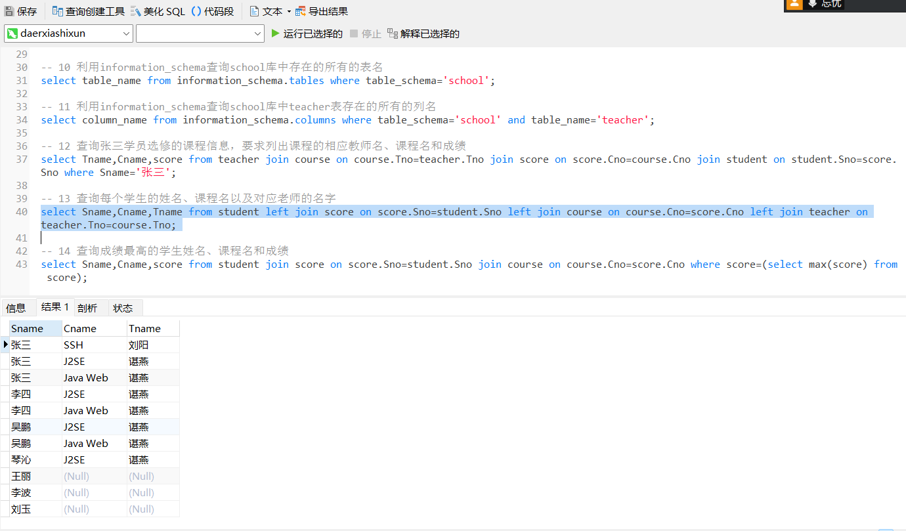

第十四题：查询成绩最高的学生姓名、课程名和成绩

截图：

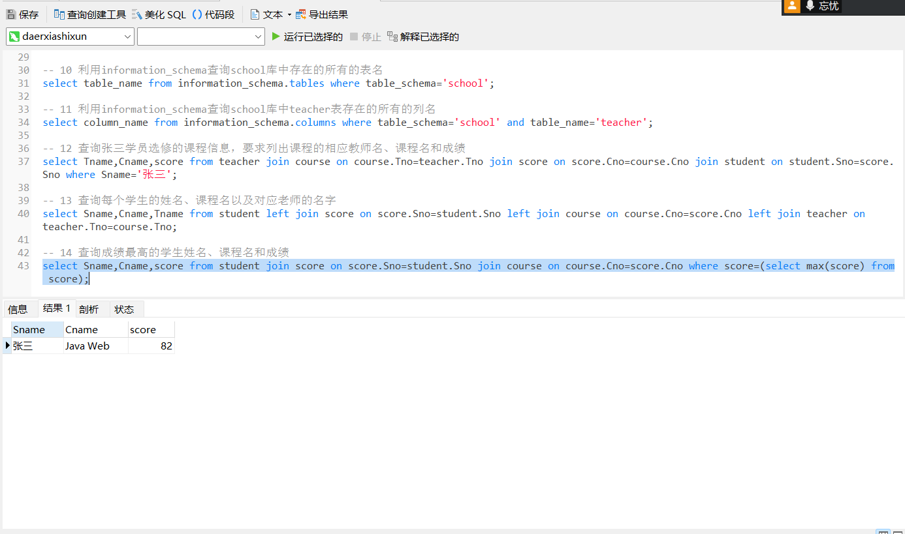
