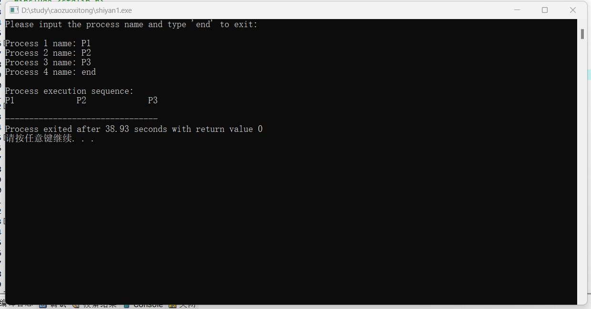

## 一、实验目的及要求

**实验目的**：了解进程调度的概念和方法，通过本实验以加深对进程调度的理解。

## 二、实验原理与内容

**实验步骤**：

### 1. 用高级语言设计PCB结构

```c
typedef struct FCFS
{
    char PrecessName[20];
    struct FCFS *next;
} FCFS;
```

### 2. 建立进程就绪队列

```c
void FCFS_InputPrecess(FCFS *L)
{
    FCFS *Follow;
    FCFS *P;
    int i;
    char PrecessName[15];
    i = 1;
    Follow = L;
    printf("Please input the precess and input end to exit\n\n");
    while(strcmp(PrecessName, "end"))
    {
        printf("the %d precessname\n", i);
        P = (FCFS*)malloc(sizeof(FCFS));
        scanf("%s", PrecessName);
        if(!strcmp(PrecessName, "end"))
        {
            break;
        }
        strcpy(P->PrecessName, PrecessName);
        Follow->next = P;
        P->next = NULL;
        Follow = P;
        i++;
    }
    if(i > 1)
    {
        FCFS_Output(L);
    }
}
```

### 3. 编制先来先服务调度算法

```c
FCFS_Output(FCFS *L)
{
    FCFS *P;
    P = L->next;
    printf("the precess sequence:\n");
    while(P)
    {
        printf("%-15s", P->PrecessName);
        P = P->next;
    }
    printf("\n");
}
```

## 三、实验软硬件环境

配置网络环境的计算机系统，安装有Turbo C或其它高级编程语言。

## 四、实验过程（实验步骤、记录、数据、分析）

### 完整实现代码

```c
#include <stdio.h>
#include <stdlib.h>
#include <string.h>

// 定义 PCB 结构体
typedef struct FCFS {
    char PrecessName[20];
    struct FCFS *next;
} FCFS;

// 进程输出函数
void FCFS_Output(FCFS *L) {
    FCFS *P = L->next;
    printf("\nProcess execution sequence:\n");
    while (P) {
        printf("%-15s", P->PrecessName);
        P = P->next;
    }
    printf("\n");
}

// 进程输入函数
void FCFS_InputProcess(FCFS *L) {
    FCFS *Follow = L;
    FCFS *P;
    int i = 1;
    char PrecessName[20] = "";

    printf("Please input the process name and type 'end' to exit:\n\n");
    while (1) {
        printf("Process %d name: ", i);
        scanf("%s", PrecessName);
        if (strcmp(PrecessName, "end") == 0) {
            break;
        }
        P = (FCFS *)malloc(sizeof(FCFS));
        strcpy(P->PrecessName, PrecessName);
        P->next = NULL;
        Follow->next = P;
        Follow = P;
        i++;
    }

    // 如果有输入进程，则输出进程序列
    if (i > 1) {
        FCFS_Output(L);
    }
}

// 主函数
int main() {
    FCFS head;
    head.next = NULL;
    FCFS_InputProcess(&head);
    return 0;
}
```


### 测试/调试及实验结果分析

程序运行后，可输入多个进程名称，输入"end"结束输入，程序将按照先来先服务的顺序输出进程执行序列。



## 五、实验结论与体会

### FCFS的特点

- **简单易实现**：算法简单，易于实现，不需要复杂的数据结构。
- **公平性**：按照进程到达的先后顺序调度，所有进程都会被处理。
- **非抢占性**：一旦 CPU 开始执行某个进程，不会被其他进程打断，直到该进程完成。
- **吞吐量稳定**：适合处理长时间的批处理任务。

### FCFS的缺点

- **平均等待时间长**：如果一个较长的进程在短进程之前到达，会导致短进程长时间等待。例如：如果一个需要30秒的进程在一个需要2秒的进程前面，整个队列的平均等待时间会显著增加。
- **低响应性**：由于等待时间不可预测，用户体验较差，特别是对于交互式系统。不适合实时系统，因为无法保证响应时间。
- **资源利用率低**：可能导致资源闲置或不均衡使用，因为长任务会独占 CPU。
- **无法实现优先级调度**：所有进程都被视为同等重要，无法根据任务的重要性进行优先处理。

### 实验体会

通过本次实验，深入理解了 FCFS调度算法的基本原理和实现过程。该算法结构简单、易于实现，但存在"长任务阻塞短任务"的缺点，容易引发"拥塞效应"。在实际应用中，应根据系统需求选择更具效率和公平性的调度算法，例如 SJF 或 RR。实验过程中，进一步掌握了链表结构的使用和内存管理的基本方法，为后续学习打下了良好的基础。