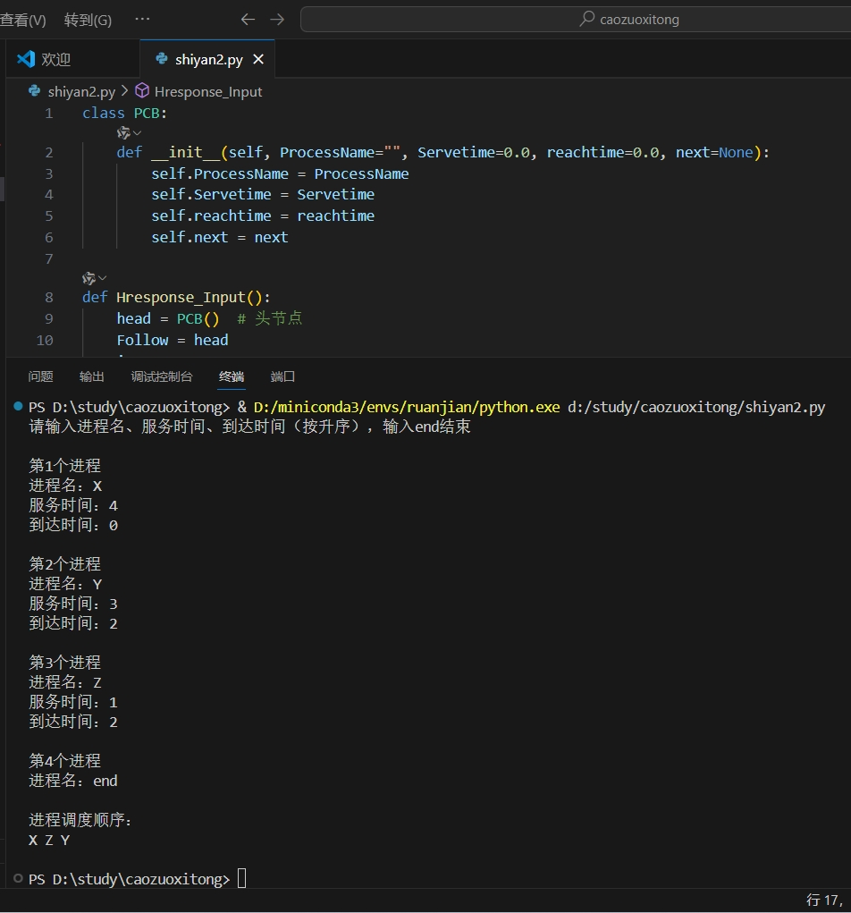

## 一、实验目的及要求

**实验目的**：了解进程调度的概念；理解高响应比优先进程调度算法；通过本实验以加深对进程调度的理解。

## 二、实验原理与内容

### 实验步骤

#### 1. 用高级语言设计PCB结构

```c
typedef struct Hresponse
{
    char PrecessName[20];
    float Servetime;
    float reachtime;
    struct Hresponse *next;
} Hresponse;
```

#### 2. 建立进程就绪队列

```c
void Hresponse_Input(Hresponse *L)
{
    Hresponse *P;
    Hresponse *Follow;
    int i;
    char PrecessName[15];
    float servetime;
    float reachtime;
    i = 1;
    Follow = L;
    printf("Please input the PrecessName and servetime and reachtime(by ASC), "
           "input end to exit\n");
    while(strcmp(PrecessName, "end"))
    {
        printf("the %d precessName\n\n", i);
        P = (Hresponse*)malloc(sizeof(Hresponse));
        if(!P) { return; }
        printf("PrecessName :");
        scanf("%s", PrecessName);
        if(!strcmp(PrecessName, "end")) { break; }
        strcpy(P->PrecessName, PrecessName);

        printf("servetime :");
        scanf("%f", &servetime);
        P->Servetime = servetime;

        printf("reachtime :");
        scanf("%f", &reachtime);
        P->reachtime = reachtime;

        Follow->next = P;
        P->next = NULL;
        Follow = P;
        i++;
    }
    if(i-1 > 0)
    {
        Hresponse_output(L, i-1);
    }
}
```

#### 3. 高响应比优先调度算法

响应比计算公式：**响应比 = (等待时间 + 服务时间) / 服务时间**

```c
Hresponse_output(Hresponse *L, int i)
{
    Hresponse *pre;
    Hresponse *current;
    Hresponse *Hpriority;
    int j;
    int flag;
    float totaltime;
    float waittime1;
    float waittime2;
    float S1;
    float S2;
    j = 1;
    totaltime = 0;
    printf("\nthe precess sequence:\n\n");
    while(j <= i-1)
    {
        flag = 1;
        current = L->next;
        pre = L;
        Hpriority = current;
        while(current->next)
        {
            waittime1 = totaltime - current->reachtime;
            waittime2 = totaltime - current->next->reachtime;
            if(waittime1 <= 0 || waittime2 < 0)
            {
                flag = 0;
                break;
            }
            else
            {
                S1 = (waittime1 + current->Servetime) / current->Servetime;
                S2 = (waittime2 + current->next->Servetime) / current->next->Servetime;
                if(S1 < S2)
                {
                    Hpriority = current->next;
                    pre = current;
                }
            }
            current = current->next;
        }
        if(flag == 0)
        {
            totaltime = Hpriority->reachtime + Hpriority->Servetime;
        }
        else
        {
            totaltime = totaltime + Hpriority->Servetime;
        }
        printf("%-10s", Hpriority->PrecessName);
        pre->next = pre->next->next;
        j++;
    }
    printf("%-10s", L->next->PrecessName);
    printf("\n\n");
}
```

## 三、实验软硬件环境

配置网络环境的计算机系统，安装有Turbo C或其它高级编程语言。

## 四、实验过程（实验步骤、记录、数据、分析）

### Python实现代码

```python
class PCB:
    def __init__(self, ProcessName="", Servetime=0.0, reachtime=0.0, next=None):
        self.ProcessName = ProcessName
        self.Servetime = Servetime
        self.reachtime = reachtime
        self.next = next

def Hresponse_Input():
    head = PCB()  # 头节点
    Follow = head
    i = 1
    print("请输入进程名、服务时间、到达时间（按升序），输入end结束")
    while True:
        print(f"\n第{i}个进程")
        ProcessName = input("进程名：")
        if ProcessName == "end":
            break
        servetime = float(input("服务时间："))
        reachtime = float(input("到达时间："))
        new_node = PCB(ProcessName, servetime, reachtime)
        Follow.next = new_node
        Follow = new_node
        i += 1
    if i > 1:
        Hresponse_output(head, i-1)
    return head

def Hresponse_output(head, n):
    totaltime = 0.0
    print("\n进程调度顺序：")
    for _ in range(n):
        current = head.next
        prev = head
        max_priority = -1
        selected_prev = None
        selected_node = None
        earliest_reach = float('inf')
        earliest_prev = None
        earliest_node = None

        # 遍历链表寻找最高响应比或最早到达的进程
        while current:
            if current.reachtime <= totaltime:
                wait_time = totaltime - current.reachtime
                priority = (wait_time + current.Servetime) / current.Servetime
                if priority > max_priority:
                    max_priority = priority
                    selected_prev = prev
                    selected_node = current
            else:
                if current.reachtime < earliest_reach:
                    earliest_reach = current.reachtime
                    earliest_prev = prev
                    earliest_node = current
            prev = current
            current = current.next

        # 处理选中的进程
        if selected_node:
            print(selected_node.ProcessName, end=' ')
            selected_prev.next = selected_node.next
            totaltime += selected_node.Servetime
        else:
            if earliest_node:
                print(earliest_node.ProcessName, end=' ')
                totaltime = earliest_node.reachtime + earliest_node.Servetime
                earliest_prev.next = earliest_node.next
    print("\n")

# 运行示例
if __name__ == "__main__":
    Hresponse_Input()
```


### 测试/调试及实验结果分析



## 五、实验结论与体会

### 高响应比优先进程调度算法的特点

- **动态优先级机制**：通过公式 `响应比 = (等待时间 + 服务时间) / 服务时间`，动态提升长作业优先级，避免饥饿问题。
- **非抢占式执行**：进程一旦运行则完成，减少上下文切换开销。
- **公平性平衡**：短作业初始响应比高优先执行，长作业随等待时间累积获得调度机会。
- **适用批处理系统**：适合对公平性要求高但实时性不敏感的场景，如后台任务调度。

### 实验体会

通过实现高响应比优先调度算法，验证了其动态优先级特性：长作业随等待时间增加获得更高优先级，避免了饥饿问题。实验表明，该算法能有效平衡短作业与长作业的执行公平性，但需遍历计算响应比，时间复杂度较高。

实践中，通过Python类与链表操作实现了进程队列的动态管理，深刻体会到调度算法对系统资源分配的核心作用。本次实验加深了对操作系统进程调度机制的理解，同时认识到算法设计需兼顾效率与公平性，为后续学习多级队列调度等复杂策略奠定基础。