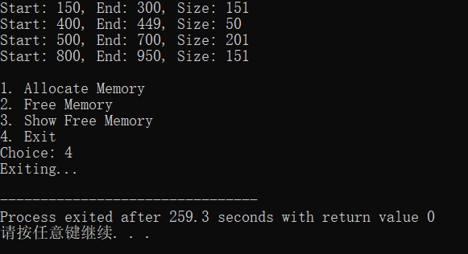
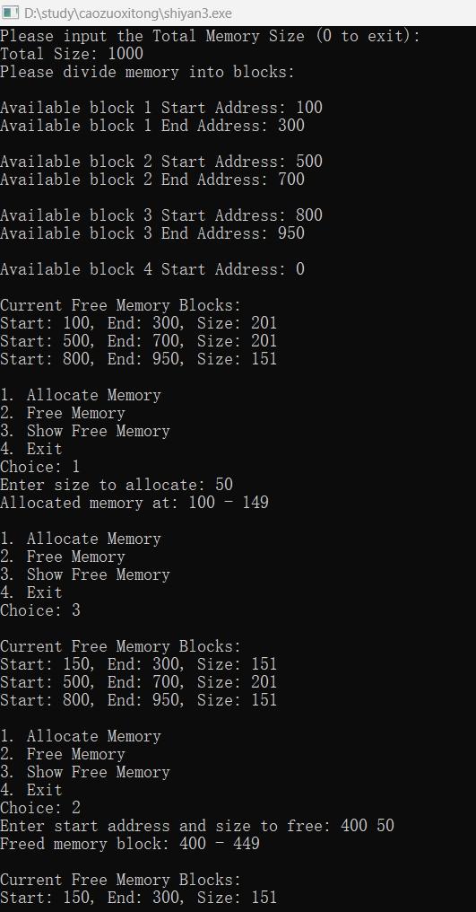

## 一、实验目的及要求

**实验目的**：了解内存分配的方法；理解连续分配的思想；通过本实验加深对内存管理的理解。

## 二、实验原理与内容

### 实验步骤

#### 1. 用高级语言设计可利用空间表的结构

```c
typedef struct FreeMenory
{
    int Size;
    int BeginAdd;
    int EndAdd;
    struct FreeMenory *pre;
    struct FreeMenory *next;
} FreeMenory;
```

#### 2. 用边界标识法实现内存的分配

```c
void InitialFreeMenory(FreeMenory *L)
{
    void output();
    int BeginAdd;
    int EndAdd;
    int flag;
    int i;
    FreeMenory *P;
    FreeMenory *Follow;
    Follow = L;
    flag = 0;
    i = 1;
again:
    printf("Please input the Total Menory Size, input 0 to exit divide:\n");
    printf("totalsize :");
    scanf("%d", &Maxsize);
    if(Maxsize < 0)
    {
        printf("errror:\n");
        goto again;
    }
    printf("please divide Menory:\n");
    while(1)
    {
again1:
        printf("\n available size %d BeginAddress: ", i);
        scanf("%d", &BeginAdd);
        if(BeginAdd == 0) break;
        if(BeginAdd < flag || BeginAdd > Maxsize)
        {
            printf("please input bigger Address than previous EndAddress "
                   "and smaller than Maxsize\n:");
            goto again1;
        }
again2:
        printf("\n available size %d EndAddress: ", i);
        scanf("%d", &EndAdd);
        if(EndAdd > Maxsize || EndAdd < BeginAdd)
        {
            printf("EndAddress must be small then MaxSize and "
                   "larger than Beginadd:\n");
            goto again2;
        }
        P = (FreeMenory*)malloc(sizeof(FreeMenory));
        P->BeginAdd = BeginAdd;
        P->EndAdd = EndAdd;
        P->Size = EndAdd - BeginAdd + 1;
        Follow->next = P;
        P->pre = Follow;
        P->next = NULL;
        Follow = P;
        flag = EndAdd;
        i++;
    }
    output(L);
}
```

## 三、实验软硬件环境

配置网络环境的计算机系统，安装有Turbo C或其它高级编程语言。

## 四、实验过程（实验步骤、记录、数据、分析）

### 完整实现代码

```c
#include <stdio.h>
#include <stdlib.h>

// 定义空闲内存块结构
typedef struct FreeMenory {
    int Size;
    int BeginAdd;
    int EndAdd;
    struct FreeMenory *pre;
    struct FreeMenory *next;
} FreeMenory;

int Maxsize; // 总内存大小

// 输出内存块信息
void output(FreeMenory *L) {
    FreeMenory *p = L->next;
    printf("\nCurrent Free Memory Blocks:\n");
    while (p) {
        printf("Start: %d, End: %d, Size: %d\n", p->BeginAdd, p->EndAdd, p->Size);
        p = p->next;
    }
}

// 初始化内存可用块
void InitialFreeMenory(FreeMenory *L) {
    int BeginAdd, EndAdd, flag = 0, i = 1;
    FreeMenory *P, *Follow = L;

    printf("Please input the Total Memory Size (0 to exit):\n");
    printf("Total Size: ");
    scanf("%d", &Maxsize);
    if (Maxsize <= 0) {
        printf("Invalid memory size!\n");
        return;
    }
    printf("Please divide memory into blocks:\n");

    while (1) {
        printf("\nAvailable block %d Start Address: ", i);
        scanf("%d", &BeginAdd);
        if (BeginAdd == 0) break;
        if (BeginAdd < flag || BeginAdd > Maxsize) {
            printf("Start address must be within valid range!\n");
            continue;
        }

        printf("Available block %d End Address: ", i);
        scanf("%d", &EndAdd);
        if (EndAdd > Maxsize || EndAdd < BeginAdd) {
            printf("Invalid end address!\n");
            continue;
        }

        P = (FreeMenory *)malloc(sizeof(FreeMenory));
        P->BeginAdd = BeginAdd;
        P->EndAdd = EndAdd;
        P->Size = EndAdd - BeginAdd + 1;
        P->pre = Follow;
        P->next = NULL;
        Follow->next = P;
        Follow = P;
        flag = EndAdd;
        i++;
    }
    output(L);
}

// 分配内存块
void AllocateMemory(FreeMenory *L, int size) {
    FreeMenory *p = L->next;
    while (p) {
        if (p->Size >= size) { // 找到合适的块
            printf("Allocated memory at: %d - %d\n", p->BeginAdd, p->BeginAdd + size - 1);
            p->BeginAdd += size;
            p->Size -= size;
            if (p->Size == 0) { // 如果分配后块变空，移除该块
                p->pre->next = p->next;
                if (p->next) p->next->pre = p->pre;
                free(p);
            }
            return;
        }
        p = p->next;
    }
    printf("No sufficient memory available!\n");
}

// 释放内存块
void FreeMemory(FreeMenory *L, int start, int size) {
    FreeMenory *p = L;
    while (p->next && p->next->BeginAdd < start) p = p->next;
    FreeMenory *newBlock = (FreeMenory *)malloc(sizeof(FreeMenory));
    newBlock->BeginAdd = start;
    newBlock->EndAdd = start + size - 1;
    newBlock->Size = size;
    newBlock->pre = p;
    newBlock->next = p->next;
    if (p->next) p->next->pre = newBlock;
    p->next = newBlock;
    printf("Freed memory block: %d - %d\n", start, start + size - 1);
    output(L);
}

int main() {
    FreeMenory *MemoryList = (FreeMenory *)malloc(sizeof(FreeMenory));
    MemoryList->next = NULL;
    InitialFreeMenory(MemoryList);

    int choice, size, start;
    while (1) {
        printf("\n1. Allocate Memory\n2. Free Memory\n"
               "3. Show Free Memory\n4. Exit\nChoice: ");
        scanf("%d", &choice);
        switch (choice) {
            case 1:
                printf("Enter size to allocate: ");
                scanf("%d", &size);
                AllocateMemory(MemoryList, size);
                break;
            case 2:
                printf("Enter start address and size to free: ");
                scanf("%d %d", &start, &size);
                FreeMemory(MemoryList, start, size);
                break;
            case 3:
                output(MemoryList);
                break;
            case 4:
                printf("Exiting...\n");
                return 0;
            default:
                printf("Invalid choice!\n");
        }
    }
}
```


### 测试/调试及实验结果分析





## 五、实验结论与体会

### 内存连续分配方式及其特点

**1. 单一连续分配（Single Contiguous Allocation）**
- 整个内存分为操作系统区域和用户程序区域
- 只有一个用户进程可以运行，无法支持多道程序
- 实现简单，但内存利用率低

**2. 固定分区分配（Fixed Partition Allocation）**
- 将内存划分为固定大小的多个分区
- 每个进程只能进入与自身大小相适应的分区
- 可能导致**内部碎片**（分区大于实际需求的进程时会浪费空间）

**3. 动态分区分配（Dynamic Partition Allocation）**
- 按需分配内存，每个进程占据一个动态大小的分区
- 可能产生**外部碎片**（小块空闲内存无法被利用）
- 需要使用空闲块管理表记录可用的内存块

**4. 可变分区分配（Variable Partition Allocation）**
- 在动态分区分配的基础上，采用不同的分配策略：
  - **首次适应（First Fit）**：找到第一个足够大的空闲块进行分配
  - **最佳适应（Best Fit）**：找到最小的但足够大的空闲块，减少碎片
  - **最差适应（Worst Fit）**：找到最大的空闲块，以便留下更大的剩余空间
- 仍然存在外部碎片问题，需要定期**内存紧凑（Compaction）**

### 实验体会

本实验通过边界标识法实现了动态内存管理，深入理解了连续内存分配的思想。实验过程中，使用链表存储空闲内存块，实现了内存的分配与释放操作。实验表明，合理管理内存可以提高系统效率，但仍需优化，如合并相邻空闲块以减少碎片化。通过该实验，加深了对内存管理的理解，并认识到在实际应用中高效的内存分配策略对于提升程序性能至关重要。