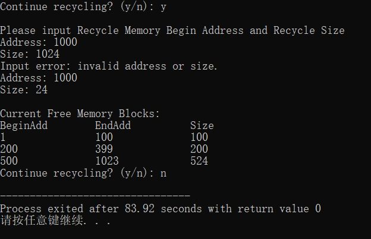
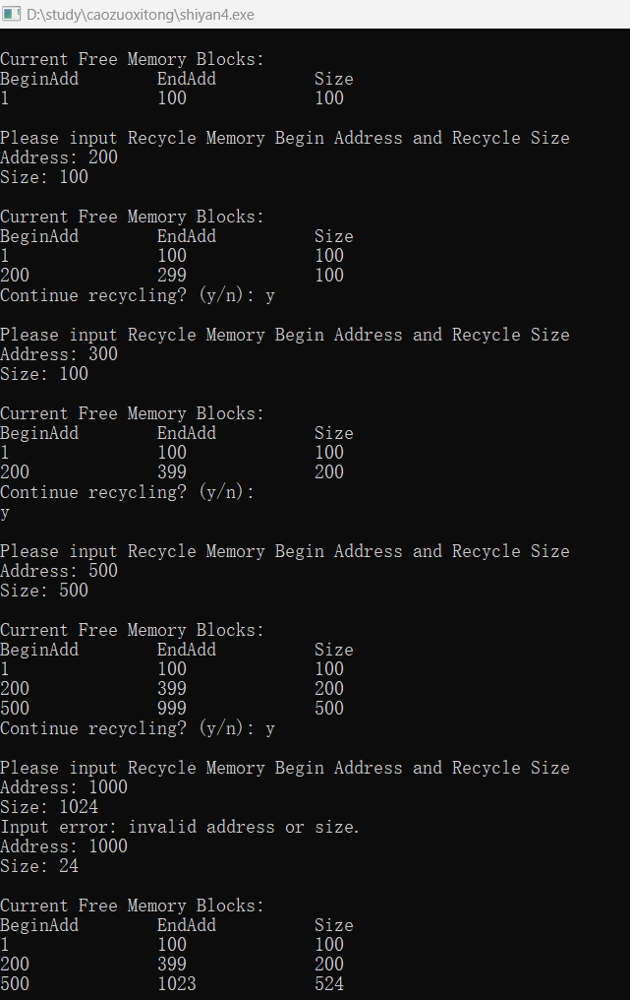

## 一、实验目的及要求

**实验目的**：了解内存回收的方法，理解连续分配的思想，通过本实验加深对内存管理的理解。

## 二、实验原理与内容

### 实验步骤

#### 1. 用高级语言设计可利用空间表的结构

```c
typedef struct FreeMenory
{
    int Size;
    int BeginAdd;
    int EndAdd;
    struct FreeMenory *pre;
    struct FreeMenory *next;
} FreeMenory;
```

#### 2. 用边界标识法实现内存的回收

内存回收的七种情况（insert值）：

| insert | 情况描述 | 处理方式 |
|--------|---------|---------|
| 0 | 与上一个块恰好相邻 | 与上一个块合并 |
| 1 | 单独插入尾部 | 新建节点插入链表尾部 |
| 2 | 插入链表头部（不与首块相邻） | 新建节点插入链表头部 |
| 3 | 与后一个块相邻 | 与后一个块合并 |
| 4 | 与前后块都相邻 | 合并前后三个块 |
| 6 | 与前一个块相邻 | 与前一个块合并 |
| 7 | 不与任何块相邻 | 单独插入中间 |

```c
void RecycleMenory(FreeMenory *L)
{
    void output();
    int Address;
    int Size;
    int EndAdd;
    int flag;
    int insert;
    FreeMenory *Search;
    FreeMenory *P;
    FreeMenory *Follow;
    Search = L->next;
    Follow = L;
    flag = 0;
    printf("\nplease input Recycle Memory begin address and Recycle size\n");
again3:
    printf("Address :");
    scanf("%d", &Address);
    printf("Size :");
    scanf("%d", &Size);
    EndAdd = Address + Size - 1;
    if(Address <= 0 || Address > Maxsize || EndAdd > Maxsize)
    {
        printf("input errror\n");
        goto again3;
    }
    while(Search)
    {
        if(Address < Search->BeginAdd)
        {
            flag = 1;
            break;
        }
        else if(Address >= Search->BeginAdd && Address <= Search->EndAdd)
        {
            printf("input error\n");
            goto again3;
        }
        Follow = Search;
        Search = Search->next;
    }
    // ... 处理七种合并情况 ...
    output(L);
}
```

## 三、实验软硬件环境

配置网络环境的计算机系统，安装有Turbo C或其它高级编程语言。

## 四、实验过程（实验步骤、记录、数据、分析）

### 完整实现代码

```c
#include <stdio.h>
#include <stdlib.h>

#define Maxsize 1024  // 最大内存大小，可按需调整

typedef struct FreeMemory {
    int Size;
    int BeginAdd;
    int EndAdd;
    struct FreeMemory *pre;
    struct FreeMemory *next;
} FreeMemory;

// 输出当前的空闲链表
void output(FreeMemory *L) {
    FreeMemory *p = L->next;
    printf("\nCurrent Free Memory Blocks:\n");
    printf("BeginAdd\tEndAdd\t\tSize\n");
    while (p) {
        printf("%d\t\t%d\t\t%d\n", p->BeginAdd, p->EndAdd, p->Size);
        p = p->next;
    }
}

// 初始化空闲内存链表
FreeMemory *initMemory() {
    FreeMemory *head = (FreeMemory *)malloc(sizeof(FreeMemory));
    FreeMemory *firstBlock = (FreeMemory *)malloc(sizeof(FreeMemory));

    head->next = firstBlock;
    head->pre = NULL;

    firstBlock->BeginAdd = 1;
    firstBlock->Size = Maxsize;
    firstBlock->EndAdd = Maxsize;
    firstBlock->pre = head;
    firstBlock->next = NULL;

    return head;
}

// 内存回收函数（边界标识法）
void RecycleMemory(FreeMemory *L) {
    int Address, Size, EndAdd, flag = 0, insert;
    FreeMemory *Search = L->next;
    FreeMemory *Follow = L;
    FreeMemory *P;

    printf("\nPlease input Recycle Memory Begin Address and Recycle Size\n");

again3:
    printf("Address: ");
    scanf("%d", &Address);
    printf("Size: ");
    scanf("%d", &Size);

    EndAdd = Address + Size - 1;

    if (Address <= 0 || Address > Maxsize || EndAdd > Maxsize || Size <= 0) {
        printf("Input error: invalid address or size.\n");
        goto again3;
    }

    // 遍历找到合适的位置
    while (Search) {
        if (Address < Search->BeginAdd) {
            flag = 1;
            break;
        } else if (Address >= Search->BeginAdd && Address <= Search->EndAdd) {
            printf("Input error: overlap with existing free block.\n");
            goto again3;
        }
        Follow = Search;
        Search = Search->next;
    }

    if (Address > Follow->EndAdd && Search == NULL) {
        flag = 1;
        if (Follow->EndAdd + 1 == Address) {
            insert = 0;
            goto again4;
        } else {
            insert = 1;
            goto again4;
        }
    }

    if (Search && EndAdd >= Search->BeginAdd) {
        flag = 0;
    }

    if (!flag) {
        Search = L;
        printf("Input error: memory conflict. Please try again.\n");
        goto again3;
    }

    if (Search->pre == L && EndAdd + 1 != Search->BeginAdd) {
        insert = 2;
        goto again4;
    }

    if (Search->pre == L && EndAdd + 1 == Search->BeginAdd) {
        insert = 3;
        goto again4;
    }

    if (Address == Search->pre->EndAdd + 1 && EndAdd == Search->BeginAdd - 1) {
        insert = 4;
        goto again4;
    }

    if (Address != Search->pre->EndAdd + 1 && EndAdd == Search->BeginAdd - 1) {
        insert = 3;
        goto again4;
    }

    if (Address == Search->pre->EndAdd + 1 && EndAdd != Search->BeginAdd - 1) {
        insert = 6;
        goto again4;
    }

    if (Address != Search->pre->EndAdd + 1 && EndAdd != Search->BeginAdd - 1) {
        insert = 7;
    }

again4:
    switch (insert) {
        case 0:  // 与上一个块合并
            Follow->Size += Size;
            Follow->EndAdd = EndAdd;
            break;

        case 1:  // 单独插入尾部
            P = (FreeMemory *)malloc(sizeof(FreeMemory));
            P->Size = Size;
            P->BeginAdd = Address;
            P->EndAdd = EndAdd;
            P->next = NULL;
            Follow->next = P;
            P->pre = Follow;
            break;

        case 2:  // 插入链表头部
            P = (FreeMemory *)malloc(sizeof(FreeMemory));
            P->Size = Size;
            P->BeginAdd = Address;
            P->EndAdd = EndAdd;
            P->next = Search;
            P->pre = L;
            Search->pre = P;
            L->next = P;
            break;

        case 3:  // 与后一个块合并
            Search->BeginAdd = Address;
            Search->Size += Size;
            break;

        case 4:  // 与前后都合并
            Follow->next = Search->next;
            if (Search->next) {
                Search->next->pre = Follow;
            }
            Follow->EndAdd = Search->EndAdd;
            Follow->Size = Follow->EndAdd - Follow->BeginAdd + 1;
            free(Search);
            break;

        case 6:  // 与前一个块合并
            P = Search->pre;
            P->EndAdd = EndAdd;
            P->Size += Size;
            break;

        case 7:  // 单独插入中间
            P = (FreeMemory *)malloc(sizeof(FreeMemory));
            P->Size = Size;
            P->BeginAdd = Address;
            P->EndAdd = EndAdd;
            P->next = Follow->next;
            if (Follow->next) {
                Follow->next->pre = P;
            }
            P->pre = Follow;
            Follow->next = P;
            break;
    }

    output(L);
}

// 主函数进行测试
int main() {
    FreeMemory *memoryList = initMemory();
    output(memoryList);

    char cont = 'y';
    while (cont == 'y' || cont == 'Y') {
        RecycleMemory(memoryList);
        printf("Continue recycling? (y/n): ");
        scanf(" %c", &cont);
    }

    return 0;
}
```


### 测试/调试及实验结果分析





## 五、实验结论与体会

### 连续分配方式中内存回收要注意的问题

1. **地址合法性**：回收的起始地址和大小必须在有效内存范围内。
2. **防止重复回收**：不能回收已经在空闲区中的地址，避免重叠。
3. **空闲块合并**：回收区若与前或后空闲块相邻，应合并为一块，减少碎片。
4. **保持链表顺序**：插入新空闲块时应按地址顺序排列，方便后续管理。
5. **更新指针和边界**：正确维护链表指针和起始、结束地址信息，确保结构完整。

### 如何实现紧凑（Compaction）

1. **移动已分配内存块**：将所有已分配的内存块向内存一端集中移动（通常向低地址方向）。
2. **更新指针或地址引用**：调整所有相关的指针或地址变量，使其指向新位置。
3. **合并空闲空间**：将分散的空闲区合并成一个大的连续空闲块，减少外部碎片。

### 内存回收的七种合并情况

| 情况 | 与前一空闲块 | 与后一空闲块 | 处理方式 |
|------|:-----------:|:-----------:|---------|
| 情况0 | 相邻 | - | 与上一个块合并，扩展其EndAdd |
| 情况1 | 不相邻 | - | 在链表尾部新建节点 |
| 情况2 | - | 不相邻 | 在链表头部新建节点 |
| 情况3 | 不相邻 | 相邻 | 与后一个块合并，扩展其BeginAdd |
| 情况4 | 相邻 | 相邻 | 合并前中后三个块，删除中间节点 |
| 情况6 | 相邻 | 不相邻 | 与前一个块合并 |
| 情况7 | 不相邻 | 不相邻 | 在中间位置新建节点 |

### 实验体会

通过本次实验，深入理解了内存连续分配方式中的内存回收原理，掌握了空闲区的管理及合并策略，了解了边界标识法的实现过程。实验提升了对操作系统内存管理机制的理解和动手编码能力。