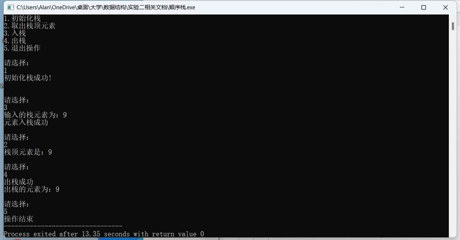
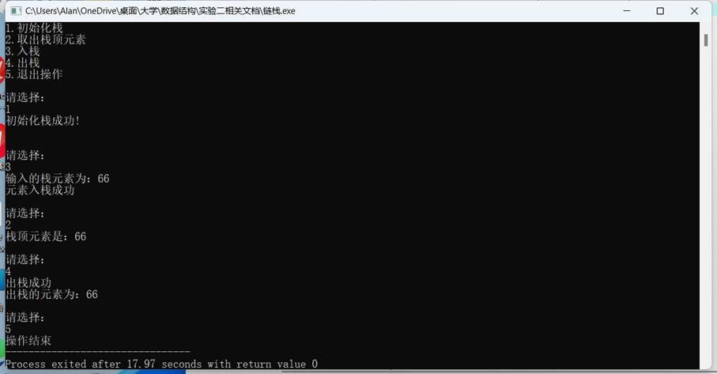
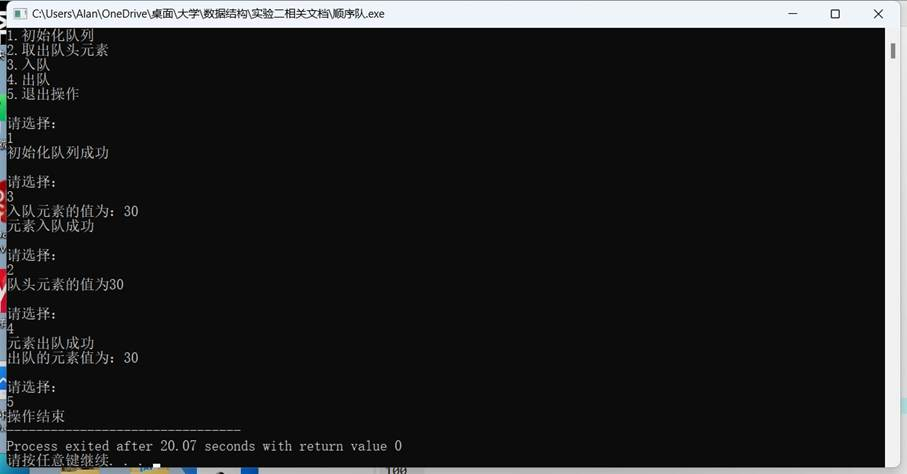
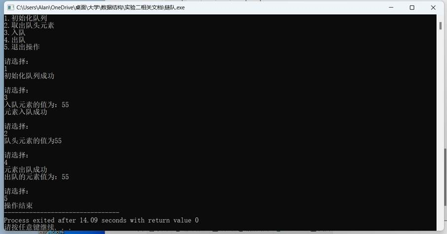

一、实验目的及要求

  实验目的：

  （1）      掌握顺序栈、链栈的存储结构。

  （2）      验证顺序栈、链栈及其基本操作的实现。

  （3）      理解算法与程序的关系，能够将顺序栈、链栈算法转换为对应的程序。

  （4）      掌握顺序队列、链式队列的存储结构。

  （5）      验证顺序队列、链式队列及其基本操作的实现。

  （6）      理解算法与程序的关系，能够将顺序队列、链式队列算法转换为对应的程序。

  （7）  

  掌握如何使用栈、队列来解决相关的应用问题。

   

  实验要求：

  (1) 程序要添加适当的注释，程序的书写要采用缩进格式。

  (2) 程序要具在一定的健壮性，即当输入数据非法时，程序也能适当地做出反应，如插入删除时指定的位置不对等等。

  (3) 程序要做到界面友好，在程序运行时用户可以根据相应的提示信息进行操作。

  (4) 根据实验报告模板详细书写实验报告。

  (5) 以班级为单位提交实验报告，文件命名：学号姓名实验一实验报告，学号姓名实验一代码。

   

   

   

   

   

   

   

   

  

 

 

  

  二、实验原理与内容

  栈：

  （1）      初始化栈。

  （2）      取出栈顶元素。

  （3）      出栈。

  （4）      入栈。

  队列：

  （1）      初始化队列。

  （2）      入队。

  （3）      出队。

  （4）      取出队头元素。

   

   

   

   

   

   

   

   

   

   

   

  

 

 

  

  三、实验软硬件环境

  Windows 11，Embarcadero Dev-C++

   

   

   

   

  

 

 

  

  四、实验过程（实验步骤、记录、数据、分析）

  顺序栈

  #include&lt;iostream&gt;

  #include&lt;stdlib.h&gt;

  #include&lt;string&gt;

  #include&lt;iomanip&gt;

  #include&lt;fstream&gt;

  #include&lt;stdio.h&gt;

  #define OK 1

  #define ERROR

  0

  #define

  MAXSIZE 100

  #define

  STACK_INIT_SIZE 10

  #define

  STACKINCREMENT 2

  #define

  OVERLOW -2

  using

  namespace std;

  typedef struct

  SqStack

  {

          int

  *base;

          int

  *top;

          int

  stacksize;

  }SqStack;

  int

  InitStack(SqStack &amp;S)

  {

          S.base=new

  int[MAXSIZE];

          if(!S.base)

          exit(OVERLOW);

          S.top=S.base;

          S.stacksize=MAXSIZE;

          return

  OK;

  }

  int

  push(SqStack &amp;S,int e)

  {

          if(S.top-S.base==S.stacksize)

          return

  ERROR;

          *(S.top++)=e;

          return

  OK; 

  }

  int

  Pop(SqStack &amp;S,int *e)

  {

          if(S.base==S.top)

          return

  ERROR;

          S.top=S.top-1;

          *e=*(S.top);

          return

  OK;

  }

  int

  GetTop(SqStack &amp;S)

  {

          if(S.top!=S.base)

          return

  *(S.top-1);

  }

  int main()

  {

          SqStack

  S;

          int

  a,b,choose,e,t;

          cout&lt;&lt;&quot;1.初始化栈\n&quot;;

          cout&lt;&lt;&quot;2.取出栈顶元素\n&quot;;

          cout&lt;&lt;&quot;3.入栈\n&quot;;

          cout&lt;&lt;&quot;4.出栈\n&quot;;

          cout&lt;&lt;&quot;5.退出操作\n&quot;;

          choose=-1;

          while(choose!=0)

          {

                   cout&lt;&lt;&quot;\n请选择：&quot;&lt;&lt;endl;

                   cin&gt;&gt;choose;

                   switch(choose)

                   {

                           case

  1:

                                    if(InitStack(S)==1)

                                    cout&lt;&lt;&quot;初始化栈成功!\n\n&quot;;

                                    else

                                    cout&lt;&lt;&quot;初始化栈失败!\n\n&quot;;

                                    break;

                           case

  2:

                                    a=GetTop(S);

                                    cout&lt;&lt;&quot;栈顶元素是：&quot;&lt;&lt;a&lt;&lt;endl;

                                    break;

                           case

  3: 

                                  

  cout&lt;&lt;&quot;输入的栈元素为：&quot;;

                                            cin&gt;&gt;e;

                                       

  if(push(S,e)==1)

                                       

  cout&lt;&lt;&quot;元素入栈成功&quot;&lt;&lt;endl;

                                       

  else

                                       

  cout&lt;&lt;&quot;元素入栈失败&quot;&lt;&lt;endl;

                                            break;

                           case

  4:

                                    int

  p;

                                    if(Pop(S,&amp;p)==0)

                                    cout&lt;&lt;&quot;出栈失败&quot;&lt;&lt;endl;

                                    else

  

                                    {

                                            Pop(S,&amp;p);

                                            cout&lt;&lt;&quot;出栈成功&quot;&lt;&lt;endl; 

                                       

  cout&lt;&lt;&quot;出栈的元素为：&quot;&lt;&lt;p&lt;&lt;endl;

                                    }

                                    break;

                           case

  5:

                                    cout&lt;&lt;&quot;操作结束&quot;;

                                    return

  0;

                   }

          }

  }

   

   

  链栈

  #include&lt;iostream&gt;

  #include&lt;stdlib.h&gt;

  #include&lt;string&gt;

  #include&lt;iomanip&gt;

  #include&lt;fstream&gt;

  #include&lt;stdio.h&gt;

  #define OK 1

  #define ERROR

  0

  #define NULL 0

  

  #define

  OVERLOW -2

  using

  namespace std;

  typedef struct

  StackNode

  {

          int

  data;

          struct

  StackNode *next;

  }StackNode,*LinkStack;

  int

  InitStack(LinkStack &amp;S)

  {

          S=NULL;

          return

  OK;

  }

  int

  push(LinkStack &amp;S,int e)

  {

          LinkStack

  p;

          p=new

  StackNode;

          p-&gt;data=e;

          p-&gt;next=S;

          S=p;

          return

  OK;

  }

  int

  Pop(LinkStack &amp;S,int *e)

  {

          LinkStack

  p;

          p=new

  StackNode;

          if(S==NULL)

          return

  ERROR;

          *e=S-&gt;data;

          p=S;

          S=S-&gt;next;

          delete

  p;

          return

  OK;

  }

  int

  GetTop(LinkStack &amp;S)

  {

          if(S!=NULL)

          return

  S-&gt;data;

  }

  int main()

  {

          LinkStack

  S;

          int

  a,b,e,choose;

          cout&lt;&lt;&quot;1.初始化栈\n&quot;;

          cout&lt;&lt;&quot;2.取出栈顶元素\n&quot;;

          cout&lt;&lt;&quot;3.入栈\n&quot;;

          cout&lt;&lt;&quot;4.出栈\n&quot;;

          cout&lt;&lt;&quot;5.退出操作\n&quot;;

          choose=-1;

          while(choose!=0)

          {

             

  cout&lt;&lt;&quot;\n请选择：&quot;&lt;&lt;endl;

                   cin&gt;&gt;choose;

                   switch(choose)

                   {

                           case

  1:

                                    if(InitStack(S)==1)

                                    cout&lt;&lt;&quot;初始化栈成功!\n\n&quot;;

                                    else

                                    cout&lt;&lt;&quot;初始化栈失败!\n\n&quot;;

                                    break;

                           case

  2:

                                    a=GetTop(S);

                                    cout&lt;&lt;&quot;栈顶元素是：&quot;&lt;&lt;a&lt;&lt;endl;

                                    break;

                           case

  3:

                                    cout&lt;&lt;&quot;输入的栈元素为：&quot;;

                                    cin&gt;&gt;e;

                                    if(push(S,e)==1)

                                    cout&lt;&lt;&quot;元素入栈成功&quot;&lt;&lt;endl;

                                    else

                                    cout&lt;&lt;&quot;元素入栈失败&quot;&lt;&lt;endl;

                                    break;

                           case

  4:

                                    int

  p;

                                    if(Pop(S,&amp;p)==0)

                                    cout&lt;&lt;&quot;出栈失败&quot;&lt;&lt;endl;

                                    else

  

                                    {

                                            Pop(S,&amp;p);

                                            cout&lt;&lt;&quot;出栈成功&quot;&lt;&lt;endl; 

                                       

  cout&lt;&lt;&quot;出栈的元素为：&quot;&lt;&lt;p&lt;&lt;endl;

                                    }

                                    break;

                           case

  5:

                                    cout&lt;&lt;&quot;操作结束&quot;;

                                    return

  0;

                   }      

          }

  }

   

   

  顺序队列

  #include&lt;iostream&gt;

  #include&lt;stdlib.h&gt;

  #include&lt;string&gt;

  #include&lt;iomanip&gt;

  #include&lt;fstream&gt;

  #include&lt;stdio.h&gt;

  #define OK 1

  #define ERROR

  0

  #define

  OVERLOW -2

  #define

  MAXQSIZE 100 

  using

  namespace std;

  typedef struct

  {

          int

  *base;

          int

  front;

          int

  rear;

  }SqQueue;

  int

  InitQueue(SqQueue &amp;Q)

  {

          Q.base=new

  int[MAXQSIZE];

          if(!Q.base)

          exit(OVERLOW);

          Q.front=Q.rear=0;

          return

  OK;

  }

  int

  QueueLength(SqQueue Q)

  {

          return

  (Q.rear-Q.front+MAXQSIZE)%MAXQSIZE;

  }

  int

  EnQueue(SqQueue &amp;Q,int e)

  {

          if((Q.rear+1)%MAXQSIZE==Q.front)

          return

  ERROR;

          Q.base[Q.rear]=e;

          Q.rear=(Q.rear+1)%MAXQSIZE;

          return

  OK;

  }

  int

  DeQueue(SqQueue &amp;Q,int *e)

  {

          if(Q.front==Q.rear)

          return

  ERROR;

          *e=Q.base[Q.front];

          Q.front=(Q.front+1)%MAXQSIZE;

          return

  OK;

  }

  int

  GetHead(SqQueue &amp;Q)

  {

          if(Q.front!=Q.rear)

          return

  Q.base[Q.front];

  }

  int main()

  {

          SqQueue

  Q;

          int

  a,b,choose=-1,e;

          cout&lt;&lt;&quot;1.初始化队列\n&quot;;

          cout&lt;&lt;&quot;2.取出队头元素\n&quot;;

          cout&lt;&lt;&quot;3.入队\n&quot;;

          cout&lt;&lt;&quot;4.出队\n&quot;;

          cout&lt;&lt;&quot;5.退出操作\n&quot;;

          while(choose!=0)

          {

                   cout&lt;&lt;&quot;\n请选择：&quot;&lt;&lt;endl;

                   cin&gt;&gt;choose;

                   switch(choose)

                   {

                           case

  1:

                           if(InitQueue(Q)==1)

                           cout&lt;&lt;&quot;初始化队列成功&quot;&lt;&lt;endl;

                           else

                           cout&lt;&lt;&quot;初始化队列失败&quot;&lt;&lt;endl;

                           break;

                           case

  2:

                           a=GetHead(Q);

                           cout&lt;&lt;&quot;队头元素的值为&quot;&lt;&lt;a&lt;&lt;endl;

                           break;

                           case

  3:

                           cout&lt;&lt;&quot;入队元素的值为：&quot;;

                           cin&gt;&gt;e;

                           if(EnQueue(Q,e)==1)

                           cout&lt;&lt;&quot;元素入队成功&quot;&lt;&lt;endl;

                           else

                           cout&lt;&lt;&quot;元素入队失败&quot;&lt;&lt;endl;

                           break;

                           case

  4:

                           if(DeQueue(Q,&amp;b)==0)

                           cout&lt;&lt;&quot;元素出队失败&quot;&lt;&lt;endl;

                           else

                           {

                                    DeQueue(Q,&amp;b);

                                    cout&lt;&lt;&quot;元素出队成功&quot;&lt;&lt;endl;

                                    cout&lt;&lt;&quot;出队的元素值为：&quot;&lt;&lt;b&lt;&lt;endl;

  

                            }

  

                            break;

                            case

  5:

                            cout&lt;&lt;&quot;操作结束&quot;;

                            return

  0;

                   }

           }

  

  }

   

   

  链队

  #include&lt;iostream&gt;

  #include&lt;stdlib.h&gt;

  #include&lt;string&gt;

  #include&lt;iomanip&gt;

  #include&lt;fstream&gt;

  #include&lt;stdio.h&gt;

  #define OK 1

  #define ERROR

  0

  #define OVERLOW

  -2

  using

  namespace std;

  typedef struct

  QNode

  {

          int

  data;

          struct

  QNode *next;

   }QNode,*QueuePtr;

   typedef

  struct

   {

         QueuePtr

  front;

         QueuePtr

  rear;

   

  }LinkQueue;

   int

  InitQueue(LinkQueue &amp;Q)

   {

         Q.front=Q.rear=new

  QNode;

         Q.front-&gt;next=NULL;

         return

  OK;

    } 

  int

  EnQueue(LinkQueue &amp;Q,int e)

  {

          QueuePtr

  p;

          p=new

  QNode;

          p-&gt;data=e;

          p-&gt;next=NULL;

          Q.rear-&gt;next=p;

          Q.rear=p;

          return

  OK;

  }

  int

  DeQueue(LinkQueue &amp;Q,int *e)

  {

          QueuePtr

  p;

          if(Q.front==Q.rear)

          return

  ERROR;

          p=Q.front-&gt;next;

          *e=p-&gt;data;

          Q.front-&gt;next=p-&gt;next;

          if(Q.rear==p)

          Q.rear=Q.front;

          delete

  p;

          return

  OK;

  }

  int

  GetHead(LinkQueue &amp;Q)

  {

          if(Q.front!=Q.rear)

          return

  Q.front-&gt;next-&gt;data;

  }

  int main()

  {

          LinkQueue

  Q;

          int

  a,b,choose=-1,e;

          cout&lt;&lt;&quot;1.初始化队列\n&quot;;

          cout&lt;&lt;&quot;2.取出队头元素\n&quot;;

          cout&lt;&lt;&quot;3.入队\n&quot;;

          cout&lt;&lt;&quot;4.出队\n&quot;;

          cout&lt;&lt;&quot;5.退出操作\n&quot;;

          while(choose!=0)

          {

                   cout&lt;&lt;&quot;\n请选择：&quot;&lt;&lt;endl;

                   cin&gt;&gt;choose;

                   switch(choose)

                   {

                           case

  1:

                              

  if(InitQueue(Q)==1)

                              

  cout&lt;&lt;&quot;初始化队列成功&quot;&lt;&lt;endl;

                              

  else

                              

  cout&lt;&lt;&quot;初始化队列失败&quot;&lt;&lt;endl;

                              

  break;

                           case

  2:

                                    a=GetHead(Q);

                              

  cout&lt;&lt;&quot;队头元素的值为&quot;&lt;&lt;a&lt;&lt;endl;

                              

  break;

                           case

  3:

                                    cout&lt;&lt;&quot;入队元素的值为：&quot;;

                              

  cin&gt;&gt;e;

                              

  if(EnQueue(Q,e)==1)

                              

  cout&lt;&lt;&quot;元素入队成功&quot;&lt;&lt;endl;

                              

  else

                              

  cout&lt;&lt;&quot;元素入队失败&quot;&lt;&lt;endl;

                              

  break;

                           case

  4:

                                    if(DeQueue(Q,&amp;b)==0)

                              

  cout&lt;&lt;&quot;元素出队失败&quot;&lt;&lt;endl;

                              

  else

                              

  {

                                     

  DeQueue(Q,&amp;b);

                                     

  cout&lt;&lt;&quot;元素出队成功&quot;&lt;&lt;endl;

                                    cout&lt;&lt;&quot;出队的元素值为：&quot;&lt;&lt;b&lt;&lt;endl;

  

                              

  } 

                              

  break;

                           case

  5:

                                    cout&lt;&lt;&quot;操作结束&quot;;

                                    return

  0;

                   }

          }

  }

   

   

   

   

   

  

 

 

  

   

   

   

   

   

   

   

  

 

 

  

  五、测试/调试及实验结果分析

  

顺序栈：

   

   

   

   

   

   

   

   

   

   

   

   

   

   

  链栈：

  

  

   

    

   

   

    

    

   

  

   

   

   

   

   

   

   

   

   

   

   

   

   

   

  

  顺序队：

   

   

  

  

   

    

   

   

    

    

   

  

   

   

   

   

   

   

   

   

   

   

   

   

   

   

  

  链队：

  

  

   

    

   

   

    

    

   

  

   

   

   

   

   

   

   

   

   

   

   

   

   

  

 

 

  

  六、实验结论与体会

  掌握了顺序栈、链栈的存储结构和顺序队列、链式队列的存储结构，验证了顺序栈、链栈、顺序队列、链式队列及其基本操作的实现，理解了算法与程序的关系，能够将顺序栈、链栈、顺序队列、链队算法转换为对应的程序，掌握了如何使用栈、队列来解决相关的应用问题。

   

  2024年  03  月 31 日