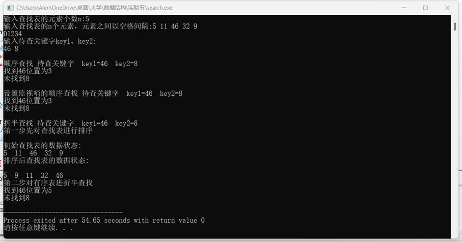
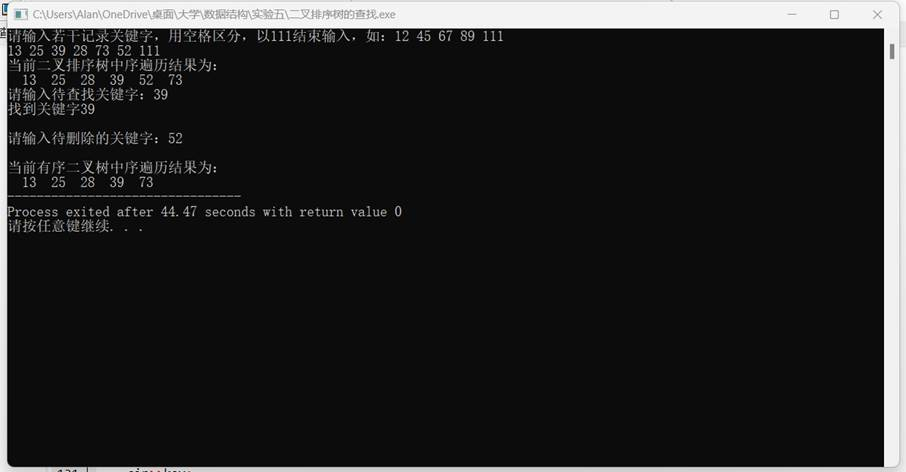

一、实验目的及要求

  实验目的

  （1）掌握顺序查找、折半查找、二叉排序树查找的算法思想及实现方法。

  （2）掌握直接插入排序、希尔（Shell）排序、冒泡排序、快速排序算法、简单选择排序、堆排序的设计思想及实现方法。

  实验要求：

  (1) 程序要添加适当的注释，程序的书写要采用缩进格式。

  (2) 程序要具在一定的健壮性，即当输入数据非法时，程序也能适当地做出反应，如插入删除时指定的位置不对等等。

  (3) 程序要做到界面友好，在程序运行时用户可以根据相应的提示信息进行操作。

  (4) 根据实验报告模板详细书写实验报告。

  (5) 以班级为单位提交实验报告，文件命名：学号姓名实验一实验报告，学号姓名实验一代码。

   

   

   

   

   

   

   

  

 

 

  

  二、实验原理与内容

  实验内容

  （1）输入N个数据建立查找表，采用顺序存储方式建立查找表，输入待查元素，利用顺序查找算法返回查找结果。利用直接插入排序、希尔（Shell）排序、快速排序算法、堆排序算法之一实现对查找表的排序，对排好序的查找进行折半查找，返回查找结果。

  （2）输入N个数据，采用建立二叉排序树的方式构建查找表，输入待查元素，利用二叉排序树查找算法返回查找结果。

   

   

   

   

   

   

   

  

 

 

  

  三、实验软硬件环境

  Windows 11，Embarcadero Dev-C++

   

   

   

   

   

  

 

 

  

  四、实验过程（实验步骤、记录、数据、分析）

  Search：

  //算法　顺序查找

  #include&lt;iostream&gt;

  using

  namespace std;

  #define

  MAXSIZE 100

  #define OK 1;

   

  typedef

  struct{

          int

  key;//关键字域

  }ElemType;

   

  typedef

  struct{

          ElemType

  *R;

          int

  length;

  }SSTable;

   

  int

  InitList_SSTable(SSTable &amp;L)

  {

          L.R=new

  ElemType[MAXSIZE+1];

          if

  (!L.R)

          {

                   cout&lt;&lt;&quot;初始化错误&quot;;

                   return

  0;

          }

          L.length=0;

          return

  OK;

  }

   

  int

  Insert_SSTable(SSTable &amp;L)

  {

          int

  n=0;

     

  cout&lt;&lt;&quot;输入查找表的元素个数n:&quot;;

     

  cin&gt;&gt;n;

          cout&lt;&lt;&quot;输入查找表的n个元素，元素之间以空格间隔:&quot;;

          for(int

  i=1;i&lt;=n&amp;&amp;i&lt;MAXSIZE;i++)

          {

   

                   cin&gt;&gt;L.R[i].key;

                   cout&lt;&lt;

                   L.length++;

   

          }

          cout&lt;&lt;endl;

          return

  1;

  }

   

  //算法　顺序查找

  int

  Search_Seq(SSTable ST, int key){

     

  //在顺序表ST中顺序查找其关键字等于key的数据元素。若找到，则函数值为

     

  //该元素在表中的位置，否则为0

      

  for (int i=ST.length; i&gt;=1; --i)

              

  if (ST.R[i].key==key) return i;              //从后往前找

      

  return 0;

    

  }// Search_Seq

   

   

    

  //算法  设置监视哨的顺序查找

   

    

  int Search_Seq2(SSTable ST, int key){

       

  //在顺序表ST中顺序查找其关键字等于key的数据元素。若找到，则函数值为

       

  //该元素在表中的位置，否则为0

       

  int i=0;

      

  ST.R[0].key =

  key;                         

                      //“哨兵”

      

  for(i = ST.length; ST.R[i].key!=key; --i)  ;         //从后往前找

      

  return i;

  }// Search_Seq

   

  //算法　折半查找

  int

  Search_Bin(SSTable ST,int key) {

     

  int low=1,high=ST.length;

          int

  mid;

          while(low&lt;=high){

          mid=(low+high)/2;

          if(key==ST.R[mid].key)

  return mid;

          else

  if (key&lt;ST.R[mid].key) high=mid-1;

          else

  low=mid+1;                                                                //表中不存在待查元素

     

  }

          return

  0;

  }// Search_Bin

   

  //算法　显示查找结果

  void

  Show_End(int result,int testkey)

  {

          if(result==0)

                   cout&lt;&lt;&quot;未找到&quot;&lt;&lt;testkey&lt;&lt;endl;

          else

                   cout&lt;&lt;&quot;找到&quot;&lt;&lt;testkey&lt;&lt;&quot;位置为&quot;&lt;&lt;result&lt;&lt;endl;

          return;

  }

   

   //算法 对顺序表L做直接插入排序

  void

  InsertSort(SSTable &amp;L)

  {

    

  //对顺序表L做直接插入排序

          int

  i,j;

          for(i=2;i&lt;=L.length;++i)

                   if(L.R[i].key&lt;L.R[i-1].key)

                   {  

                                                                              //&quot;&lt;&quot;，需将r[i]插入有序子表

                           L.R[0]=L.R[i];                                  

                         //将待插入的记录暂存到监视哨中

             

  L.R[i]=L.R[i-1];                 

                   //r[i-1]后移

             

  for(j=i-2; L.R[0].key&lt;L.R[j].key;--j)                       //从后向前寻找插入位置

                                    L.R[j+1]=L.R[j];                                       //记录逐个后移，直到找到插入位置

             

  L.R[j+1]=L.R[0];                                              //将r[0]即原r[i]，插入到正确位置

                   }                                                                                          //if

  }                                                                                                           //InsertSort

   

   

   

  //算法9-8堆排序

  void

  heapAdjust(SSTable &amp;L, int s, int m){

    int j;

   

  L.R[0]=L.R[s];

   

  for(j=2*s;j&lt;=m;j*=2){

        if(j&lt;m&amp;&amp;L.R[j].key&lt;L.R[j+1].key)

  ++j;

        if(L.R[0].key&gt;=L.R[j].key)

  break;

        L.R[s]=L.R[j];

  s=j;

    }

   

  L.R[s]=L.R[0];

  }

   

  ////算法9-8堆排序

  void heapSort

  (SSTable &amp;L){

    

  //对顺序表L进行堆排序。

    int i;

   

  for(i=L.length/2;i&gt;0;--i)

       

  heapAdjust(L,i,L.length);

   

  for(i=L.length;i&gt;1;--i){

        L.R[0]=L.R[1];L.R[1]=L.R[i];L.R[i]=L.R[0];

        heapAdjust(L,1,i-1);

    }

  }

   

   

   

   

   

   

   

  void

  show(SSTable L)

  {

          int

  i;

          cout&lt;&lt;endl;

          for(i=1;i&lt;=L.length;i++)

                   cout&lt;&lt;L.R[i].key&lt;&lt;&quot; 

  &quot;;

  }

   

   

   

  int main()

  {

          SSTable

  ST;

          int

  key1,key2;//待查关键字

          int

  result;

          InitList_SSTable(ST);//初始化查找表

          Insert_SSTable(ST);//在查找表中添加元素

          cout&lt;&lt;&quot;输入待查关键字key1、key2:&quot;&lt;&lt;endl;

          cin&gt;&gt;key1&gt;&gt;key2;

   

          //算法　顺序查找

          cout&lt;&lt;endl&lt;&lt;&quot;顺序查找 待查关键字  key1=&quot;&lt;&lt;key1&lt;&lt;&quot; 

  key2=&quot;&lt;&lt;key2&lt;&lt;endl;

          result=Search_Seq(ST,

  key1);

          Show_End(result,key1);

          result=Search_Seq(ST,

  key2);

          Show_End(result,key2);

     

  //算法  设置监视哨的顺序查找

     

  cout&lt;&lt;endl&lt;&lt;&quot;设置监视哨的顺序查找

  待查关键字 

  key1=&quot;&lt;&lt;key1&lt;&lt;&quot; 

  key2=&quot;&lt;&lt;key2&lt;&lt;endl;

     

  result=Search_Seq2(ST, key1);

          Show_End(result,key1);

          result=Search_Seq2(ST,

  key2);

          Show_End(result,key2);

   

      

  cout&lt;&lt;endl&lt;&lt;&quot;折半查找

  待查关键字 

  key1=&quot;&lt;&lt;key1&lt;&lt;&quot; 

  key2=&quot;&lt;&lt;key2&lt;&lt;endl;

          //对查找表进行排序

          cout&lt;&lt;&quot;第一步先对查找表进行排序&quot;&lt;&lt;endl;

          cout&lt;&lt;endl&lt;&lt;&quot;初始查找表的数据状态:&quot;;

     

  show(ST);

          //InsertSort(ST);//插入排序

           heapSort

  (ST);//堆排序

   

          cout&lt;&lt;endl&lt;&lt;&quot;排序后查找表的数据状态:&quot;&lt;&lt;endl;

      

  show(ST);

      

  cout&lt;&lt;endl&lt;&lt;&quot;第二步对有序表进折半查找&quot;&lt;&lt;endl;

          //算法　折半查找

     

  result=Search_Bin(ST, key1);

          Show_End(result,key1);

          result=Search_Bin(ST,

  key2);

          Show_End(result,key2);

          return

  0;

  }

   

  二叉排序树的查找：

  //算法　二叉排序树的递归查找

  //算法　二叉排序树的插入

  //算法　二叉排序树的创建

  //算法 　二叉排序树的删除

  #include&lt;iostream&gt;

  using

  namespace std;

  #define

  ENDFLAG 111

   

  typedef struct

  ElemType{

          int

  key;

  }ElemType;

   

  typedef struct

  BSTNode{

          ElemType

  data;       //结点数据域

          BSTNode

  *lchild,*rchild;       //左右孩子指针

  }BSTNode,*BSTree;

   

   

  //算法　二叉排序树的递归查找

  BSTree

  SearchBST(BSTree T,int key) {

    //在根指针T所指二叉排序树中递归地查找某关键字等于key的数据元素

    //若查找成功，则返回指向该数据元素结点的指针，否则返回空指针

   

  if((!T)||key==T-&gt;data.key) return T;

    else if

  (key&lt;T-&gt;data.key) return SearchBST(T-&gt;lchild,key);

    else

  return SearchBST(T-&gt;rchild,key);

  } // SearchBST

   

   

   

  //算法　二叉排序树的插入

  void

  InsertBST(BSTree &amp;T,ElemType e ) {

    //当二叉排序树T中不存在关键字等于e.key的数据元素时，则插入该元素

    if(!T)

  {               

                           //找到插入位置，递归结束

                    BSTree

  S = new

  BSTNode;                      //生成新结点*S

          

  S-&gt;data =

  e;                 

                 //新结点*S的数据域置为e

          

  S-&gt;lchild = S-&gt;rchild = NULL;    //新结点*S作为叶子结点

          

  T =S;                                           //把新结点*S链接到已找到的插入位置

    }

    else if

  (e.key&lt; T-&gt;data.key)

       

  InsertBST(T-&gt;lchild, e );                     //将*S插入左子树

    else if

  (e.key&gt; T-&gt;data.key)

       

  InsertBST(T-&gt;rchild, e);                      //将*S插入右子树

  }// InsertBST

   

   

   

  //算法　二叉排序树的创建

  void

  CreateBST(BSTree &amp;T ) {

    //依次读入一个关键字为key的结点，将此结点插入二叉排序树T中

    T=NULL;

   

  ElemType e;

   

  cin&gt;&gt;e.key;

   

  while(e.key!=ENDFLAG){     //ENDFLAG为自定义常量，作为输入结束标志

     

  InsertBST(T, e);            //将此结点插入二叉排序树T中

     

  cin&gt;&gt;e.key;

   

  }//while

  }//CreatBST

   

  void

  DeleteBST(BSTree &amp;T,int key) {

    //从二叉排序树T中删除关键字等于key的结点

    BSTree

  p=T;BSTree

  f=NULL;                    

                    //初始化

    BSTree

  q;

    BSTree

  s;

   

  /*------------下面的while循环从根开始查找关键字等于key的结点*p-------------*/

   

  while(p){

    

  if (p-&gt;data.key == key) break;                  //找到关键字等于key的结点*p，结束循环

    

  f=p;                               

                      //*f为*p的双亲结点

    

  if (p-&gt;data.key&gt; key)  p=p-&gt;lchild;           //在*p的左子树中继续查找

    

  else p=p-&gt;rchild;                                    //在*p的右子树中继续查找

   

  }//while

  if(!p)

  return;                        

            //找不到被删结点则返回

  /*—考虑三种情况实现p所指子树内部的处理：*p左右子树均不空、无右子树、无左子树—*/

  if

  ((p-&gt;lchild)&amp;&amp; (p-&gt;rchild)) {                //被删结点*p左右子树均不空

      

  q = p;

           s

  = p-&gt;lchild;

      

  while

  (s-&gt;rchild)               

                      //在*p的左子树中继续查找其前驱结点，即最右下结点

        

  {q = s; s = s-&gt;rchild;}               

                 //向右到尽头

      

  p-&gt;data =

  s-&gt;data;           

                         //s指向被删结点的“前驱”

      

  if(q!=p){

                    q-&gt;rchild

  = s-&gt;lchild;       //重接*q的右子树

           }

      

  else q-&gt;lchild = s-&gt;lchild;                     //重接*q的左子树

      

  delete s;

    }//if

  else{

          if(!p-&gt;rchild)

  {              

            //被删结点*p无右子树，只需重接其左子树

                    

  q = p; p = p-&gt;lchild;

           

  }//else if

          else

  if(!p-&gt;lchild)

  {              

             //被删结点*p无左子树，只需重接其右子树

                    q

  = p; p = p-&gt;rchild;

           

  }//else if

          /*——————————将p所指的子树挂接到其双亲结点*f相应的位置————————*/

           

  if(!f)

  T=p;                      

                         //被删结点为根结点

           

  else if (q==f-&gt;lchild) f-&gt;lchild = p;         //挂接到*f的左子树位置

           

  else f-&gt;rchild =

  p;                

                //挂接到*f的右子树位置

           

  delete q;

          }

  }//DeleteBST

   

  //算法 　二叉排序树的删除

   

  //中序遍历

  void

  InOrderTraverse(BSTree &amp;T)

  {

          if(T)

          {

          InOrderTraverse(T-&gt;lchild);

          cout&lt;&lt;&quot; 

  &quot;&lt;&lt;T-&gt;data.key;

          InOrderTraverse(T-&gt;rchild);

          }

  }

   

  int 

  main()

  {

          BSTree

  T;

          cout&lt;&lt;&quot;请输入若干记录关键字，用空格区分，以111结束输入，如：12 45 67 89

  111&quot;&lt;&lt;endl;

          CreateBST(T);

          cout&lt;&lt;&quot;当前二叉排序树中序遍历结果为：&quot;&lt;&lt;endl;

          InOrderTraverse(T);

          int

  key;//待查找或待删除内容

     

  cout&lt;&lt;endl;

          cout&lt;&lt;&quot;请输入待查找关键字：&quot;;

          cin&gt;&gt;key;

          BSTree

  result=SearchBST(T,key);

          if(result)

          {cout&lt;&lt;&quot;找到关键字&quot;&lt;&lt;key&lt;&lt;endl;}

          else

          {cout&lt;&lt;&quot;未找到&quot;&lt;&lt;key&lt;&lt;endl;}

                   cout&lt;&lt;endl;

          cout&lt;&lt;&quot;请输入待删除的关键字：&quot;;

          cin&gt;&gt;key;

          DeleteBST(T,key);

          cout&lt;&lt;endl;

          cout&lt;&lt;&quot;当前有序二叉树中序遍历结果为：&quot;&lt;&lt;endl;

          InOrderTraverse(T);

          return

  0;

  }

   

   

   

   

   

   

   

   

   

   

   

   

   

   

   

   

   

   

   

   

   

   

   

   

   

   

   

   

   

   

  

 

 

  

   

  

 

 

  

  五、测试/调试及实验结果分析

  Search：

  

  

   

    

   

   

    

    

   

  

   

   

   

   

   

   

   

   

   

   

   

   

   

  

  二叉排序树的查找：

  

  

   

    

   

   

    

    

   

  

   

   

   

   

   

   

   

   

   

   

   

   

   

   

   

   

   

   

  

 

 

  

  六、实验结论与体会

  利用上述知识成功编写出所要实现的功能。过程虽然有些困难，但我借助书本一步一步地编写出来，成就感十足！

   

   

   

   

   

   

  2024年  6  月  15  日