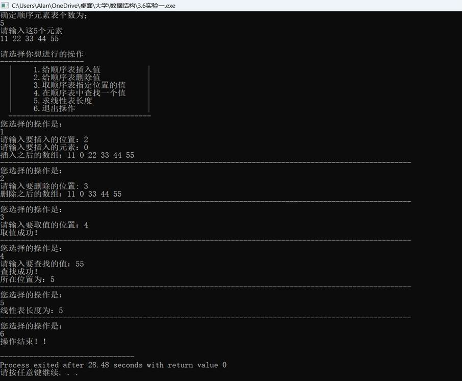
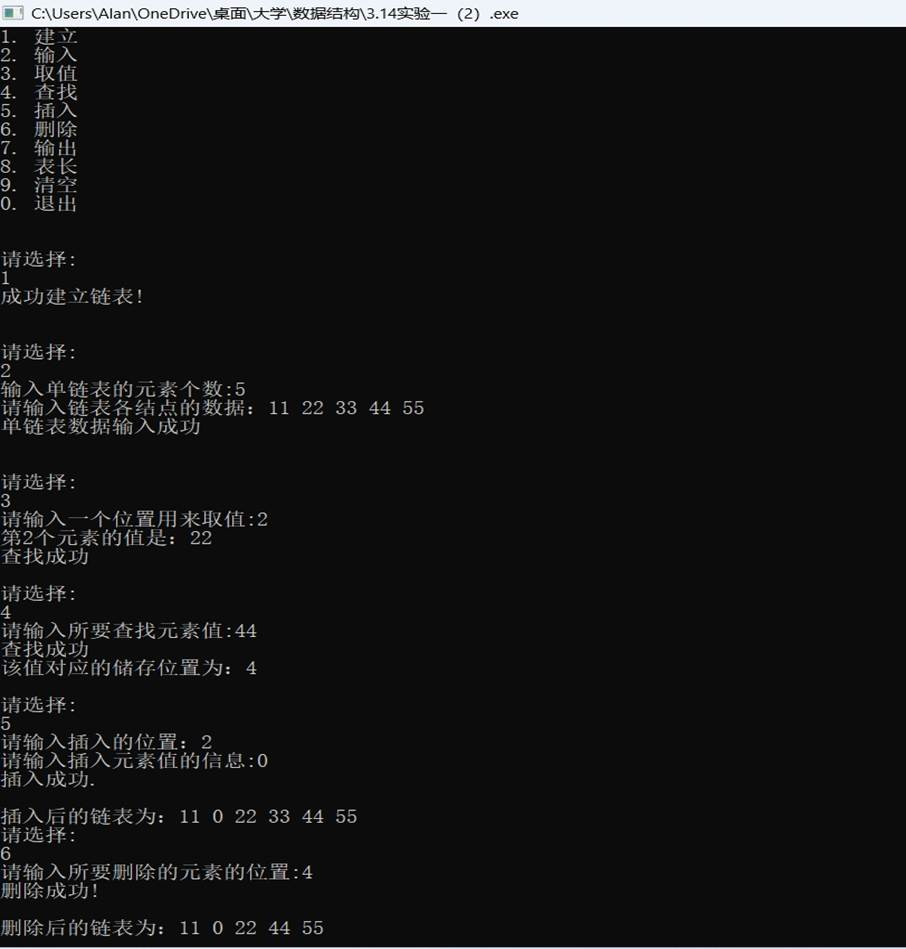
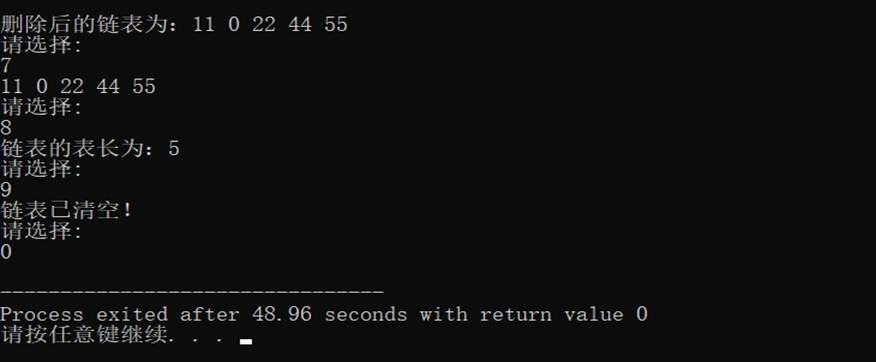

一、实验目的及要求

  实验目的：

  (1)掌握顺序表的存储结构。

  (2)验证顺序表及其基本操作的实现。

  (3)理解算法与程序的关系，能够将顺序表算法转换为对应的程序。

  （4）掌握线性表的链式存储结构。

  （5）验证链表基本操作的实现。

  （6）学会使用链表来解决各种实际问题。

  实验要求：

  (1) 程序要添加适当的注释，程序的书写要采用缩进格式。

  (2) 程序要具在一定的健壮性，即当输入数据非法时，程序也能适当地做出反应，如插入删除时指定的位置不对等等。

  (3) 程序要做到界面友好，在程序运行时用户可以根据相应的提示信息进行操作。

  (4) 根据实验报告模板详细书写实验报告。

  (5) 以班级为单位提交实验报告，文件命名：学号姓名实验一实验报告，学号姓名实验一代码。

   

   

   

   

   

   

   

  

 

 

  

  二、实验原理与内容

  实验内容：

  (1）初始化顺序表。

  (2）在顺序表的第 i 个位置插入元素。

  (3）删除顺序表的第 i 个元素。

  (4）输出顺序表。

  (5）判断顺序表是否为空。

  (6）判断顺序表是否为满。

  (7）求顺序表第 i 个元素的值。

  (8）查找值为 x 的元素。

  （9）初始化链表。

  （10）建立单链表。

  （11）在链表的第i位置插入元素。

  （12）删除链表的第i个元素。

  （13）输出链表。

  （14）判断链表是否为空。

  （15）求链表中第i个元素的值。

  （16）查找值为x的元素。

  （17）清空链表。

   

   

   

   

   

   

   

   

   

  

 

 

  

  三、实验软硬件环境

  Windows 11，Embarcadero Dev-C++

   

   

   

   

  

 

 

  

  四、实验过程（实验步骤、记录、数据、分析）

  (1)代码如下：

  #include&lt;cstdio&gt;

  #include&lt;stdlib.h&gt;

  #include&lt;iostream&gt;

  using

  namespace std;

  #define

  MAXSIZE 1000

  typedef struct

  {

          int

  *elem;

          int

  length;

  }SeqList;

  void

  InitList(SeqList &amp;L)

  {

          L.elem=new

  int[MAXSIZE];

          if(!L.elem)

  exit (0);

          L.length=0;

  }

  int

  Creat(SeqList &amp;L,int e)

  { 

          for(int

  i=0;i&lt;e;i++)

          {

           

  cin&gt;&gt;L.elem[i];

           

  ++L.length;

     

  }

  }

  int

  Delete(SeqList &amp;L,int e)

  {

          for(int

  j=e;j&lt;=L.length-1;j++)

           

  L.elem[j-1]=L.elem[j];

           

  --L.length;

           

  return 1;

  }

  int

  Print(SeqList &amp;L)

  {

          int

  i;

          for(i=0;i&lt;L.length;i++)

          {

                   printf(&quot;%d

  &quot;,L.elem[i]);  

          }

  }

  int

  lengthList(SeqList &amp;L)

  {

          return

  L.length;

  }

  int 

  SearchList(SeqList &amp;L,int e)

  {

          int

  i=0;

          while(i&lt;=L.length&amp;&amp;L.elem[i-1]!=e)

          i++;

          if(L.elem[i-1]==e)

          return

  i;

          else

          return-1;

  }

  int

  Insert(SeqList &amp;L,int i,int e)

  {

          if((i&lt;1)||(i&gt;L.length))

  

          return

  0;

          if(L.length==MAXSIZE)

  

          return

  0;

          for(int

  j=L.length-1;j&gt;=i-1;j--)

          L.elem[j+1]=L.elem[j];

          L.elem[i-1]=e;

          ++L.length;

          return

  1;

  }

  int

  GetList(SeqList &amp;L,int i)

  {

          if(i&lt;1||i&gt;L.length+1)

          return

  0;

          int

  e=L.elem[i-1];

          return

  1;

  }

  int main()

  {

          int

  n,e,x,k,i;

          SeqList

  L;

          InitList(L);

          cout&lt;&lt;&quot;确定顺序元素表个数为；&quot;&lt;&lt;endl;

          scanf(&quot;%d&quot;,&amp;n);

          cout&lt;&lt;&quot;请输入这&quot;&lt;&lt;n&lt;&lt;&quot;个元素&quot;&lt;&lt;endl;

          Creat(L,n);

          cout&lt;&lt;endl;

          cout&lt;&lt;&quot;请选择你想进行的操作&quot;&lt;&lt;endl;

          cout&lt;&lt;&quot;--------------------&quot;&lt;&lt;endl;

          cout&lt;&lt;&quot; 

  |     1.给顺序表插入值          

  |&quot;&lt;&lt;endl;

          cout&lt;&lt;&quot; 

  |     2.给顺序表删除值          

  |&quot;&lt;&lt;endl;

          cout&lt;&lt;&quot; 

  |     3.取顺序表指定位置的值     |&quot;&lt;&lt;endl;

          cout&lt;&lt;&quot; 

  |     4.在顺序表中查找一个值     |&quot;&lt;&lt;endl;

          cout&lt;&lt;&quot; 

  |     5.求线性表长度            

  |&quot;&lt;&lt;endl;

     

  cout&lt;&lt;&quot;  |     6.退出操作                

  |&quot;&lt;&lt;endl;

     

  cout&lt;&lt;&quot; 

  ----------------------------------&quot;&lt;&lt;endl;

     

  while(1)

     

  {

          cout&lt;&lt;&quot;您选择的操作是：&quot;&lt;&lt;endl;

          cin&gt;&gt;x;

          switch(x)

          {

                   case

  1:

                   {

             

  cout&lt;&lt;&quot;请输入要插入的位置：&quot;;

             

  cin&gt;&gt;i;

             

  cout&lt;&lt;&quot;请输入要插入的元素：&quot;;

             

  cin&gt;&gt;e;

             

  if (Insert(L,i,e))

             

  {

                 

  cout&lt;&lt;&quot;插入之后的数组：&quot;;

                 

  Print(L);

                 

  printf(&quot;\n&quot;);

                 

  printf(&quot;--------------------------------------------------------------------------------------------------&quot;);

           

        printf(&quot;\n&quot;);

             

  }

                   }break;

                   case

  2:

                   {

                           cout&lt;&lt;&quot;请输入要删除的位置: &quot;;

                           cin&gt;&gt;i;

  

                      

  if (Delete(L,i))

             

  {

                 

  cout&lt;&lt;&quot;删除之后的数组：&quot;;

                 

  Print(L);

                 

  printf(&quot;\n&quot;);

                 

  printf(&quot;--------------------------------------------------------------------------------------------------&quot;);

                 

  printf(&quot;\n&quot;);

             

  }      

                   }break;

                   case

  3:

                   {

                      

  cout&lt;&lt;&quot;请输入要取值的位置：&quot;;

             

  cin&gt;&gt;k;

             

  if (GetList(L,k))

                 

  cout&lt;&lt;&quot;取值成功！&quot;&lt;&lt;endl;

             

  printf(&quot;--------------------------------------------------------------------------------------------------&quot;);

             

  printf(&quot;\n&quot;);

             

  break;

                   }break;

                   case

  4:

                   {

                      

  int e;

             

  cout&lt;&lt;&quot;请输入要查找的值：&quot;;

     

          cin&gt;&gt;e;

             

  k=SearchList(L,e);

             

  if (k&gt;0)

                 

  cout&lt;&lt;&quot;查找成功！&quot;&lt;&lt;endl&lt;&lt;&quot;所在位置为：&quot;&lt;&lt;k&lt;&lt;endl;

             

  else

                 

  cout&lt;&lt;&quot;查找失败！&quot;&lt;&lt;endl;

             

  printf(&quot;--------------------------------------------------------------------------------------------------&quot;);

             

  printf(&quot;\n&quot;);

             

  break;

                   }break;

                   case

  5:

                   {

                           cout&lt;&lt;&quot;线性表长度为：&quot;;

             

  cout&lt;&lt;lengthList(L)&lt;&lt;endl;

             

  printf(&quot;--------------------------------------------------------------------------------------------------&quot;);

             

  printf(&quot;\n&quot;);

             

  break;

                   }break;

                   case

  6:

                   {

                           cout&lt;&lt;&quot;操作结束！！&quot;&lt;&lt;endl;

             

  return 0;

                   }break;

                   default:

         

  {

             

  cout&lt;&lt;&quot;请输入正确的序号！！&quot;;

             

  break;

         

  }

                   }

          }

  } 

   

   

   

   

  （2）代码如下：

  #include&lt;iostream&gt;

  #include&lt;stdlib.h&gt;

  #include&lt;string&gt;

  #include&lt;iomanip&gt;

  #include&lt;fstream&gt;

  using

  namespace std;

  #define OK 1

  #define ERROR

  0

  #define

  OVERFLOW -2

  #define NULL 0

  typedef int

  Status; 

  typedef int

  dataType;

  typedef struct

  LNode

  {

     

  dataType data; 

     

  struct LNode *next;

  } LNode,

  *LinkList; 

  int length;

  Status

  InitList_L(LinkList &amp;L)

  { 

     

  L = new LNode;

     

  L-&gt;next = NULL;

     

  return OK;

  }

  LNode

  *CreateList_R(LinkList &amp;L,int n)

  {

          int

  a[n],i;

          LinkList

  tail;

          LNode

  *p;

          L-&gt;next=NULL;

          tail=L;

          printf(&quot;请输入链表各结点的数据：&quot;); 

          for(i=0;i&lt;n;i++)

          {

                   scanf(&quot;%d&quot;,&amp;a[i]);

                   p=(LNode

  *)malloc(sizeof(LNode));

                   p-&gt;data=a[i];

                   tail-&gt;next=p;

                   tail=p;

          }

          tail-&gt;next=NULL;

          return

  L;

  }

  LNode

  *GetElem_L(LinkList &amp;L,int i)

  {

          int

  j=1;

          LinkList

  p=L-&gt;next;

          while(p&amp;&amp;j&lt;i)

          {

           

  j++;

           

  p=p-&gt;next;

          }

          printf(&quot;第%d个元素的值是：%d\n&quot;,i,p-&gt;data);

  }

  int

  LocateElem_L(LinkList &amp;L,int n)

  {

          LinkList

  p=L;

          int

  cout=0;

          while(p&amp;&amp;p-&gt;data!=n)

          {

                   p=p-&gt;next;

                   ++cout;

          }

          return

  cout;

          if(p==NULL||p-&gt;data==n)

          return

  n;

  }

  LNode

  *GetNode(LinkList &amp;L,int i)

  {

          int

  j=0;

          LNode

  *p=L;

          while(p-&gt;next!=NULL&amp;&amp;j&lt;i)

          {

                   p=p-&gt;next;

                   j++;

          }

          if(i==j)

          return

  p;

          else

  return NULL;

  }

  int

  ListInsert_L(LinkList &amp;L,int n,int i)

  {

          LinkList

  p,s;

          p=GetNode(L,n-1);

  

          if(p==NULL)

          {

                   printf(&quot;未找到第%d个结点&quot;,n-1);

                   return

  0;

          }

          s=(LinkList)malloc(sizeof(LNode));

          s-&gt;data=i;

          s-&gt;next=p-&gt;next;

          p-&gt;next=s;

          return

  1;

  }

  int

  ListDelete_L(LinkList &amp;L,int n)

  {

          LNode

  *p,*r;

          int

  i;

          p=GetNode(L,n-1);

          if(p==NULL||p-&gt;next==NULL)

          {

                   printf(&quot;未找到第%d个结点&quot;,i-1);

                   return

  0;

          }

          r=p-&gt;next;

          p-&gt;next=r-&gt;next;

          free(r);

          return

  1;

  }

  int

  PrintList(LinkList &amp;L)

  {

          LinkList

  p=L;

          int

  e;

          while(p-&gt;next!=NULL)

          {

           

  p=p-&gt;next;

           

  e=p-&gt;data;

           

  printf(&quot;%d &quot;,e);

          }

  }

  LNode

  *LengthList(LinkList &amp;L)

  {

          LinkList

  p=L;

          int

  cout=0;

          while(p-&gt;next!=NULL)

          {

                   p=p-&gt;next;

                   ++cout;

          }

          printf(&quot;链表的表长为：%d&quot;,cout);

  }

  int

  EmptyList(LinkList &amp;L)

  {

          LinkList

  p,q;

          for(p=NULL,q=L-&gt;next;p;p=q,p=p-&gt;next)

          {

                   free(p);

          }

          printf(&quot;链表已清空！&quot;); 

  }

  int main()

  {

     

  int a, length, choose;

     

  double t;

     

  int e;

     

  LinkList L;

     

  cout &lt;&lt; &quot;1. 建立\n&quot;;

     

  cout &lt;&lt; &quot;2. 输入\n&quot;;

     

  cout &lt;&lt; &quot;3. 取值\n&quot;;

     

  cout &lt;&lt; &quot;4. 查找\n&quot;;

     

  cout &lt;&lt; &quot;5. 插入\n&quot;;

     

  cout &lt;&lt; &quot;6. 删除\n&quot;;

     

  cout &lt;&lt; &quot;7. 输出\n&quot;;

     

  cout &lt;&lt; &quot;8. 表长\n&quot;;

     

  cout &lt;&lt; &quot;9. 清空\n&quot;;

     

  cout &lt;&lt; &quot;0. 退出\n\n&quot;;

     

  choose = -1;

     

  while (choose != 0)

     

  {

         

  cout &lt;&lt; &quot;\n请选择:&quot;&lt;&lt;endl;

         

  cin &gt;&gt; choose;

         

  switch (choose)

         

  {

         

  case 1: //建立一个单链表

             

  if (InitList_L(L))

                 

  cout &lt;&lt; &quot;成功建立链表!\n\n&quot;;

             

  break;

         

  case 2: //使用后插法创建单链表

             

  cout &lt;&lt; &quot;输入单链表的元素个数:&quot;;

             

  cin&gt;&gt;length;

              

  if(length&gt;0)

             

  {

             

          CreateList_R(L, length);

                 

  cout &lt;&lt; &quot;单链表数据输入成功\n\n&quot;;

             

  }

             

  else cout &lt;&lt; &quot;元素个数输入有误，单链表数据输入失败\n\n&quot;;

             

  break;

         

  case 3: //单链表的按序号取值

             

  cout &lt;&lt; &quot;请输入一个位置用来取值:&quot;;

             

  cin &gt;&gt; a;

             

  if (GetElem_L(L, a))

             

  {

                 

  cout &lt;&lt; &quot;查找成功\n&quot;;

             

  }

             

  else

                 

  cout &lt;&lt; &quot;查找失败\n\n&quot;;

             

  break;

         

  case 4://单链表的按值查找

             

  cout &lt;&lt; &quot;请输入所要查找元素值:&quot;;

             

  cin &gt;&gt; t;

             

  if (LocateElem_L(L, t) != NULL)

             

  {

                 

  cout &lt;&lt; &quot;查找成功\n&quot;;

                 

  cout &lt;&lt; &quot;该值对应的储存位置为：&quot; &lt;&lt; LocateElem_L(L, t)&lt;&lt; endl;

             

  }

               

  else

                 

  cout &lt;&lt; &quot;查找失败! &quot; &lt;&lt; t &lt;&lt; &quot; 没有找到\n\n&quot;;

             

  break;

         

  case 5: //单链表的插入

             

  cout &lt;&lt; &quot;请输入插入的位置：&quot;;

             

  cin &gt;&gt; a;

             

  cout &lt;&lt; &quot;请输入插入元素值的信息:&quot;;

             

  cin &gt;&gt; e;

             

  if (ListInsert_L(L,a, e))

             

  {

             

          cout &lt;&lt; &quot;插入成功.\n\n&quot;;

             

          cout&lt;&lt;&quot;插入后的链表为：&quot;;

             

          PrintList(L);

                           }

             

  else

                 

  cout &lt;&lt; &quot;插入失败!\n\n&quot;;

             

  break;

         

  case 6://单链表的删除

       

        cout &lt;&lt; &quot;请输入所要删除的元素的位置:&quot;;

             

  cin &gt;&gt; a;

             

  if (ListDelete_L(L, a))

             

  {

             

           cout &lt;&lt; &quot;删除成功!\n\n&quot;;

             

           cout&lt;&lt;&quot;删除后的链表为：&quot;;

                                     PrintList(L);

  

                           }

             

  else

                 

  cout &lt;&lt; &quot;删除失败!\n\n&quot;;

             

  break;

         

  case 7://单链表的输出

             

  PrintList(L);

             

  break;

         

  case 8://单链表的表长

             

  LengthList(L);

             

  break;

         

  case 9: //清空单链表

             

  EmptyList(L);

   

             

  break;

         

  }

     

  }

     

  return 0;

  }

   

  

 

 

  

   

  

 

 

  

  五、测试/调试及实验结果分析

  

（1）测试如下：

   

   

   

   

   

   

   

   

   

   

   

   

   

   

   

   

   

   

   

  

（2）测试如下：

   

   

   

   

   

   

   

   

   

   

   

   

   

   

   

   

   

   

   

   

   

   

   

  

  

   

    

   

   

    

    

   

  

   

   

   

   

   

   

   

   

   

   

   

  

 

 

  

  六、实验结论与体会

  掌握了线性表的链式存储结构，验证了链表基本操作的实现，学会了使用链表来解决各种实际问题，理解了算法与程序的关系，能够将顺序表算法转换为对应的程序。

   

   

   

   

   

   

  2024年 03 月 17 日