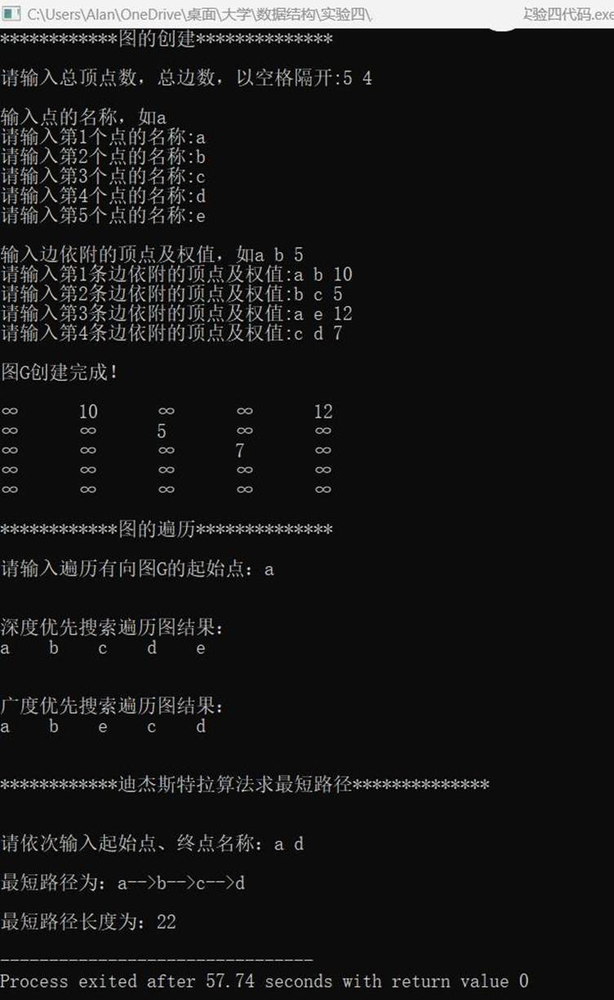

一、实验目的及要求

  实验目的

  （1）     

  掌握图的存储结构。

  （2）     

  掌握图的基本操作及实现。

  （3）     

  理解图的遍历和求解最短路径算法。

  实验要求

  (1) 程序要添加适当的注释，程序的书写要采用缩进格式。

  (2) 程序要具在一定的健壮性，即当输入数据非法时，程序也能适当地做出反应，如插入删除时指定的位置不对等等。

  (3) 程序要做到界面友好，在程序运行时用户可以根据相应的提示信息进行操作。

  (4) 根据实验报告模板详细书写实验报告。

  (5) 以班级为单位提交实验报告，文件命名：学号姓名实验一实验报告，学号姓名实验一代码。

   

   

  

 

 

  

  二、实验原理与内容

  （1）     

  图的创建。

  （2）     

  图的基本操作。 

  （3）     

  实现图的深度优先遍历和广度优先遍历。

  （4）     

  实现迪杰斯特拉算法计算任意两点之间的最短路径。

   

   

   

   

   

   

   

   

   

   

  

 

 

  

  三、实验软硬件环境

  Windows 11，Embarcadero Dev-C++

   

   

   

   

   

  

 

 

  

  四、实验过程（实验步骤、记录、数据、分析）

  #include

  &lt;iostream&gt;

  using namespace

  std;

   

  #define MaxInt

  32767                   

                                        //表示极大值，即∞

  #define MVNum

  100                      

                                            //最大顶点数

  #define

  MAXQSIZE 100

  typedef char

  VerTexType;             

                      //假设顶点的数据类型为字符型

  typedef int

  ArcType;                 

     //假设边的权值类型为整型

  bool visited1[MVNum];          

                              //广度优先访问标志数组，其初值为&quot;false&quot;

   

   

  //------------图的邻接矩阵-----------------

  typedef struct

  {

     

  VerTexType

  vexs[MVNum];           

                                              //顶点表

     

  ArcType arcs[MVNum][MVNum];                                                   //邻接矩阵

     

  int

  vexnum,arcnum;               

                                                    //图的当前点数和边数

  } Graph;

   

   

  //------------图的遍历-----------------

  bool

  visited[MVNum];                                                  //深度优先访问标志数组，其初值为&quot;false&quot;

  int

  FirstAdjVex(Graph G, int v);                              //返回v的第一个邻接点

  int

  NextAdjVex(Graph G, int v, int w);           //返回v相对于w的下一个邻接点

   

   

  int *D=new

  int[MVNum];                             //用于记录最短路的长度

  bool *S=new

  bool[MVNum];                       //标记顶点是否进入S集合

  int *Path=new

  int[MVNum];                          //用于记录最短路顶点的前驱

   

   

  //----队列的定义及操作--------

  typedef struct

  {

     

  ArcType *base;                                                          //初始化的动态分配存储空间

     

  int front;                                                             //头指针，若队列不空，指向队头元素

     

  int rear;                                     //尾指针，若队列不空，指向队尾元素的下一个位置

  } sqQueue;

   

   

  void

  InitQueue(sqQueue &amp;Q){

          //构造一个空队列Q

          Q.base

  = new ArcType[MAXQSIZE];

          if(!Q.base)    

  exit(1);                          //存储分配失败

          Q.front

  = Q.rear = 0;

  }//InitQueue

   

  void

  EnQueue(sqQueue &amp;Q, ArcType e){

          //插入元素e为Q的新的队尾元素

          if((Q.rear

  + 1) % MAXQSIZE == Q.front)

                   return;

          Q.base[Q.rear]

  = e;

          Q.rear

  = (Q.rear + 1) % MAXQSIZE;

  }//EnQueue

   

  bool

  QueueEmpty(sqQueue Q){

          //判断是否为空队

          if(Q.rear

  == Q.front)

                   return

  true;

          return

  false;

  }//QueueEmpty

   

  void

  DeQueue(sqQueue &amp;Q, ArcType &amp;u){

          //队头元素出队并置为u

          u

  = Q.base[Q.front];

          Q.front

  = (Q.front + 1) % MAXQSIZE;

  }//DeQueue

  //--------------------------------------------------

   

  int

  LocateVex(Graph G , VerTexType v){

          //确定点v在G中的位置

          for(int

  i = 0; i &lt; G.vexnum; ++i)

                   if(G.vexs[i]

  == v)

                           return

  i;

                   return

  -1;

  }//LocateVex

   

  //----有向网的创建--------

  void

  CreateGraph(Graph &amp;G){ 

     

  //采用邻接矩阵表示法，创建有向网G

  

          int

  i , j , k;

          cout

  &lt;&lt;&quot;请输入总顶点数，总边数，以空格隔开:&quot;;

     

  cin &gt;&gt; G.vexnum &gt;&gt; G.arcnum;                                                       //输入总顶点数，总边数

          cout

  &lt;&lt; endl;

          

          cout

  &lt;&lt; &quot;输入点的名称，如a&quot; &lt;&lt;endl;

   

     

  for(i = 0; i &lt; G.vexnum; ++i){   

                   cout

  &lt;&lt; &quot;请输入第&quot; &lt;&lt; (i+1) &lt;&lt; &quot;个点的名称:&quot;;

                   cin

  &gt;&gt;

  G.vexs[i];                       

                        //依次输入点的信息 

          }      

          cout

  &lt;&lt; endl;

   

     

  for(i = 0; i &lt; G.vexnum;

  ++i)               

                    //初始化邻接矩阵，边的权值均置为极大值MaxInt 

                   for(j

  = 0; j &lt; G.vexnum; ++j)   

                           G.arcs[i][j]

  = MaxInt;  

          cout

  &lt;&lt; &quot;输入边依附的顶点及权值，如a b 5&quot; &lt;&lt; endl;

          for(k

  = 0; k &lt; G.arcnum;++k){                                                         //构造邻接矩阵 

                   VerTexType

  v1 , v2;

                   ArcType

  w;

                   cout

  &lt;&lt; &quot;请输入第&quot; &lt;&lt; (k + 1) &lt;&lt; &quot;条边依附的顶点及权值:&quot;;

                   cin

  &gt;&gt; v1 &gt;&gt; v2&gt;&gt;w;                                                                         //输入一条边依附的顶点及权值

                   i

  = LocateVex(G, v1);  j = LocateVex(G, v2);              //确定v1和v2在G中的位置，即顶点数组的下标 

                    G.arcs[i][j]

  = w;                                                 

  //置有向&lt;v1,

  v2&gt;的的权值为w

                    

  

          }//for

  }//CreateUDN 

  //--------------------------------------------------

   

   

  //----深度优先遍历--------

  void

  DFSTraverse(Graph G, int v){                        

          //图G为邻接矩阵类型 

          int

  w;

          cout

  &lt;&lt; G.vexs[v] &lt;&lt; &quot;    &quot;;  visited[v]

  = true;                //访问第v个顶点，并置访问标志数组相应分量值为true 

          for(w

  = 0; w &lt; G.vexnum; w++)                                                             //依次检查邻接矩阵v所在的行  

                   if((G.arcs[v][w]

  != MaxInt)&amp;&amp; (!visited[w]))  DFSTraverse(G, w);

  //G.arcs[v][w]!=0表示w是v的邻接点，如果w未访问，则递归调用DFSTraverse 

  }//DFS

   

   

  int

  FirstAdjVex(Graph G , int v){

          //返回v的第一个邻接点

          int

  i;

          for(i

  = 0 ; i &lt; G.vexnum ; ++i){

                   if(G.arcs[v][i]

  !=MaxInt &amp;&amp; visited[i] == false)

                           return

  i;

          }

          return

  -1;

  }//FirstAdjVex

   

  int

  NextAdjVex(Graph G , int v , int w){

          //返回v相对于w的下一个邻接点

          int

  i;

          for(i

  = w ; i &lt; G.vexnum ; ++i){

                   if(G.arcs[v][i]

  != MaxInt &amp;&amp; visited[i] == false)

                           return

  i;

          }

          return

  -1;

  }//NextAdjVex

  //--------------------------------------------------

   

  //----广度优先遍历--------

  int FirstAdjVex1(Graph

  G , int v){

          //返回v的第一个邻接点

          int

  i;

   

          for(i

  = 0 ; i &lt; G.vexnum ; ++i){

                   if(G.arcs[v][i]

  != MaxInt &amp;&amp; visited1[i] == false)

                           return

  i;

          }

          return

  -1;

  }//FirstAdjVex1

   

  int

  NextAdjVex1(Graph G , int v , int w){

          //返回v相对于w的下一个邻接点

          int

  i;

   

          for(i

  = w ; i &lt; G.vexnum ; ++i){

                   if(G.arcs[v][i]

  != MaxInt &amp;&amp; visited1[i] == false)

                           return

  i;

          }

          return

  -1;

  }//NextAdjVex1

  void

  BFSTraverse (Graph G, int v){

     

  //按广度优先非递归遍历连通图G

          sqQueue

  Q;

          ArcType

  u;

          ArcType

  w;

   

     

  cout &lt;&lt; G.vexs[v] &lt;&lt; &quot;   

  &quot;;    visited1[v] = true;                                                //访问第v个顶点，并置访问标志数组相应分量值为true

     

  InitQueue(Q);             

                                                                                                            //辅助队列Q初始化，置空

     

  EnQueue(Q,

  v);                                                                                                                        //v进队

     

  while(!QueueEmpty(Q)){                                                                                                        //队列非空

                   DeQueue(Q,

  u);                                                                                                            //队头元素出队并置为u

                   for(w

  = FirstAdjVex1(G, u); w &gt;= 0; w = NextAdjVex1(G, u, w)){

                           //依次检查u的所有邻接点w ，FirstAdjVex(G, u)表示u的第一个邻接点

                           //NextAdjVex(G,

  u, w)表示u相对于w的下一个邻接点，w≥0表示存在邻接点

                           if(!visited1[w]){               

                                                                                //w为u的尚未访问的邻接顶点

                                    cout

  &lt;&lt; G.vexs[w] &lt;&lt; &quot;    &quot;;  

  visited1[w] = true;                                     //访问w，并置访问标志数组相应分量值为true

                                    EnQueue(Q,

  w);                                                                                                           //w进队

                           }//if

                   }//for

     

  }//while

  }//BFSTraverse

  //--------------------------------------------------

   

   

  //--------最短路径算法--------

  void

  ShortestPath_DIJ(Graph G, int v0){

     

  //用Dijkstra算法求有向网G的v0顶点到其余顶点的最短路径

     

  int v , i , w , min;

          int

  n =

  G.vexnum;                   

                                      //n为G中顶点的个数

   

          for(v

  = 0; v &lt; n;

  ++v){            

                                     //n个顶点依次初始化

                   S[v]

  =

  false;                 

                                            //S初始为空集

                   D[v]

  = G.arcs[v0][v];                                                    //将v0到各个终点的最短路径长度初始化为弧上的权值

                   if(D[v]

  &lt; MaxInt)  Path [v] = v0;                                         //如果v0和v之间有弧，则将v的前驱置为v0

                   else

  Path [v] =

  -1;              

                                         //如果v0和v之间无弧，则将v的前驱置为-1

          }//for

   

          S[v0]=true;                   

                                                          //将v0加入S

          D[v0]=0;                     

                                                         //源点到源点的距离为0

   

          /*—初始化结束，开始主循环，每次求得v0到某个顶点v的最短路径，将v加到S集—*/

          for(i

  = 1;i &lt; n; ++i){                                                                           //对其余n-1个顶点，依次进行计算

         

  min= MaxInt;

         

  for(w = 0; w &lt; n; ++w)

                           if(!S[w]

  &amp;&amp; D[w] &lt; min){                                               //选择一条当前的最短路径，终点为v

                                    v

  = w;

                                    min

  = D[w];

                           }//if

                   S[v]=true;                  

                                              //将v加入S

                   for(w

  = 0;w &lt; n;

  ++w)                                                   //更新从v0出发到集合V,S上所有顶点的最短路径长度

                           if(!S[w]

  &amp;&amp; (D[v] + G.arcs[v][w] &lt; D[w])){

                                    D[w]

  = D[v] + G.arcs[v][w];                                //更新D[w]

                                    Path

  [w] =

  v;             

                                           //更改w的前驱为v

                           }//if

     

  }//for

  }//ShortestPath_DIJ

   

  void

  DisplayPath(Graph G , int begin ,int temp ){

          //显示最短路

          if(Path[temp]

  != -1){

                   DisplayPath(G

  , begin ,Path[temp]);

                   cout

  &lt;&lt; G.vexs[Path[temp]] &lt;&lt; &quot;--&gt;&quot;;

          }

  }//DisplayPath

  //----------------------------

   

  //主函数

  int main()

  {

     

  Graph G;

     

  int i, j,num_start, num_destination;

     

  VerTexType start, destination;

     

  cout &lt;&lt; &quot;************图的创建**************&quot; &lt;&lt; endl &lt;&lt; endl;

     

  CreateGraph(G);

     

  cout &lt;&lt; endl;

     

  cout &lt;&lt; &quot;图G创建完成！&quot;

  &lt;&lt; endl &lt;&lt; endl;

     

  for(i = 0 ; i &lt; G.vexnum ; ++i)

     

  {

         

  for(j = 0; j &lt; G.vexnum; ++j)

         

  {

             

  if(j != G.vexnum - 1)

             

  {

                 

  if(G.arcs[i][j] != MaxInt)

                     

  cout &lt;&lt; G.arcs[i][j] &lt;&lt; &quot;\t&quot;;

                 

  else

                     

  cout &lt;&lt; &quot;∞&quot; &lt;&lt; &quot;\t&quot;;

             

  }

             

  else

             

  {

                 

  if(G.arcs[i][j] != MaxInt)

                     

  cout &lt;&lt; G.arcs[i][j] &lt;&lt;endl;

                 

  else

                     

  cout &lt;&lt; &quot;∞&quot; &lt;&lt;endl;

             

  }

         

  }

     

  }//for

     

  

     

  

     

  cout &lt;&lt; endl&lt;&lt; &quot;************图的遍历**************&quot; &lt;&lt; endl &lt;&lt;

  endl;

     

  cout &lt;&lt; &quot;请输入遍历有向图G的起始点：&quot;;

          VerTexType

  c;

          cin

  &gt;&gt; c;

          for(i

  = 0 ; i &lt; G.vexnum ; ++i){

                   if(c

  == G.vexs[i])

                           break;

          }

          cout

  &lt;&lt; endl;

          while(i

  &gt;= G.vexnum){

                   cout

  &lt;&lt; &quot;该点不存在，请重新输入！&quot; &lt;&lt; endl;

                   cout

  &lt;&lt; &quot;请输入遍历连通图的起始点：&quot;;

                   cin

  &gt;&gt; c;

                   for(i

  = 0 ; i &lt; G.vexnum ; ++i){

                           if(c

  == G.vexs[i])

                                    break;

                   }

          }

     

  cout &lt;&lt; endl&lt;&lt; &quot;深度优先搜索遍历图结果：&quot; &lt;&lt; endl;

     

  DFSTraverse(G,i);

     

  cout &lt;&lt; endl;

     

  cout &lt;&lt; endl&lt;&lt; endl&lt;&lt; &quot;广度优先搜索遍历图结果：&quot; &lt;&lt; endl;

     

  BFSTraverse(G,i);

     

  cout &lt;&lt; endl;

     

  

     

  cout &lt;&lt; endl&lt;&lt; endl&lt;&lt; &quot;************迪杰斯特拉算法求最短路径**************&quot;

  &lt;&lt; endl &lt;&lt; endl;

     

  cout &lt;&lt; endl&lt;&lt; &quot;请依次输入起始点、终点名称：&quot;;

     

  cin &gt;&gt; start &gt;&gt; destination;

     

  num_start = LocateVex(G, start);

     

  num_destination = LocateVex(G, destination);

     

  ShortestPath_DIJ(G, num_start);

     

  cout &lt;&lt; endl &lt;&lt;&quot;最短路径为：&quot;;

     

  DisplayPath(G, num_start, num_destination);

  cout &lt;&lt;

  G.vexs[num_destination]&lt;&lt;endl;

     

  cout &lt;&lt; endl &lt;&lt;&quot;最短路径长度为：&quot;;

     

  cout &lt;&lt; D[num_destination]&lt;&lt;endl;

     

  return 0;

  }//main

   

   

   

   

   

   

   

   

   

   

   

   

   

  

 

 

  

   

  

 

 

  

  五、测试/调试及实验结果分析

  

   

   

   

   

   

   

   

   

   

   

   

   

   

   

   

   

   

   

   

   

   

   

   

   

   

   

   

   

   

   

   

   

   

   

   

   

   

  

 

 

  

  六、实验结论与体会

  利用上述知识成功编写出所要实现的功能。过程虽然有些困难，但我借助书本一步一步地编写出来，成就感十足！

   

   

   

   

   

   

  2024年  6 月 10  日