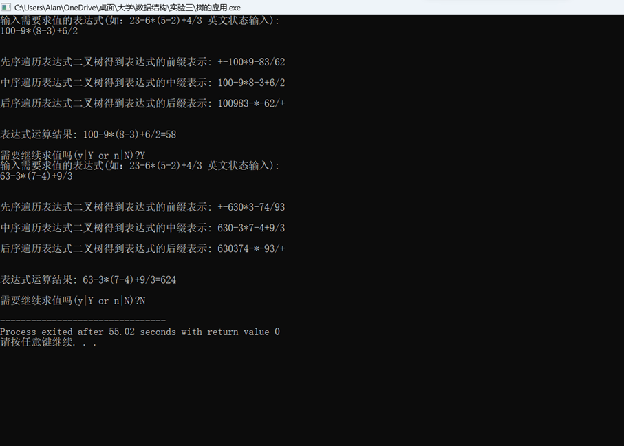

一、实验目的及要求

  实验目的：

  （1）掌握二叉树的二叉链表存储结构。

  （2）验证二叉树遍历算法及其他基本操作的实现。

  （3）理解算法与程序的关系，能够将二叉树的算法转换为对应的程序。

  （4）学会使用二叉树来解决各种实际问题，掌握利用二叉树求解表达式的值。

   

  实验要求：

  (1) 程序要添加适当的注释，程序的书写要采用缩进格式。

  (2) 程序要具在一定的健壮性，即当输入数据非法时，程序也能适当地做出反应，如插入删除时指定的位置不对等等。

  (3) 程序要做到界面友好，在程序运行时用户可以根据相应的提示信息进行操作。

  (4) 根据实验报告模板详细书写实验报告。

  (5) 以班级为单位提交实验报告，文件命名：学号姓名实验一实验报告，学号姓名实验一代码。

   

   

  

 

 

  

  二、实验原理与内容

  （1）定义二叉树的结点结构。

  （2）创建表达式二叉树。

  （3）先序遍历表达式二叉树得到表达式的前缀表示。

  （4）中序遍历表达式二叉树得到表达式的中缀表示。

  （5）后序遍历表达式二叉树得到表达式的后缀表示。

  （6）计算表达式的值。

   

   

   

   

   

   

   

  

 

 

  

  三、实验软硬件环境

  Windows 11，Embarcadero Dev-C++

   

   

   

   

   

  

 

 

  

  四、实验过程（实验步骤、记录、数据、分析）

  //二叉树的应用-表达式求值

  #include&lt;iostream&gt;

  #include&lt;fstream&gt;

  #include&lt;math.h&gt;

  #include&lt;string.h&gt;

  using

  namespace std;

  #define

  MAXSIZE  100//表达式字符串最大值

  #define

  N  10//表达式项的最大长度

  char

  expression[MAXSIZE ]; //存储表达式字符串

  char

  str[MAXSIZE][N];//存储表达式操作数、运算符

  int

  expstart,expend;//表达式开始、结束位置

  typedef char

  ElemType;

  typedef struct

  BiTNode

  {

          ElemType

  data[N];

          BiTNode*

  lchild,* rchild;

  }BiTNode,*BiTree;

   

  bool

  Judge(char (*str)[N],int expstart,int expend)//判断当前表达式是否需要消除最外层的括号

  {

     

  bool result=false;

     

  if(strcmp(str[expstart],&quot;(&quot;)==0&amp;&amp;strcmp(str[expend],&quot;)&quot;)==0)

     

  {

         

  char flag=')';

         

  for(int i=expstart+1; i&lt;expend; i++)

         

  {

             

  if(strcmp(str[i],&quot;(&quot;)==0||strcmp(str[i],&quot;)&quot;)==0)

                 

  flag=str[i][0];

         

  }

         

  if(flag==')')

             

  result=true;

     

  }

     

  return result;

   

  }

  int

  GetOprt(char (*str)[N],int expstart,int expend)

  //取得当前表达式中优先级最低的操作符在表达式expression中的位置

  {

     

  int position=-1;

     

  int sign=0;

     

  int t=1;

     

  while(position==-1)

     

  {

         

  for(int i=expstart; i&lt;=expend; i++)

         

  {

             

  if(strcmp(str[i],&quot;(&quot;)==0)

             

  {

                 

  i++;

                 

  sign=1; //有一个左括号

                 

  while(sign&gt;0)

       

            {

                     

  //sign=0，表示括号去完了

                     

  if(strcmp(str[i],&quot;(&quot;)==0)

                         

  sign++;

                     

  if(strcmp(str[i],&quot;)&quot;)==0)

                         

  sign--;

                     

  i++;

                 

  }

         

          i--;

             

  }

             

  if(t==1)

             

  {

                 

  if(strcmp(str[i],&quot;+&quot;)==0||strcmp(str[i],&quot;-&quot;)==0)

                     

  position=i; //记录括号外优先级最低的加减符号位置

             

  }

             

  else

             

  {

                 

  if(strcmp(str[i],&quot;*&quot;)==0||strcmp(str[i],&quot;/&quot;)==0)

                     

  position=i; //记录括号外优先级最低的乘除符号位置

             

  }

         

  }

         

  t++;

     

  }

     

  return position;

  }

  //递归建立二叉树,根据表达式运算符的优先级，从低到高以先序递归的方式构建表达式二叉树

  BiTNode

  *CreateBT(char (*str)[N], int expstart, int expend)

  {

          int

  position=-1;

          BiTNode

  *BT;

          if(expend-expstart==0)

          {

                   BT=(BiTNode*)malloc(sizeof(BiTNode));

                   strcpy(BT-&gt;data,str[expstart]);

                   BT-&gt;lchild=NULL;

                   BT-&gt;rchild=NULL;

                   return

  BT;

          }

          position=GetOprt(str,expstart,expend);

          BT=(BiTNode*)malloc(sizeof(BiTNode));

          strcpy(BT-&gt;data,str[position]);

          

          bool

  removable=Judge(str,expstart,position-1);

          if(removable)

             

  BT-&gt;lchild=CreateBT(str,expstart+1,position-2);

          else

             

  BT-&gt;lchild=CreateBT(str,expstart,position-1);

          

          removable=Judge(str,position+1,expend);

          if(removable)

             

  BT-&gt;rchild=CreateBT(str,position+2,expend-1);

          else

             

  BT-&gt;rchild=CreateBT(str,position+1,expend);

          return

  BT;

  }

  //将叶节点中以字符形式存储的数字转换成浮点型的

  double

  StrToDigital(char str[])

  {

     

  int i,len,position;

     

  double sum;

     

  len=strlen(str);

     

  for(i=0; i&lt;len; i++)

         

  if(str[i]=='.')

             

  break;

     

  position=i;

     

  i=0;

     

  sum=0;

     

  while(i&lt;len)

     

  {

         

  if(i&lt;position)

             

  sum+=(str[i]-'0')*pow(10,position-i-1);

         

  else if(i&gt;position)

             

  sum+=(str[i]-'0')*pow(10,position-i);

         

  i++;

     

  }

     

  return sum;

  }

   

  //先序遍历

  void

  PreOrderBT(BiTree BT)

  {

          if(BT)

          {

                   cout&lt;&lt;BT-&gt;data;

                   PreOrderBT(BT-&gt;lchild);

                   PreOrderBT(BT-&gt;rchild);

          }

  }

   

  //中序遍历

  void

  InOrderBT(BiTree BT)

  {

          if(BT)

          {

                   InOrderBT(BT-&gt;lchild);

                   cout&lt;&lt;BT-&gt;data;

                   InOrderBT(BT-&gt;rchild);

          }

  }

  //

  //后序遍历

  void

  PostOrderBT(BiTree BT)

  {

          if(BT)

          {

                   PostOrderBT(BT-&gt;lchild);

                   PostOrderBT(BT-&gt;rchild);

                   cout&lt;&lt;BT-&gt;data;

          }

  }

   

  //求整个表达式的结果

  double

  CalulateValue(BiTNode* BT)

  {

     

  double result=0;

     

  if(BT-&gt;lchild==NULL&amp;&amp;BT-&gt;rchild==NULL)

     

  {

         

  result=StrToDigital(BT-&gt;data);

         

  return result;

     

  }

     

  double Lresult=CalulateValue(BT-&gt;lchild);

     

  double Rresult=CalulateValue(BT-&gt;rchild);

     

  switch(BT-&gt;data[0])

     

  {

     

  case '+':

         

  return Lresult+Rresult;

         

  break;

     

  case '-':

         

  return Lresult-Rresult;

         

  break;

     

  case '*':

         

  return Lresult*Rresult;

         

  break;

     

  case '/':

         

  return Lresult/Rresult;

         

  break;

     

  }

     

  return result;

  }

   

  //初始化，输入表达式expression并将每项操作数或运算符存入字符数组str中

  void Init()

  {

     

  int i,j,k;

     

  cout&lt;&lt;&quot;输入需要求值的表达式(如：23-6*(5-2)+4/3

  英文状态输入):\n&quot;;

     

  gets(expression);

     

  int length=strlen(expression);

     

  i=0;

     

  k=0;

     

  while(i&lt;length)  //将表达式存储到str数组中

     

  {

         

  if(expression[i]=='+'||expression[i]=='-'||expression[i]=='*'||expression[i]=='/'||expression[i]=='('||expression[i]==')')

             

  str[k++][0]=expression[i++]; //存储操作符

         

  else  //存储数字

         

  {

             

  j=0;

             

  while((expression[i]&gt;='0'&amp;&amp;expression[i]&lt;='9') ||

  expression[i]=='.')

             

  {

                 

  str[k][j]=expression[i];

                 

  i++;

                 

  j++;

             

  }

             

  k++;

         

  }

     

  }

     

  expstart=0;

     

  expend=k-1;

   

  };

   

  //主函数

  int main()

  {

     

  char c;

     

  bool removable;

     

  do

     

  {

     

          double result;

     

          BiTNode *BT;

         

  Init();

         

  removable=Judge(str,expstart,expend);

         

  if(removable)

             

  BT=CreateBT(str,expstart+1,expend-1);

         

  else

             

  BT=CreateBT(str,expstart,expend);

         

  cout&lt;&lt;&quot;\n\n先序遍历表达式二叉树得到表达式的前缀表示: &quot;;

         

  PreOrderBT(BT);  //先序遍历

         

  cout&lt;&lt;&quot;\n\n中序遍历表达式二叉树得到表达式的中缀表示: &quot;;

         

  InOrderBT(BT);  //中序遍历

         

  cout&lt;&lt;&quot;\n\n后序遍历表达式二叉树得到表达式的后缀表示: &quot;;

         

  PostOrderBT(BT); //后序遍历

         

  cout&lt;&lt;&quot;\n\n&quot;;

         

  cout&lt;&lt;&quot;\n表达式运算结果: &quot;;

         

  result=CalulateValue(BT); //计算表达式的结果

         

  cout&lt;&lt;expression&lt;&lt;&quot;=&quot;&lt;&lt;result;

         

  cout&lt;&lt;&quot;\n\n需要继续求值吗(y|Y or n|N)?&quot;;

         

  c=getchar();

         

  getchar();

     

  }

     

  while(c=='y'||c=='Y');

     

  return 0;

  }

   

   

   

   

   

   

   

   

   

  

 

 

  

   

  

 

 

  

  五、测试/调试及实验结果分析

  

  

   

    

   

   

    

    

   

  

   

   

   

   

   

   

   

   

   

   

   

   

   

   

   

   

   

   

  

 

 

  

  六、实验结论与体会

  利用上述知识成功编写出所要实现的功能。过程虽然有些困难，但我借助书本一步一步地编写出来，成就感十足！

   

   

   

   

  2024年  5  月  13  日