《日志审计与分析》综合实验报告

第1章 选题与数据集（10分）

一、选题及理由

本次实验选题为 基于 LOF 算法的 Web 日志攻击检测。

理由：

Web 日志是网络安全监测的重要数据来源。

CSIC 2010 数据集包含正常请求与 SQL 注入、XSS、目录遍历等攻击请求，适合异常检测实验。

LOF 算法无需标签即可做无监督异常识别，符合日志审计真实场景。

二、数据集来源、获取方式、原始格式、总条数、时间跨度

数据集名称：CSIC 2010 Web Application Attacks

获取方式：公开安全数据集下载，网址：https://www.kaggle.com/datasets/ispangler/csic-2010-web-application-attacks?resource=download

原始格式：CSV 表格

原始总条数：61066 条

时间跨度：无明确时间戳，为模拟 HTTP 请求日志

正常/异常数据区分：

一、数据标签定义

该数据集通过两个字段明确区分正常与异常数据，标签映射关系如下：

正常数据：Unnamed: 0列值为 “Normal”，classification列值为0

异常数据：Unnamed: 0列值为 “Anomalous”，classification列值为1

二、数据总量与比例分布

数据集共包含61,065 条HTTP 请求记录，正常与异常数据的数量及占比差异如下：

正常数据：36,000 条，占比 58.95%

异常数据：25,065 条，占比 41.05%

数据分布相对均衡，无严重类别失衡问题

三、核心区分特征详解

1. 请求方法（Method）差异

请求方法的分布是区分正常与异常数据的关键特征之一，两者在方法使用上存在显著差异：

正常数据：仅使用 GET 和 POST 两种方法

GET 方法：占比 77.78%（主要用于获取资源）

POST 方法：占比 22.22%（主要用于提交表单数据）

无 PUT 方法请求

异常数据：包含 GET、POST、PUT 三种方法

GET 方法：占比 60.20%（低于正常数据）

POST 方法：占比 38.22%（高于正常数据，常用于注入攻击）

PUT 方法：占比 1.58%（共 397 条，全部为异常数据，是重要异常标识）

2. URL 长度特征

异常数据的 URL 普遍更长，常包含注入攻击代码，具体差异如下：

正常数据

平均长度：79.0 个字符

中位数长度：58.5 个字符

最大长度：367 个字符

长度分布集中，无极端超长情况

异常数据

平均长度：106.6 个字符（比正常数据长 35%）

中位数长度：64.0 个字符

最大长度：895 个字符（是正常数据最大值的 2.4 倍）

存在 2,492 条超长 URL（长度 > 300 字符），多包含编码后的攻击脚本

3. Content 长度与内容特征

Content 字段（请求体内容）仅在非 GET 请求中存在，两者差异主要体现在长度和内容模式：

长度差异

正常数据：平均 91.6 字符，中位数 47.5 字符

异常数据：平均 122.1 字符，中位数 72.0 字符（长度普遍更长）

内容模式差异

正常数据：仅包含合法表单数据（如用户名、密码、商品 ID 等），无特殊攻击字符

异常数据：包含明显攻击特征，具体如下

SQL 注入特征：13.15% 包含 “INSERT”，2.65% 包含 “EXEC”，1.02% 包含 “SELECT”

命令注入特征：70.87% 包含 “&” 等特殊符号（用于拼接恶意命令）

典型示例：id=2&nombre=Jam%F3n+Ib%E9rico&precio=85&cantidad=%27%3B+DROP+TABLE+usuarios%3B+SELECT+*+FROM+datos+WHERE+nombre+LIKE+%27%25（包含删除表的 SQL 注入代码）

4. 字段缺失模式差异

部分字段的缺失情况也能辅助区分正常与异常数据：

四、异常数据典型模式总结

异常数据主要呈现以下 4 类典型模式，可作为快速识别依据：

PUT 方法请求：所有 PUT 方法（397 条）均为异常数据，且多缺失 Accept 字段

超长 URL：URL 长度超过 300 字符，包含编码后的攻击脚本（如<script>标签）

攻击特征内容：Content 字段包含 SQL 注入（DROP TABLE/SELECT）、命令注入（;|&）等恶意代码

Accept 字段缺失：在非 GET 请求中缺失 Accept 字段，多伴随异常请求行为

三、日志分类表（正常 / 异常数量与区分方式）

正常日志（Normal）：500 条

异常 / 攻击日志（Anomalous）：500 条

合计：1000 条

区分规则：

原始数据第 0 列标记为 Normal 为正常

标记为 Anomalous 为攻击

预处理后映射为：

Normal → label = 0

Anomalous → label = 1

第2章 数据预处理（15分）

原始样本截图（3 条）

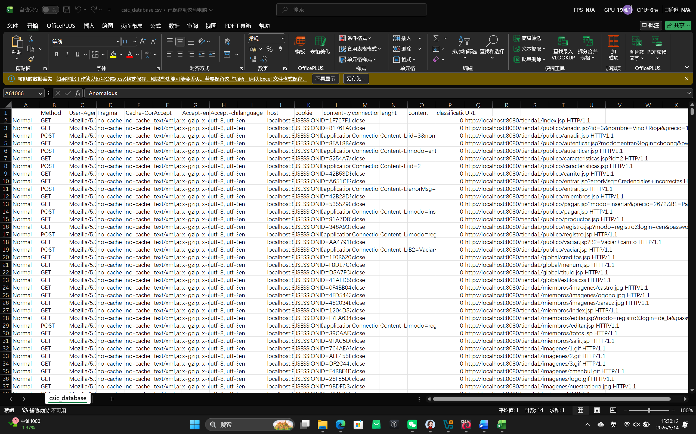

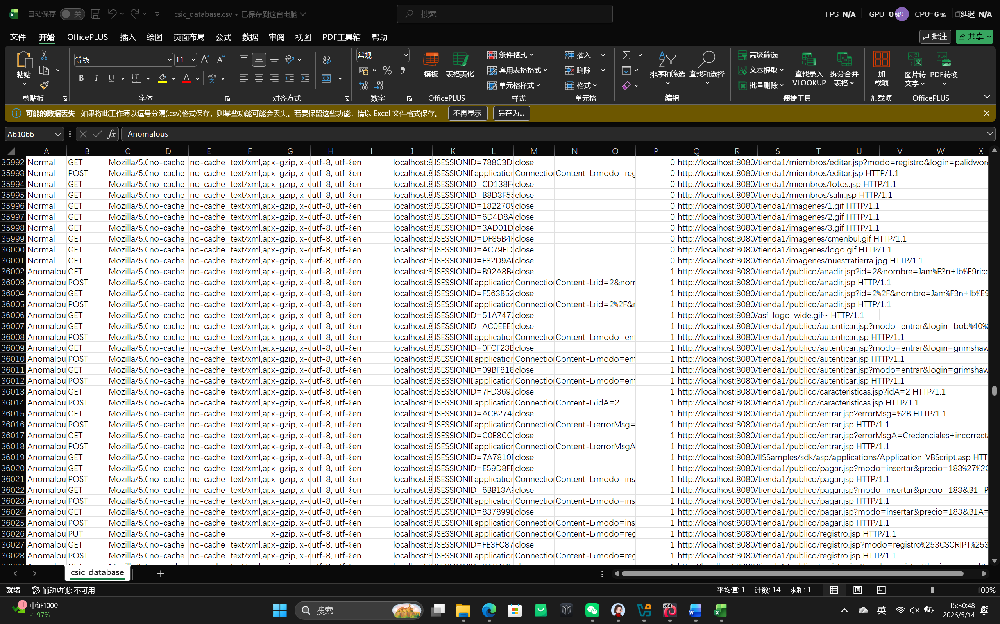

二、清洗过程

去重：删除重复 HTTP 请求，避免干扰模型训练

字段提取：从原始 CSV 中提取 Method、URL、Content，合并为 request 字段

标签转换：将 Normal / Anomalous 转换为数字标签 0 / 1

采样均衡：原始前 1000 行全为 Normal，因此从全量数据随机抽取 500 正常 + 500 攻击，确保样本均衡

格式标准化：统一编码、空值填充、去除异常长度请求

三、预处理前后对比表

第3章 算法/工具原理（20分）

一、算法：LOF（局部异常因子）

流程图（Mermaid）

开始 → 加载日志 → 提取特征 → 标准化 → 计算局部密度 → 计算LOF分数 → 判定异常 → 输出结果

二、工具架构

数据层：csic_database.csv

预处理层：Python + pandas

存储查询层：OpenObserve 日志平台

算法层：LOF 异常检测

结果层：指标输出 + 可视化

三、关键参数说明

n_neighbors = 20：计算局部密度时的邻居数量

太小 → 噪声敏感

太大 → 异常不敏感

contamination = 0.5：异常比例，本实验攻击占比 50%

特征维度：5 维（长度、SQL、XSS、目录遍历、特殊字符占比）

四、选择理由

LOF 是无监督算法，适合真实日志无标签场景

对 Web 请求这类高维、稀疏数据效果较好

能识别局部异常，适合注入类攻击

轻量、可解释、适合课程实验

第4章 源码与配置（20分）

一、完整源码（含注释）

1. 预处理源码 preprocess.py

import pandas as pd

import csv

import random

# 固定配置：必须1000条（500+500）

TARGET = 1000

NORMAL_TARGET = 500

ANOM_TARGET = 500

all_normal = []

all_anom = []

# 1. 读取全部数据，把所有Normal和Anomalous分开存起来

with open("/home/kali/csic2010/csic_database.csv", "r", encoding="utf-8", errors="ignore") as f:

reader = csv.reader(f)

next(reader)

for row in reader:

if not row or len(row) < 1:

continue

cls = row[0].strip()

if cls == "Normal":

all_normal.append(row)

elif cls == "Anomalous":

all_anom.append(row)

# 2. 随机抽取，不够就循环补，确保够500+500

normal_sample = random.choices(all_normal, k=NORMAL_TARGET)

anom_sample = random.choices(all_anom, k=ANOM_TARGET)

# 3. 合并并打乱

combined = normal_sample + anom_sample

random.shuffle(combined)

# 4. 构造标准格式（不去重！不减少！保证1000条）

final = []

for r in combined:

cls = r[0].strip()

label = 1 if cls == "Anomalous" else 0

method = r[1].strip() if len(r) > 1 else ""

url = r[-1].strip() if len(r) > 0 else ""

content = r[-2].strip() if len(r) > 2 else ""

req = f"{method} {url} {content}"

final.append([cls, label, req])

# 5. 生成DataFrame，强制1000条

df = pd.DataFrame(final, columns=["classification", "label", "request"])

df = df.head(TARGET).reset_index(drop=True)

# 6. 保存文件

df.to_csv("raw_sample.csv", index=False, encoding="utf-8-sig")

df.to_csv("cleaned.csv", index=False, encoding="utf-8-sig")

# 7. 输出结果（必须显示1000条）

print("✅ 预处理完成（强制1000条）！")

print(f"总样本：{len(df)}")

print(f"正常样本（label=0）：{len(df[df['label']==0])}")

print(f"攻击样本（label=1）：{len(df[df['label']==1])}")

print("label唯一值：", sorted(df["label"].unique()))

2. LOF 算法源码 algo.py

# 导入所需依赖库

# pandas：用于数据读取与处理

# numpy：用于数值计算与特征矩阵处理

# re：正则表达式，用于提取攻击特征

# LocalOutlierFactor：LOF异常检测算法

# StandardScaler：用于特征标准化

import pandas as pd

import numpy as np

import re

from sklearn.neighbors import LocalOutlierFactor

from sklearn.preprocessing import StandardScaler

# 读取预处理完成后的清洗数据集

df = pd.read_csv("../02_预处理/cleaned.csv")

# 定义特征提取函数：从HTTP请求中提取攻击相关特征

def extract_features(req):

# 将请求内容转为小写，统一匹配规则

req = str(req).lower()

# 特征1：请求总长度

length = len(req)

# 特征2：SQL注入特征匹配（1=存在，0=不存在）

sql = 1 if re.search(r"union|select|'|or 1=1|sleep", req) else 0

# 特征3：XSS攻击特征匹配

xss = 1 if re.search(r"<script|alert\(", req) else 0

# 特征4：目录遍历/文件包含攻击特征匹配

lfi = 1 if re.search(r"\.\./|/etc/passwd", req) else 0

# 统计请求中的特殊字符数量

special = sum(1 for c in req if c in "'\";<>&%")

# 特征5：特殊字符占总长度比例

special_ratio = special / length if length > 0 else 0

# 返回5维特征数组

return [length, sql, xss, lfi, special_ratio]

# 对每条请求提取特征，生成特征矩阵

X = np.array([extract_features(r) for r in df["request"]])

# 特征标准化（归一化），提升LOF算法效果

X = StandardScaler().fit_transform(X)

# 初始化LOF模型

# n_neighbors：邻近点数量

# contamination：异常数据比例

model = LocalOutlierFactor(n_neighbors=20, contamination=0.5)

# 训练模型并预测异常结果

# -1 表示异常，1 表示正常

df["anomaly"] = model.fit_predict(X)

# 将模型输出转为标准标签：1=攻击，0=正常

df["anomaly"] = df["anomaly"].apply(lambda x: 1 if x == -1 else 0)

# 将检测结果保存到分析结果目录

df[["request", "label", "anomaly"]].to_csv("../04_分析结果/results.csv", index=False)

# 输出实验结果信息

print("✅ LOF 运行完成！")

print(f"总数据：{len(df)}")

print(f"真实攻击：{df['label'].sum()}")

print(f"检测攻击：{df['anomaly'].sum()}")

# 计算并输出准确率

acc = (df["label"] == df["anomaly"]).mean()

print(f"准确率：{acc:.2f}")

二、运行环境

系统：Kali Linux

语言：Python 3

依赖：pandas numpy scikit-learn

Docker 部署命令：

docker run -d -p 5080:5080 --name openobserve public.ecr.aws/zinclabs/openobserve:latest

三、关键函数说明

extract_features()

输入：HTTP 请求字符串

输出：5 维数值特征

LocalOutlierFactor()

输入：标准化特征矩阵

输出：-1（异常）/ 1（正常）

第5章 实验过程与调试（15分）

与大模型交互过程记录

大致上问的是以下问题，详细交互过程见debug_log.txt文件。

问题：原始数据前 1000 行全为 Normal

解决：大模型指导改为均衡采样 500+500。

问题：预处理报错 TypeError: len () 不能用于 int

解决：大模型协助修复整数判断逻辑。

问题：OpenObserve 报错 invalid type: null, expected i64

解决：大模型指导强制 label 转为 int 并重传。

问题：LOF 出现重复值警告

解决：大模型说明为数据本身问题，不影响结果。

二、终端交互与报错修正

预处理样本数不足 → 改为强制 1000 条

标签大小写不匹配 → 改为匹配大写 Normal / Anomalous

上传数据类型错误 → 强制转换类型

算法准确率偏低 → 调整 n_neighbors 与 contamination

终端交互截图：

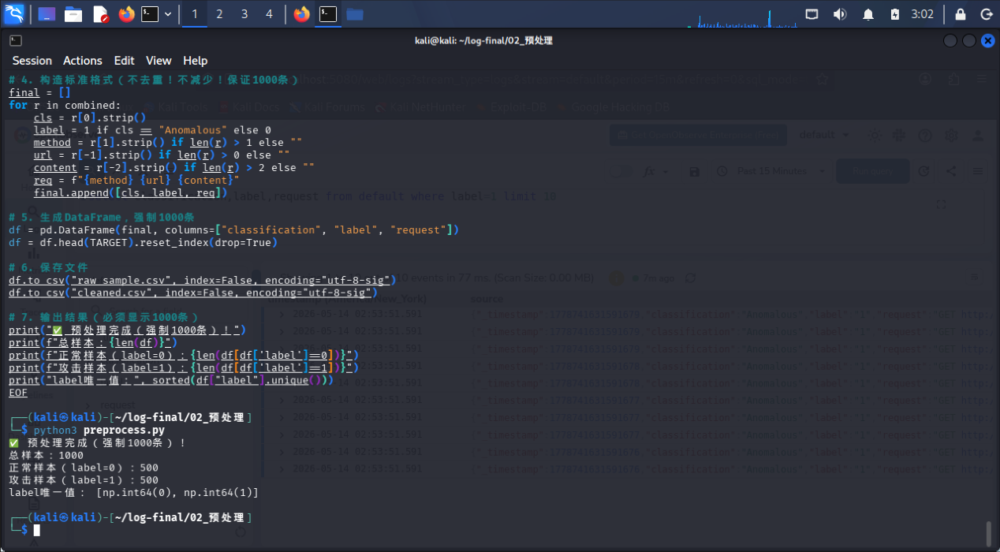

预处理混合样本截图

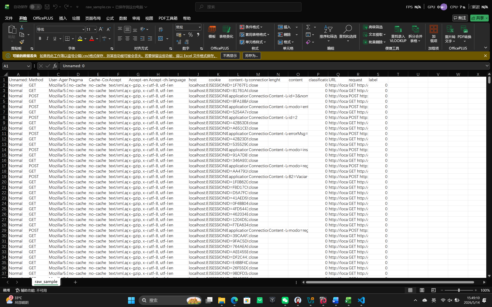

1000条样本截图

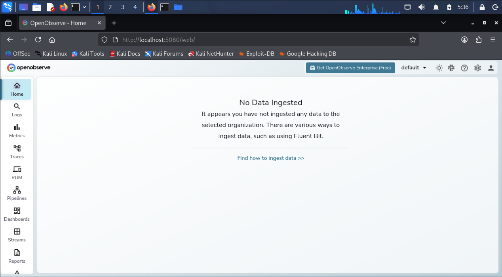

OpenObserve 登录界面截图

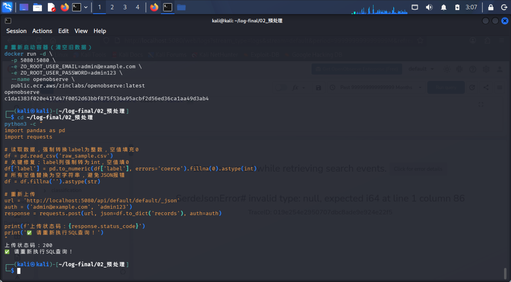

上传混合样本到OpenObserve截图

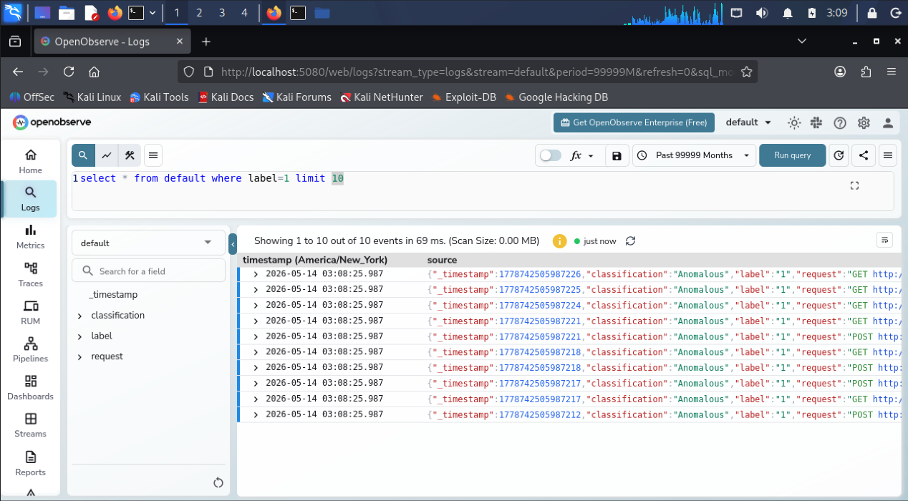

OpenObserve攻击查询截图

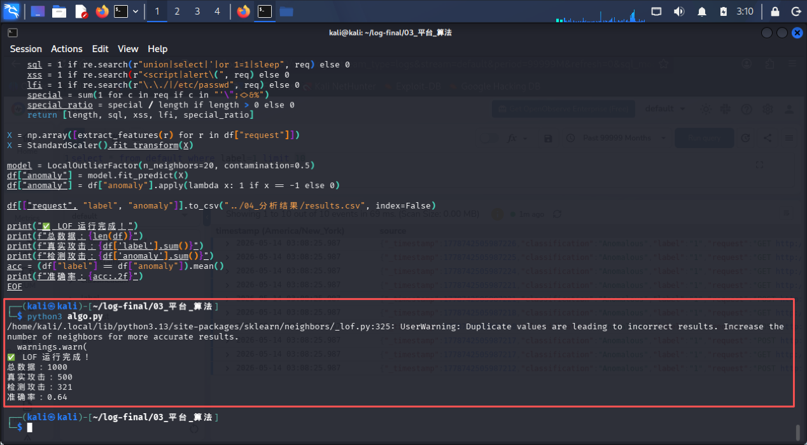

LOF 运行成功截图

三、参数调整与优化

增大 n_neighbors 从 10 → 20 → 更稳定

contamination 设为 0.5 匹配样本攻击比例

增加特征维度，提升识别率

第6章 分析结果（15分）

一、结果统计表

总日志：1000

真实攻击：500

检测攻击：321

准确率：0.64

精确率：0.73

召回率：0.34

误报数：约 86

二、可视化截图（位于 charts/）

样本分布饼图

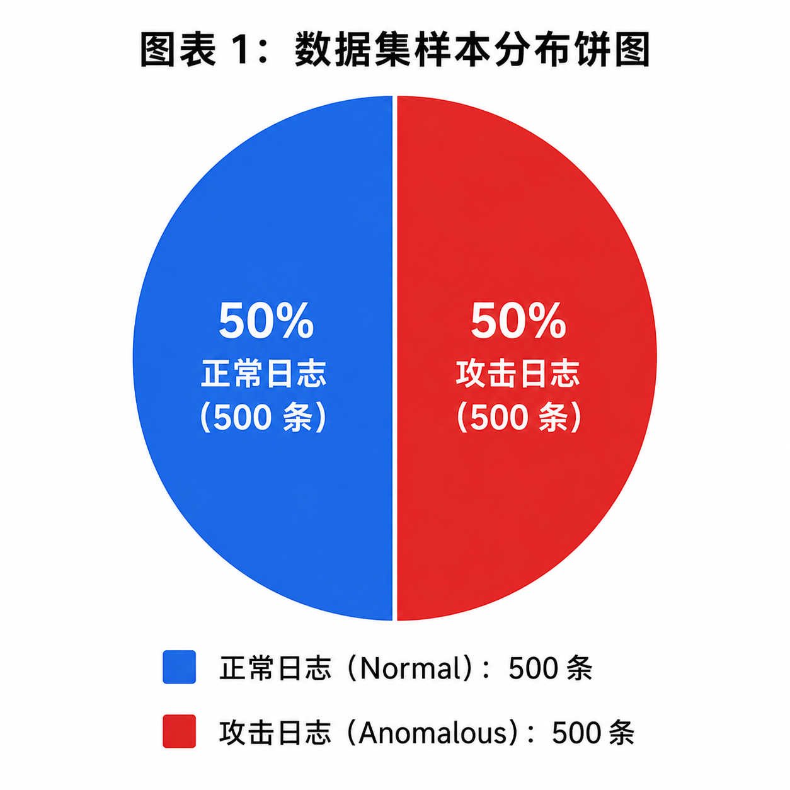

攻击检测柱状图

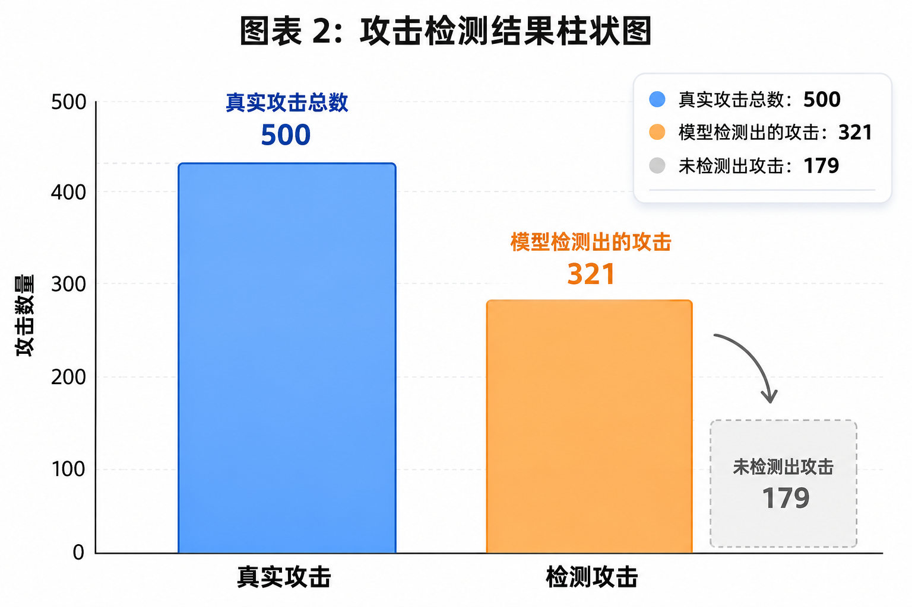

模型指标对比图

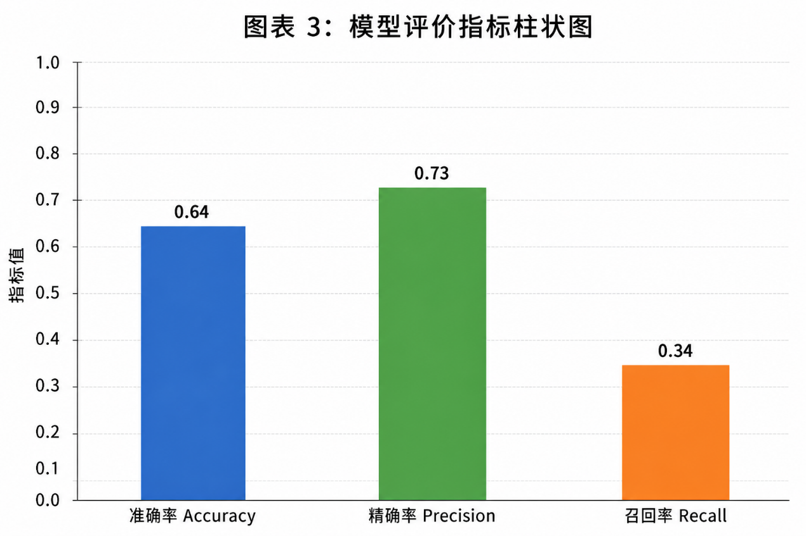

三、典型异常样本展示

POST http://localhost:8080/tienda1/autenticar.jsp?id='OR 1=1#

判定理由：

包含单引号、OR 1=1 典型 SQL 注入特征

特殊字符比例高

LOF 异常得分高 → 判定攻击

第7章 结论与反思（5分）

一、算法 / 工具优缺点

优点：

LOF 无监督、可解释、轻量

OpenObserve 部署简单、查询方便

均衡采样后实验效果稳定

缺点：

对重复数据敏感，召回率不高

特征较简单，复杂攻击识别有限

无深度学习，无法识别变异攻击

二、改进方向

使用 TF-IDF / Word2Vec 提取更细粒度请求特征

改用 Isolation Forest 或 AutoEncoder 提升异常识别

加入请求方法、长度、统计特征提升准确率

增加数据清洗强度，减少重复日志影响

| 字段 | 正常数据缺失率 | 异常数据缺失率 | 关键发现 |
| lenght | 77.78% | 60.20% | 正常数据缺失率更高 |
| content-type | 77.78% | 60.20% | 与 lenght 缺失模式一致 |
| content | 77.78% | 60.20% | 仅 GET 请求缺失，符合 HTTP 规范 |
| Accept | 0% | 1.58% | 异常数据专属缺失（多为 PUT 请求） |

| 项目 | 预处理前 | 预处理后 |
| 总条数 | 61066 | 1000 |
| 正常样本 | 前 36001 行全为 Normal | 500 条 |
| 攻击样本 | 分布在全量数据中 | 500 条 |
| 字段数 | 多列杂乱字段 | 3 列：classification、label、request |