# 实验目的

掌握 DVWA 靶机的部署与基本配置方法，包括 LAMP 环境搭建、DVWA 安装及安全级别设置。

熟悉常见 Web 漏洞的识别与扫描技术，通过工具（如 Nikto、Dirb、Nmap）发现配置缺陷与潜在风险。

理解并实践基础 Web 防护措施，通过 Apache 安全配置（如禁用目录浏览、设置安全响应头）提升系统防护能力。

# 实验原理

Web 漏洞靶场原理：DVWA（Damn Vulnerable Web Application）是一个故意设计存在多种常见 Web 安全漏洞的 PHP/MySQL 应用程序，旨在为安全研究人员、开发人员和学生提供一个合法、可控的渗透测试与防护学习环境。其核心原理包括：

漏洞模拟机制：DVWA 通过不同安全级别的代码实现（如 low、medium、high、impossible），展示同一功能在不同防护措施下的安全性差异，帮助理解输入验证、输出编码、会话管理等安全控制的重要性。

典型漏洞覆盖：包含 SQL 注入、跨站脚本（XSS）、文件包含（LFI/RFI）、命令执行、CSRF、暴力破解等 OWASP Top 10 中的常见漏洞。

扫描与防护对抗：通过漏洞扫描工具（如 Nikto、Dirb、Nmap）可自动发现配置缺陷与潜在风险；而通过 Web 服务器（Apache）安全配置、目录权限控制、响应头加固等手段，可有效缓解部分风险，体现“纵深防御”思想。

信息泄露风险：不当的目录权限、敏感文件暴露（如 config.inc.php、php.ini）会直接导致攻击者获取数据库凭证或系统配置，是 Web 安全的基础防线。

本实验通过“搭建 → 扫描 → 分析 → 修复”的闭环流程，帮助学生建立从攻击视角发现漏洞、从防御视角实施加固的完整安全思维。

# 实验内容与步骤

## 环境准备与DVWA搭建

关于DVWA

Damn Vulnerable Web Application (DVWA)(译注：可以直译为："该死的"不安全Web应用程序)，是一个编码差的、易受攻击的 PHP/MySQL Web应用程序。 它的主要目的是帮助信息安全专业人员在合法的环境中，练习技能和测试工具，帮助 Web 开发人员更好地了解如何加强 Web 应用程序的安全性，并帮助学生和教师在可控的教学环境中了解和学习 Web 安全技术。

DVWA的目的是通过简单明了的界面来练习一些最常见的 Web 漏洞，所练习的漏洞具有不同的难度级别。 请注意，此软件存在提示和无提示的漏洞。 这是特意为之。 依靠自己的能力尝试并发现尽可能多的安全问题。

步骤1：Kali Linux环境检查

# bash 检查系统版本

cat /etc/os-release

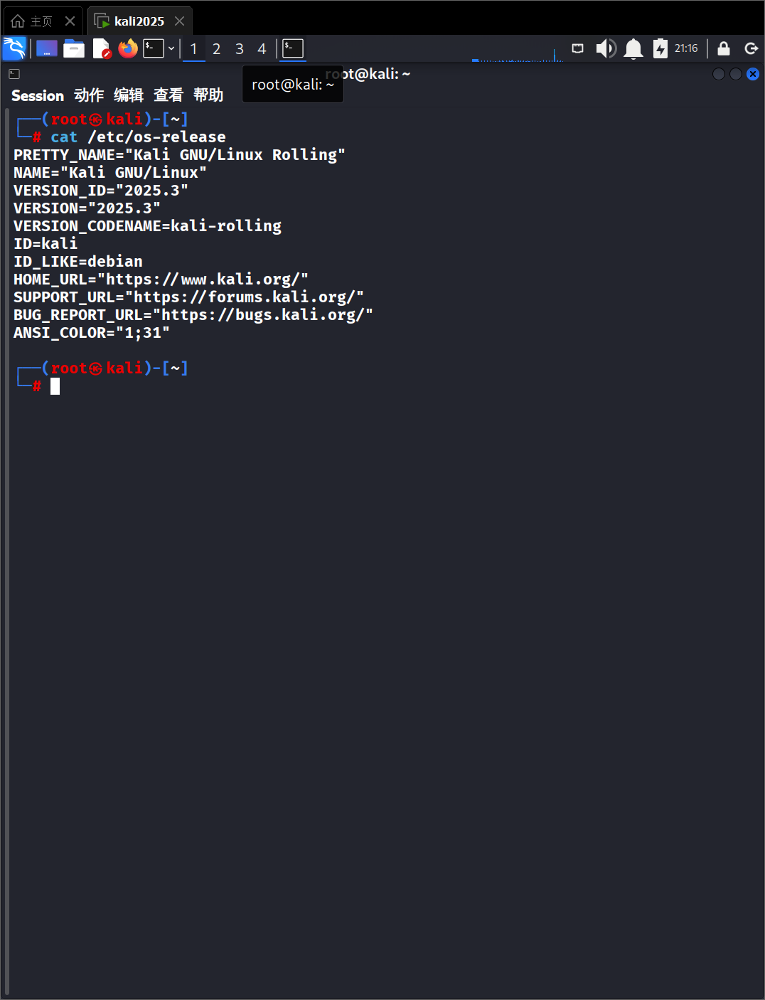

# 更新系统包

sudo apt update && sudo apt upgrade -y

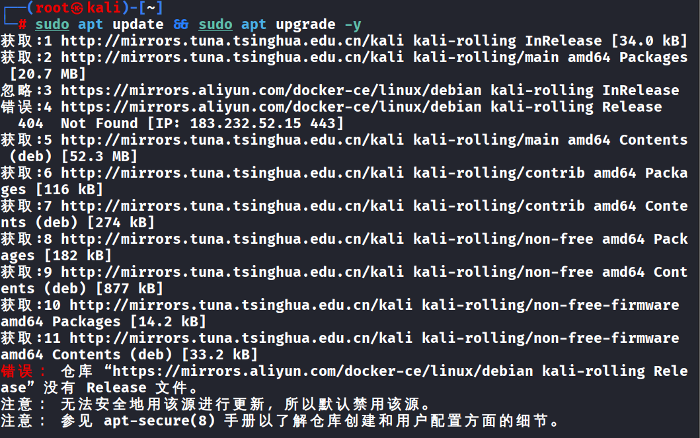

# 检查必要服务状态

sudo systemctl status apache2

sudo systemctl status mysql

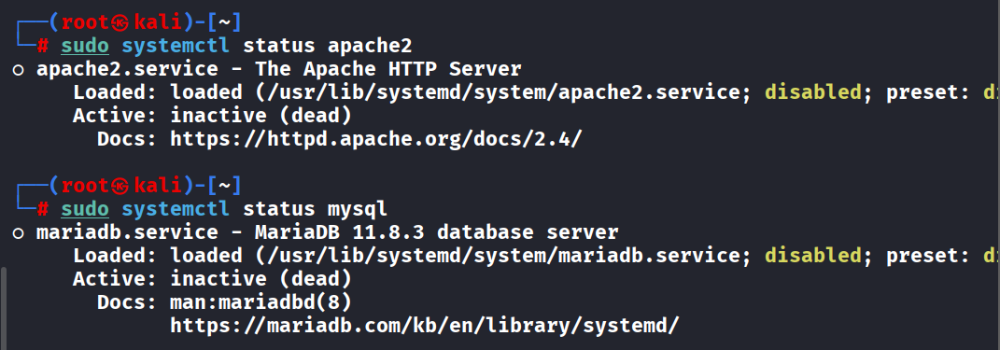

步骤2：安装必要组件

# 安装LAMP环境，LAMP 的核心是 “Web 服务器（Apache）+ 数据库（MariaDB/MySQL）+ 脚本解释器（PHP）”。Kali Linux 从 2020 年起默认用 MariaDB（MySQL 的分支，兼容 MySQL 命令）

sudo apt install -y apache2 mysql-server php php-mysql libapache2-mod-php php-gd php-curl

# 安装PHP扩展

sudo apt install -y php-mbstring php-xml

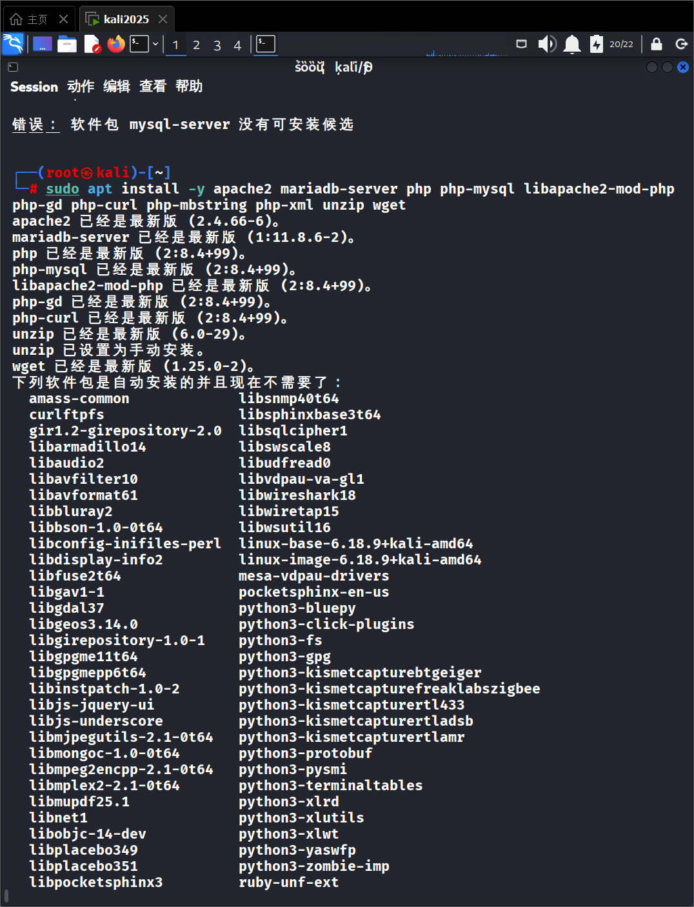

步骤3：配置数据库

# 启动MySQL服务

sudo systemctl start mysql

sudo systemctl enable mysql

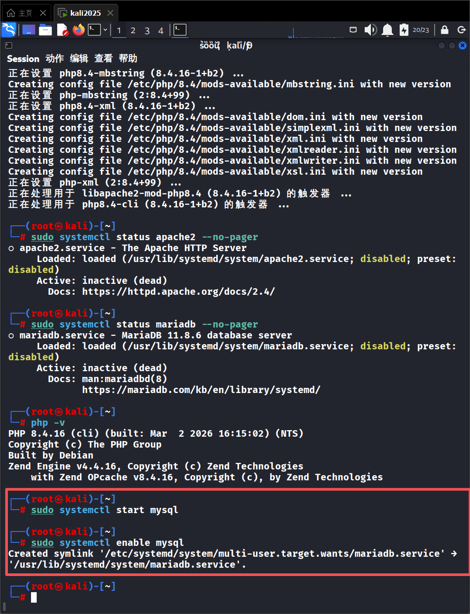

# 安全配置MySQL（可选）

sudo mysql_secure_installation

# 创建DVWA数据库

sudo mysql -u root -p

# 在MySQL提示符下执行：

CREATE DATABASE dvwa;

CREATE USER 'dvwa'@'localhost' IDENTIFIED BY 'p@ssw0rd';

GRANT ALL PRIVILEGES ON dvwa.* TO 'dvwa'@'localhost';

FLUSH PRIVILEGES;

exit;

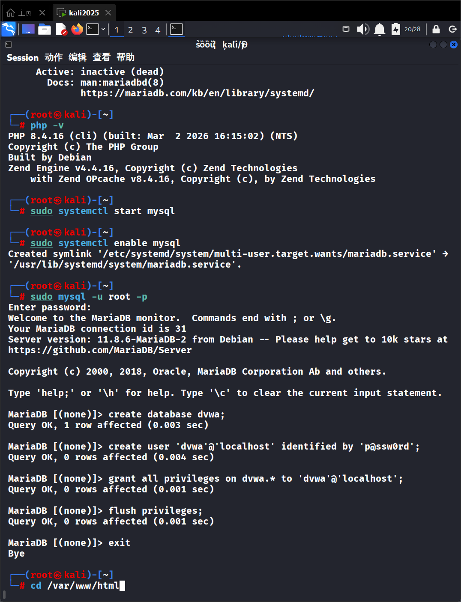

步骤4：下载和配置DVWA

# 进入网站根目录

cd /var/www/html/

# 下载DVWA压缩包

sudo wget https://github.com/digininja/DVWA/archive/master.zip

# 解压压缩包（若未安装unzip，先执行sudo apt install unzip -y）

sudo unzip master.zip

# 重命名文件夹方便访问

sudo mv DVWA-master dvwa

# 设置权限，更改dvwa文件夹的所有者和组用户为www-data，www-data 是 Apache2（以及 Nginx 等 Web 服务器）在 Debian/Ubuntu/Kali 等 Debian 系 Linux 发行版中默认使用的系统用户。

sudo chown -R www-data:www-data dvwa

# r（读）= 4，w（写）= 2，x（执行）= 1，-（无权限）= 0，755分别对应所有者，组用户和其他用户。

sudo chmod -R 755 dvwa

# 进入配置目录，复制配置文件

cd dvwa/config

sudo cp config.inc.php.dist config.inc.php

# 编辑配置文件

sudo nano config.inc.php

# 修改以下配置

$_DVWA[ 'db_server'] = '127.0.0.1';

$_DVWA[ 'db_user' ] = 'dvwa';

$_DVWA[ 'db_database' ] = 'dvwa';

$_DVWA[ 'db_password' ] = 'p@ssw0rd';

$_DVWA[ 'db_port'] = '3306';

修改后按Ctlr+O保存修改，按Ctrl+X退出编辑文件回到终端。

步骤5：修改PHP配置

# 允许URL包含

sudo nano /etc/php/8.4/apache2/php.ini

通过 php -v 或 ls /etc/php/ 确认版本，确定php.ini的准确位置。

# 找到并修改：

# allow_url_fopen = On  -允许包含远程文件 (RFI) [启用url-include]

# allow_url_include = On -允许远程访问（就是请求http） (RFI) [启用url-fopen]

# 重启Apache

sudo systemctl restart apache2

步骤6：完成安装

打开浏览器访问：http://localhost/dvwa

打开dvwa网站后，选择左侧边栏的“DVWA  Security”将 Security Level 调至 “low”，然后点击“Submmit”按钮，以便进行漏洞利用实验。

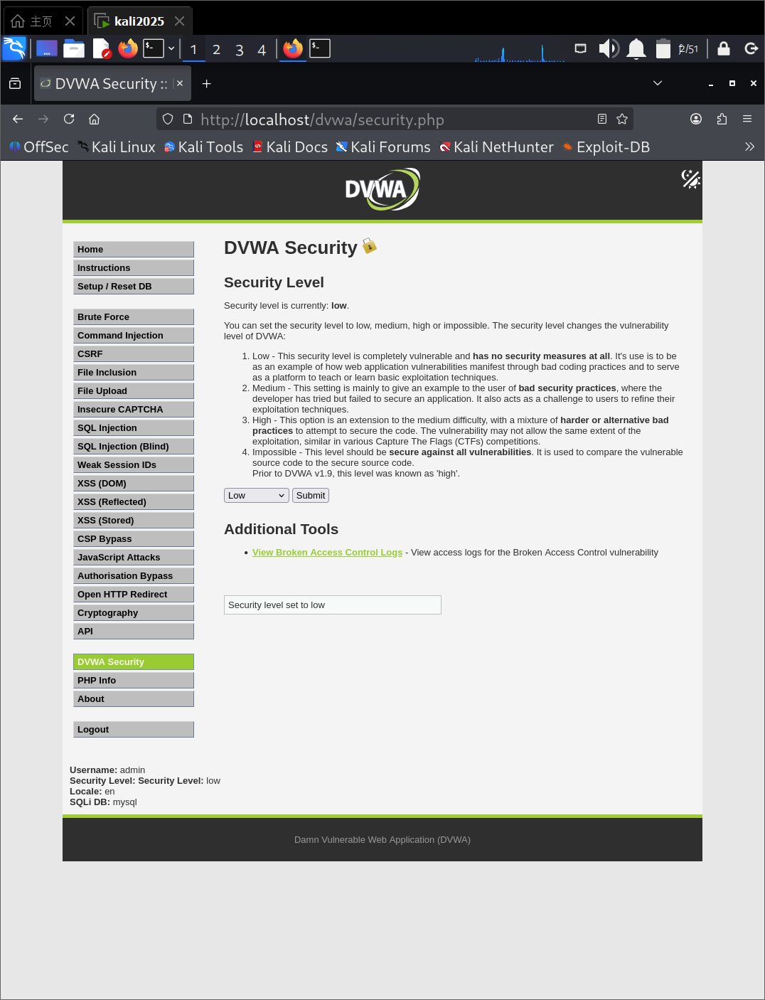

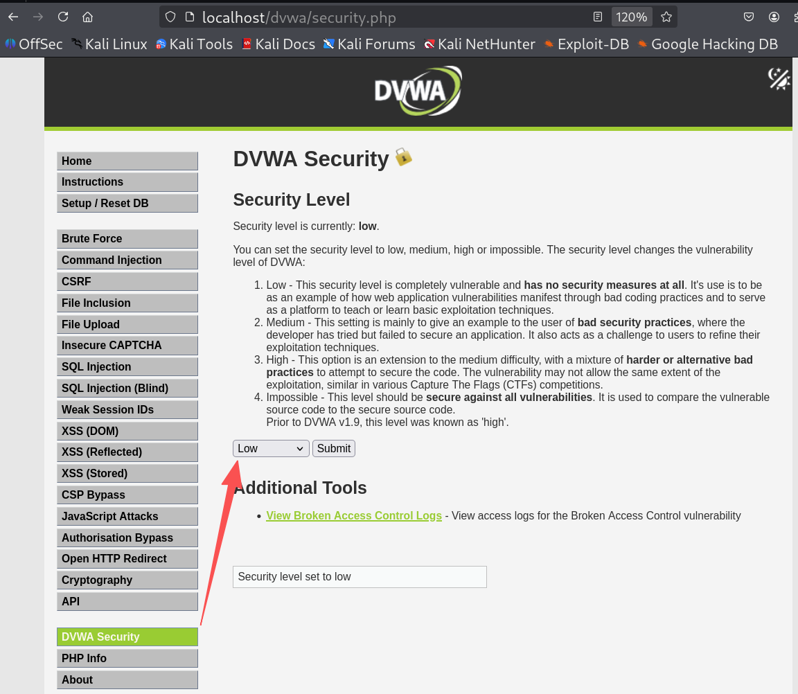

点击网站左侧栏的“Setup/Reset DB”，然后点击“Create / Reset Database”按钮在mysql中创建dvwa数据库。

使用默认登录凭证：admin/password

## 漏洞扫描与防护实践

任务1：信息收集

任务1.1 使用Nmap进行端口扫描

Nmap（Network Mapper）是一款开源、功能强大且广泛使用的网络发现与安全审计工具，由 Gordon Lyon（Fyodor）开发。它不仅用于端口扫描，还支持操作系统识别、服务版本探测、漏洞检测、网络映射等多种高级功能。

bash

nmap -sS -sV -O localhost

参数说明：

-sS：SYN 扫描（半开放扫描），用于探测开放端口。

-sV：版本检测，尝试识别服务版本信息。

-O：操作系统指纹识别，判断目标主机的操作系统类型。

扫描结果如图所示。

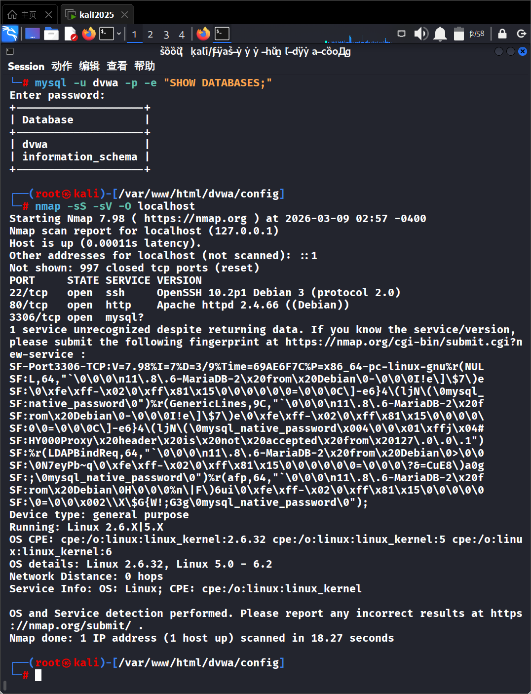

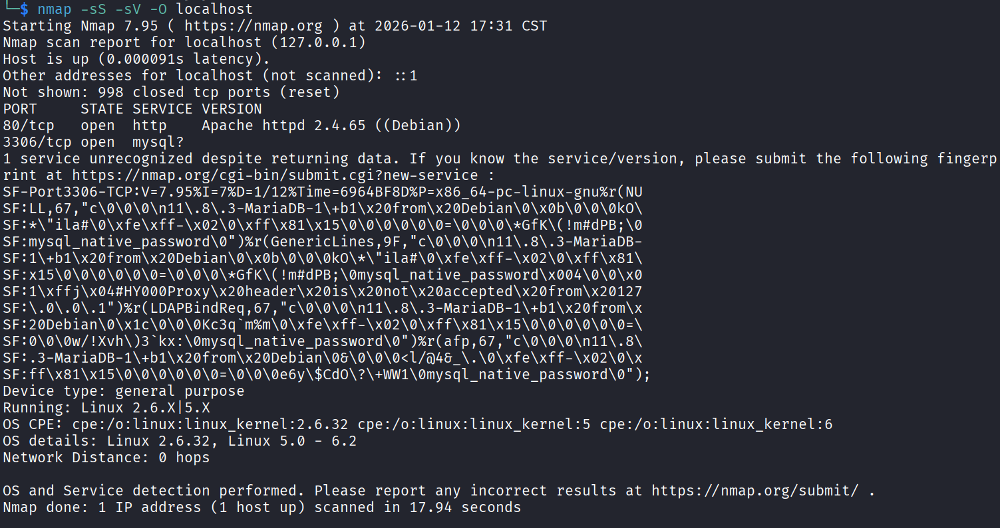

扫描结果解析：

目标主机信息

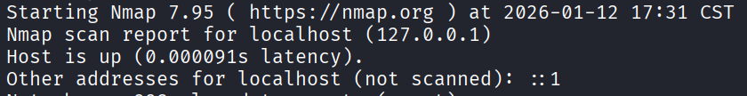

扫描对象为本地主机 localhost（IP：127.0.0.1）。

主机处于在线状态，响应延迟极低（约 91 微秒），说明是本地回环测试。

端口与服务信息

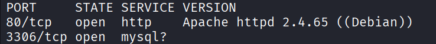

端口 80（HTTP）

状态：开放（open）

服务：Apache HTTP Server 2.4.65（运行在 Debian 系统上）

含义：

Web 服务器正在运行，可通过浏览器访问 http://localhost。

版本号 2.4.65 是较新版本，通常已修复常见漏洞，但仍需关注配置安全（如目录浏览、敏感文件暴露等）。

端口 3306（MySQL）

状态：开放（open）

服务：MySQL（但未识别出具体版本，显示为 mysql?）

含义：

MySQL 数据库服务正在运行，且监听在本地端口。

由于是本地连接，攻击者无法从外网直接访问，但若存在弱密码或远程访问配置，则仍存在风险。

mysql? 表示 Nmap 未能成功获取版本信息，可能是防火墙限制、服务无响应或返回数据不完整。

可使用 nmap --script=banner 或 telnet localhost 3306 进一步确认 MySQL 版本。

使用nmap --script=banner 127.0.0.1查看mysql版本。

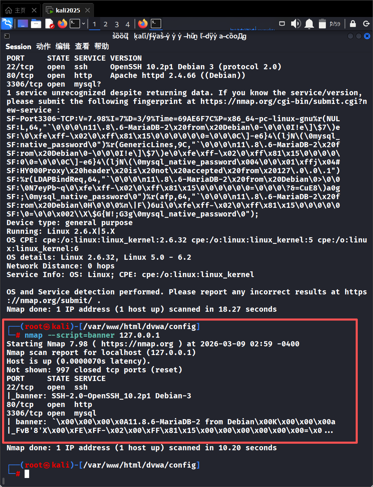

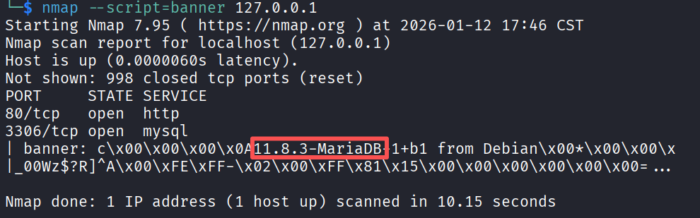

使用telnet localhost 3306查看mysql版本。

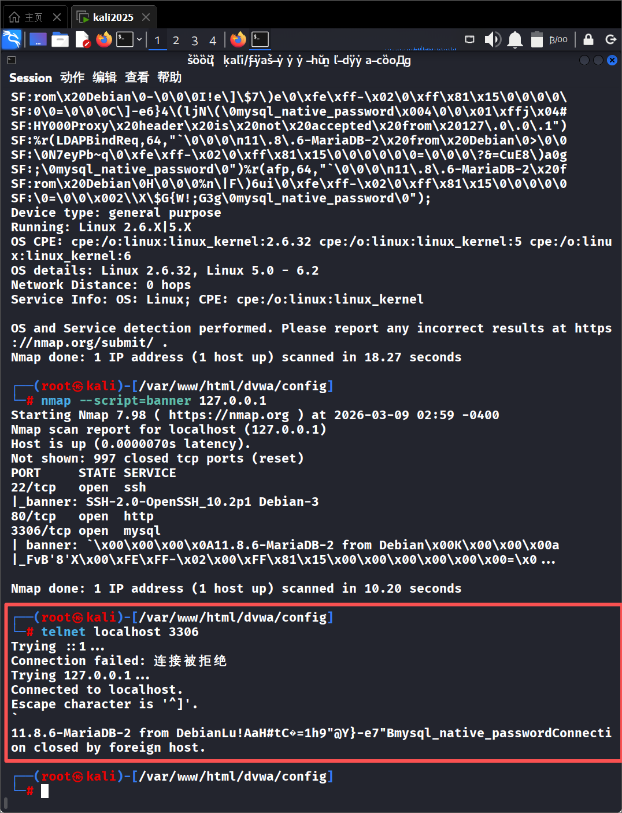

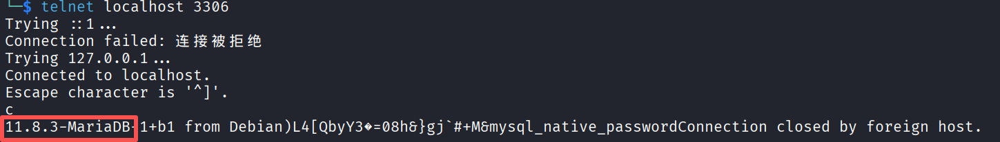

可知，数据库类型：MariaDB（MySQL 的开源分支），版本号：11.8.3。

尝试nmap的其它选项，查看不同的输出结果。

任务1.2 使用Nikto进行Web漏洞扫描

Nikto 是一款开源、功能强大的 Web 服务器漏洞扫描器，由 Chris Sullo 开发，基于 Perl 编写，遵循 GPL 协议。它专注于自动检测 Web 服务器和 Web 应用中的安全配置错误、过时软件、危险文件及已知漏洞。

nikto -h http://localhost/dvwa

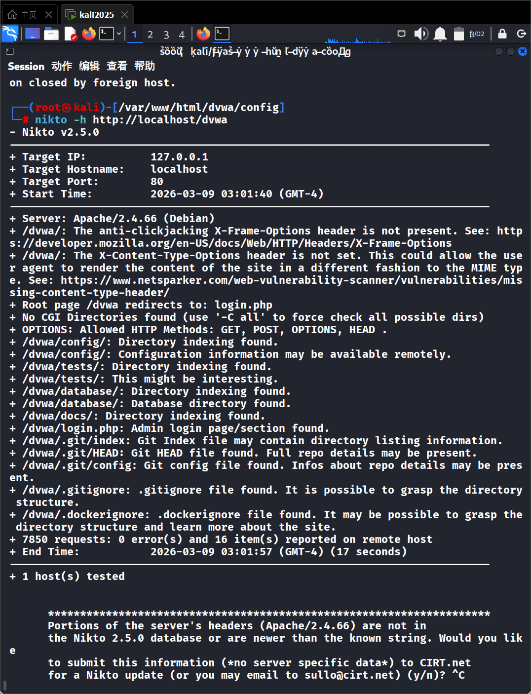

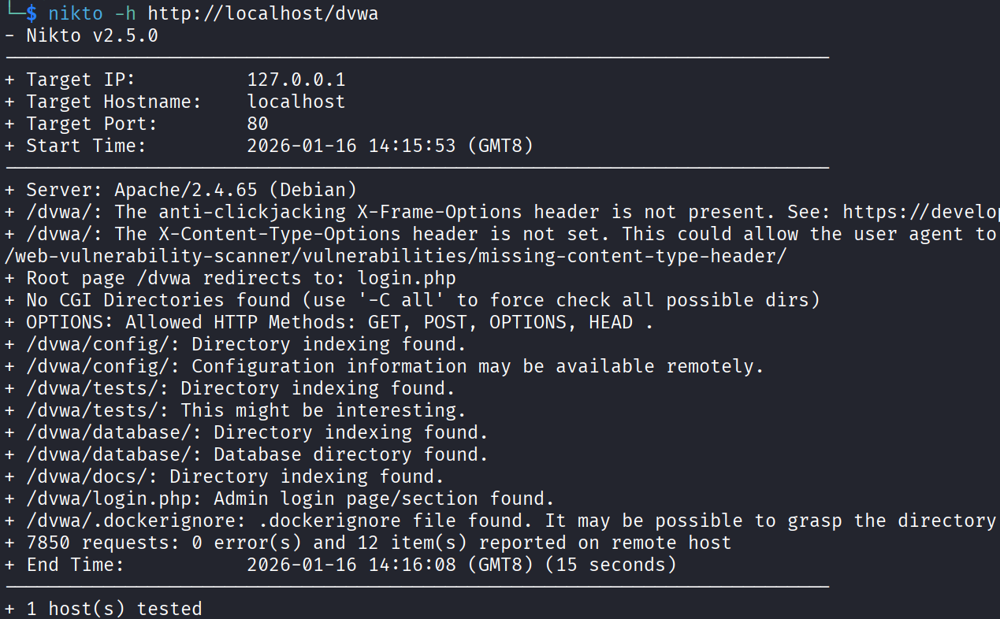

Nikto 扫描 DVWA 风险评估详情见下表：

其中的漏洞缺少 X-Frame-Options 安全头，可能导致点击劫持（Clickjacking）攻击。攻击者可将网页嵌入到自己的 <iframe> 中，诱导用户在不知情的情况下执行操作（如点击按钮、提交表单等）。

而X-Content-Type-Options: nosniff 缺失，浏览器可能对响应内容进行 MIME 类型嗅探，导致非 HTML 文件（如上传的图片）被当作 HTML 执行，引发 XSS 攻击。

以上两项安全头缺失的修复建议：

使用sudo nano /etc/apache2/sites-available/000-default.conf 编辑Apache 虚拟主机配置，参照如下添加相应内容：

<VirtualHost *:80>

DocumentRoot /var/www/html/DVWA

<Directory "/var/www/html/DVWA">

AllowOverride All

Require all granted

</Directory>

# 安全头

Header always set X-Frame-Options "DENY"

Header always set X-Content-Type-Options "nosniff"

Header always set Content-Security-Policy "default-src 'self' 'unsafe-inline' 'unsafe-eval';"

</VirtualHost>

然后重启 Apache：

sudo systemctl restart apache2

再使用Nikto进行Web漏洞扫描，查看缺少 X-Frame-Options 响应头的错误是否还存在。

nikto -h http://localhost/dvwa

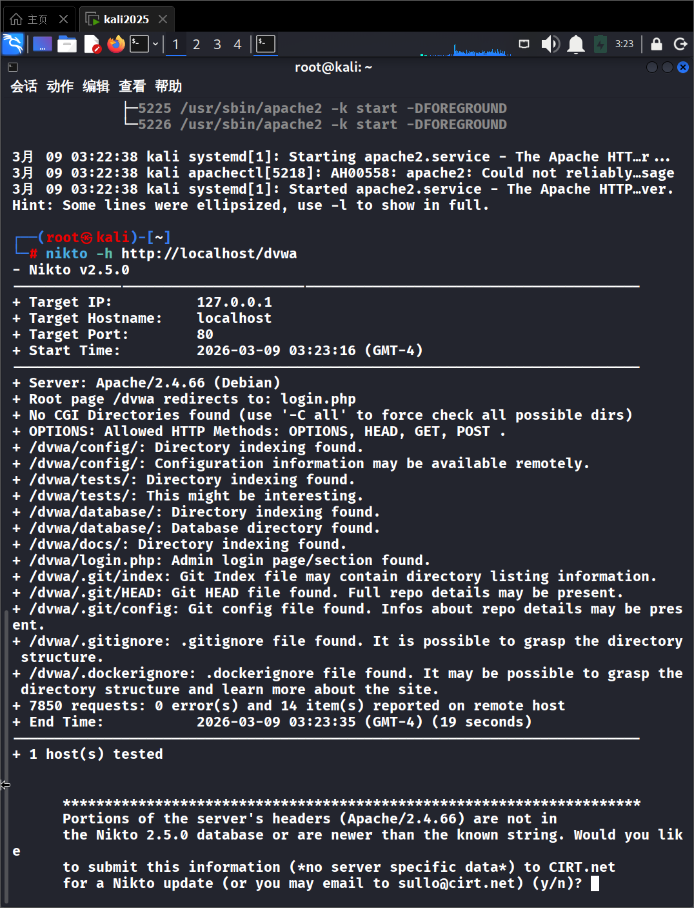

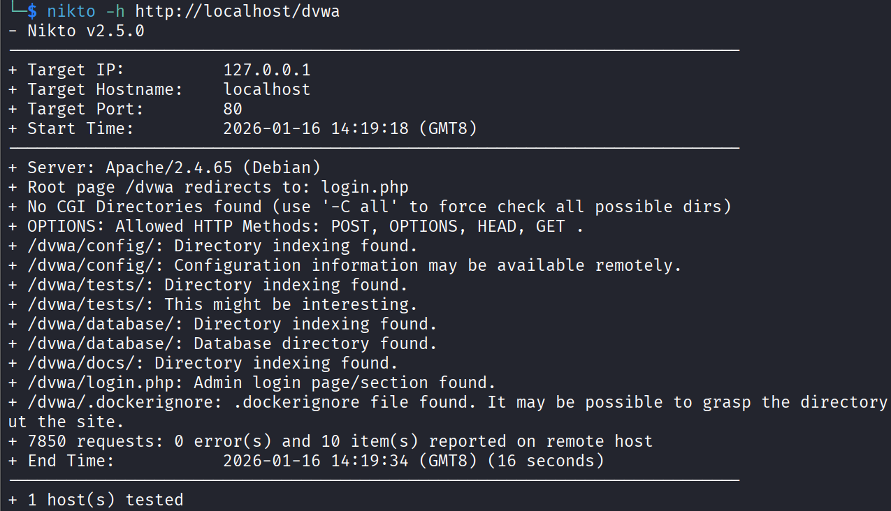

以上修改了Apache 的配置文件 /etc/apache2/sites-available/000-default.conf 后，成功修复了之前缺失的安全响应头问题（如 X-Frame-Options、X-Content-Type-Options）。

其余的漏洞如目录浏览（Directory Indexing）被启用、敏感目录和文件暴露，请完成其余漏洞的修复。

再次扫描，结果如下：

nikto -h http://localhost/dvwa

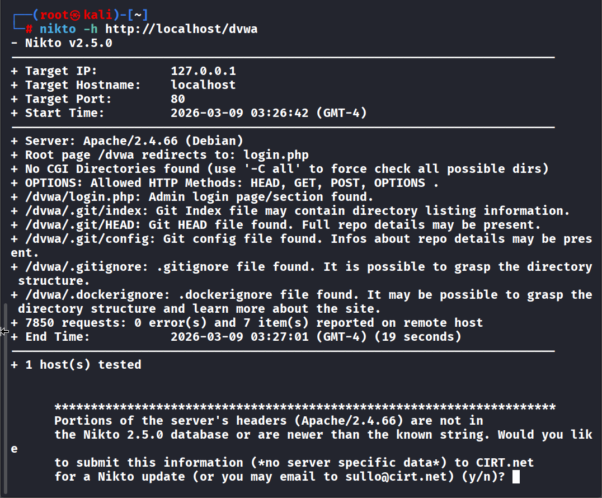

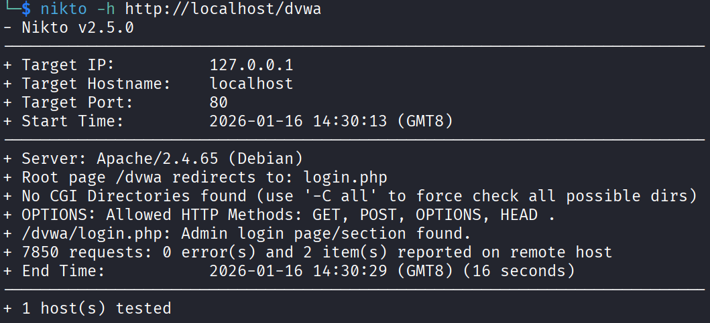

修复后，Nikto 应不再报告：

Directory indexing found

Configuration information may be available remotely

Database directory found

但仍可能提示：登录页面存在，这是正常现象。

任务1.3 使用Dirb进行目录枚举

dirb（Directory Bruteforcer）是一款开源的 Web 目录和文件暴力扫描工具，主要用于在渗透测试或安全审计中自动发现 Web 服务器上隐藏的、未链接的或未公开的目录与文件。

dirb http://localhost/dvwa

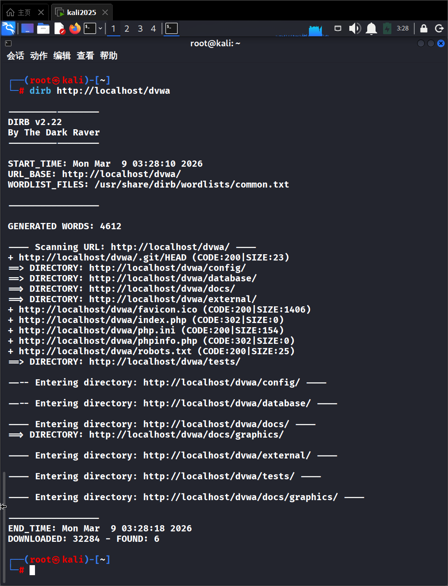

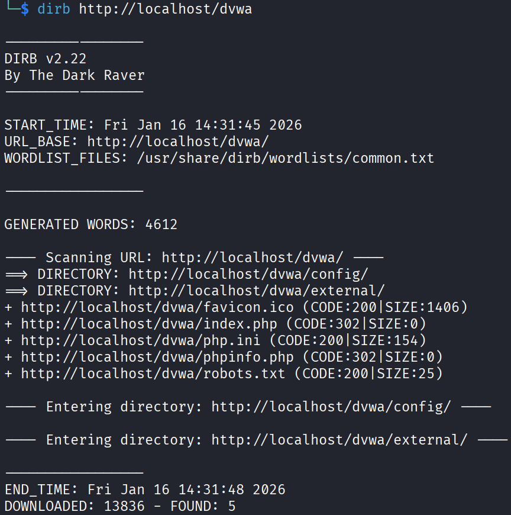

dirb 的核心判断依据是 HTTP 状态码，这几个是高频值：

200：请求成功（文件 / 目录存在且可访问）；

302：临时重定向（比如未登录跳登录页）；

404：不存在（dirb 默认不显示 404 结果）；

403：权限拒绝（目录 / 文件存在，但服务器禁止访问）。

从扫描结果可以看出，PHP配置文件php.ini 返回 200 ，客户端可直接访问该文件，属于敏感信息泄露风险；核心风险就是任何访问该 URL 的客户端（浏览器 / 爬虫 / 攻击者）都能直接读取这个 PHP 核心配置文件的内容，这在 Web 安全中属于典型的敏感信息泄露漏洞，DVWA 中出现此情况是刻意设计的演练场景，真实环境中必须禁止外部访问php.ini。使用浏览器访问http://localhost/dvwa/php.ini能够查看php.ini的内容。

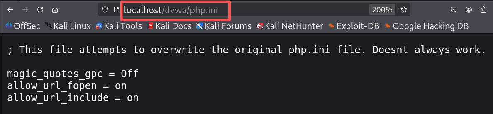

要禁止外部访问php.ini，修改Apache配置文件000-default.conf。通过 Apache 配置文件限制特定文件访问：使用nano修改sudo nano /etc/apache2/sites-available/ 000-default.conf 中添加：

<Directory "/var/www/html/dvwa">

<Files "php.ini">

Require all denied

</Files>

<Directory

修改了Apache配置文件000-default.conf之后，再用dirb扫描，可以看到php.ini的状态码为403，禁止访问。

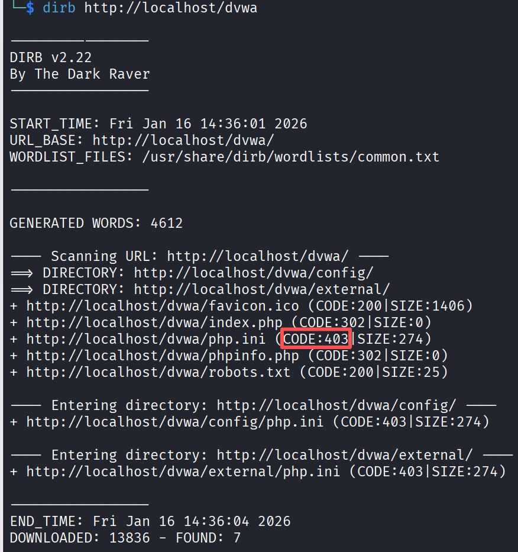

通过以上的修改配置，php.ini的状态码为403，表示服务器禁止访问。再次使用浏览器访问http://localhost/dvwa/php.ini还能发现能够访问php.ini的内容，是刚才的设置无效吗？不是。浏览器还能访问php.ini，其实是访问了浏览器缓存中的内容。

需要清除Firefox的缓存，点击Firefox菜单中的HIstory，选择Clear resent history...菜单，选中History复选框，点击Clear按钮，如图所示。在浏览器中再次访问http://localhost/dvwa/php.ini，此时不能看到php.ini的内容。

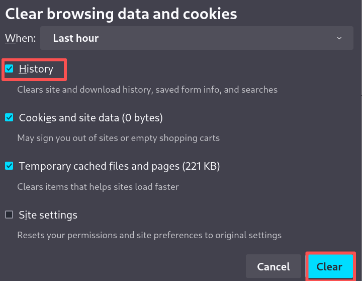

使用dirb http://localhost/dvwa扫描文件和目录的结果中，http://localhost/dvwa/robots.txt的状态码为200，在浏览器中能够robots.txt的内容，如下图所示。

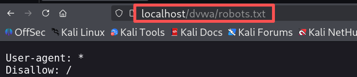

请进行相关设置，使得浏览器不能访问robots.txt。注意设置完成后应清除浏览器缓存然后再访问http://localhost/dvwa/robots.txt。设置正确后，访问http://localhost/dvwa/robots.txt应该出现信息“Forbidden”。

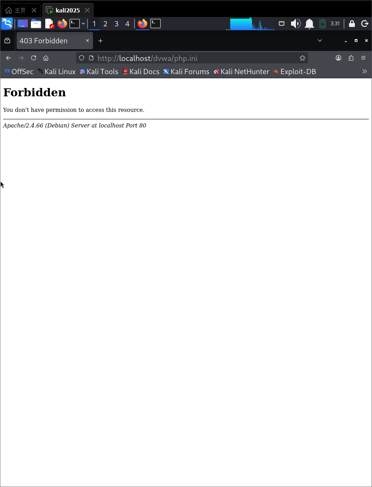

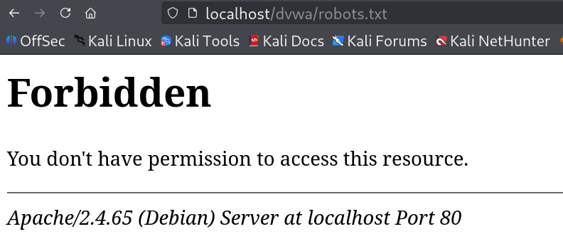

或是在kali终端使用curl命令连接，应返回HTTP的状态码为403，如下图所示。

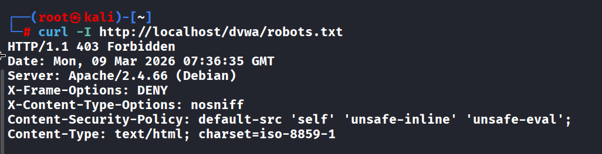

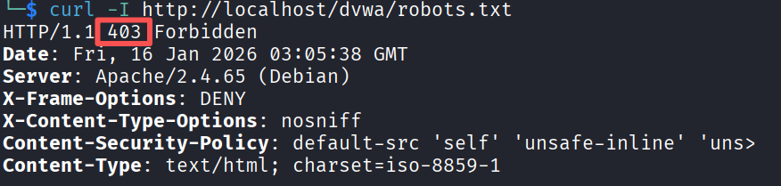

# 思考题

1、为什么在 DVWA 安装完成后，需要将安全级别（Security Level）调整为 “low”？这对漏洞扫描和利用有何影响？

将安全级别调整为"low"是为了暴露最完整的漏洞场景，便于学习和测试。影响：

代码层面：low级别的代码完全没有防护措施，如：

没有输入验证和过滤

没有参数化查询

没有输出编码

没有CSRF令牌

扫描和利用影响：

漏洞扫描工具能发现更多安全问题

漏洞利用更容易成功

便于理解漏洞原理和攻击手法

与medium/high级别形成对比，理解防护措施的作用

2、Nikto 扫描结果显示 “Directory indexing found”，这属于什么类型的安全风险？如何通过 Apache 配置彻底禁用目录浏览？

属于信息泄露（Information Disclosure）风险，具体是配置不当导致的安全隐患。

风险危害：

攻击者可以浏览目录结构

发现敏感文件（备份文件、配置文件、源码）

收集系统信息，为后续攻击做准备

可能暴露数据库备份、密码文件等

彻底禁用目录浏览的Apache配置：

# 方法1：在虚拟主机配置中

<Directory "/var/www/html/dvwa">

Options -Indexes

</Directory>

# 方法2：或使用.htaccess文件

echo "Options -Indexes" | sudo tee /var/www/html/dvwa/.htaccess

3、为什么禁止外部访问 php.ini 文件很重要？除了修改 Apache 配置，还有哪些更根本的解决方法？

php.ini 包含敏感的PHP配置信息，可能泄露：

数据库连接信息

文件路径信息

错误报告设置

禁用函数列表

扩展加载路径

会话配置信息

更根本的解决方法：

1. 将php.ini移出Web根目录

sudo mv /etc/php/8.4/apache2/php.ini /etc/php/8.4/apache2/php.ini.bak

# 但通常php.ini本来就不在Web目录

2.设置严格的文件权限

sudo chmod 600 /etc/php/8.4/apache2/php.ini

sudo chown root:root /etc/php/8.4/apache2/php.ini

3.禁用PHP信息泄露

expose_php = Off

display_errors = Off

4.使用.htaccess保护

<Files "*.ini">

Order Allow,Deny

Deny from all

</Files>

4、在修复 X-Frame-Options 和 X-Content-Type-Options 后，Nikto 扫描结果项减少，但这是否意味着 DVWA 已“安全”？为什么？

不，DVWA仍然不安全。 修复安全头只是增强了部分防护，但：

仍然存在的风险：

应用层漏洞依然存在

SQL注入漏洞

XSS跨站脚本

文件包含漏洞

命令执行漏洞

CSRF跨站请求伪造

安全头的作用有限

X-Frame-Options：仅防止点击劫持

X-Content-Type-Options：仅防止MIME嗅探

无法防御代码级别的漏洞

安全是一个整体

需要代码安全、配置安全、运维安全等多层次防护

遵循"纵深防御"原则

安全头只是众多防护措施中的一层

5、dirb 扫描发现 /dvwa/phpinfo.php 返回 302 重定向，这说明了什么？如果该页面可被直接访问，会带来什么风险？

302重定向说明需要登录才能访问，这是一个身份验证保护机制。

说明：

页面需要身份验证

未登录用户被重定向到登录页面

这是正确的安全配置

如果可被直接访问的风险：

系统信息泄露

PHP版本和配置

服务器环境变量

文件系统路径

已加载的模块

漏洞利用辅助

帮助攻击者了解系统环境

发现已禁用的函数

找到可利用的扩展

定位敏感路径

具体泄露的信息

# phpinfo() 可能泄露：

$_SERVER['DOCUMENT_ROOT']    # Web根目录

$_SERVER['SCRIPT_FILENAME']  # 文件路径

extension_dir                # 扩展目录

include_path                 # 包含路径

memory_limit                 # 内存限制

disable_functions            # 禁用的函数

4.  最佳实践

# 生产环境应该：

# 1. 删除phpinfo.php文件

sudo rm /var/www/html/dvwa/phpinfo.php

# 2. 或在配置中禁止访问

<Files "phpinfo.php">

Require all denied

</Files>

| 风险类型 | 具体影响（ImpactDetails） | 危害 等级 | 核心发现摘要 |
| 信息泄露（Information Disclosure） | 攻击者可直接访问 /dvwa/config/ 目录，下载 config.inc.php 文件，其中明文包含 数据库用户名、密码、主机地址，导致数据库完全暴露。 | High | 配置目录开启目录浏览，敏感凭证文件可被未授权下载。 |
| 信息泄露（Information Disclosure） | /dvwa/database/ 目录可浏览，可能包含 SQL 脚本、备份文件（如 dvwa.sql），泄露数据库结构、初始数据或测试用例。 | Medium–High | 数据库相关目录暴露，辅助攻击者理解系统架构。 |
| 信息泄露（Information Disclosure） | /dvwa/tests/ 和 /dvwa/docs/ 目录开启索引，可能包含调试脚本、API 文档、单元测试代码，暴露内部逻辑或未公开接口。 | Medium | 开发/测试目录未保护，增加攻击面。 |
| 安全头缺失（Missing Security Headers） | 缺少 X-Frame-Options，允许页面被嵌入 <iframe>，可被用于 点击劫持（Clickjacking）：诱使用户在不知情下执行操作（如修改密码、删除账户）。 | Medium | 缺少防点击劫持头部，存在 UI 红ressing 风险。 |
| 安全头缺失（Missing Security Headers） | 缺少 X-Content-Type-Options: nosniff，浏览器可能对响应内容进行 MIME 嗅探，将非 HTML 内容（如上传的图片）当作 HTML 执行，触发 XSS。 | Medium | 缺少 MIME 类型保护，可能放大 XSS 漏洞影响。 |
| 敏感文件暴露（Sensitive File Exposure） | .dockerignore 文件可被访问，虽不直接泄露密钥，但可推断项目忽略的文件路径（如 .env, secrets/），辅助路径猜测攻击。 | Low | 隐藏文件暴露，提供项目结构线索。 |
| 管理入口识别（Admin Interface Exposure） | 明确识别出 /dvwa/login.php 为登录页面，虽非漏洞，但为后续 暴力破解、凭证填充、CSRF 提供目标锚点。 | Info | 登录入口被自动识别，便于攻击者定向测试。 |