软件工程期末大作业报告

题目——ATM系统的设计与实现

作品评阅成绩表

小组成员信息

1.ATM系统的设计

任务描述：完成系统需求分析后（课程实验部分完成需求分析），已经明确用户需求，获取初步类图，然后需要进行软件设计。在软件设计阶段需要进行系统体系结构设计、选择设计模式，根据体系结构和设计模式补充、完善类图，设计数据库和用户界面，主要包括以下内容：体系结构设计、设计模式选择、补充和完善类图、数据库设计和界面设计。

1.1体系结构设计

本系统采用 三层架构 + 分布式服务器模型：

（1）表现层（GUI 层）

ATM 客户端（ATM GUI）

柜员终端 TellerGUI（含管理员/经理/柜员权限）

采用 Tkinter 图形界面开发

负责用户交互、界面展示、表单输入等

（2）业务逻辑层（Business Logic Layer）

CentralServer：中央服务器处理所有跨分行交易

BranchServer：每个分行的账户管理和交易处理

TellerLogic：柜员终端业务逻辑（含审计日志写入）

负责事务处理、权限控制、审计记录、逻辑运算

（3）数据访问层（DAO Layer）

dao.py

负责对 MySQL 执行 CRUD 及事务操作

对数据库访问进行封装，减少代码重复

（4）数据库服务器（MySQL）

保存账户、客户、卡片、柜员、交易记录、审计日志等全部数据

保证 ACID 和数据一致性

1.2 设计模式选择

（1）MVC 模式

GUI = View

TellerLogic / CentralServer = Controller

DAO = Model
→ 提升可维护性，降低耦合度。

（2）单例模式（Singleton）

CentralServer 使用单例，保证全局唯一中央处理核心。

（3）工厂模式（Factory）

DAO 用于统一创建数据库连接。

（4）观察者模式（Observer）

ATM 若扩展为实时监控，可推送交易事件给监控系统。

1.3 补充、完善类图

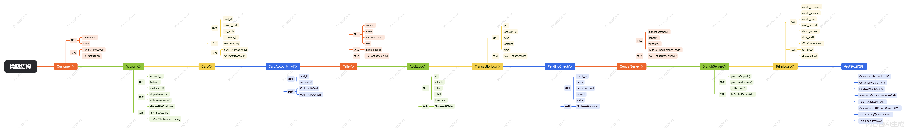

1.4 数据库设计

1.4.1 类与表的映射关系

1.4.2 数据库设计规范

采用第三范式（3NF）

所有主键均唯一

外键连接明确（如 card.customer_id → customer.customer_id）

金额字段统一使用 DECIMAL(12,2)

时间统一使用 DATETIME

密码使用 SHA256 存储

1.4.3 数据库表

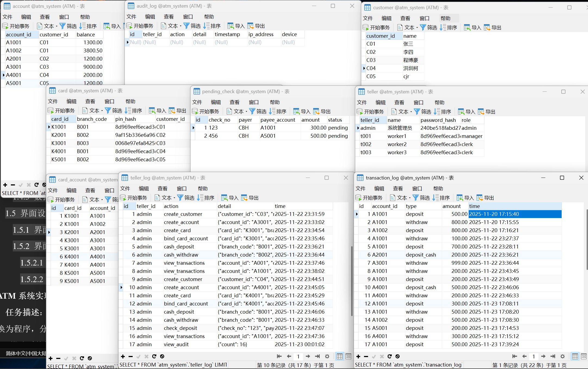

1.5 界面设计

1.5.1 界面结构设计

ATM GUI：

登录界面（卡号 + PIN）

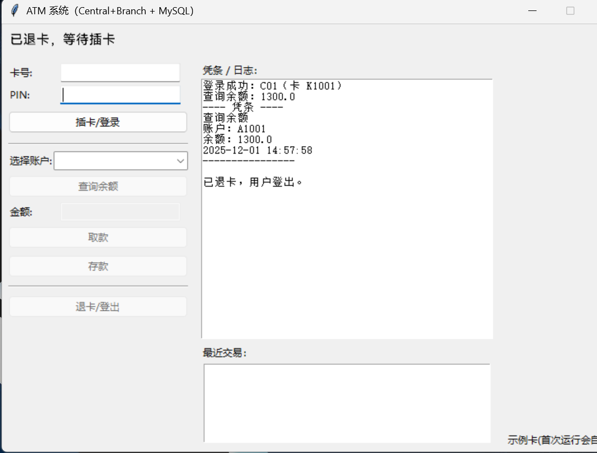

选择功能界面：选择账户/查询余额/取款/存款

选择账户：

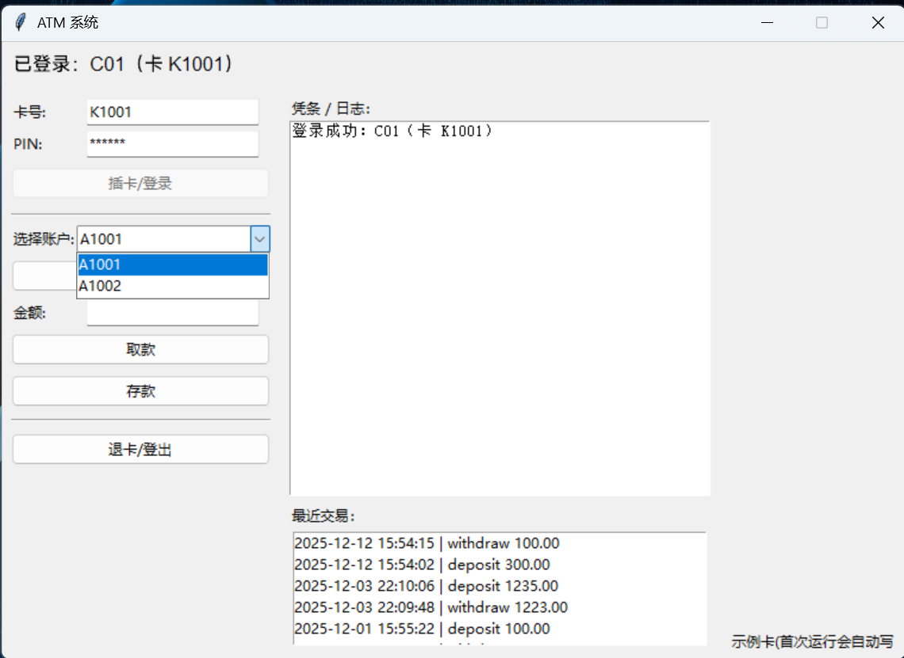

查询余额：

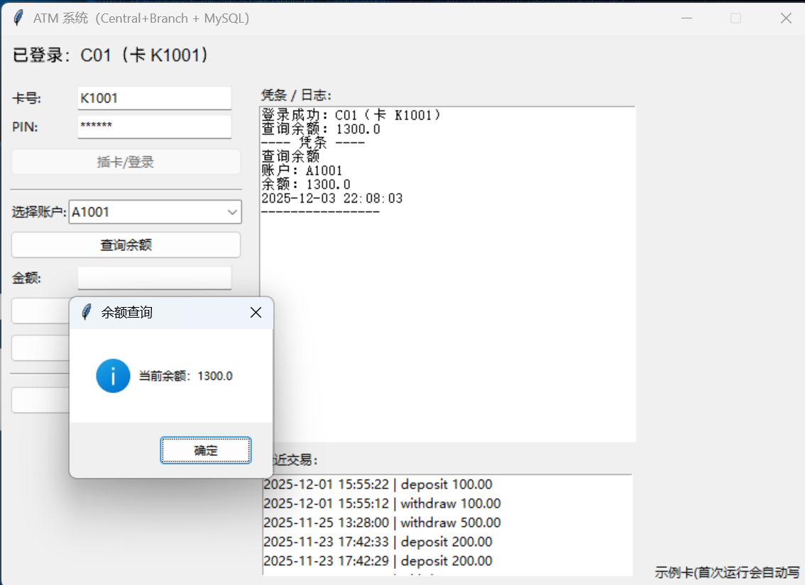

取款：

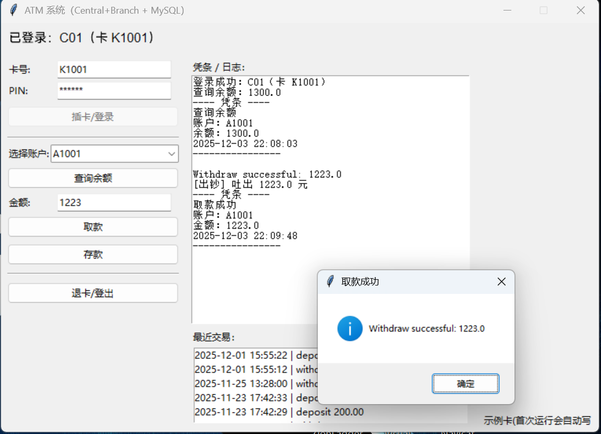

存款：

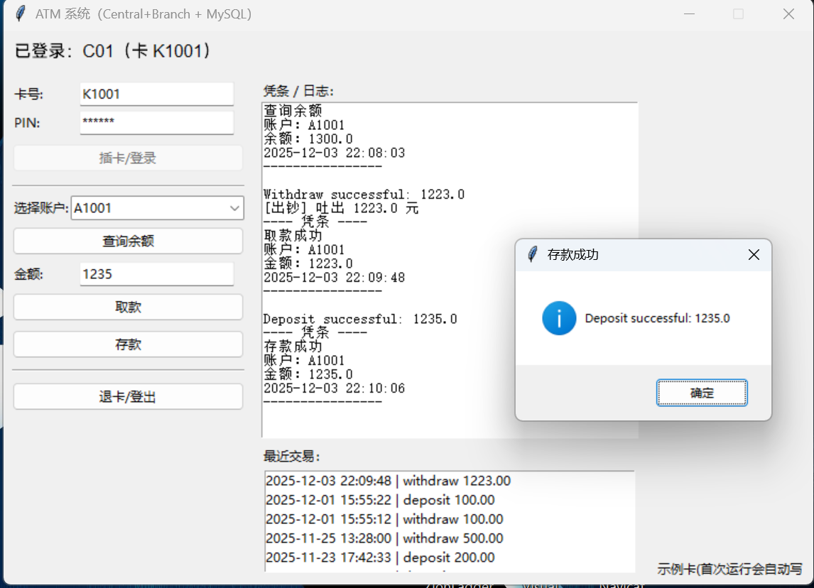

交易结果界面

打印凭条（文本模拟）

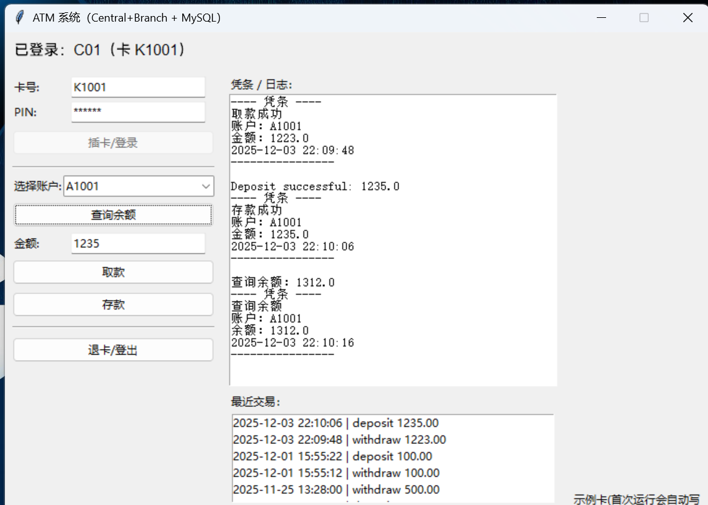

Teller GUI：

登录界面

左侧功能菜单（权限自动控制）

右侧输出日志区

功能分为：客户管理 / 账户管理 / 卡管理 / 柜面业务 / 审计管理 / 管理员管理

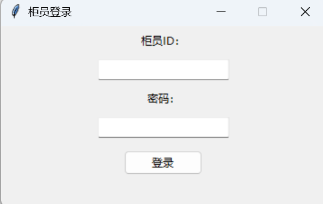

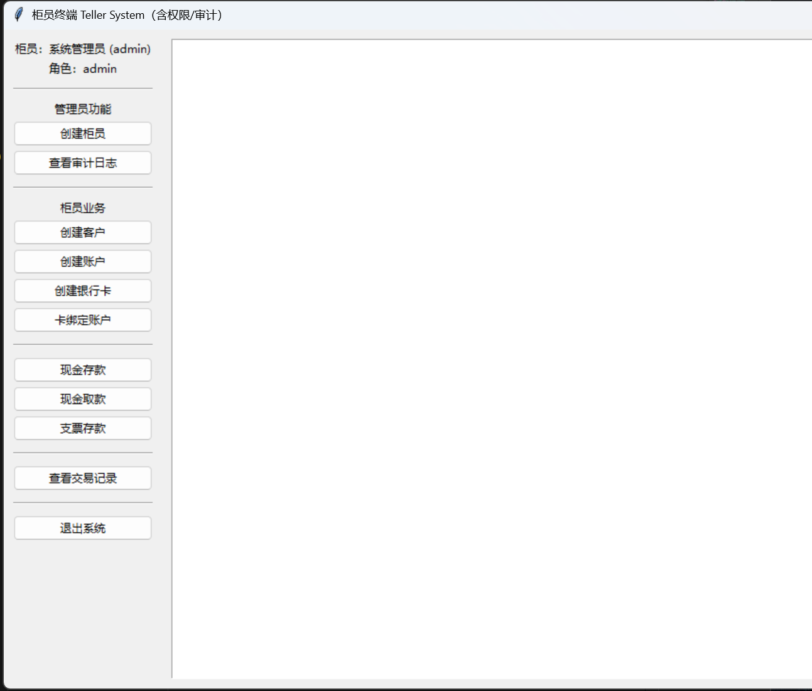

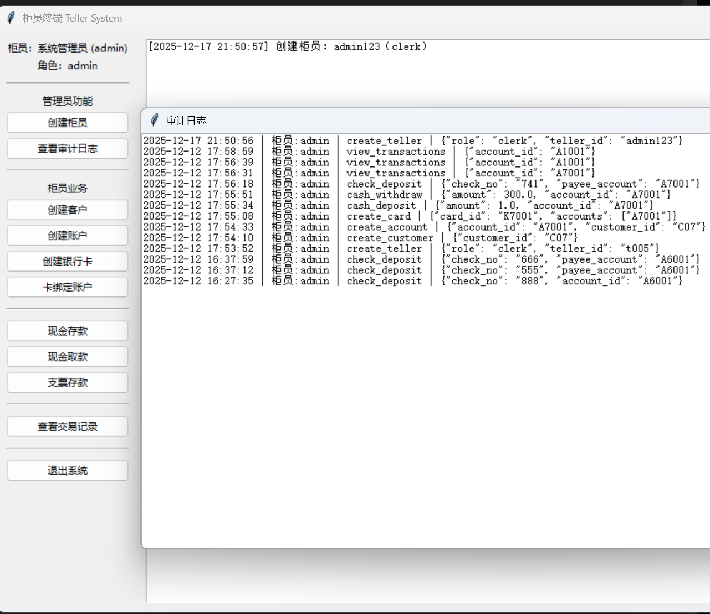

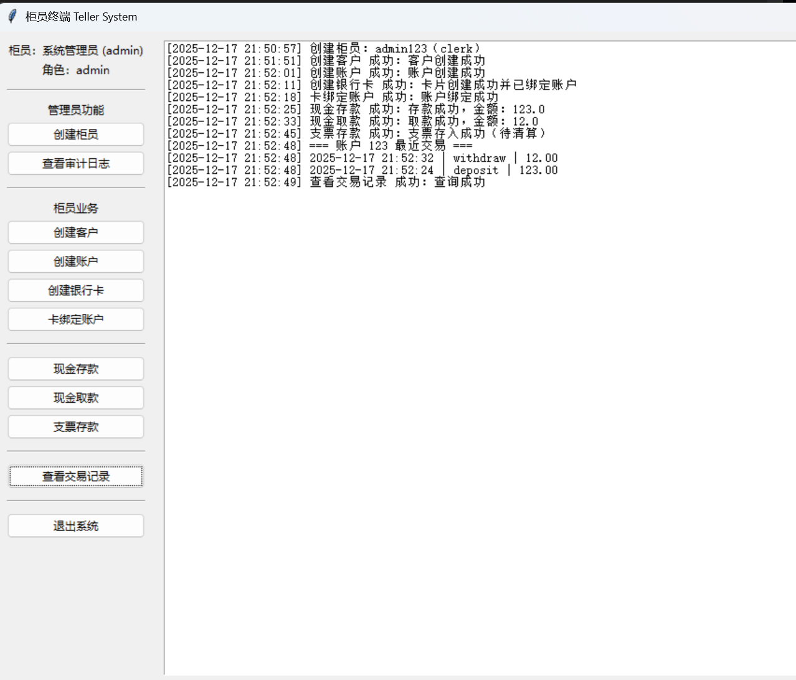

1.5.2 界面设计

1.5.2.1 功能界面设计

  按钮采用 ttk.Button

  输入采用表单弹窗 make_form()

  所有结果输出到日志区（ScrolledText）

1.5.2.2 交互界面

强制登录认证

无权限按钮自动隐藏

所有错误通过 messagebox.showerror 提示

所有成功操作写入审计日志

2. ATM系统实现

任务描述：软件设计完成后，需要将体系结构、设计模式、界面等设计结果转换为程序，分析、选择一种面向对象设计语言，理解、制定、执行编程规范，理解、搭建系统框架，采用版本控制工具管理进行版本控制，主要包括以下内容：选择编程语言、制定编程规范和编程。

2.1 选择程序设计语言

在 ATM 系统实现阶段，选择 Python 作为系统的主要开发语言，原因如下：

面向对象特性完善
         Python 支持类、对象、继承、多态等面向对象特性，便于按照系统设计

阶段的类图和模块划分进行实现。

开发效率高
         Python 语法简洁、可读性强，能够减少冗余代码，提高开发效率，适合

课程设计和快速迭代开发。

丰富的标准库与第三方库支持
         Python 提供了丰富的标准库，例如数据库访问、加密、网络通信等，能

够满足 ATM 系统在数据存储、安全校验和通信方面的需求。

良好的跨平台性
         Python 程序可以在 Windows、Linux 等多种操作系统上运行，便于系统

部署与测试。

适合 GUI 与后台逻辑分离
         Python 可结合 Tkinter 等 GUI 框架实现用户界面，同时通过模块化方

式将界面层、业务逻辑层和数据访问层分离，符合系统分层设计思想。

综上所述，Python 语言能够较好地满足 ATM 系统在功能性、可维护性和扩展性方面的需求，因此被选为本系统的实现语言。

2.2 指定编程语言规范

为保证代码质量和团队协作效率，在系统实现过程中制定统一的编程规范，主要包括以下几个方面：

命名规范

类名采用大驼峰命名法（如 TellerLogic、CentralServer）；

函数名和变量名采用小写字母加下划线（如 create_account、check_deposit）；

常量采用全大写字母并以下划线分隔（如 PERMISSION_MAP）。

代码结构规范

每个模块文件只负责单一功能；

数据访问层（DAO）、业务逻辑层和界面层分别放置在不同模块中；

使用注释对模块、类和关键函数进行说明。

注释规范

文件头部添加模块功能说明；

类和方法使用简要注释说明其功能和参数含义；

关键业务逻辑处添加必要的说明性注释。

异常处理规范

对数据库操作、用户输入等关键位置进行异常捕获；

使用统一的错误提示信息，避免程序直接崩溃。

安全规范

用户密码采用哈希方式存储；

重要操作记录审计日志，便于后期追溯。

通过以上编程规范的制定和执行，有效提高了代码的可读性和可维护性，为系统后续测试和维护提供了保障。

2.3 编程

2.3.1 搭建系统架构

目录结构：

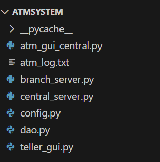

为保证代码质量和团队协作效率，在系统实现过程中制定统一的编程规范，主要包括以下几个方面：

命名规范

类名采用大驼峰命名法（如 TellerLogic、CentralServer）；

函数名和变量名采用小写字母加下划线（如 create_account、check_deposit）；

常量采用全大写字母并以下划线分隔（如 PERMISSION_MAP）。

代码结构规范

每个模块文件只负责单一功能；

数据访问层（DAO）、业务逻辑层和界面层分别放置在不同模块中；

使用注释对模块、类和关键函数进行说明。

注释规范

文件头部添加模块功能说明；

类和方法使用简要注释说明其功能和参数含义；

关键业务逻辑处添加必要的说明性注释。

异常处理规范

对数据库操作、用户输入等关键位置进行异常捕获；

使用统一的错误提示信息，避免程序直接崩溃。

安全规范

用户密码采用哈希方式存储；

重要操作记录审计日志，便于后期追溯。

通过以上编程规范的制定和执行，有效提高了代码的可读性和可维护性，为系统后续测试和维护提供了保障。

2.3.2 编码

在系统编码阶段，严格按照设计文档和编程规范完成各功能模块的实现，主要包括：

数据库访问模块（DAO）

实现对客户、账户、银行卡、交易记录和审计日志的增删查改操作；

对数据库异常进行统一处理。

业务逻辑模块

实现现金存取款、支票存款、账户余额查询等核心业务；

实现基于角色的权限控制机制；

对关键业务操作进行审计日志记录。

用户界面模块

实现 ATM 用户操作界面和柜员操作界面；

根据不同用户角色动态显示功能菜单；

提供友好的操作提示和错误提示。

安全与日志模块

对用户密码进行加密处理；

记录系统关键操作日志，便于系统审计和问题定位。

通过以上模块的编码实现，ATM 系统完成了从设计到实现的全过程，系统功能完整、结构清晰，为后续的系统测试和部署运行奠定了良好基础。

3. ATM系统测试

任务描述：项目开发过程中必须对软件进行较为系统、详细的测试来保证软件的质量。在软件开发过程中，不同的开发阶段对应不同类型的测试。它们的测试目的、测试内容、测试方法、测试工具和测试人员等不尽相同。软件孵化中心主要采用白盒测试和黑盒测试的方法进行测试，测试流程遵循单元测试、集成测试、系统测试和验收测试。主要包括以下内容：单元测试、集成测试、系统测试和验收测试。

3.1 单元测试

3.1.1 制定单元测试计划

为保证 ATM 系统单元测试工作的系统性和有效性，在测试开始前制定了详细的单元测试计划，具体内容如下。

（1）单元测试目标

单元测试的主要目标包括：

验证各功能模块中单个函数或方法的正确性；

检查程序在正常输入和异常输入情况下的处理能力；

确保各模块满足设计阶段规定的功能需求；

尽早发现代码层面的逻辑错误和边界条件问题。

通过单元测试，确保每个模块在集成之前已经具备稳定、可靠的功能基础。

（2）单元测试范围

根据 ATM 系统的模块划分，单元测试主要覆盖以下内容：

数据访问层（DAO 层）

创建客户、账户、银行卡的数据库操作；

账户余额更新与查询；

交易记录与审计日志的写入和查询；

支票待清算记录的添加与读取。

业务逻辑层

现金存款与取款逻辑；

支票存款逻辑；

权限校验函数的正确性；

异常情况下的业务处理流程。

工具函数

密码加密函数；

金额数据格式转换函数。

（3）单元测试方法

本系统单元测试主要采用白盒测试方法，即测试人员在了解程序内部结构和实现逻辑的前提下，对代码进行测试。具体测试方法包括：

语句覆盖测试：确保每条关键语句至少被执行一次；

分支覆盖测试：对条件判断的不同分支分别进行测试；

边界值测试：重点测试金额为 0、负数或极大值等边界情况；

异常测试：模拟数据库操作失败、非法输入等异常情况。

（4）单元测试环境

单元测试在如下环境中进行：

操作系统：Windows 11

开发语言：Python

数据库：MySQL

开发工具：PyCharm / VS Code

测试方式：人工编写测试用例并执行函数调用

该测试环境与系统实际运行环境保持一致，确保测试结果具有参考价值。

（5）单元测试人员与职责

单元测试主要由系统开发人员完成，其职责包括：

编写并执行单元测试用例；

记录测试结果和发现的问题；

修复单元测试中发现的缺陷；

对修复后的模块进行回归测试，确保问题彻底解决。

（6）单元测试通过标准

单元测试的通过标准如下：

所有被测函数均能正确执行并返回预期结果；

异常输入能够被正确捕获并给出合理提示；

不出现程序崩溃或数据异常情况；

所有测试用例执行结果均为“通过”。

只有在单元测试全部通过后，系统才能进入集成测试阶段。

3.1.2 设计单元测试用例

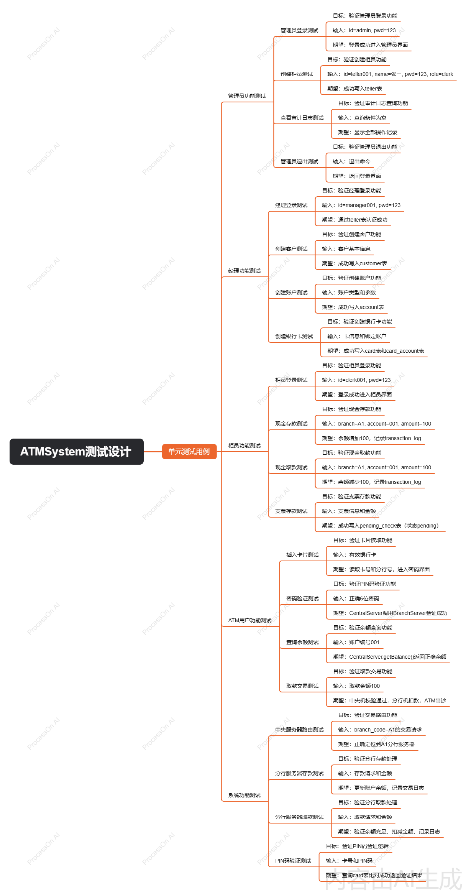

🟥 一、管理员（admin）用例

A1. 管理员登录

输入账号密码

验证密码哈希

进入管理员界面

A2. 创建柜员账户

输入柜员ID、姓名、密码、角色（admin/manager/clerk）

写入 teller 表

A3. 查看审计日志

查询 audit_log 表

显示全部操作记录

A4. 管理员退出系统

🟧 二、经理（manager）用例

（说明：manager 权限高于 clerk，低于 admin）

M1. 经理登录

通过 teller 表认证

M2. 创建客户

写入 customer 表

M3. 创建账户

写入 account 表

M4. 创建银行卡

写入 card 表

写入 card_account 绑定关系

M5. 卡绑定新账户

写入 card_account 表

M6. 现金存款

调用 CentralServer.deposit

分发到账户，并写 transaction_log

M7. 现金取款

调用 CentralServer.withdraw

扣减余额并写 transaction_log

M8. 支票存款

写入 pending_check 表（状态 pending）

M9. 查看交易记录

查询 transaction_log 表

🟩 三、柜员（clerk）用例

（说明：clerk 权限最低，不允许创建卡和柜员）

C1. 柜员登录

C2. 创建客户

C3. 创建账户

C4. 现金存款

C5. 现金取款

C6. 支票存款

C7. 查看交易记录

🟦 四、ATM 用户（持卡人）用例

（基于 ATM GUI + CentralServer 完整代码）

U1. 插入卡片

读取卡号、分行号

ATM 进入下一状态

U2. 输入密码

CentralServer 调用 BranchServer 验证 PIN

U3. 查看账户列表（卡绑定账户）

card_account 表查询

U4. 查询余额

CentralServer.getBalance()

U5. 取款交易

输入金额 → 中央机校验 → 分行机扣款

ATM 出钞

transaction_log 写入

U6. 查询交易记录

显示最近记录

U7. 打印凭条

U8. 退卡并退出

🟪 五、系统运行支持类用例（内部逻辑）

（不直接由用户触发，但属于可识别的系统功能）

S1. 中央服务器路由交易

根据卡片 branch_code 定位分行服务器

S2. 分行服务器处理存款

S3. 分行服务器处理取款

S4. 分行服务器验证 PIN

S5. DAO 层数据库 CRUD 操作

S6. 记录交易日志（transaction_log）

S7. 写入审计日志（audit_log）

⭐ 最终用例总数：32 个

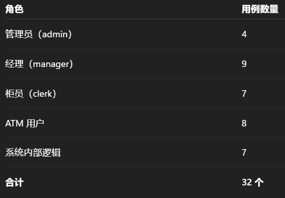

3.1.3 执行单元测试

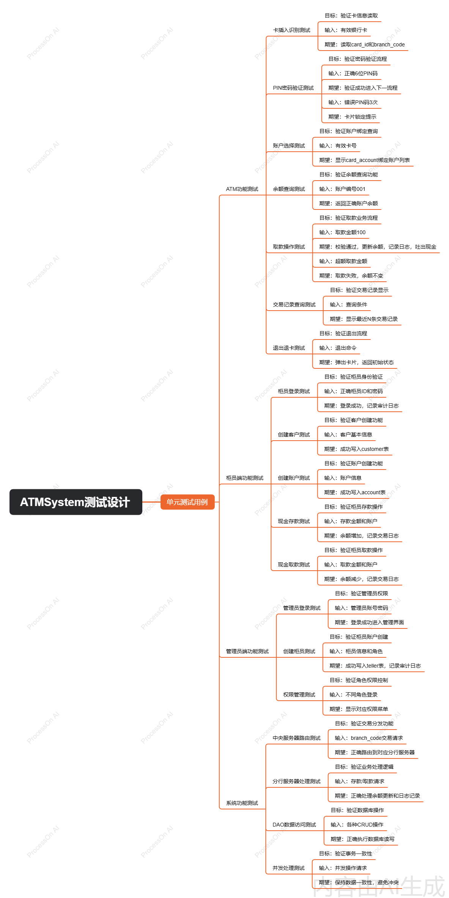

🟥 一、ATM 端功能需求

ATM 面向储户使用，为持卡用户提供现金交易服务。其核心需求如下：

1. ATM 卡插入与识别

ATM 能够读取磁卡的 卡号（card_id） 与 分行代码（branch_code）。

ATM 将卡信息传递给中央服务器进行识别。

2. PIN 密码验证

用户输入 6 位 PIN 密码。

中央服务器调用对应分行服务器验证密码与 PIN 哈希是否匹配。

验证成功进入下一流程，失败三次卡片锁定提示。

3. 账户选择

系统查询 card_account 中该卡所绑定的所有账户。

用户可选择任一账户开展交易。

4. 查询余额

ATM 发起余额查询请求到 CentralServer。

CentralServer 委托 BranchServer 返回账户余额。

5. 取款操作

用户输入取款金额。

ATM 校验取款额度是否符合限制（单笔上限、余额不足）。

成功完成取款后：

自动更新账户 balance

写入 transaction_log

打印账单

吐出现金

6. 查询交易记录

显示最近 N 条交易记录（来自 transaction_log 表）。

7. 打印凭条

ATM 可打印凭条内容，包括时间、卡号、余额、交易类型。

8. 退出与退卡

用户主动退出或超时自动退出。

ATM 弹出卡片并回到初始状态。

🟧 二、柜员端功能（clerk/manager）

柜员端主要用于银行内部业务，包括开户、卡片管理、现金/支票业务。

1. 柜员登录

输入柜员ID与密码。

验证通过后进入主界面，并记录登录审计日志。

2. 创建客户

输入 customer_id 与姓名。

写入 customer 表。

3. 创建账户

输入 account_id、customer_id、初始余额。

系统自动写入 account 表。

4. 创建银行卡（manager 权限）

输入卡号、分行代码、PIN 明文、客户绑定。

系统生成 pin_hash 并写入 card 表。

5. 卡绑定账户（manager 权限）

一张卡可绑定多个账户（利用 card_account 中间表）。

输入卡号与账户号进行绑定。

6. 现金存款

输入分行代码、金额、账户号。

通过 CentralServer → BranchServer 完成余额增加。

7. 现金取款

与 ATM 一致，柜员可人工执行现金取款。

8. 支票存入

柜员接收支票（check_no、payer、金额）。

写入 pending_check 表，状态 pending。

9. 查看交易记录

输入账户号，查询 transaction_log。

🟥 三、管理员端功能（admin）

管理员拥有最高权限，负责银行系统后台管理。

1. 创建柜员/管理员账户

输入柜员ID、姓名、密码、角色（admin/manager/clerk）。

写入 teller 表，并写入审计日志。

2. 查看审计日志

查询 audit_log 表。

可按时间、操作类型、柜员ID筛选。

3. 权限管理

根据不同的角色显示不同菜单（GUI 动态隐藏按钮）：

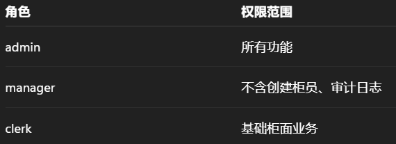

4. 系统监控

查看系统操作行为。

🟩 四、系统内部功能需求（CentralServer / BranchServer / DAO）

这些功能不是由用户直接触发，但属于系统运行必须具备的功能：

1. 中央服务器路由功能

根据卡片的 branch_code 将请求分发到对应 BranchServer。

2. 分行服务器业务处理

存款流程：更新账户余额 → 写入交易日志

取款流程：余额检查 → 扣款 → 写交易日志

验证 PIN

3. DAO 数据访问层

负责所有数据库 CRUD：

create_customer

create_account

create_card

add_card_account

deposit/withdraw

get_transaction_logs

add_audit_log

get_audit_logs

4. 日志管理

所有柜员和管理员的操作写入审计日志（audit_log）。

所有交易写入 transaction_log。

5. 并发处理

分行服务器应保持账户更新的事务性。

避免多台 ATM 或柜员同时操作导致的数据冲突。

⭐ 总结：功能需求覆盖范围

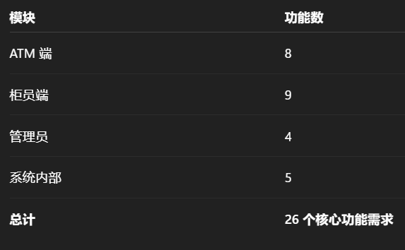

3.1.4 单元测试报告

  所有核心函数均通过

  DAO 在断网情况下能正确抛出异常

3.2 集成测试

3.2.1 制定集成测试计划

在集成测试阶段，测试工作的主要目标是验证系统各模块之间的接口是否

正确、数据传递是否一致、业务流程是否能够按照设计要求完整执行。

本系统的集成测试计划如下：

测试对象确定
    本次集成测试主要涉及以下模块：

数据访问层（DAO）：负责数据库操作，如账户、交易记录、审计日志等；

业务逻辑层（TellerLogic、CentralServer）：负责权限校验、业务规则处理；

表现层（teller_gui.py、atm_gui_central.py）：负责用户交互与操作触发。

集成顺序安排
    按照自底向上的方式进行集成：

首先集成 DAO 与数据库，验证数据读写正确性；

然后将业务逻辑层与 DAO 进行集成，验证业务流程是否正确；

最后集成 GUI 界面，验证用户操作是否能够正确触发业务逻辑并反映结果。

测试环境说明

操作系统：Windows 11

开发语言：Python

数据库：MySQL

图形界面：Tkinter

测试通过标准

各模块之间接口调用无异常；

数据在模块之间传递准确无误；

所有主要业务流程均可正常完成；

系统无严重逻辑错误或程序崩溃现象。

3.2.2 设计集成测试用例

根据系统功能和模块交互关系，设计以下典型集成测试用例：

柜员登录与权限校验用例

输入合法柜员账号和密码；

系统应正确验证身份，并根据角色加载相应功能菜单；

不同角色（admin、manager、clerk）显示的功能权限应符合设计要求。

账户创建与数据库写入用例

在 GUI 中创建客户和账户；

业务逻辑层调用 DAO 模块写入数据库；

数据库中应成功生成对应记录，且字段信息正确。

现金存取款业务用例

在界面发起存款或取款操作；

业务逻辑层调用 CentralServer 进行处理；

DAO 层更新账户余额并记录交易流水；

界面正确显示操作结果。

支票存款业务用例

提交支票信息；

系统将支票信息写入 pending_check 表；

审计日志中应记录对应操作信息。

审计日志记录用例

执行任意关键业务操作；

DAO 层应成功写入 audit_log 表；

管理员可以通过界面查看完整审计记录。

3.2.3 执行集成测试

按照既定的测试计划和测试用例，对系统进行集成测试，具体执行过程如下：

启动数据库服务，确保相关数据表已正确创建；

运行系统程序，依次完成柜员登录、客户创建、账户创建等操作；

在执行各项业务操作过程中，观察界面反馈信息；

同时检查数据库中对应表的数据变化情况，确认数据是否正确写入；

针对不同角色重复上述测试步骤，验证权限控制是否生效；

在测试过程中记录发现的问题，并对代码进行相应修复后重新测试。

测试结果表明，各模块在集成后能够正常协同工作，系统业务流程执行顺畅，未出现严重的接口错误或数据不一致问题。

3.2.4 集成测试总结

通过本次集成测试，可以得出以下结论：

系统各功能模块之间接口设计合理，模块集成顺利；

数据访问层、业务逻辑层与界面层之间的数据传递准确可靠；

权限控制机制在集成环境下运行正常，不同角色的操作权限符合设计要求；

审计日志和交易记录功能在系统集成后能够正确记录关键操作；

集成测试有效地发现并消除了部分模块协作中的潜在问题，提高了系统整体稳定性。

综上所述，本系统已通过集成测试，满足设计阶段提出的功能和质量要求，为后续系统测试和实际运行奠定了良好基础。

3.3 系统测试

3.3.1 制定系统测试计划

系统测试计划的制定以需求分析说明书和系统设计文档为依据，重点关注系统整体功能和业务流程的正确性。

系统测试计划主要内容如下：

测试目标

·验证 ATM 系统整体功能是否满足需求分析中的功能需求；

·验证不同用户角色（admin、manager、clerk、ATM 用户）的业务流程

是否完整、正确；

·验证系统在正常及异常操作下的稳定性和可靠性。

测试范围

·ATM 客户端功能（取款、查询、密码校验等）；

·柜员终端功能（客户管理、账户管理、卡片管理、存取款、支票业务等）；

·权限控制与审计日志功能；

·中央服务器与分行服务器之间的协作功能。

测试环境

·操作系统：Windows 11

·开发语言：Python

·数据库：MySQL

·网络环境：本地模拟中央机与分行机通信

·图形界面：Tkinter

测试通过准则

·系统所有核心功能均可正常使用；

·不同角色的操作权限符合设计要求；

·数据库中数据一致、无明显错误；

·系统运行过程中无崩溃或严重异常。

3.3.2 设计系统测试用例

根据系统功能需求和用户角色，设计以下系统测试用例：

用户登录测试用例

输入正确的账号和密码，系统应成功登录；

输入错误密码，系统应提示错误信息并拒绝登录；

不同角色登录后显示不同功能界面。

ATM 取款业务测试用例

插卡、输入正确 PIN 码，系统应允许进入操作界面；

输入合法取款金额，ATM 应成功吐钞并打印凭条；

输入超过余额的金额，系统应拒绝操作并提示原因。

柜员业务流程测试用例

创建客户、账户、银行卡流程完整且无错误；

现金存款、取款操作后账户余额正确更新；

支票存款信息成功进入待清算状态。

权限控制测试用例

管理员可以创建柜员并查看审计日志；

经理可以创建银行卡并绑定账户；

普通柜员只能执行柜台业务，不能访问管理功能。

异常与边界测试用例

输入非法数据（负金额、空字段）系统应给出提示；

数据库异常情况下系统能够给出合理错误提示。

3.3.3 执行系统测试

按照系统测试计划，对 ATM 系统进行全面测试，执行过程如下：

部署完整系统环境，包括数据库、中央服务器、分行服务器及客户

端；

启动 ATM 客户端和柜员终端，模拟真实用户操作；

按照测试用例逐一执行各项功能操作；

记录系统在正常操作和异常操作下的行为；

对发现的问题进行分析和修改，并进行回归测试；

确认所有核心功能均可在系统级别正常运行。

测试结果表明，系统在完整运行环境下功能稳定，业务流程连贯，各模块协同工作良好，能够满足设计阶段提出的系统需求。

3.3.4 系统测试总结

通过系统测试，可以得到以下结论：

ATM 系统整体结构合理，各功能模块协同运行稳定；

系统实现了需求分析阶段提出的主要功能目标；

权限控制机制有效，不同角色的操作边界清晰；

数据处理准确，系统在多数异常情况下能够进行合理处理；

系统具备较好的可用性和可靠性，满足课程设计的要求。

综上所述，ATM 系统已经通过系统测试，具备交付和演示条件，为最终的验收测试和实际应用奠定了坚实基础。

问题与思考

（1）使用面向对象方法学完成该实验的体会是什么？

将系统拆解成类，让系统结构清晰、可维护

类图、用例图让思考更系统化

代码复用率提升（如 DAO、CentralServer）

权限与审计模块实现更自然

（2）你认为完成系统设计过程中，哪些步骤更重要？为什么？

最重要的是：需求分析、类图设计、接口设计。

原因：

需求分析决定系统做什么
若需求错误，后续所有阶段都会返工。

类图决定系统的骨架
类设计正确，系统自然稳定；类设计混乱，代码会越写越乱。

接口（API）决定模块沟通方式
接口清晰就能降低模块冲突，提升开发速度。

| 类别 | 设计说明文档 | 工程源码 | 视频和答辩PPT | 总分 | 总评人 | 复查人 |
| 分值 | 50 | 30 | 20 | 100 |  |  |
| 得分 |  |  |  |  |  |  |

| 小组序号 | 小组成员 | 小组成员 | 任务分工 |
| 小组序号 | 学号 | 姓名 |  |
| 1 | 20230876**** | *** | 负责整个ATM系统代码的编写和修改，以及文档的编写和PPT修改。 |
| 1 | 20230876**** | *** | 负责ATM系统的测试和修改，文档的编写，以及PPT制作。 |
| 1 |  |  |  |

| 类名 | 表名 | 说明 |
| Customer | customer | 储户信息 |
| Account | account | 账户及余额 |
| Card | card | ATM 银行卡 |
| CardAccount | card_account | 卡与账户绑定关系 |
| Teller | teller | 柜员/管理员账号 |
| Teller | teller_log | 柜员操作日志 |
| TransactionLog | transaction_log | 交易记录 |
| AuditLog | audit_log | 审计日志 |
| PendingCheck | pending_check | 支票待清算表 |